# Խումբ 1 (145 հարց)

Ճիշտ պատասխանը **թավ** է և նշված ✅-ով։ Աղբյուր՝ roadpolice.am, ABC կարգեր։

### 1-1. Նշաններից ո՞րն է կոչվում «Արգելքի շրջանցումը ձախից»։

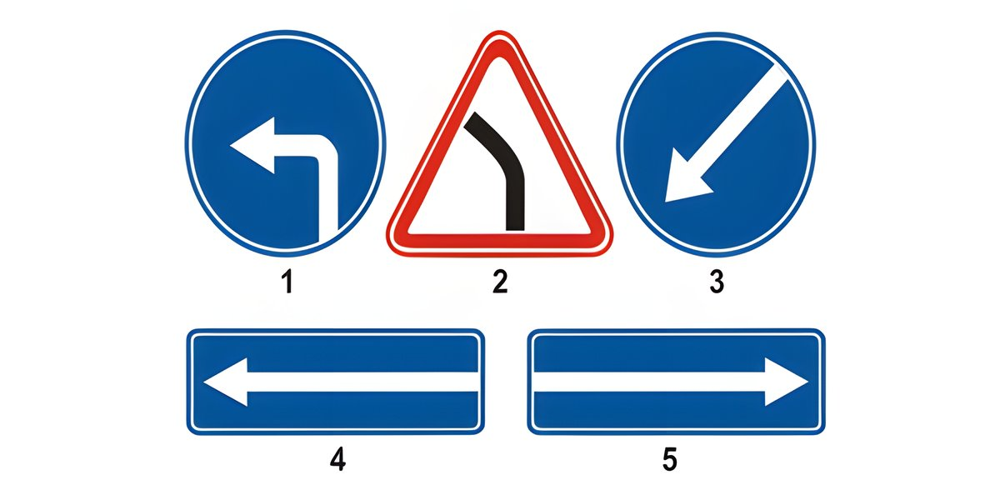

1. 1
2. 2
3. **3** ✅
4. 4
5. 5

### 1-2. Նշված դեպքում ո՞ր գոտուց պետք է կատարվի աջ շրջադարձը։

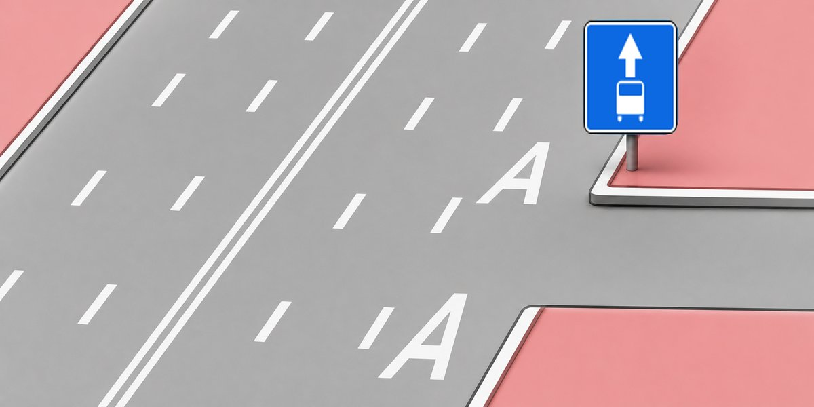

1. Միայն երկրորդ գոտուց
2. **Միայն «A» գծանշումով նշված աջ եզրային գոտուց** ✅

### 1-3. Խաչմերուկում կազմակերպված է շրջանաձեւ երթեւեկություն։ Երթեւեկելի մասը, որով մոտենում եք խաչմերուկին, ունի երթեւեկության երկու գոտի։ Խաչմերուկ մուտք գործելիս` շրջադարձ կատարելու համար ո՞ր գոտին եք պարտավոր զբաղեցնել:

1. Աջ գոտին
2. Ձախ գոտին
3. **Կա՛մ աջ, կա՛մ ձախ գոտին** ✅

### 1-4. Թույլատրվու՞մ է արդյոք մուտք գործել բակ նշված տեղից։

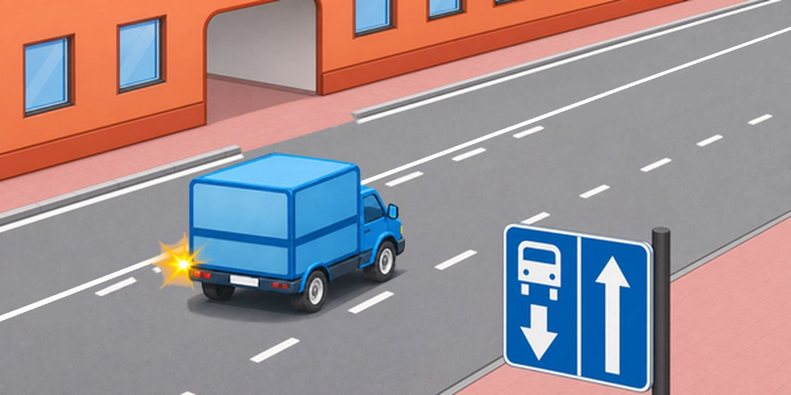

1. **Թույլատրվում է** ✅
2. Արգելվում է

### 1-5. Երկկողմ երթեւեկությամբ գծանշված ճանապարհներին, երեք գոտու առկայության դեպքում (բացառությամբ երթեւեկության դարձափոխային կարգավորմամբ ճանապարհների), որոնցից միջինն օգտագործվում է երկու ուղղություններով երթեւեկության համար, ձախ եզրային գոտի մուտք գործելը

1. Թույլատրվում է։
2. **Արգելվում է։** ✅
3. Թույլատրվում է՝ միայն վազանցի, շրջանցման, ձախ շրջադարձի կամ հետադարձի համար։

### 1-6. Ո՞ր պատասխանում է ճիշտ նշված երթեւեկության թույլատրելի ուղղությունը։

1. Միայն հետադարձ
2. Ուղիղ եւ հետադարձ
3. **Միայն ուղիղ** ✅

### 1-7. Ո՞ր ուղղությամբ է արգելվում երթեւեկությունը:

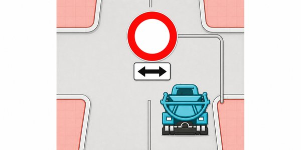

1. **Դեպի ձախ եւ դեպի աջ** ✅
2. Ուղիղ եւ հակառակ ուղղությամբ
3. Միայն ուղիղ
4. Բոլոր ուղղություններով

### 1-8. Հետադարձն արգելվում է

1. Հետիոտնային անցումների վրա։
2. Թունելներում։
3. Կամուրջների, ուղեկամուրջների, էստակադների վրա եւ դրանց տակ։
4. Երկաթուղային գծանցներում։
5. **Թվարկած բոլոր դեպքերում։** ✅

### 1-9. Ո՞ր պատասխանում է ճիշտ նշված երթեւեկության թույլատրելի ուղղությունը։

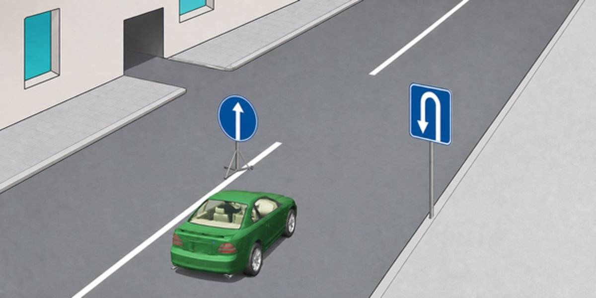

1. Ուղիղ եւ դեպի ձախ` մուտք գործելով բակ
2. **Միայն ուղիղ** ✅
3. Միայն հետադարձ
4. Ուղիղ եւ հետադարձ

### 1-10. Հետադարձն արգելվում է, եթե ճանապարհի թեկուզ եւ մեկ ուղղությամբ տեսանելիությունը պակաս է

1. **100 մ-ից։** ✅
2. 150 մ-ից։
3. 300 մ-ից։

### 1-11. Դուք երթեւեկում եք երեք գոտի ունեցող երկկողմ երթեւեկությամբ ճանապարհով։ Ո՞ր դեպքում է թույլատրվում մուտք գործել միջին գոտի։

1. Միայն վազանցի դեպքում
2. Միայն շրջանցման դեպքում
3. Միայն ձախ շրջադարձի կամ հետադարձի դեպքում
4. **Թվարկած բոլոր դեպքերում** ✅

### 1-12. Ո՞ր ուղղությամբ է թույլատրվում բեռնատար ավտոմոբիլի երթեւեկությունը։

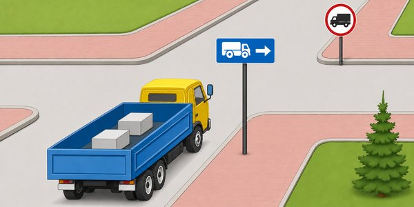

1. Միայն դեպի աջ
2. **Դեպի աջ, դեպի ձախ եւ հակառակ ուղղությամբ** ✅
3. Միայն դեպի ձախ

### 1-13. Ո՞ր նկարում է վարորդը ճիշտ կատարում մանեւրը։

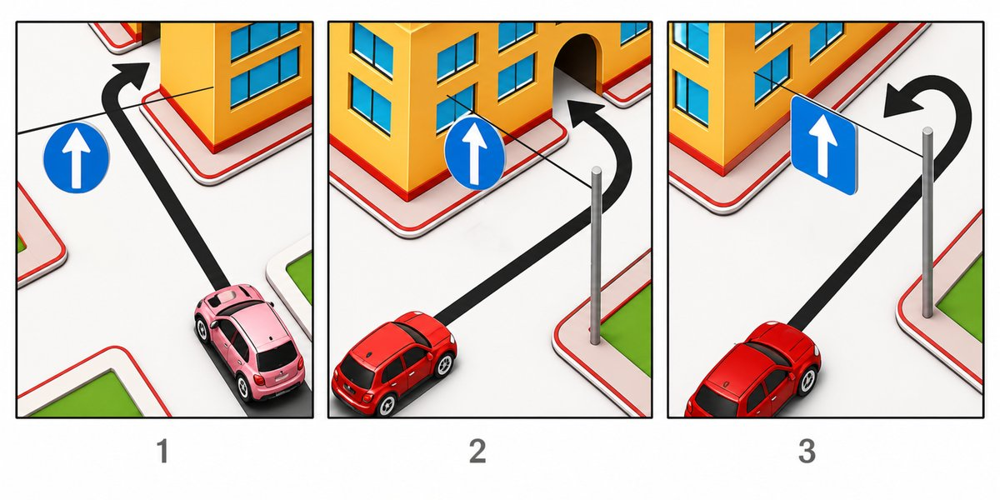

1. **1** ✅
2. 2
3. 3

### 1-14. Ո՞ր տրանսպորտային միջոցի վարորդն է ճիշտ կատարում հետադարձը:

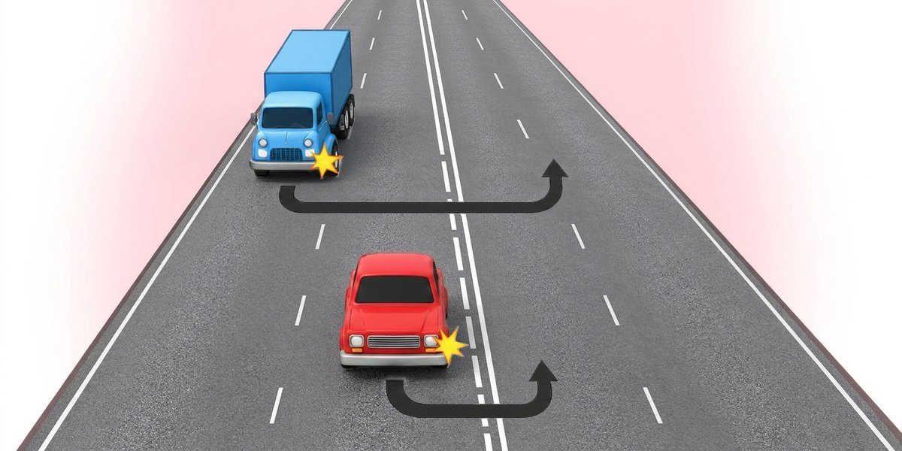

1. Կապույտ ավտոմոբիլի վարորդը
2. **Կարմիր ավտոմոբիլի վարորդը** ✅
3. Երկու վարորդներն էլ

### 1-15. Ճանապարհային նշանների, գծանշման եւ բաժանարար գոտու բացակայության դեպքում վարորդները երկկողմ երթեւեկությամբ ճանապարհների երթեւեկելի մասում գտնվող ճանապարհային կառույցների տարրերը պետք է շրջանցեն

1. **Աջ կողմից։** ✅
2. Ձախ կողմից։

### 1-16. Ո՞ր ուղղությամբ է արգելվում երթեւեկությունը։

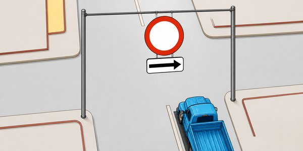

1. Միայն դեպի ձախ
2. **Միայն դեպի աջ** ✅
3. Ուղիղ եւ դեպի ձախ
4. Բոլոր ուղղություններով

### 1-17. Ո՞ր տրանսպորտային միջոցի վարորդն է խախտում կանոնները շրջադարձ կատարելիս՝ արգելակման գոտի ունեցող ճանապարհին։

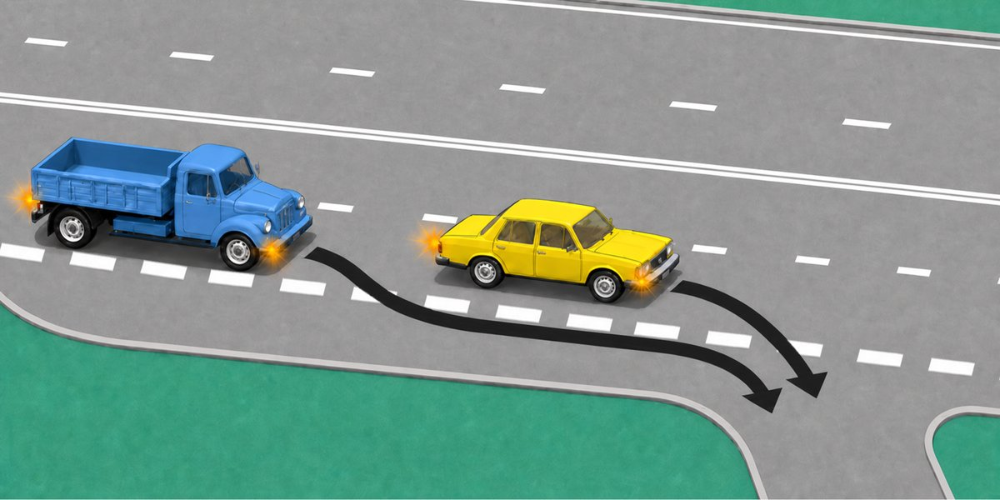

1. Երկու վարորդն էլ
2. **Դեղին ավտոմոբիլի վարորդը** ✅
3. Երկու վարորդն էլ շրջադարձը կատարում են ճիշտ

### 1-18. Թույլատրվու՞մ է արդյոք տվյալ իրադրությունում կարմիր ավտոմոբիլի վարորդին շարունակել երթեւեկությունը։

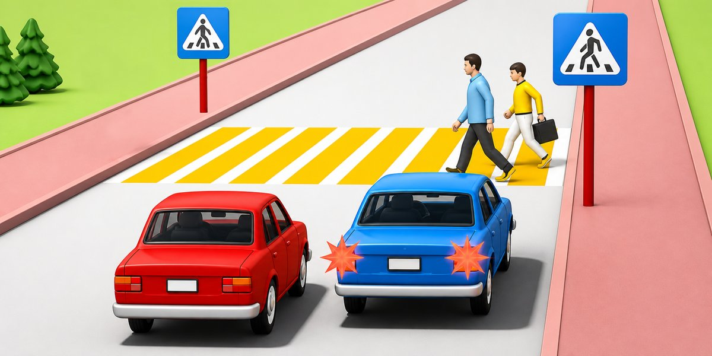

1. Թույլատրվում է
2. **Արգելվում է** ✅

### 1-19. Երեք գոտի ունեցող երկկողմ երթեւեկությամբ ճանապարհի վրա Ձեզ անհրաժեշտ է կատարել ձախ շրջադարձ։ Ո՞ր գոտուց կկատարեք տվյալ մանեւրը։

1. Աջ գոտուց
2. **Միջին գոտուց** ✅
3. Աջ կամ միջին գոտուց
4. Միջին գոտուց, եթե զբաղեցված է աջ գոտին

### 1-20. Թույլատրվու՞մ է արդյոք կարմիր ավտոմոբիլի վարորդին երթեւեկել տրամվայի գծերով։

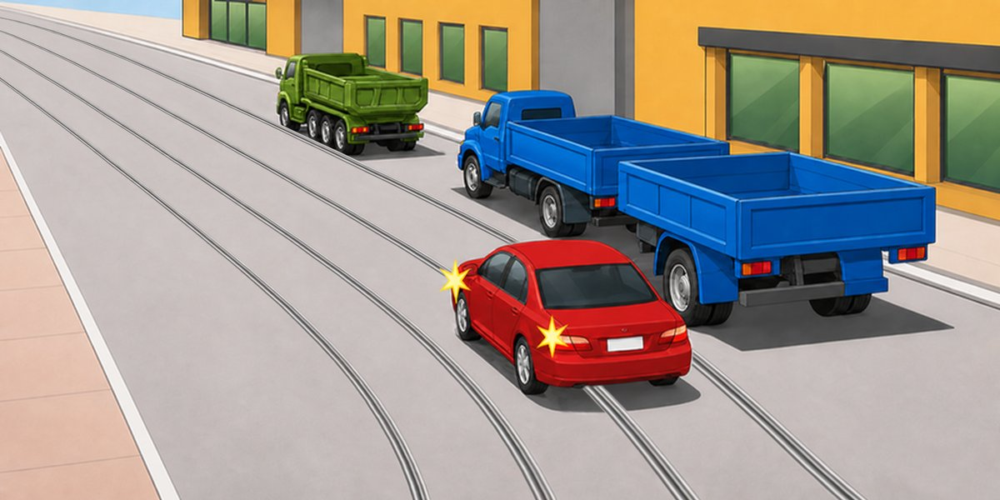

1. **Թույլատրվում է** ✅
2. Արգելվում է

### 1-21. Հետադարձն արգելվում է

1. Հետիոտնային անցումների վրա եւ թունելներում։
2. Կամուրջների, ուղեկամուրջների, էստակադների վրա եւ դրանց տակ։
3. Երկաթուղային գծանցներում։
4. Ճանապարհի` թեկուզ եւ մեկ ուղղությամբ 100 մ-ից պակաս տեսանելիության տեղերում։
5. **Բոլոր թվարկած դեպքերում։** ✅

### 1-22. Ո՞ր ուղղություններով է թույլատրվում երթեւեկությունը։

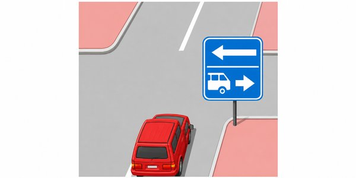

1. Միայն դեպի ձախ
2. **Ուղիղ, դեպի ձախ եւ հետադարձ** ✅
3. Միայն ուղիղ

### 1-23. Ո՞ր տրանսպորտային միջոցների վարորդներն են խախտել ճանապարհային նշանի պահանջները։

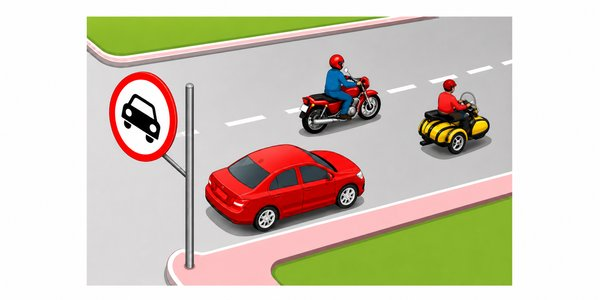

1. Մոտոցիկլների վարորդները
2. Ավտոմոբիլի եւ կողային կցորդով մոտոցիկլի վարորդները
3. Միայն ավտոմոբիլի վարորդը
4. **Բոլոր տրանսպորտային միջոցների վարորդները** ✅

### 1-24. Համընթաց ուղղությամբ երթեւեկող տրանսպորտային միջոցների միաժամանակյա վերադասավորման դեպքում ճանապարհը պետք է զիջի

1. **Ձախից ընթացող տրանսպորտային միջոցի վարորդը։** ✅
2. Աջից ընթացող տրանսպորտային միջոցի վարորդը։

### 1-25. Ո՞ր տրանսպորտային միջոցի վարորդն ունի առաջնահերթ երթեւեկության իրավունք։

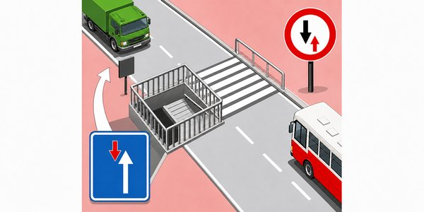

1. **Բեռնատար ավտոմոբիլի վարորդը** ✅
2. Ավտոբուսի վարորդը

### 1-26. Եթե համապատասխան նշաններով կահավորված, երկայնական թեքությամբ ճանապարհահատվածներում հանդիպակաց երթեւեկությունը դժվարացած է, ապա ճանապարհը պետք է զիջել

1. Վայրէջքի ուղղությամբ ընթացող տրանսպորտային միջոցին։
2. Ընդհանուր օգտագործման տրանսպորտային միջոցին։
3. **Վերելքի ուղղությամբ ընթացող տրանսպորտային միջոցին։** ✅

### 1-27. Երթեւեկության առավելություն ունի

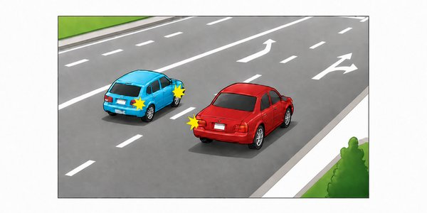

1. Կապույտ ավտոմոբիլը, քանի որ կարմիրը փոխում է երթեւեկության ուղղությունը դեպի ձախ։
2. **Կարմիր ավտոմոբիլը, քանի որ միաժամանակյա վերադասավորման դեպքում գտնվում է աջ կողմում։** ✅
3. Կապույտ ավտոմոբիլը, քանի որ միաժամանակյա վերադասավորման դեպքում գտնվում է ձախ կողմում։

### 1-28. Պարտավո՞ր են արդյոք տրանսպորտային միջոցների վարորդները բնակավայրերում ճանապարհը զիջել կահավորված եւ նշված կանգառի կետերի տարածքից երթեւեկությունը սկսող ընդհանուր օգտագործման տրանսպորտային միջոցներին։

1. **Այո** ✅
2. Ոչ

### 1-29. Ո՞ր տրանսպորտային միջոցի վարորդը պետք է զիջի ճանապարհը։

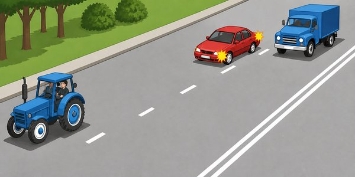

1. **Թեթեւ մարդատար ավտոմոբիլի վարորդը** ✅
2. Բեռնատար ավտոմոբիլի վարորդը

### 1-30. Ո՞ր տրանսպորտային միջոցի վարորդը պետք է զիջի ճանապարհը։

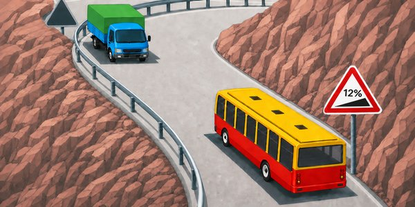

1. Ավտոբուսի վարորդը
2. **Ավտոմոբիլի վարորդը** ✅

### 1-31. Ո՞ր տրանսպորտային միջոցի վարորդը պետք է զիջի ճանապարհը։

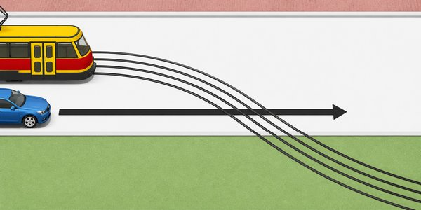

1. **Ավտոմոբիլի վարորդը** ✅
2. Տրամվայի վարորդը

### 1-32. Նշե՛ք խաչմերուկի անցման հերթականությունը:

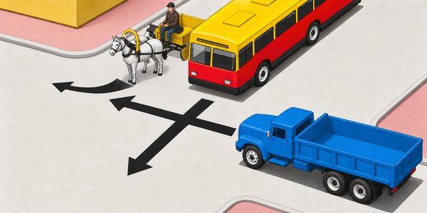

1. Ավտոբուսը, բեռնատար ավտոմոբիլը, լծասայլը
2. **Ավտոբուսը եւ լծասայլը, բեռնատար ավտոմոբիլը** ✅

### 1-33. Հանդիպակաց երթեւեկության դեպքում կտրուկ վայրէջքի վրա անհրաժեշտ է ճանապարհը զիջել

1. Ընդհանուր օգտագործման տրանսպորտային միջոցին։
2. **Վերեւ բարձրացող տրանսպորտային միջոցին։** ✅
3. Ներքեւ իջնող տրանսպորտային միջոցին։

### 1-34. Բնակավայրերում միեւնույն ուղղությամբ երթեւեկության 3 եւ ավելի գոտիների առկայության դեպքում ձախ եզրային գոտի զբաղեցնել թույլատրվու՞մ է արդյոք թեթև մարդատար տրանսպորտային միջոցներին։

1. Թույլատրվում է վազանց կատարելիս
2. Թույլատրվում է ձախ շրջադարձ կամ հետադարձ կատարելիս
3. **Թույլատրվում է թվարկված երկու դեպքերում** ✅

### 1-35. Բոլոր ճանապարհներին միեւնույն ուղղությամբ երթեւեկության 3 եւ ավելի գոտիների առկայության դեպքում ձախ եզրային գոտի զբաղեցնել թույլատրվու՞մ է արդյոք մոտոցիկլներին։

1. Թույլատրվում է վազանց կատարելիս
2. Թույլատրվում է ձախ շրջադարձ կամ հետադարձ կատարելիս
3. **Թույլատրվում է թվարկված երկու դեպքերում** ✅

### 1-36. Տվյալ իրադրությունում սպիտակ թեթեւ մարդատար ավտոմոբիլի վարորդը

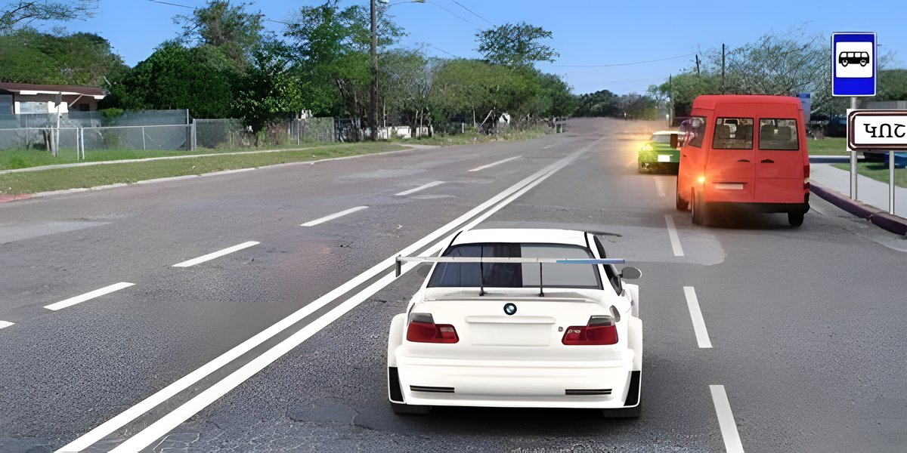

1. **Ճանապարհը պետք է զիջի երթուղային ավտոբուսին, որը սկսում է երթեւեկությունը նշված կանգառի կետից։** ✅
2. Ունի առաջնահերթ երթեւեկության իրավունք, քանի որ երթուղային ավտոբուսը վերադասավորվում է` երկրորդ գոտի անցնելով։

### 1-37. Ո՞ր տրանսպորտային միջոցի վարորդն ունի առաջնահերթ երթեւեկության իրավունք։

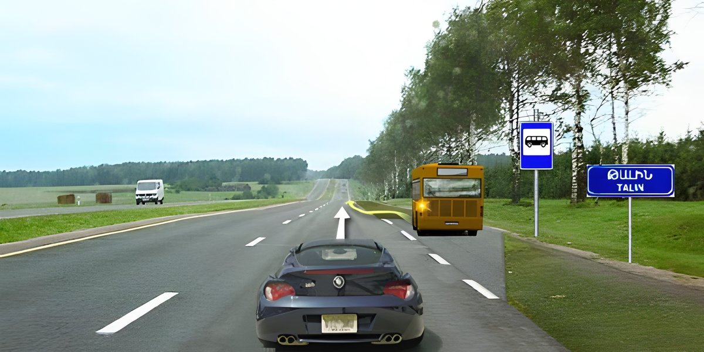

1. **Թեթեւ մարդատար ավտոմոբիլի վարորդը** ✅
2. Երթուղային ավտոբուսի վարորդը

### 1-38. Ո՞ր տրանսպորտային միջոցի վարորդն ունի առաջնահերթ երթեւեկության իրավունք տվյալ իրավիճակում։

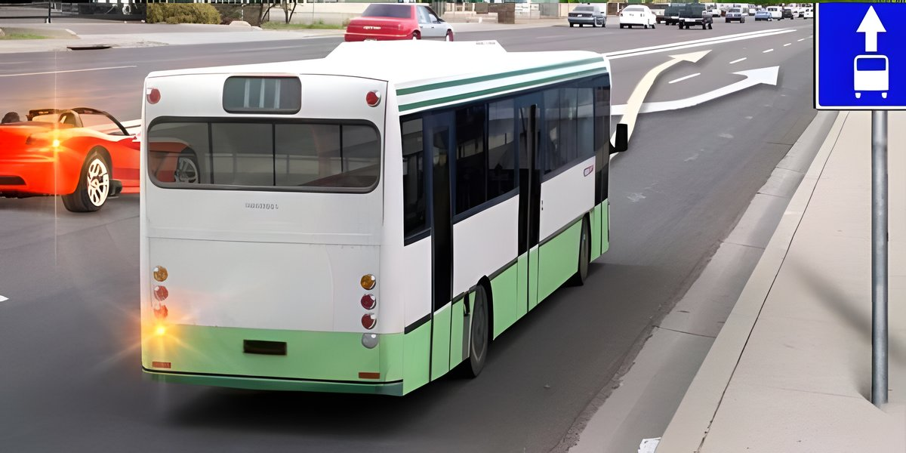

1. **Ավտոբուսի վարորդը** ✅
2. Թեթեւ մարդատար ավտոմոբիլի վարորդը
3. Թեթեւ մարդատար ավտոմոբիլի վարորդը իրավունք չունի անցնել աջ գոտի

### 1-39. Եթե մտադիր եք շարունակել երթեւեկությունն ուղիղ, ո՞ր տրանսպորտային միջոցին պետք է զիջել ճանապարհը։

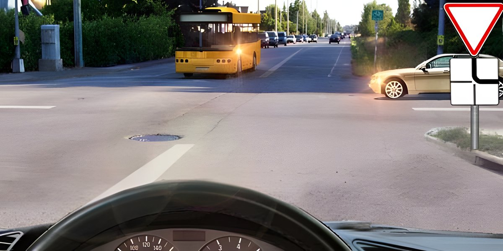

1. **Երկու տրանսպորտային միջոցներին** ✅
2. Միայն ավտոբուսին
3. Միայն թեթեւ մարդատար ավտոմոբիլին
4. Ոչ մեկին

### 1-40. Եթե մտադիր եք շարունակել երթեւեկությունն ուղիղ, ու՞մ պետք է զիջել ճանապարհը։

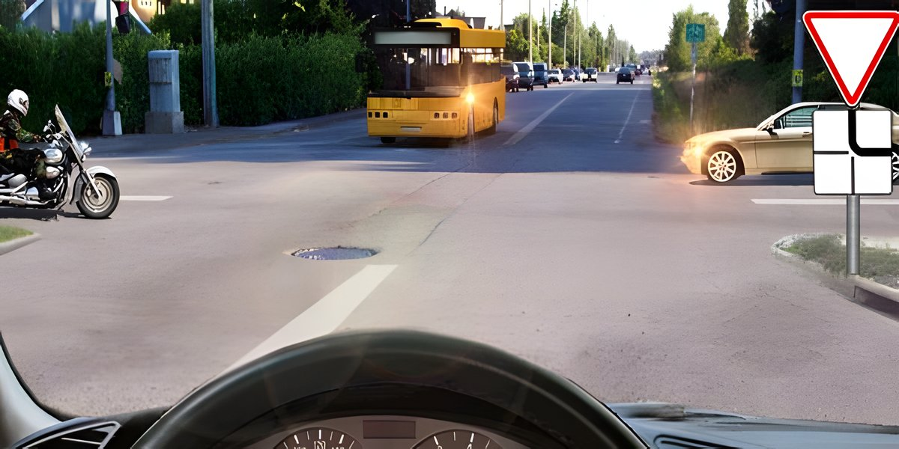

1. Միայն թեթեւ մարդատար ավտոմոբիլին
2. **Միայն ավտոբուսին եւ թեթեւ մարդատար ավտոմոբիլին** ✅
3. Բոլոր տրանսպորտային միջոցներին
4. Միայն մոտոցիկլին

### 1-41. Տվյալ իրադրությունում պարտավո՞ր է մոտոցիկլի վարորդը զիջել ճանապարհը։

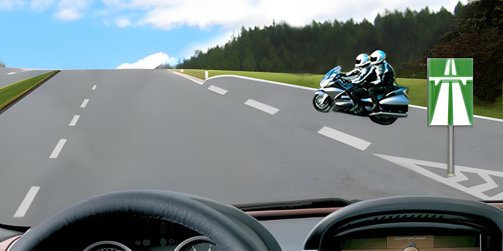

1. Պարտավոր չէ
2. **Պարտավոր է** ✅

### 1-42. Տվյալ իրադրությունում ունե՞ք արդյոք նշված մանեւրի իրավունք։

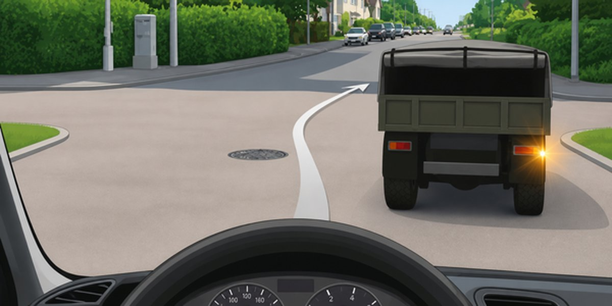

1. Այո
2. **Ոչ** ✅

### 1-43. Դուք շարունակում եք երթեւեկությունն ուղիղ։ Ո՞ր տրանսպորտային միջոցին պետք է զիջել ճանապարհը։

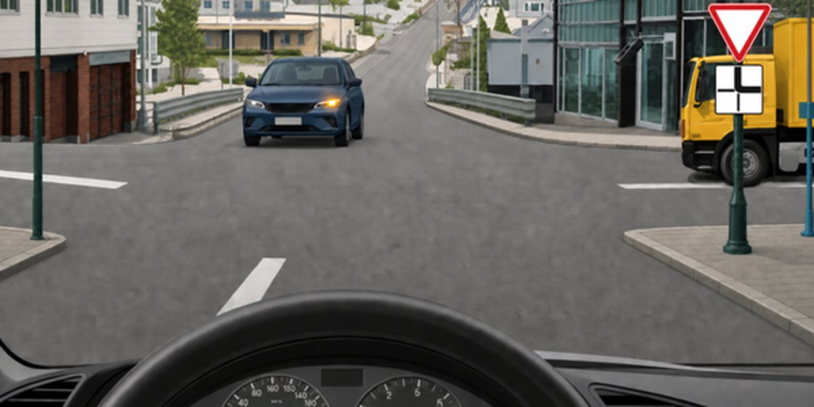

1. Միայն թեթեւ մարդատար ավտոմոբիլին
2. Բեռնատար ավտոմոբիլին
3. **Երկու տրանսպորտային միջոցներին** ✅
4. Ոչ մեկին

### 1-44. Դուք շարունակում եք երթեւեկությունն ուղիղ։ Պարտավո՞ր եք արդյոք զիջել ճանապարհը թեթեւ մարդատար ավտոմոբիլին։

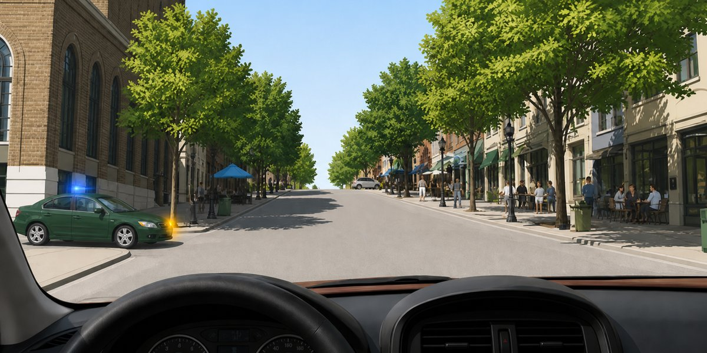

1. Պարտավոր եք
2. **Պարտավոր չեք** ✅

### 1-45. Դուք սկսում եք երթեւեկել ճամփեզրից։ Պարտավո՞ր եք արդյոք զիջել ճանապարհը թեթեւ մարդատար ավտոմոբիլին, որը կատարում է հետադարձ։

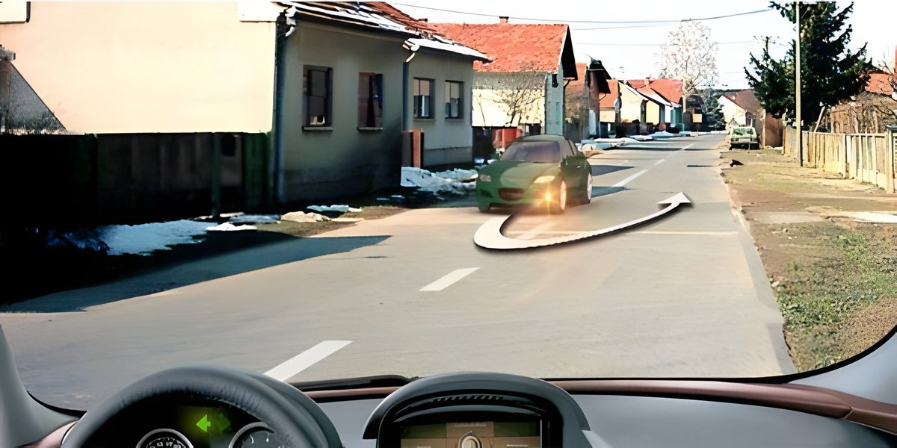

1. **Պարտավոր եք** ✅
2. Պարտավոր չեք

### 1-46. Դուք շարունակում եք երթեւեկությունն ուղիղ։ Ո՞ր տրանսպորտային միջոցին պետք է զիջել ճանապարհը։

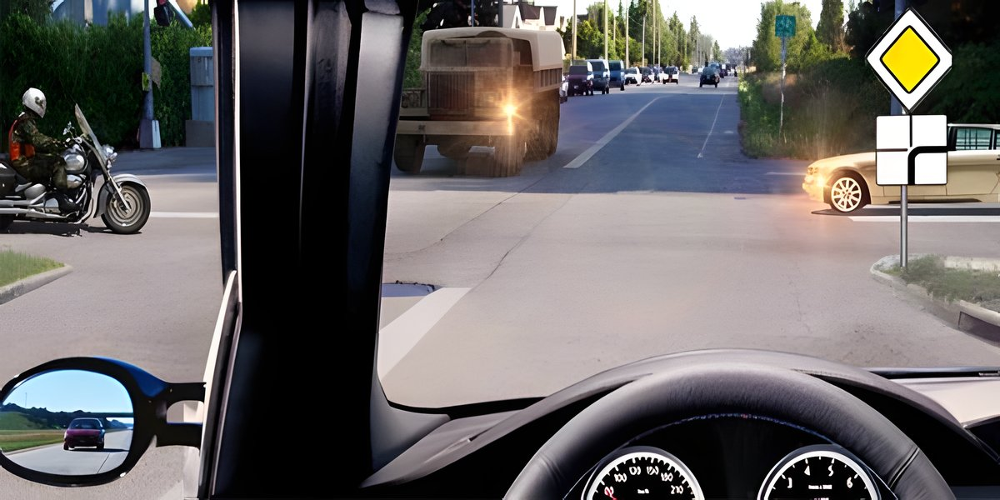

1. **Միայն թեթեւ մարդատար ավտոմոբիլին** ✅
2. Ոչ մեկին
3. Միայն թեթեւ մարդատար ավտոմոբիլին եւ մոտոցիկլին
4. Բոլոր տրանսպորտային միջոցներին

### 1-47. Եթե մտադիր եք կատարել ձախ շրջադարձ, ո՞ր տրանսպորտային միջոցին պետք է զիջել ճանապարհը։

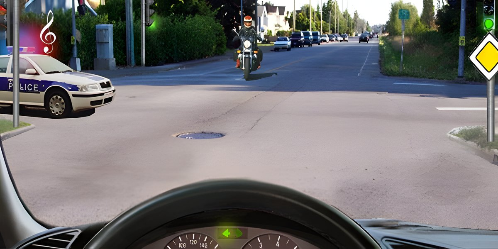

1. Մոտոցիկլին
2. Պարեկային ավտոմոբիլին
3. **Բոլոր տրանսպորտային միջոցներին** ✅

### 1-48. Եթե մտադիր եք խաչմերուկում կատարել հետադարձ, ո՞ր տրանսպորտային միջոցին պետք է զիջել ճանապարհը։

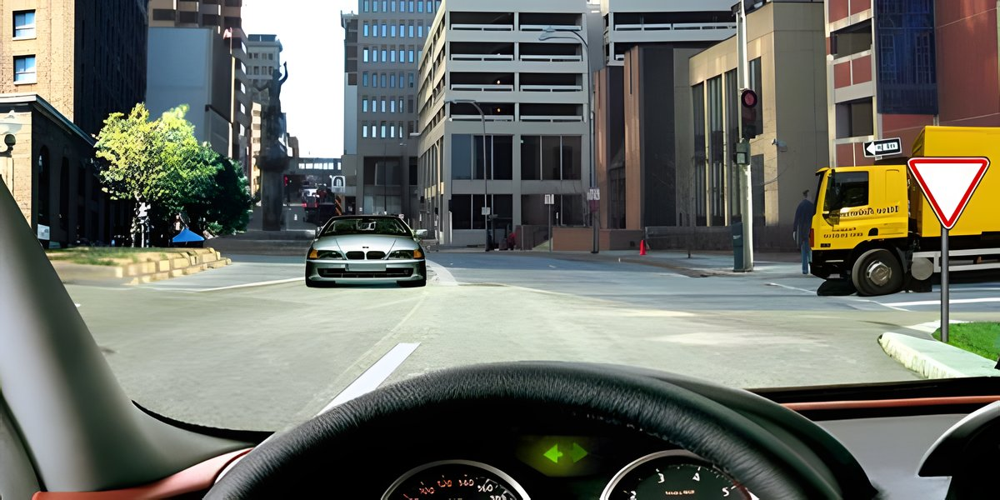

1. Թեթեւ մարդատար ավտոմոբիլին
2. **Բոլոր տրանսպորտային միջոցներին** ✅
3. Բեռնատար ավտոմոբիլին

### 1-49. Եթե մտադիր եք խաչմերուկում կատարել ձախ շրջադարձ, ո՞ր տրանսպորտային միջոցին պետք է զիջել ճանապարհը։

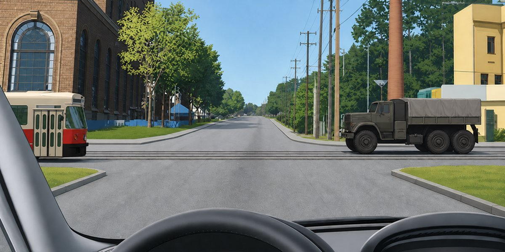

1. Բեռնատար ավտոմոբիլին
2. **Բոլոր տրանսպորտային միջոցներին** ✅
3. Ոչ մեկին

### 1-50. Եթե մտադիր եք խաչմերուկում կատարել ձախ շրջադարձ, ո՞ր տրանսպորտային միջոցին պետք է զիջել ճանապարհը։

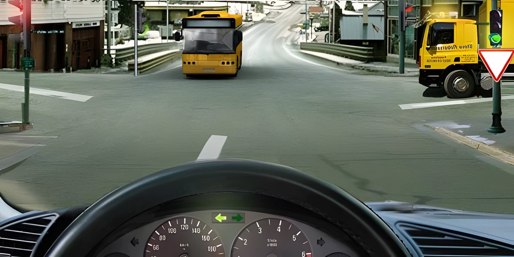

1. Ոչ մեկին
2. **Միայն ավտոբուսին** ✅
3. Միայն միացված փարոսիկով բեռնատար ավտոմոբիլին
4. Բոլոր տրանսպորտային միջոցներին

### 1-51. Եթե մտադիր եք խաչմերուկում կատարել հետադարձ, ո՞ր տրանսպորտային միջոցին պետք է զիջել ճանապարհը։

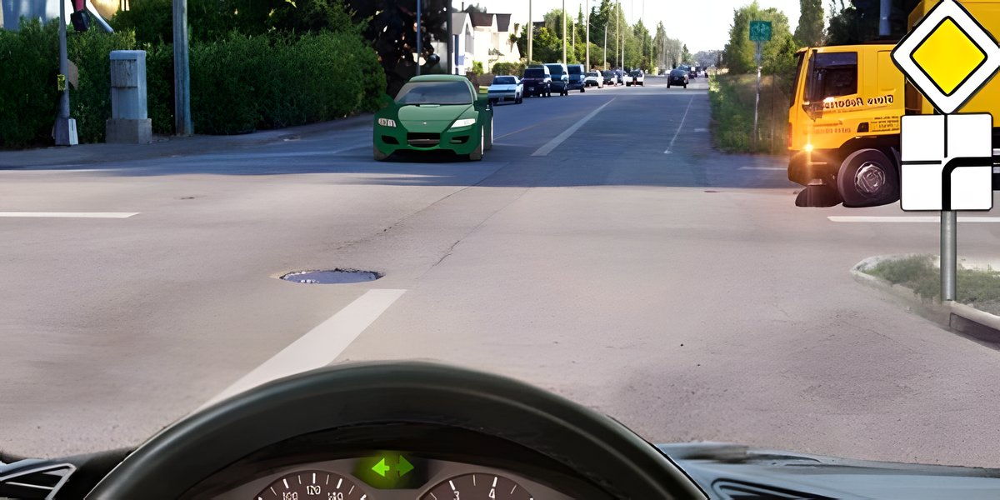

1. **Բեռնատար ավտոմոբիլին** ✅
2. Թեթեւ մարդատար ավտոմոբիլին
3. Բոլոր տրանսպորտային միջոցներին
4. Ոչ մեկին

### 1-52. Եթե մտադիր եք կատարել ձախ շրջադարձ, ո՞ր տրանսպորտային միջոցին պետք է զիջել ճանապարհը։

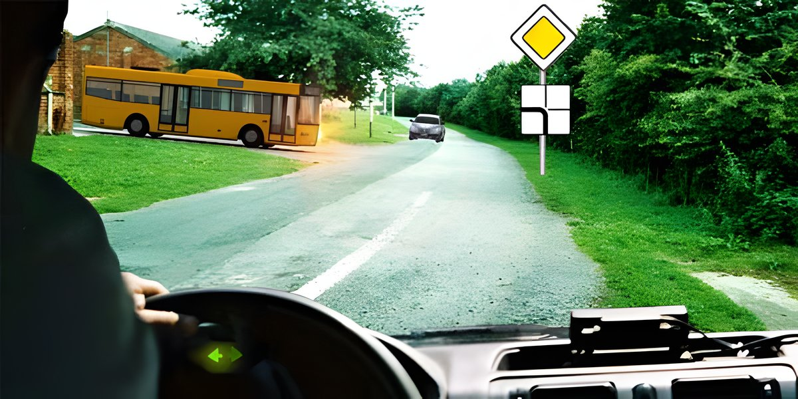

1. Ավտոբուսին
2. Ավտոբուսին եւ թեթեւ մարդատար ավտոմոբիլին
3. Թեթեւ մարդատար ավտոմոբիլին
4. **Ոչ մեկին** ✅

### 1-53. Եթե մտադիր եք կատարել աջ շրջադարձ, պարտավո՞ր եք արդյոք զիջել ճանապարհը թեթեւ մարդատար ավտոմոբիլին։

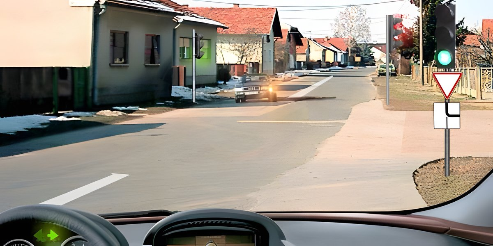

1. Պարտավոր եք
2. **Պարտավոր չեք** ✅

### 1-54. Եթե մտադիր եք կատարել աջ շրջադարձ, ո՞ր տրանսպորտային միջոցին պետք է զիջել ճանապարհը։

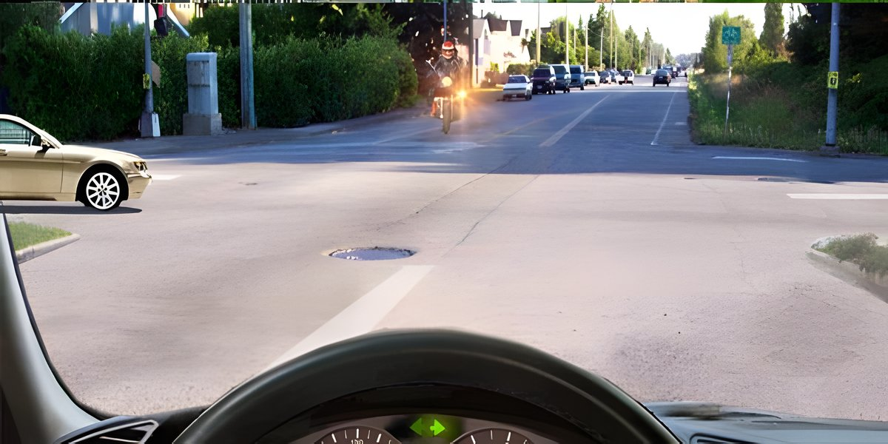

1. **Ոչ մեկին** ✅
2. Թեթեւ մարդատար ավտոմոբիլին
3. Մոտոցիկլին եւ թեթեւ մարդատար ավտոմոբիլին

### 1-55. Պարտավոր ենք արդյո՞ք այս իրավիճակում զիջել հանդիպակաց գոտուց մոտեցող ավտոմոբիլի վարորդին:

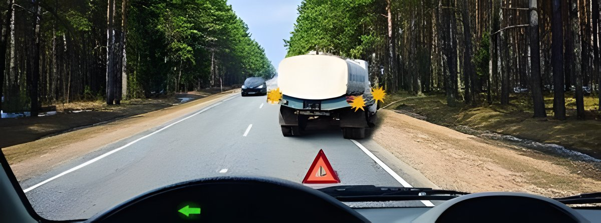

1. **Այո** ✅
2. Ոչ

### 1-56. Այս իրավիճակում պարտավոր եք

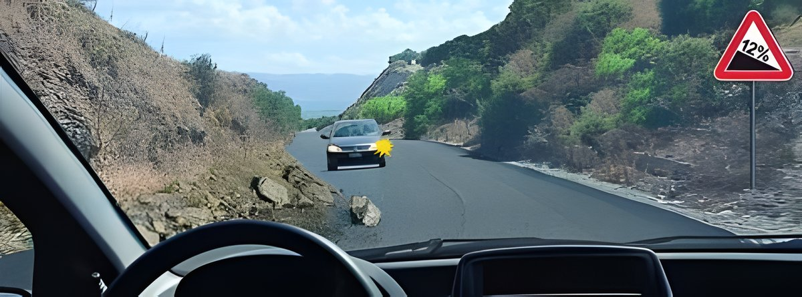

1. **Զիջել ճանապարհը։** ✅
2. Անցնել առաջինը։

### 1-57. Տվյալ իրավիճակում

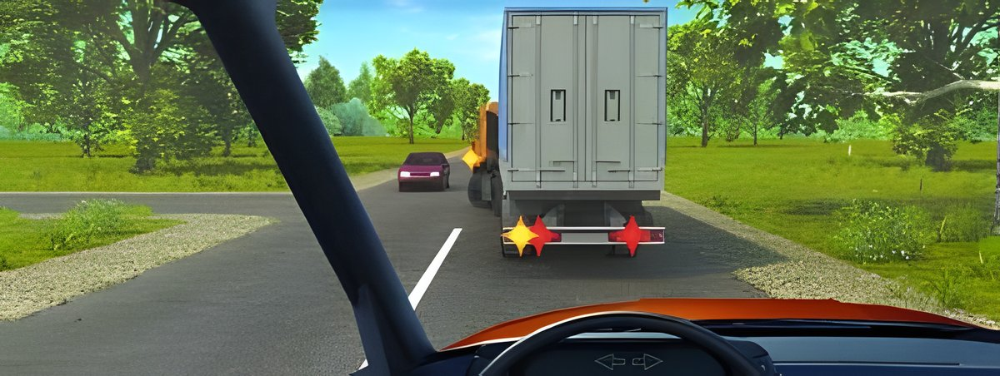

1. Կարող ենք շրջանցել բեռնատարին աջ կողմից՝ կողնակով:
2. **Շարունակել երթևեկությունը միայն բեռնատարի անցումից հետո:** ✅
3. Երկու գործողություններն էլ թույլատրելի են։

### 1-58. Այս իրավիճակում

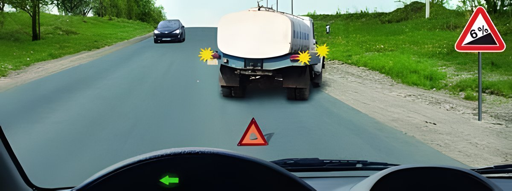

1. Պետք է զիջել ճանապարհը։
2. **Կարող եք առաջինն անցնել։** ✅

### 1-59. Տվյալ իրավիճակում ուղիղ երթևեկելու դեպքում թույլատրվում է

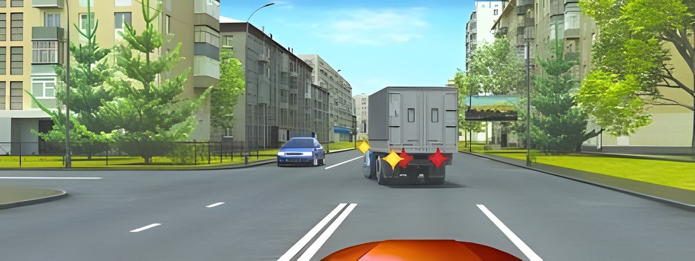

1. Շրջանցել բեռնատարն աջ կողմից:
2. Շարունակել երթևեկությունը միայն բեռնատարի անցումից հետո։
3. **Նշված երկու դեպքերն էլ թույլատրելի են։** ✅

### 1-60. Այս իրավիճակում

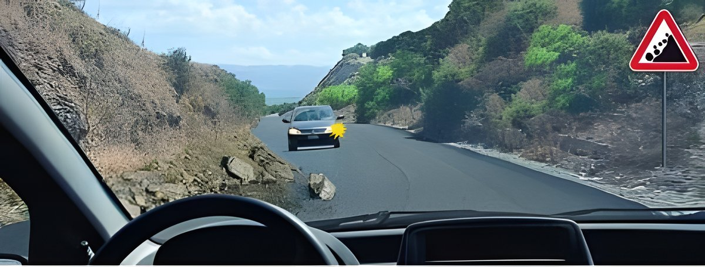

1. Պարտավոր ենք զիջել ճանապարհը:
2. **Ունենք առաջնահերթ երթևեկության իրավունք:** ✅

### 1-61. Ո՞ր հետագծով է թույլատրվում մոտենալ մայթեզրում սպասող հետիոտնին։

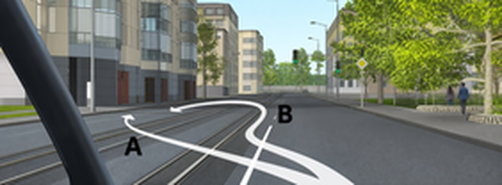

1. Միայն A։
2. **Միայն B։** ✅
3. Երկու հետագծերով էլ թույլատրվում է։

### 1-62. Դուրս գալով ճանապարհ՝ այս իրավիճակում պարտավոր ենք զիջել

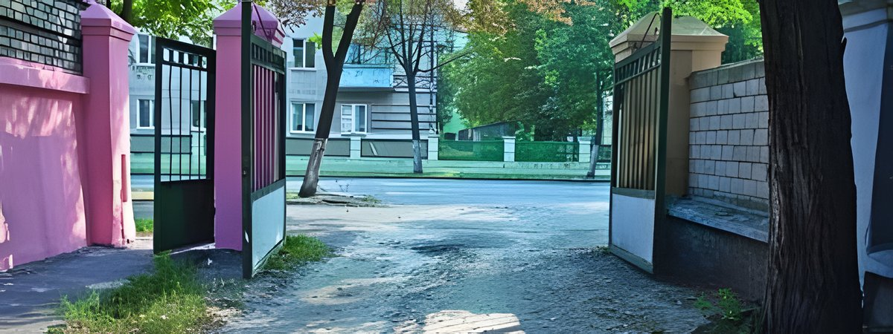

1. Աջ կողմից մոտեցող վարորդներին։
2. Բոլոր վարորդներին։
3. **Վարորդներին և հետիոտներին։** ✅

### 1-63. Այս իրավիճակում ճանապարհը զիջել պարտավոր է

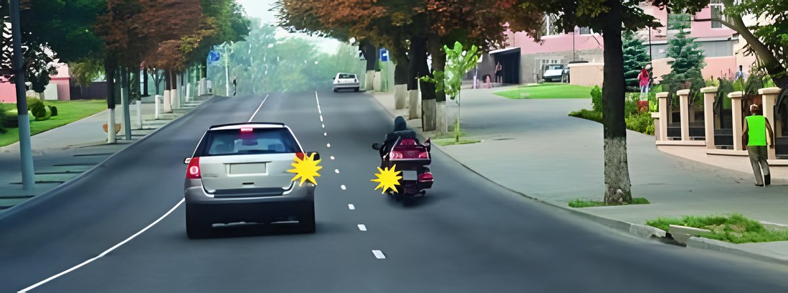

1. **Թեթև մարդատարի վարորդը։** ✅
2. Մոտոցիկլի վարորդը։

### 1-64. Ո՞ր հետագծով է թույլատրված հետադարձը։

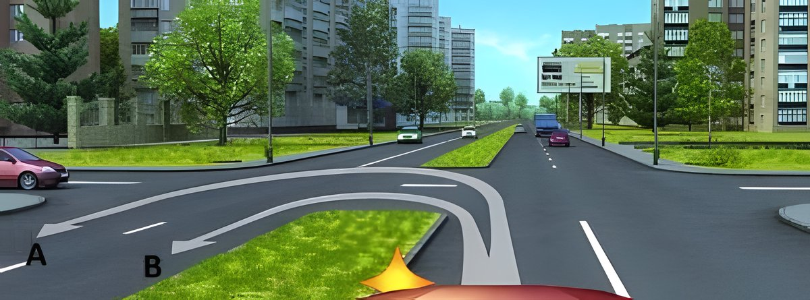

1. **Միայն A** ✅
2. Միայն B
3. Երկու հետագծերով էլ թույլատրվում է։

### 1-65. Կապույտ ավտոմոբիլի վարորդը ո՞ր նկարում ներկայացված իրավիճակում ունի առաջնահերթ երթևեկության իրավունք մյուս վարորդի նկատմամբ։

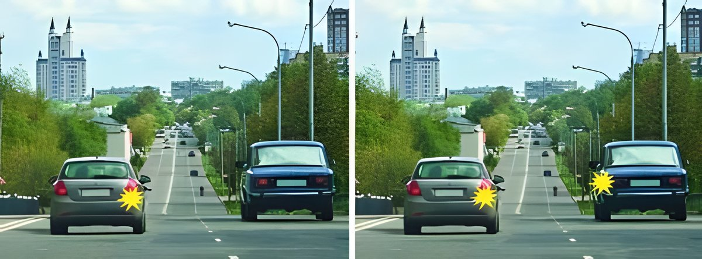

1. Ձախ
2. Աջ
3. **Երկու նկարներում էլ** ✅

### 1-66. Հետադարձը նշված տեղում

1. Թույլատրվում է, եթե մոտեցող գնացք չկա։
2. **Թույլատրվում է։** ✅
3. Արգելվում է։

### 1-67. Ո՞ր հետագծով է թույլատրված աջ շրջադարձը։

1. **Միայն A** ✅
2. Միայն B
3. Երկու հետագծերով էլ թույլատրված է։

### 1-68. Նշված եղանակով հետադարձն այս խաչմերուկում

1. Թույլատրվում է։
2. **Չի թույլատրվում։** ✅

### 1-69. Ո՞ր տրանսպորտային միջոցի վարորդը պետք է զիջի ճանապարհը։

1. Բեռնատարի
2. **Թեթև մարդատարի** ✅

### 1-70. Ո՞ր հետագծով է թույլատրվում հետադարձը վարորդին։

1. Միայն A
2. **Միայն B** ✅
3. Ցանկացած

### 1-71. Այս գոտուց ո՞ր ուղղությամբ կարող է թեթև մարդատարի վարորդը շարունակել երթևեկությունը։

1. Միայն ուղիղ
2. Ուղիղ և աջ
3. Ցանկացած
4. **Ուղիղ, ձախ և հակառակ** ✅

### 1-72. Աջ շրջադարձ կատարելիս դեպի աջ հարող ճանապարհ՝ անհրաժեշտ է

1. Շարունակել երթևեկությունն այս գոտով և շրջադարձը կատարել միայն այդ գոտուց։
2. **Վերադասավորվել արգելակման գոտի և շրջադարձը կատարել միայն այդ գոտուց։** ✅
3. Երկու տարբերակներն էլ ճիշտ են:

### 1-73. Դեպի բակ ձախ շրջադարձ կատարելիս ո՞ւմ պետք է զիջել ճանապարհը։

1. Միայն հանդիպակաց ուղղությամբ երթևեկող ավտոմոբիլի վարորդին
2. **Վարորդին և հետիոտներին** ✅
3. Ոչ ոքի

### 1-74. Հետադարձն այս խաչմերուկում

1. **Թույլատրված է։** ✅
2. Արգելված է։

### 1-75. Պարտավոր է՞ թեթև մարդատարի վարորդը զիջել ճանապարհն իր գոտի վերադասավորվող ավտոկռունկի վարորդին։

1. Այո, եթե ավտոկռունկը նարնջագույն փարոսիկներով է կահավորված
2. Այո
3. **Ոչ** ✅

### 1-76. Թույլատրված է՞ հետադարձն այս վայրում։

1. Այո
2. **Թույլատրված է, եթե տեսանելիությունը 100 մետր և ավելի է** ✅
3. Ոչ

### 1-77. Պարտավո՞ր է արդյոք թեթև մարդատարի վարորդը վերադասավորվել աջ եզրային գոտի՝ վազանցն ավարտելուց հետո։

1. **Ոչ, եթե վազանցը կատարում է բնակավայրում։** ✅
2. Այո
3. Ոչ

### 1-78. Ո՞ր հետագծով է թույլատրված ձախ շրջադարձը

1. Միայն A
2. **Միայն B** ✅
3. Ցանկացած

### 1-79. Այն դեպքերում, երբ տրանսպորտային միջոցների երթևեկության ուղիները հատվում են, իսկ անցման հերթականությունը կանոններով սահմանված չէ, ճանապարհը պետք է զիջի այն վարորդը

1. **Որին տրանսպորտային միջոցը մոտենում է աջից։** ✅
2. Որին տրանսպորտային միջոցը մոտենում է ձախից:

### 1-80. Ո՞ր վարորդը պետք է զիջի ճանապարհը։

1. **Սպիտակ ավտոմոբիլի վարորդը** ✅
2. Դեղին ավտոմոբիլի վարորդը

### 1-81. Հետադարձը նշված վայրում

1. Թույլատրվում է։
2. Թույլատրվում է, եթե չի խոչընդոտում ընդհանուր օգտագործման տրանսպորտային միջոցների վարորդներին։
3. **Արգելվում է։** ✅

### 1-82. Ո՞ր հետագծով է թույլատրված ձախ շրջադարձը։

1. Միայն A
2. **Միայն B** ✅
3. Ցանկացած

### 1-83. Թեթև մարդատարի վարորդը

1. **Պետք է զիջի ճանապարհը։** ✅
2. Ունի առավելություն, քանի որ մոտեցել է աջ կողմից։

### 1-84. Ո՞ր հետագծով է թույլատրված աջ շրջադարձը։

1. **Միայն A** ✅
2. Միայն B
3. Ցանկացած

### 1-85. Ո՞ր հետագծով է թույլատրված հետադարձը։

1. Միայն A
2. **A կամ C** ✅
3. Բոլոր

### 1-86. Պարտավո՞ր է վարորդը վերադասավորվել աջ գոտի և հետո միայն կատարել աջ շրջադարձն այս իրավիճակում։

1. Այո
2. **Ոչ** ✅

### 1-87. Գտնվելով կամրջի վրա՝ թույլատրվո՞ւմ է հետադարձը։

1. Թույլատրվում է, եթե տեսանելիությունը 100 մետր և ավելի է
2. **Արգելվում է** ✅

### 1-88. Մուտք գործել խաչմերուկ նշված գոտուց

1. Թույլատրվում է միայն հետադարձ կատարելիս։
2. **Թույլատրվում է ցանկացած դեպքում։** ✅

### 1-89. Թույլատրված է՞ հետադարձն այս վայրում։

1. Այո
2. **Թույլատրված է, եթե տեսանելիությունը 100 մետր և ավելի է** ✅
3. Ոչ

### 1-90. Երկրորդ գոտիով ուղիղ ընթացող վարորդը պարտավո՞ր է զիջել աջից վերադասավորվող վարորդին։

1. **Պարտավոր չէ** ✅
2. Պարտավոր է

### 1-91. Հետադարձն այս վայրում

1. **Թույլատրվում է։** ✅
2. Արգելվում է։

### 1-92. Ձախ շրջադարձը թույլատրվում է

1. Միայն A հետագծով
2. Միայն B հետագծով
3. **Ցանկացած հետագծով** ✅

### 1-93. Կայանատեղիից միաժամանակ երթևեկությունը սկսելու դեպքում պարտավո՞ր եք արդյոք զիջել ճանապարհը առջևում գտնվող վարորդին։

1. **Այո** ✅
2. Ոչ

### 1-94. Այս իրավիճակում վարորդը ո՞ր հետագծով իրավունք ունի կատարել ձախ շրջադարձ։

1. Միայն A
2. Միայն B
3. **Ցանկացած** ✅

### 1-95. Խաչմերուկում թույլատրվու՞մ է արդյոք հետընթաց կատարումով հետադարձ կատարել։

1. Այո
2. Այո, եթե խոչընդոտ չի ստեղծի խաչմերուկով երթևեկողների համար
3. **Ոչ** ✅

### 1-96. Թույլատրվո՞ւմ է վարորդին այս իրավիճակում աջ շրջադարձ կատարել։

1. Այո
2. **Ոչ** ✅

### 1-97. Այս իրավիճակում կանգառ կատարելիս ո՞ր ազդանշանի լուսային ցուցիչը պետք է միացնի վարորդը։

1. Աջ
2. Աջ, վերադասավորումից հետո՝ ձախ
3. **Ձախ** ✅

### 1-98. Նշեք այն հետագիծը (հետագծերը), որով թույլատրված է երթևեկությունը։

1. Բոլոր
2. Միայն A
3. **Միայն A կամ C** ✅

### 1-99. Տեսանելիության բացակայության պատճառով հետընթաց կատարելիս վարորդը պետք է

1. Ձայնային ազդանշան տա։
2. Միացնի վթարային լուսային ազդանշանը։
3. **Դիմի այլ անձանց օգնությանը։** ✅

### 1-100. Բակ մուտք գործելու համար հետընթաց կատարելն այս իրավիճակում

1. Թույլատրվում է։
2. **Արգելվում է։** ✅

### 1-101. Այս իրավիճակում հետընթաց վարմամբ հետադարձ կատարելը՝ օգտագործելով բակի մուտքը

1. **Թույլատրվում է, եթե չի խոչընդոտի այլ երթևեկողներին** ✅
2. Արգելվում է։

### 1-102. Թույլատրվո՞ւմ է թեթև մարդատարի վարորդին սկսել երթևեկությունը։

1. Այո
2. **Այո, եթե չի խոչընդոտի բեռնատարի վարորդին** ✅
3. Ոչ

### 1-103. Ո՞ր տարբերակում է թույլատրված հետընթացը։

1. Խաչմերուկներում
2. **Աջ եզրային չհանդիսացող գոտիներում** ✅
3. Հետիոտնային անցումներում

### 1-104. Տվյալ իրավիճակում թույլատրվու՞մ է վարորդին երթևեկել տրամվայի գծերով։

1. Այո
2. Թույլատրվում է միայն հետադարձ կամ ձախ շրջադարձ կատարելու դեպքում
3. **Ոչ** ✅

### 1-105. Այս իրավիճակում ձախ շրջադարձ կատարելիս պարտավո՞ր է արդյոք վարորդը լուսային ցուցիչով ազդանշան տալ։

1. **Այո** ✅
2. Այո, երբ առկա է հանդիպակաց երթևեկող
3. Պարտավոր չէ

### 1-106. Ձախ շրջադարձ թույլատրվում է

1. Միայն A հետագծով։
2. **Միայն B հետագծով։** ✅
3. Երկու հետագծերով։

### 1-107. Հետընթաց վարմամբ թեթև մարդատարի վարորդին թույլատրվո՞ւմ է մոտենալ կամրջի վրա գտնվող ուղևորին։

1. Այո
2. Այո, եթե չի ստեղծի խոչընդոտ այլ մասնակիցների համար
3. **Ոչ** ✅

### 1-108. Թույլատրվու՞մ է հետադարձ կատարել այս իրավիճակում։

1. **Թույլատրվում է միայն ճանապարհի 100 մետրից ավելի տեսանելիության դեպքում** ✅
2. Արգելվում է

### 1-109. Ի՞նչ կանոն է խախտում վարորդը՝ մուտք գործելով բակ։

1. Աջ շրջադարձ է կատարում միայն ուղիղ նշանի ազդման գոտում
2. **Լուսային ցուցիչով ազդանշան չի տալիս** ✅
3. Երկու խախտումները՝ միաժամանակ

### 1-110. Բեռնատարի վարորդին ճանապարհը զիջել

1. Պարտավոր ենք։
2. Պարտավոր ենք, եթե նա այդ մասին ձեռքով ազդանշան է տվել։
3. **Պարտավոր չենք։** ✅

### 1-111. Ո՞ր հետագծով է թույլատրված հետադարձը։

1. **Միայն A** ✅
2. Միայն B
3. Ցանկացած

### 1-112. Ո՞ր հետագծով է թույլատրված հետադարձը։

1. **Ցանկացած** ✅
2. Միայն B
3. Միայն A

### 1-113. Ճանապարհը պետք է զիջի

1. Թեթև մարդատարի վարորդը։
2. **Բեռնատարի վարորդը։** ✅

### 1-114. Թույլատրվո՞ւմ է սխալմամբ խաչմերուկ մուտք գործելուց հետո հետընթաց վարմամբ շտկել և շարունակել երթևեկությունն անհրաժեշտ ուղղությամբ։

1. Այո
2. **Ոչ** ✅

### 1-115. Այս գոտուց երթևեկությունը շարունակել թույլատրվում է

1. Միայն ձախ ուղղությամբ։
2. **Ձախ և հակառակ ուղղություններով։** ✅
3. Աջ, ձախ և հակառակ ուղղություններով։

### 1-116. Թույլատրվո՞ւմ է նշված իրադրությունում հետընթաց կատարել՝ աջ շրջադարձով բակ մտնելու համար։

1. Այո, եթե չենք խոչընդոտի ընդհանուր օգտագործման տրանսպորտային միջոցների երթևեկությունը
2. **Ոչ** ✅

### 1-117. Այս իրավիճակում, վերադասավորվելով հարևան գոտի,

1. **Պարտավոր եք զիջել նշված գոտով ընթացող վարորդներին։** ✅
2. Ունեք երթևեկության առավելություն։

### 1-118. Ո՞ր հետագծով է թույլատրված հետադարձը։

1. Միայն A
2. Միայն B
3. **Ցանկացած** ✅

### 1-119. Ո՞ր հետագծով է թույլատրված ձախ շրջադարձը

1. Միայն A
2. Միայն C
3. **Ցանկացած** ✅

### 1-120. Այս իրավիճակում թույլատրվու՞մ է հետընթացով մոտենալ ուղևորին։

1. **Այո** ✅
2. Ոչ

### 1-121. Ինչպե՞ս պետք է վարվեք խաչմերուկից դուրս ձախ շրջադարձի և հետադարձի ժամանակ։

1. Պետք է ճանապարհը զիջել հանդիպակաց տրանսպորտային միջոցներին
2. **Պետք է ճանապարհը զիջել հանդիպակաց տրանսպորտային միջոցներին և համընթաց երթևեկող տրամվայներին** ✅

### 1-122. Այս իրավիճակում թույլատրվու՞մ է հետընթաց։

1. **Արգելվում է** ✅
2. Թույլատրվում է՝ մինչև հետիոտնային անցումը

### 1-123. Երթևեկությունը սկսելիս պարտավո՞ր եք արդյոք զիջել ճանապարհը հետադարձ կատարող վարորդին։

1. **Այո** ✅
2. Ոչ

### 1-124. Այս իրավիճակում հետընթացով մոտենալ ուղևորին

1. Թույլատրվում է։
2. Թույլատրվում է, եթե չի խոչընդոտում այլ վարորդների երթևեկությանը։
3. **Արգելվում է։** ✅

### 1-125. Ո՞ր վարորդն է խախտում երթևեկության կանոնները՝ դուրս գալով շրջանաձև երթևեկությամբ խաչմերուկից։

1. **Թեթև մարդատարի վարորդը** ✅
2. Երկու վարորդներն էլ խախտում են
3. Ոչ ոք

### 1-126. Հետադարձն այս խաչմերուկում

1. **Թույլատրվում է։** ✅
2. Արգելվում է։

### 1-127. Ո՞ր ուղղությամբ է թույլատրված երթևեկությունը։

1. **Միայն ձախ** ✅
2. Ուղիղ և ձախ
3. Ձախ և հետադարձ

### 1-128. Պարտավո՞ր եք արդյոք միացնել աջ շրջադարձի ցուցիչն այս խաչմերուկում։

1. **Այո** ✅
2. Ոչ
3. Այո, բացառությամբ հետադարձ կատարելիս:

### 1-129. Մերձակա տարածք մուտք գործելիս վարորդը պետք է ճանապարհը զիջի

1. Միայն հետիոտներին։
2. Միայն հեծանվորդներին։
3. **Հեծանվորդներին և չստեղծի խոչընդոտ հետիոտների համար։** ✅

### 1-130. Մերձակա տարածքից դուրս գալիս վարորդը պետք է ճանապարհը զիջի

1. միայն հետիոտներին։
2. դրանով երթևեկող տրանսպորտային միջոցներին։
3. **երթևեկող տրանսպորտային միջոցներին և չստեղծի խոչընդոտ հետիոտների համար։** ✅

### 1-131. Հետադարձ կատարել նշանից հետո թույլատրվում է

1. Միայն երկու կողմից 100 մետր տեսանելիության դեպքում։
2. Խոչընդոտ չստեղծելու դեպքում։
3. **Ոչ մի դեպքում։** ✅

### 1-132. Ազդանշան տալը երթևեկության մյուս մասնակիցների նկատմամբ առավելություն

1. Տալիս է։
2. Տալիս է միայն վերադասավորվելիս։
3. **Չի տալիս։** ✅

### 1-133. Նշված հետագծով աջ շրջադարձը

1. **Թույլատրված է։** ✅
2. Արգելված է։

### 1-134. Բեռնատարից առաջ անցնելուց հետո ո՞ր գոտով է թույլատրվում շարունակել երթևեկությունը։

1. **Միայն աջ** ✅
2. Երկու համընթաց գոտիներով էլ թույլատրվում է

### 1-135. Դեպի բակ շրջադարձ կատարելիս պետք է

1. Զիջել հեծանվորդին։
2. Չստեղծել խոչընդոտ հետիոտների համար։
3. **Երկու պատասխաններն էլ ճիշտ են։** ✅

### 1-136. Հետադարձը նշված վայրում

1. Թույլատրվում է։
2. Թույլատրվում է, եթե առկա չեն ընդհանուր օգտագործման տրանսպորտային միջոցներ։
3. **Արգելվում է։** ✅

### 1-137. Եթե երկու կողմից 100 մետր տեսանելիությունն ապահովված է, թույլատրվու՞մ է նշված հետագծով հետադարձ կատարել։

1. **Ոչ** ✅
2. Այո

### 1-138. Առաջնահերթ երթևեկության իրավունք ունի

1. Թեթև մարդատարի վարորդը։
2. **Բեռնատարի վարորդը։** ✅

### 1-139. Միաժամանակ վերադասավորվելիս ո՞ր տրանսպորտային միջոցի վարորդն ունի առաջնահերթ երթևեկության իրավունք։

1. Բեռնատարի վարորդը
2. **Թեթև մարդատարի վարորդը** ✅

### 1-140. Թույլատրվո՞ւմ է հետընթացով մոտենալ ուղևորին։

1. Այո
2. **Ոչ** ✅

### 1-141. Աջ շրջադարձ կատարելով բակ մուտք գործելու դեպքում՝ պարտավոր ենք զիջել

1. Միայն հետիոտներին։
2. Միայն հեծանվորդին։
3. Ոչ մեկին։
4. **Հեծանվորդին և հետիոտներին։** ✅

### 1-142. Այս վերելքի ուղղությամբ շարժվելիս հետադարձը

1. Թույլատրվում է, եթե հնարավոր լինի այն կատարել մեկ գործողությամբ։
2. **Թույլատրվում է, եթե ապահովված է 100 մետր տեսանելիությունը՝ երկու կողմից։** ✅
3. Չի թույլատրվում։

### 1-143. Ո՞ր տրանսպորտային միջոցի վարորդը պետք է զիջի ճանապարհը։

1. **Ավտոբուսի վարորդը** ✅
2. Թեթև մարդատարի վարորդը

### 1-144. Թույլատրվում է հետադարձն այս վայրում։

1. **Թույլատրվում է՝ երկու կողմից 100մ տեսանելիության պայմաններում** ✅
2. Արգելվում է

### 1-145. Թույլատրվո՞ւմ է անցնել կամուրջը, եթե դա չի խոչընդոտում մոտոցիկլի վարորդին։

1. **Այո** ✅
2. Ոչ
