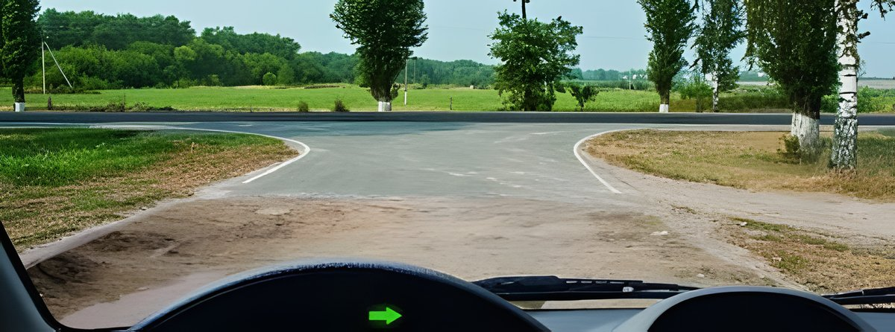
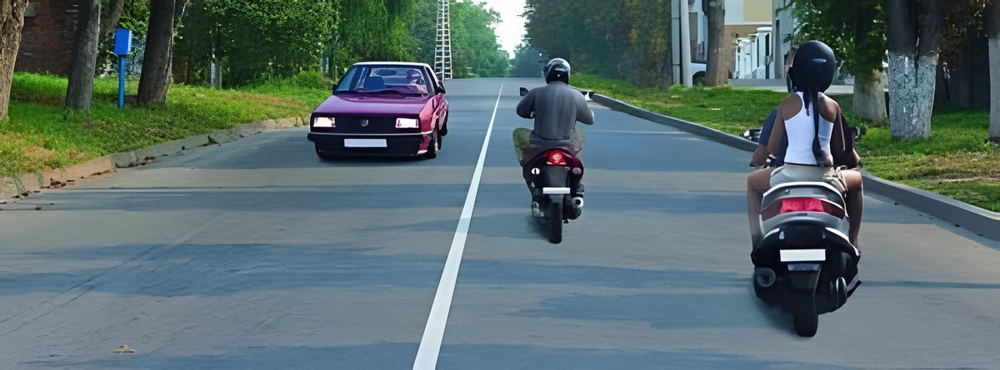
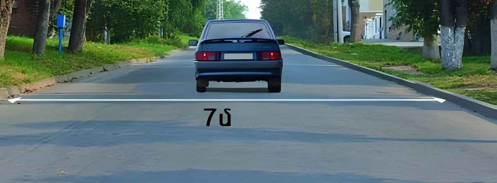
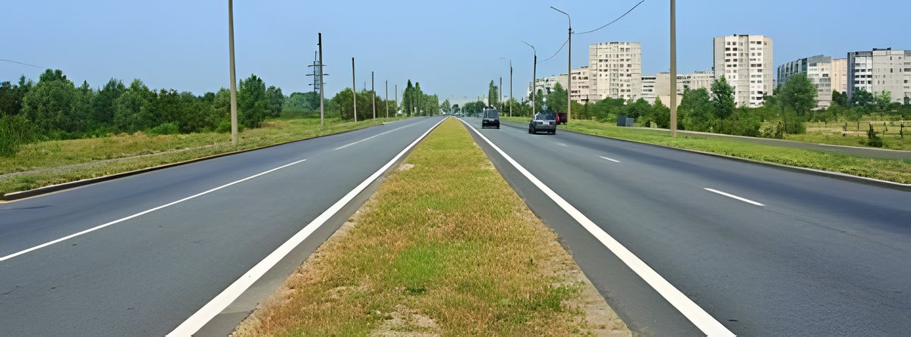
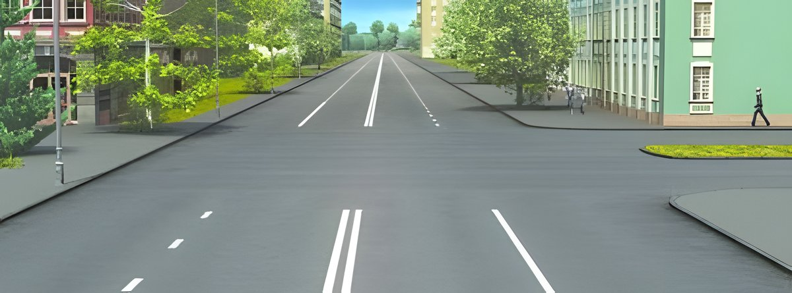
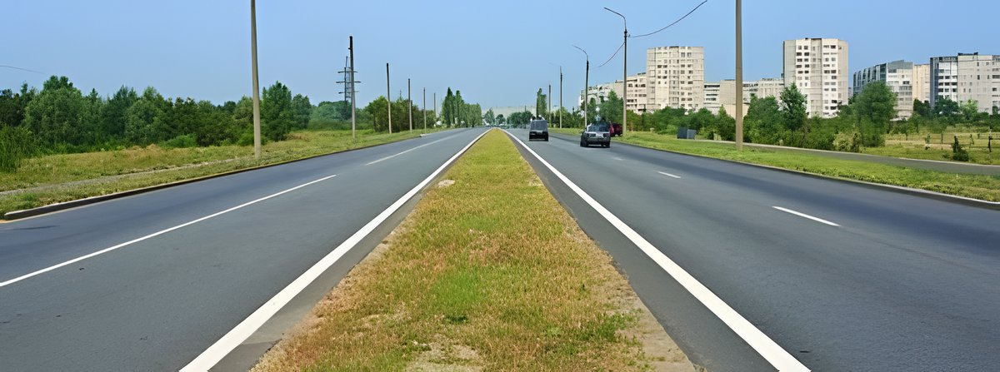
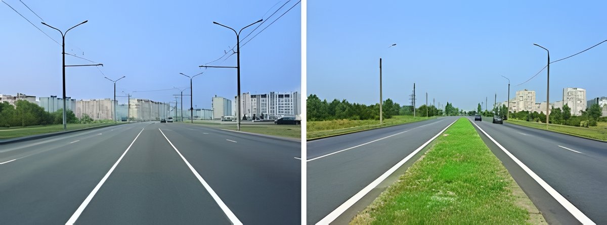
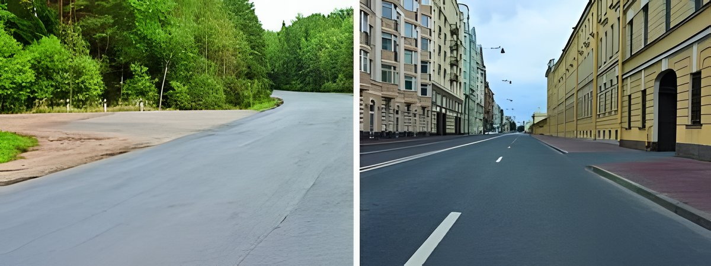
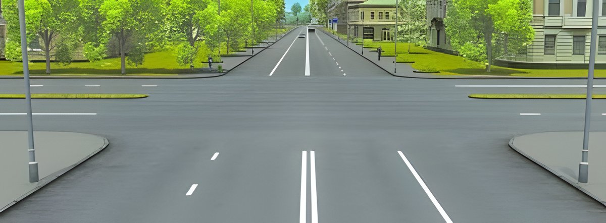

# Խումբ 2 (82 հարց)

Ճիշտ պատասխանը **թավ** է և նշված ✅-ով։ Աղբյուր՝ roadpolice.am, ABC կարգեր։

### 2-1. «Ճանապարհային երթեւեկության անվտանգության ապահովման մասին» ՀՀ օրենքի համաձայն ուղեւոր է համարվում

1. Տրանսպորտային միջոցի սրահում (խցիկում) կամ տրանսպորտային միջոցի վրա գտնվող անձը` բացառությամբ վարորդի եւ վարել սովորեցնողի։
2. **Տրանսպորտային միջոցի սրահում (խցիկում) կամ տրանսպորտային միջոցի վրա գտնվող, ինչպես նաեւ տրանսպորտային միջոց նստող (բարձրացող) ու դրանից դուրս եկող (իջնող) անձը` բացառությամբ վարորդի եւ վարել սովորեցնողի։** ✅

### 2-2. «Ճանապարհային երթեւեկության անվտանգության ապահովման մասին» ՀՀ օրենքի համաձայն՝ «A» կարգի տրանսպորտային միջոցներ վարելու իրավունքի վկայական կարող է տրվել

1. 16 տարին լրացած անձանց։
2. 17 տարին լրացած անձանց։
3. **18 տարին լրացած անձանց։** ✅

### 2-3. «Ճանապարհային երթեւեկության անվտանգության ապահովման մասին» ՀՀ օրենքի համաձայն՝ «BE» կարգի տրանսպորտային միջոցներ վարելու իրավունքի վկայական կարող է տրվել

1. 17 տարին լրացած անձանց։
2. 18 տարին լրացած անձանց։
3. **19 տարին լրացած անձանց։** ✅

### 2-4. «Ճանապարհային երթեւեկության անվտանգության ապահովման մասին» ՀՀ օրենքի համաձայն` ճանապարհի երթեւեկելի մաս է համարվում

1. Ճանապարհի տարրը` նախատեսված տրանսպորտային միջոցների երթեւեկության համար։
2. **Ճանապարհի տարրը` նախատեսված ոչ ռելսագնաց տրանսպորտային միջոցների երթեւեկության համար։** ✅

### 2-5. Պարտավո՞ր է արդյոք վարել սովորողն ուսումնական վարման ժամանակ ամրակապվել անվտանգության գոտիներով։

1. **Պարտավոր է** ✅
2. Պարտավոր չէ
3. Պարտավոր չէ, եթե դա դժվարացնում է ավտոմոբիլ ղեկավարելը
4. Պարտավոր չէ, եթե թույլատրում է վարել սովորեցնողը

### 2-6. «Ճանապարհային երթեւեկության անվտանգության ապահովման մասին» ՀՀ օրենքի համաձայն՝ հետիոտն է համարվում

1. **Տրանսպորտային միջոցից դուրս` ճանապարհի վրա գտնվող անձը` բացառությամբ ճանապարհի վրա աշխատանքներ իրականացնելու իրավասություն ունեցող եւ օրենսդրությամբ սահմանված կարգով այդ աշխատանքներն իրականացնող անձը։** ✅
2. Տրանսպորտային միջոցից դուրս` ճանապարհի վրա գտնվող, այդ թվում` ճանապարհի վրա աշխատանքներ իրականացնելու իրավասություն ունեցող եւ օրենսդրությամբ սահմանված կարգով այդ աշխատանքներն իրականացնող անձը։

### 2-7. «Ճանապարհային երթեւեկության անվտանգության ապահովման մասին» ՀՀ օրենքի համաձայն՝ տրանսպորտային միջոցի գործնական վարման սկզբնական ուսուցումը իրականացվում է

1. Բնակավայրերից դուրս` ճանապարհներին` հաշվի առնելով տրանսպորտային միջոցների երթեւեկության ինտենսիվությունը։
2. **Փակ հրապարակում կամ ավտոդրոմում։** ✅
3. Ցանկացած ճանապարհին (բացառությամբ ավտոմայրուղիների)` հաշվի առնելով տրանսպորտային միջոցների երթեւեկության ինտենսիվությունը։

### 2-8. «Ճանապարհային երթեւեկության անվտանգության ապահովման մասին» ՀՀ օրենքի համաձայն` մերձակա տարածքից ելքը դեպի ճանապարհ համարվու՞մ է արդյոք խաչմերուկ։

1. **Չի համարվում** ✅
2. Համարվում է

### 2-9. «Ճանապարհային երթեւեկության անվտանգության ապահովման մասին» ՀՀ օրենքի համաձայն՝ «B», «C» եւ «D» կարգերի տրանսպորտային միջոցներ վարելու իրավունքի վկայական ունեցող անձանց թույլատրվում է դրանք վարել նաեւ կցորդներով, եթե կցորդի թույլատրելի առավելագույն զանգվածը չի գերազանցում

1. **750 կիլոգրամը։** ✅
2. 800 կիլոգրամը։
3. 1000 կիլոգրամը։

### 2-10. «Ճանապարհային երթեւեկության անվտանգության ապահովման մասին» ՀՀ օրենքի համաձայն՝ հեծանվորդներին արգելվում է երթեւեկել՝

1. Առանց պաշտպանիչ ակնոցների։
2. **Առանց սաղավարտի։** ✅
3. Երկու դեպքում էլ։

### 2-11. «Ճանապարհային երթեւեկության անվտանգության ապահովման մասին» ՀՀ օրենքի համաձայն՝ «B» եւ «C» կարգերի տրանսպորտային միջոցներ վարելու իրավունքի վկայական կարող է տրվել

1. 16 տարին լրացած անձանց։
2. 17 տարին լրացած անձանց։
3. **18 տարին լրացած անձանց։** ✅

### 2-12. «Ճանապարհային երթեւեկության անվտանգության ապահովման մասին» ՀՀ օրենքի համաձայն՝ մոպեդ է համարվում

1. **Ոչ ավել, քան 50 սմ խորանարդ բանվորական ծավալի շարժիչով եւ ոչ ավել, քան 50 կմ/ժ առավելագույն արագությամբ երկանիվ կամ եռանիվ տրանսպորտային միջոցը։** ✅
2. Ոչ ավել, քան 60 սմ խորանարդ բանվորական ծավալի շարժիչով եւ ոչ ավել, քան 60 կմ/ժ առավելագույն արագությամբ երկանիվ կամ եռանիվ տրանսպորտային միջոցը։
3. Ոչ ավել, քան 70 սմ խորանարդ բանվորական ծավալի շարժիչով եւ ոչ ավել, քան 70 կմ/ժ առավելագույն արագությամբ երկանիվ կամ եռանիվ տրանսպորտային միջոցը։

### 2-13. «Ճանապարհային երթեւեկության անվտանգության ապահովման մասին» ՀՀ օրենքի համաձայն՝ հարկադրված կանգառ է համարվում

1. Երթեւեկության ընդհատումը՝ կապված լուսացույցի արգելող ազդանշանի անսպասելի միացման հետ։
2. Երթեւեկության ընդհատումը՝ կապված ճանապարհին գոյացած խցանման հետ։
3. Տրանսպորտային միջոցի անսարքության, վարորդի (ուղեւորի) ֆիզիկական եւ (կամ) հոգեկան վիճակով եւ (կամ) բեռի փոխադրմամբ պայմանավորված՝ վտանգի կամ ճանապարհին ի հայտ եկած այլ խոչընդոտի պատճառով տրանսպորտային միջոցն անշարժ վիճակի բերելը։
4. **Թվարկած բոլոր դեպքերը։** ✅

### 2-14. «Ճանապարհային երթեւեկության անվտանգության ապահովման մասին» ՀՀ օրենքի համաձայն՝ անբավարար տեսանելիություն է համարվում

1. Ճանապարհի տեսանելիության հեռավորությունը՝ օրվա մութ ժամանակ։
2. Ճանապարհի տեսանելիության հեռավորությունը բնակավայրերում՝ երթեւեկելի մասի արհեստական լուսավորվածության բացակայության պայմաններում։
3. **Մառախուղի, անձրեւի, ձյունաթափի եւ (կամ) ճանապարհային երթեւեկության անվտանգության ապահովման համար այլ անբարենպաստ եղանակի պայմաններում, ճանապարհի տեսանելիությունը եւ (կամ) մինչեւ 300 մետր տեսանելիության հեռավորությունը։** ✅

### 2-15. «Ճանապարհային երթեւեկության անվտանգության ապահովման մասին» ՀՀ օրենքի համաձայն՝ կանգառ է համարվում

1. **Մինչեւ 5 րոպե կամ ուղեւորի նստելու, իջնելու եւ (կամ) տրանսպորտային միջոցը բեռնելու, բեռնաթափելու համար անհրաժեշտ ժամանակով տրանսպորտային միջոցն կանխամտածված անշարժ վիճակի բերելը։** ✅
2. 5 րոպեից ավելի տրանսպորտային միջոցն անշարժ վիճակի բերելը, եթե դա կապված չէ ուղեւորների նստեցման, իջեցման կամ տրանսպորտային միջոցի բեռնման, բեռնաթափման հետ։

### 2-16. «Ճանապարհային երթեւեկության անվտանգության ապահովման մասին» ՀՀ օրենքի համաձայն՝ ընդհանուր օգտագործման տրանսպորտային միջոց է համարվում

1. **Կանգառի կետեր (կանգառներ) ունեցող, երթուղիներով շարժվող, ուղեւորներ եւ (կամ) ուղեբեռներ տեղափոխող տրանսպորտային միջոցը (տրամվայ, տրոլեյբուս, ավտոբուս)։** ✅
2. Կանգառի կետեր (կանգառներ) ունեցող, երթուղիներով շարժվող, ուղեւորներ եւ (կամ) ուղեբեռներ տեղափոխող տրանսպորտային միջոցը (տրամվայ, տրոլեյբուս, ավտոբուս), ինչպես նաեւ թեթեւ մարդատար տաքսի ավտոմոբիլը։

### 2-17. «Ճանապարհային երթեւեկության անվտանգության ապահովման մասին» ՀՀ օրենքի համաձայն՝ հետիոտներին են հավասարեցվում

1. Առանց շարժիչի հաշմանդամային սայլակներով տեղաշարժվող հաշմանդամները։
2. Բեռնասայլակ, սահնակ, մանկասայլակ կամ հաշմանդամային սայլակ քաշող (հրող) անձինք։
3. **Թվարկած բոլոր անձինք։** ✅

### 2-18. «Ճանապարհային երթեւեկության անվտանգության ապահովման մասին» ՀՀ օրենքի համաձայն՝ կցորդ (կիսակցորդ) է համարվում

1. Կոշտ կցիչով քարշակվող ցանկացած մեխանիկական տրանսպորտային միջոցը։
2. **Շարժիչով չկահավորված տրանսպորտային միջոցը, որը նախատեսված է մեխանիկական տրանսպորտային միջոցով շարժման մեջ դրվելու եւ դրա կազմում որպես մեկ ամբողջություն երթեւեկելու համար (ներառյալ՝ հատուկ կցորդը)։** ✅

### 2-19. «Ճանապարհային երթեւեկության անվտանգության ապահովման մասին» ՀՀ օրենքի համաձայն՝ Հայաստանի Հանրապետության ճանապարհներին սահմանվում է

1. **Աջակողմյան երթեւեկություն։** ✅
2. Ձախակողմյան երթեւեկություն։

### 2-20. «Ճանապարհային երթեւեկության անվտանգության ապահովման մասին» ՀՀ օրենքի համաձայն՝ կայանում է համարվում

1. 5 րոպեից ավելի տրանսպորտային միջոցը կանխամտածված անշարժ վիճակի բերելը, եթե դա կապված չէ ուղեւորների նստեցման, իջեցման կամ տրանսպորտային միջոցի բեռնման, բեռնաթափման հետ։
2. **5 րոպեից ավելի տրանսպորտային միջոցը կանխամտածված անշարժ վիճակի բերելը, բացառությամբ ճանապարհային երթեւեկության այլ մասնակցի կամ որեւէ արգելքի հետ ընդհարումը կանխելու, ուղեւորի նuտելու, իջնելու եւ (կամ) տրանuպորտային միջոցը բեռնելու, բեռնաթափելու, ինչպես նաև օրեսդրությամբ նախտեսված այլ դեպքերի։** ✅

### 2-21. «Ճանապարհային երթեւեկության անվտանգության ապահովման մասին» ՀՀ օրենքի համաձայն՝ ՀՀ զինված ուժեր եւ այլ զորքեր զորակոչված անձանց «D» կարգի եւ «D1» ենթակարգի տրանսպորտային միջոցներ վարելու իրավունքի վկայական կարող է տրվել

1. 18 տարին լրացած անձանց։
2. **19 տարին լրացած անձանց։** ✅
3. 20 տարին լրացած անձանց։
4. 21 տարին լրացած անձանց։

### 2-22. «Ճանապարհային երթեւեկության անվտանգության ապահովման մասին» ՀՀ օրենքի համաձայն՝ տրանսպորտային միջոցի ձեռք բերման օրվանից ի՞նչ ժամկետում այն պետք է ներկայացվի պետական գրանցման՝ Ներքին գործերի նախարարության հաշվառման-քննական բաժին։

1. **15 օրվա ընթացքում** ✅
2. 10 օրվա ընթացքում
3. 20 օրվա ընթացքում

### 2-23. «Ճանապարհային երթեւեկության անվտանգության ապահովման մասին» ՀՀ օրենքի համաձայն՝ ճանապարհային երթեւեկությանը մասնակցող տրանսպորտային միջոցը տեխնիկապես սարքին վիճակում պահպանելու համար պատասխանատվություն կրում է

1. **Տրանսպորտային միջոցի սեփականատերը կամ օգտագործողը։** ✅
2. Տրանսպորտային միջոցը վաճառած կազմակերպությունը։
3. Տրանսպորտային միջոցի՝ վերջին տարեկան տեխնիկական զննությունն իրականացրած կազմակերպությունը։
4. Թվարկած բոլոր անձինք եւ կազմակերպությունները։

### 2-24. «Ճանապարհային երթեւեկության անվտանգության ապահովման մասին» ՀՀ օրենքի համաձայն՝ երթեւեկությունը սկսելուց առաջ տրանսպորտային միջոցի վարորդը պարտավոր է ստուգել

1. Արգելակային համակարգի եւ ղեկային կառավարման սարքինությունը։
2. Անվադողերի պահպանաշերտի նախշանկարի մնացորդային բարձրության համապատասխանությունը սահմանված նորմերին։
3. **Բոլոր թվարկածները։** ✅

### 2-25. «Ճանապարհային երթեւեկության անվտանգության ապահովման մասին» ՀՀ օրենքի համաձայն՝ տրանսպորտային միջոցի վարորդը պարտավոր է օժանդակելու նպատակով տրամադրել տրանսպորտային միջոցը

1. Ոստիկանության ծառայողներին՝ շտապ բժշկական օգնության կարիք ունեցող անձանց բժշկական հաստատություն տեղափոխելու համար։
2. Բուժաշխատողներին, որոնք բուժօգնություն ցույց տալու համար մեկնում են համընթաց ուղղությամբ (վարորդի համաձայնությամբ)։
3. **Երկու դեպքում էլ։** ✅

### 2-26. «Ճանապարհային երթեւեկության անվտանգության ապահովման մասին» ՀՀ օրենքի համաձայն՝ տրանսպորտային միջոցի վարորդը պարտավոր է ճանապարհատրանսպորտային պատահարին առընչություն ունենալու դեպքում

1. Անմիջապես կանգնեցնել տրանսպորտային միջոցը։
2. Միացնել վթարային լուսային ազդանշանը։
3. Չտեղաշարժել պատահարի հետ կապված առարկաները։
4. **Կատարել թվարկած բոլոր գործողությունները։** ✅

### 2-27. «Ճանապարհային երթեւեկության անվտանգության ապահովման մասին» ՀՀ օրենքի համաձայն՝ մեխանիկական տրանսպորտային միջոցի վարորդը պարտավոր է իր մոտ ունենալ

1. **Տվյալ կարգի տրանսպորտային միջոցը վարելու վարորդական վկայականը եւ տրանսպորտային միջոցի հաշվառման փաստաթղթերը կամ ՀՀ տարածքում նաև դրանց թվային տարբերակները:** ✅
2. Լիազորագիր՝ այլ անձին պատկանող տրանսպորտային միջոցը վարելու դեպքում։
3. Թվարկած բոլոր փաստաթղթերը։

### 2-28. «Ճանապարհային երթեւեկության անվտանգության ապահովման մասին» ՀՀ օրենքի համաձայն՝ երթեւեկության գոտի է համարվում

1. Երթեւեկելի մասի գծանշված երկայնական գոտին, որի լայնությունը բավարար է տրանսպորտային միջոցների՝ մեկ շարքով երթեւեկության համար։
2. **Երթեւեկելի մասի գծանշված կամ չգծանշված երկայնական գոտին, որի լայնությունը բավարար է տրանսպորտային միջոցների՝ մեկ շարքով երթեւեկության համար։** ✅

### 2-29. «Ճանապարհային երթեւեկության անվտանգության ապահովման մասին» ՀՀ օրենքի համաձայն՝ թույլատրելի առավելագույն զանգված է համարվում

1. Լրակազմված եւ լիցքավորված տրանսպորտային միջոցի զանգվածը։
2. **Վարորդով, ուղեւորներով եւ բեռով բեռնված, լրակազմված ու լիցքավորված տրանսպորտային միջոցի զանգվածը, որն արտադրող կազմակերպությունը սահմանել է որպես առավելագույն թույլատրելի։** ✅

### 2-30. «Ճանապարհային երթեւեկության անվտանգության ապահովման մասին» ՀՀ օրենքի համաձայն՝ կարգավորող է համարվում

1. **Ճանապարհային երթեւեկությունը կարգավորելու իրավասություն ունեցող եւ օրենսդրությամբ սահմանված կարգով այդ կարգավորումն իրականացնող անձը։** ✅
2. Երթեւեկության ցանկացած մասնակից (վարորդ, ուղեւոր կամ հետիոտն), որը, անհրաժեշտություն առաջանալու դեպքում, կատարում է կարգավորող գործողություններ։
3. Թվարկած բոլոր անձինք։

### 2-31. «Ճանապարհային երթեւեկության անվտանգության ապահովման մասին» ՀՀ օրենքի համաձայն՝ հեծանիվ է համարվում

1. Առնվազն երկու անիվ ունեցող եւ որպես կանոն դրա վրա գտնվող մարդու մկանային ուժով, մասնավորապես ոտնակի կամ բռնակի օգնությամբ շարժման մեջ դրվող տրանսպորտային միջոցը, ինչպես նաեւ հաշմանդամային սայլակը։
2. **Առնվազն երկու անիվ ունեցող եւ, որպես կանոն, դրա վրա գտնվող անձի մկանային ուժով, մասնավորապես ոտնակի կամ բռնակի օգնությամբ շարժման մեջ դրվող տրանսպորտային միջոցը՝ բացառությամբ հաշմանդամային սայլակի, որը կարող է ունենալ նաև երկարատև ծանրաբեռնվածության ռեժիմում 025 կՎտ-ը չգերազանցող նոմինալ առավելագույն հզորությամբ՝ 25կմ/ժ-ից ավելի արագության դեպքում ավտոմատ անջատվող էլեկտրական շարժիչ։** ✅

### 2-32. «Ճանապարհային երթեւեկության անվտանգության ապահովման մասին» ՀՀ օրենքի համաձայն՝ տրանսպորտային միջոց վարել սովորեցնողը

1. **Հավասարեցվում է վարորդին։** ✅
2. Չի հավասարեցվում վարորդին։

### 2-33. «Ճանապարհային երթեւեկության անվտանգության ապահովման մասին» ՀՀ օրենքի համաձայն՝ վթարային իրադրություն է համարվում

1. Երթեւեկության մասնակցի գործողության եւ (կամ) անգործության հետեւանքով առաջացած իրավիճակը, որի ժամանակ ստեղծվում է ճանապարհատրանսպորտային պատահարի իրական վտանգ։
2. **Երթեւեկության մասնակցի եւ (կամ) կարգավորողի գործողության եւ (կամ) անգործության հետեւանքով առաջացած իրավիճակը, որի ժամանակ ստեղծվում է ճանապարհատրանսպորտային պատահարի իրական վտանգ։** ✅

### 2-34. «Ճանապարհային երթեւեկության անվտանգության ապահովման մասին» ՀՀ օրենքի համաձայն՝ օրվա մութ ժամանակ է համարվում

1. Աշնանը եւ ձմռանը` երեկոյան ժամը 20.00-ից մինչեւ առավոտյան ժամը 8.00-ը, գարնանը եւ ամռանը` երեկոյան ժամը 22.00-ից մինչեւ առավոտյան ժամը 6.00-ն ընկած ժամանակահատվածը։
2. **Մթնշաղի վերջի եւ աղջամուղջի սկզբի միջեւ ընկած ժամանակահատվածը։** ✅
3. Արեգակնային լուսավորության բացակայության ժամանակահատվածը։

### 2-35. «Ճանապարհային երթեւեկության անվտանգության ապահովման մասին» ՀՀ օրենքի համաձայն՝ թեթեւ մարդատար ավտոմոբիլ է համարվում

1. **Ուղեւորների համար նախատեսված 8-ից ոչ ավելի նստատեղ ունեցող, իր կառուցվածքով եւ կահավորվածությամբ ուղեւորների եւ ուղեբեռի անվտանգ եւ հարմարավետ փոխադրման համար նախատեսված ավտոմոբիլը։** ✅
2. Ուղեւորների (բացառությամբ մինչեւ 12 տարեկան երեխաների) համար նախատեսված 4-ից ոչ ավելի նստատեղ ունեցող, իր կառուցվածքով եւ կահավորվածությամբ ուղեւորների եւ ուղեբեռի անվտանգ եւ հարմարավետ փոխադրման համար նախատեսված ավտոմոբիլը։

### 2-36. «Ճանապարհային երթեւեկության անվտանգության ապահովման մասին» ՀՀ օրենքի համաձայն՝ հետիոտներին են հավասարեցվում

1. Շարժիչ ունեցող հաշմանդամային սայլակով` հետիոտնի արագությամբ տեղաշարժվող հաշմանդամները։
2. Հեծանիվ, մոպեդ կամ մոտոցիկլ տանող անձինք։
3. **Բոլոր թվարկած անձինք։** ✅

### 2-37. «Ճանապարհային երթեւեկության անվտանգության ապահովման մասին» ՀՀ օրենքի համաձայն՝ տրանսպորտային միջոց վարելու իրավունքը ծագում է

1. Ներքին գործերի նախարարության հաշվառման-քննական բաժնում տրանսպորտային միջոց վարելու գործնական քննությունը դրական հանձնելու պահից։
2. **Վարորդական իրավունքի վկայական ստանալու պահից։** ✅

### 2-38. «Ճանապարհային երթեւեկության անվտանգության ապահովման մասին» ՀՀ օրենքի համաձայն՝ «A» եւ «B» կարգերի տրանսպորտային միջոցներ վարելու միջազգային վարորդական վկայականները կարող են տրվել

1. 16 տարին լրացած անձանց։
2. 17 տարին լրացած անձանց։
3. **18 տարին լրացած անձանց։** ✅

### 2-39. «Ճանապարհային երթեւեկության անվտանգության ապահովման մասին» ՀՀ օրենքի համաձայն՝ «C» կարգի տրանսպորտային միջոցներ վարելու միջազգային վարորդական վկայական կարող է տրվել

1. 18 տարին լրացած անձանց։
2. 20 տարին լրացած անձանց։
3. **21 տարին լրացած անձանց։** ✅

### 2-40. «Ճանապարհային երթեւեկության անվտանգության ապահովման մասին» ՀՀ օրենքի համաձայն՝ ազգային վարորդական վկայականը տրվում է

1. 5 տարի ժամկետով։
2. **10 տարի ժամկետով։** ✅
3. 20 տարի ժամկետով
4. Անժամկետ։

### 2-41. «Ճանապարհային երթեւեկության անվտանգության ապահովման մասին» ՀՀ օրենքի համաձայն` միջազգային վարորդական վկայականը տրվում է

1. 1 տարի ժամկետով։
2. **3 տարի ժամկետով։** ✅
3. 5 տարի ժամկետով։
4. Անժամկետ։

### 2-42. «Ճանապարհային երթևեկության անվտանգության ապահովման մասին» ՀՀ օրենքի համաձայն՝ վարորդի թեկնածու կարող է դառնալ (բացառությամբ «AM» ենթակարգի տրանսպորտային միջոցի վարորդի թեկնածուի)

1. 15 տարին լրացած անձը։
2. 16 տարին լրացած անձը։
3. **17 տարին լրացած անձը։** ✅

### 2-43. «Ճանապարհային երթեւեկության անվտանգության ապահովման մասին» ՀՀ օրենքի համաձայն՝ կանգառ է համարվում

1. Տրանսպորտային միջոցն անշարժ վիճակի բերելը` կապված ուղեւորի պահանջի հետ։
2. 5 րոպեից ավելի ժամանակով տրանսպորտային միջոցը կանխամտածված անշարժ վիճակի բերելը, եթե դա կապված չէ ուղեւորների նստեցման, իջեցման կամ տրանսպորտային միջոցի բեռնման, բեռնաթափման հետ։
3. **Մինչեւ 5 րոպե կամ ուղեւորի նստելու, իջնելու եւ (կամ) տրանսպորտային միջոցը բեռնելու, բեռնաթափելու համար անհրաժեշտ ժամանակով տրանսպորտային միջոցը կանխամտածված անշարժ վիճակի բերելը։** ✅

### 2-44. «Ճանապարհային երթեւեկության անվտանգության ապահովման մասին» ՀՀ օրենքի համաձայն՝ տրանսպորտային միջոցի թույլատրելի առավելագույն զանգված է համարվում

1. Լրակազմված եւ լիցքավորված տրանսպորտային միջոցի առավելագույն զանգվածը։
2. **Վարորդով, ուղեւորներով եւ բեռով բեռնված, լրակազմված ու լիցքավորված տրանսպորտային միջոցի զանգվածը, որն արտադրող կազմակերպությունը սահմանել է որպես առավելագույն թույլատրելի։** ✅
3. Վարորդով, ուղեւորներով եւ բեռով բեռնված տրանսպորտային միջոցի զանգվածը, որն արտադրող կազմակերպությունը սահմանել է որպես առավելագույն թույլատրելի։

### 2-45. «Ճանապարհային երթեւեկության անվտանգության ապահովման մասին» ՀՀ օրենքի համաձայն՝ «B», «C», «D» կարգերի եւ «C1», «D1» ենթակարգերի տրանսպորտային միջոցներ վարելու իրավունք ունեցող անձանց թույլատրվում է դրանք վարել նաեւ կցորդներով, եթե կցորդի առավելագույն թույլատրելի զանգվածը

1. 950 կիլոգրամ է։
2. 850 կիլոգրամ է։
3. **750 կիլոգրամ է։** ✅

### 2-46. Հողային ծածկույթով ճանապարհից դուրս գալով՝ ասֆալտբետոնե ծածկույթ ունեցող ճանապարհը

1. **պետք է համարենք գլխավոր ճանապարհ։** ✅
2. պետք է համարենք մեզ հավասարազոր ճանապարհ։

### 2-47. Քանի՞ երթևեկության գոտի կա այս երթևեկելի մասում։

1. Մեկ
2. **Երկու** ✅
3. Երեք

### 2-48. Թույլատրվու՞մ է արդյոք ընթանալ երթևեկելի մասի կենտրոնով նշված լայնության պայմաններում։

1. Այո
2. Այո, երբ հանդիպակաց երթևեկությունը բացակայում է
3. **Ոչ** ✅

### 2-49. Նշվածներից ո՞ր անշարժ օբյեկտը արգելք չի հանդիսանում։

1. Երթևեկելի մասի ծածկույթի վնասվածքը
2. Կողմնակի առարկան
3. Անսարք կամ անշարժ ավտոմեքենան
4. **Խցանման պատճառով կանգ առած ավտոմեքնան** ✅

### 2-50. Ճանապարհի մաս հանդիսանում են արդյո՞ք մայթը կամ կողնակները։

1. **Այո** ✅
2. Միայն կողնակը
3. Ոչ

### 2-51. Քանի՞ երթևեկելի մասեր ունի այս ճանապարհը։

1. Մեկ
2. **Երկու** ✅
3. Չորս

### 2-52. Քանի՞ խաչմերուկ կա այս նկարում։

1. **Մեկ** ✅
2. Երկու
3. Չորս

### 2-53. Քանի՞ երթևեկելի մասերի հատում կա այս խաչմերուկում ։

1. Մեկ
2. **Երկու** ✅

### 2-54. Քանի՞ երթևեկության գոտիներ ունի այս ճանապարհը։

1. Երկու
2. **Չորս** ✅

### 2-55. Ո՞ր նկարում ճանապարհը բաժանարար գոտի ունի։

1. Միայն աջ
2. **Երկու նկարներում էլ** ✅
3. Միայն ձախ

### 2-56. Զիջել ճանապարհն այլ տրանսպորտային միջոցներին նշանակում է, որ

1. Վարորդը չպետք է շարունակի կամ վերսկսի երթևեկությունը կամ կատարի որևէ մանևր, եթե դա կարող է այլ տրանսպորտային միջոցների վարորդներին ստիպել փոխել շարժման ուղղությունը կամ արագությունը:
2. **Վարորդը չպետք է շարունակի կամ վերսկսի երթևեկությունը կամ կատարի որևէ մանևր, եթե դա կարող է այլ տրանսպորտային միջոցների վարորդներին ստիպել անսպասելի փոխել շարժման ուղղությունը կամ արագությունը** ✅
3. Վարորդը պետք է անվերապահորեն կանգնեցնի տրանսպորտային միջոցը:

### 2-57. Ո՞ր նկարում է խաչմերուկ պատկերված:

1. **Միայն ձախ** ✅
2. Միայն աջ
3. Երկու նկարներում էլ

### 2-58. Քանի՞ երթևեկելի մասերի հատում կա խաչմերուկում։

1. Մեկ
2. **Երկու** ✅
3. Չորս

### 2-59. Վերադասավորում է համարվում

1. Տրանսպորտային միջոցի զբաղեցրած երթևեկության գոտուց երթևեկության սկզբնական ուղղությունը պահպանելով դուրս գալը։
2. Տրանսպորտային միջոցի գծանշված երթևեկության գոտու սահմաններում զբաղեցրած շարքից, երթևեկության սկզբնական ուղղությունը պահպանելով դուրս գալը։
3. **Նշված երկու դեպքերն էլ։** ✅

### 2-60. Շրջադարձ է համարվում

1. Տրանսպորտային միջոցի` այլ ճանապարհ դուրս գալու նպատակով իրականացվող մանևրը։
2. **Տրանսպորտային միջոցի` այլ ճանապարհ կամ ճանապարհից մերձակա տարածք դուրս գալու նպատակով իրականացվող մանևրը։** ✅

### 2-61. Հետադարձ է համարվում

1. Տրանսպորտային միջոցը հանդիպակաց ուղղությամբ վարելը։
2. **Տրանսպորտային միջոցի շարժման ուղղությունը հանդիպակաց ուղղությամբ փոխելու նպատակով իրականացվող մանևրը։** ✅

### 2-62. Կողանցում է համարվում

1. **Շարժման մեջ գտնվող մեկ կամ մի քանի տրանսպորտային միջոցներից առաջ անցնելը` առանց զբաղեցրած գոտուց դուրս գալու։** ✅
2. Շարժման մեջ գտնվող մեկ կամ մի քանի տրանսպորտային միջոցներից առաջ անցնելը` կապված զբաղեցրած գոտուց դուրս գալու հետ։

### 2-63. Երթևեկության սկիզբ է համարվում

1. **Կանգառի կամ կայանման վայրից տրանսպորտային միջոցի շարժումն սկսելու պահը` կապված հարևան երթևեկության գոտի վերադասավորման հետ կամ առանց դրա։** ✅
2. Կանգառի կամ կայանման վայրից տրանսպորտային միջոցի շարժումն սկսելու պահը` կապված հարևան երթևեկության գոտի վերադասավորման հետ:

### 2-64. Մանևրում է համարվում

1. **տրանսպորտային միջոցի երթևեկության սկիզբ (կապված հարևան երթևեկության գոտի դուրս գալու հետ), վերադասավորում, երթևեկության ուղղության փոփոխություն, կանգառ (վերադասավորվելով) և հետընթաց կատարելը։** ✅
2. տրանսպորտային միջոցի երթևեկության սկիզբ, վերադասավորում, երթևեկության ուղղության փոփոխություն, կանգառ և հետընթաց կատարելը։

### 2-65. «Ճանապարհային երթեւեկության անվտանգության ապահովման մասին» ՀՀ օրենքի համաձայն՝ բեռնատար ավտոմոբիլը

1. **իր կառուցվածքով և կահավորվածությամբ բեռների փոխադրման համար նախատեսված ավտոմոբիլն է։** ✅
2. իր կառուցվածքով և կահավորվածությամբ բեռների փոխադրման համար նախատեսված 3.5 տոննայից ավել կշռող ավտոմոբիլն է։

### 2-66. «Ճանապարհային երթեւեկության անվտանգության ապահովման մասին» ՀՀ օրենքի համաձայն՝ բաժանարար գոտի է համարվում

1. Ճանապարհի հարակից երթևեկելի մասերը բաժանող, կառուցվածքորեն առանձնացված տարրը, որը նախատեսված չէ տրանսպորտային միջոցների և հետիոտների երթևեկության կամ կանգառի համար։
2. **ճանապարհի հարակից երթևեկելի մասերը բաժանող, կառուցվածքորեն և (կամ) համապատասխան գծանշումով առանձնացված տարրը, որը նախատեսված չէ տրանսպորտային միջոցների և հետիոտների երթևեկության կամ կանգառի համար։** ✅

### 2-67. «Ճանապարհային երթեւեկության անվտանգության ապահովման մասին» ՀՀ օրենքի համաձայն՝ տրանսպորտային միջոց է համարվում

1. Ավտոմոբիլն ու մոտոցիկլը։
2. **Ճանապարհով մարդ, բեռ կամ վրան տեղադրված սարքավորում փոխադրելու համար նախատեսված սարքը։** ✅

### 2-68. «Ճանապարհային երթեւեկության անվտանգության ապահովման մասին» ՀՀ օրենքի համաձայն՝ վարորդին են հավասարեցվում

1. **Ճանապարհով բեռնակիր և (կամ) հեծկան կենդանիներ կամ անասուններ քշող անձը։** ✅
2. Բեռնակիր և (կամ) հեծկան կենդանիներ կամ անասուններ քշող անձը։

### 2-69. «Ճանապարհային երթեւեկության անվտանգության ապահովման մասին» ՀՀ օրենքի համաձայն՝ մոտոցիկլին են հավասարեցվում

1. Լրակազմված և լցավորված վիճակում առանց վարորդի, բեռի և ուղևորների` մինչև 400 կգ զանգվածով եռանիվ մեխանիկական տրանսպորտային միջոցները։
2. Մոտոամենագնացները (քվադրոցիկլերը)։
3. **Մոտոցիկլային նստեցվածքով կամ մոտոցիկլային տեսակի ղեկով քվադրիցիկլները։** ✅

### 2-70. «Ճանապարհային երթեւեկության անվտանգության ապահովման մասին» ՀՀ օրենքի համաձայն՝ մայթ է համարվում

1. Օրենսդրությամբ սահմանված կարգով հետիոտնի տեղաշարժվելու համար նախատեսված երթևեկելի մասին հարող ճանապարհի տարրը։
2. Օրենսդրությամբ սահմանված կարգով հետիոտնի տեղաշարժվելու համար նախատեսված երթևեկելի մասից որևէ եղանակով առանձնացված ճանապարհի տարրը։
3. **Նշված երկու դեպքերը։** ✅

### 2-71. «Ճանապարհային երթեւեկության անվտանգության ապահովման մասին» ՀՀ օրենքի համաձայն՝ ավտոմոբիլ է համարվում

1. **Ճանապարհով մարդկանց կամ բեռներ փոխադրելու կամ բեռներ փոխադրելու համար օգտագործվող տրանսպորտային միջոցի քարշակման համար նախատեսված մեխանիկական տրանսպորտային միջոցը, բացառությամբ այնպիսի տրանսպորտային միջոցները, ինչպիսիք են գյուղատնտեսական տրակտորները, որոնց օգտագործումը ճանապարհով մարդկանց կամ բեռներ փոխադրելու կամ բեռներ փոխադրելու համար օգտագործվող տրանսպորտային միջոցի քարշակման համար հանդիսանում է լրացուցիչ գործառույթ։** ✅
2. Ճանապարհով մարդկանց կամ բեռներ փոխադրելու կամ բեռներ փոխադրելու համար օգտագործվող տրանսպորտային միջոցի քարշակման համար նախատեսված մեխանիկական տրանսպորտային միջոցը, այդ թվում այնպիսի տրանսպորտային միջոցները, ինչպիսիք են գյուղատնտեսական տրակտորները, որոնց օգտագործումը ճանապարհով մարդկանց կամ բեռներ փոխադրելու կամ բեռներ փոխադրելու համար օգտագործվող տրանսպորտային միջոցի քարշակման համար հանդիսանում է լրացուցիչ գործառույթ:

### 2-72. <<Ճանապարհային երթևեկության անվտանգության ապահովման մասին>> ՀՀ օրենքի համաձայն՝ «A» կարգի տրանսպորտային միջոցներ վարելու իրավունք վերապահող ՀՀ ազգային վարորդական վկայականն իրավունք է տալիս վարելու նաև

1. «A1» ենթակարգի տրանսպորտային միջոցները։
2. «AM» ենթակարգի տրանսպորտային միջոցները։
3. «B1» ենթակարգի (մոտոցիկլային նստատեղ կամ ղեկ ունեցող) տրանսպորտային միջոցները։
4. **Բոլոր թվարկված տրանսպորտային միջոցները։** ✅

### 2-73. <<Ճանապարհային երթևեկության անվտանգության ապահովման մասին>> ՀՀ օրենքի համաձայն՝ «B» կարգի տրանսպորտային միջոցներ վարելու իրավունք վերապահող ՀՀ ազգային վարորդական վկայականն իրավունք է տալիս վարելու նաև

1. **«B1» ենթակարգի (բացառությամբ մոտոցիկլային նստատեղ կամ ղեկ ունեցող տրանսպորտային միջոցների) տրանսպորտային միջոցները։** ✅
2. «AM» ենթակարգի տրանսպորտային միջոցները։

### 2-74. <<Ճանապարհային երթևեկության անվտանգության ապահովման մասին>> ՀՀ օրենքի համաձայն՝ ՀՀ իրավասու մարմինների տված միջազգային վարորդական վկայականները ՀՀ տարածքում տրանսպորտային միջոցներ վարելու նպատակով համարվում են

1. Գործող։
2. **Չգործող։** ✅

### 2-75. <<Ճանապարհային երթևեկության անվտանգության ապահովման մասին>> ՀՀ օրենքի համաձայն՝ տրանսպորտային միջոցներ վարելու իրավունքը ծագում է

1. Վարորդական իրավունքի վկայականը ստանալու պահից:
2. Վարորդական իրավունքի վկայականի թվային տարբերակը հատկացնելու պահից:
3. **Երկու դեպքերում էլ։** ✅

### 2-76. <<Ճանապարհային երթևեկության անվտանգության ապահովման մասին>> ՀՀ օրենքի համաձայն՝ ՀՀ քաղաքացիների (այդ թվում՝ երկքաղաքացի հանդիսացող)` այլ երկրներում ստացած և Վիեննայի 1968 թվականի «Ճանապարհային երթևեկության մասին» կոնվենցիայով և դրա հետագա փոփոխություններով ու լրացումներով վարորդական վկայականներին ներկայացվող պահանջներին համապատասխանող վարորդական վկայականները Հայաստանի Հանրապետության տարածքում համարվում են գործող՝ այդ անձանց` Հայաստանի Հանրապետություն մուտք գործելու պահից

1. Մեկ տարի ժամկետով։
2. Վեց ամիս ժամկետով:
3. **Երեք ամիս ժամկետով:** ✅

### 2-77. <<Ճանապարհային երթևեկության անվտանգության ապահովման մասին>> ՀՀ օրենքի համաձայն՝ թվարկվածներից ո՞ր կարգերի տրանսպորտային միջոցներ վարելու վարորդական իրավունքի վկայական առաջին անգամ ստանալու համար դիմող անձինք պետք է Ներքին գործերի նախարարության հաշվառման-քննական բաժին ներկայացնեն բժշկական հավատարմագրում անցած լինելու մասին տեղեկանք:

1. «B», «C», «D»
2. **«C», «D», «T»** ✅
3. «B», «D», «T»
4. «B»,«C», «D»,

### 2-78. <<Ճանապարհային երթևեկության անվտանգության ապահովման մասին>> ՀՀ օրենքի համաձայն` գործնական վարման ուսուցում անցնող վարորդի թեկնածուի կողմից ճանապարհային երթևեկության կանոնները խախտելու դեպքում՝ օրենքով սահմանված կարգով, պատասխանատվություն է կրում

1. Վարորդի թեկնածուն։
2. **Ուսումնական կենտրոնի վարորդ-հրահանգիչը կամ անհատական կարգով գործնական վարել սովորեցնողը:** ✅
3. Երկուսն էլ։

### 2-79. <<Ճանապարհային երթևեկության անվտանգության ապահովման մասին>> ՀՀ օրենքի համաձայն` «BC» կարգերի ազգային վարորդական վկայական ունեցող 18 տարեկան անձը ե՞րբ կարող է ստանալ նույն կարգերի միջազգային վարորդական վկայական։

1. Ազգային վարորդական վկայականը ստանալու հետ միաժամանակ
2. 19 տարեկանը լրանալուց հետո
3. 20 տարեկանը լրանալուց հետո
4. **21 տարեկանը լրանալուց հետո** ✅

### 2-80. <<Ճանապարհային երթևեկության անվտանգության ապահովման մասին>> ՀՀ օրենքի համաձայն` «BE», «CE» կարգերի ազգային վարորդական վկայական ունեցող 19 տարեկան անձը ե՞րբ կարող է ստանալ նույն կարգերի միջազգային վարորդական վկայական։

1. Ազգային վարորդական վկայականը ստանալու հետ միաժամանակ
2. 20 տարեկանը լրանալուց հետո
3. **21 տարեկանը լրանալուց հետո** ✅
4. 22 տարեկանը լրանալուց հետո

### 2-81. <<Ճանապարհային երթևեկության անվտանգության ապահովման մասին>> ՀՀ օրենքի համաձայն` թույլատրվո՞ւմ է «C1» ենթակարգի վարորդական վկայական ունեցող անձին վարել բեռնատար ավտոմոբիլ, որի թույլատրելի առավելագույն զանգվածը գերազանցում է 8500 կգ-ը։

1. Թույլատրվում է
2. **Չի թույլատրվում** ✅

### 2-82. <<Ճանապարհային երթևեկության անվտանգության ապահովման մասին>> ՀՀ օրենքի համաձայն` ընդհանուր օգտագործման ճանապարհներին թույլատրվում է շահագործել

1. **Քվադրիցիկլ։** ✅
2. Քվադրոցիկլ։
3. Երկուսն էլ։
