# Խումբ 4 (179 հարց)

Ճիշտ պատասխանը **թավ** է և նշված ✅-ով։ Աղբյուր՝ roadpolice.am, ABC կարգեր։

### 4-1. Թույլատրվու՞մ է արդյոք մուտք գործել այս նշանով գոտի՝ աջ շրջադարձ կատարելիս։

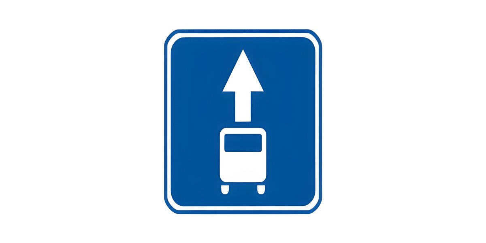

1. Թույլատրվում է
2. Արգելվում է
3. **Թույլատրվում է, եթե այդ գոտին մնացած երթեւեկելի մասից բաժանված չէ գծանշման հոծ գծով** ✅

### 4-2. Այս ճանապարհային նշանը ցույց է տալիս

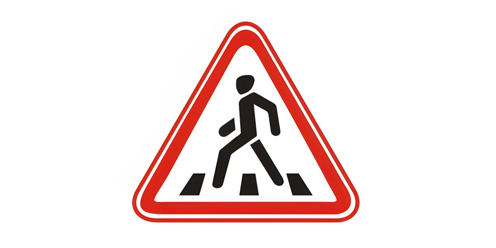

1. Ճանապարհի հատված, որտեղ առկա է մայթ կամ հետիոտնային արահետ։
2. **Ճանապարհի հատված, որտեղ առկա է հետիոտնային անցում։** ✅
3. Ճանապարհի հատված, որտեղ չկա մայթ կամ հետիոտնային արահետ։

### 4-3. Նշաններից ո՞րն է արգելում երթեւեկությունը նշանի վրա պատկերվածից ավելի փոքր միջտարածությամբ։

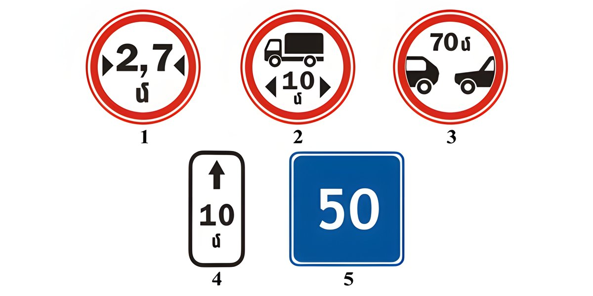

1. 1
2. 2
3. **3** ✅
4. 4
5. 5

### 4-4. Ճանապարհի վտանգավոր հատվածի տեղամասից ի՞նչ հեռավորության վրա են տեղադրվում այս նշանները բնակավայրերում։

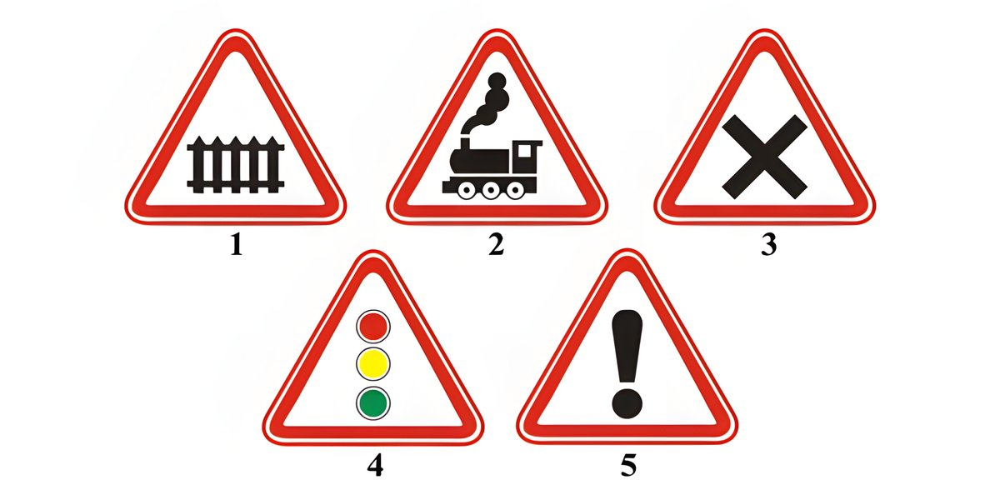

1. 15 - 25 մ
2. 25 - 50 մ
3. **50 - 100 մ** ✅
4. 100 - 150 մ
5. 150 - 300 մ

### 4-5. Այս ճանապարհային նշանը

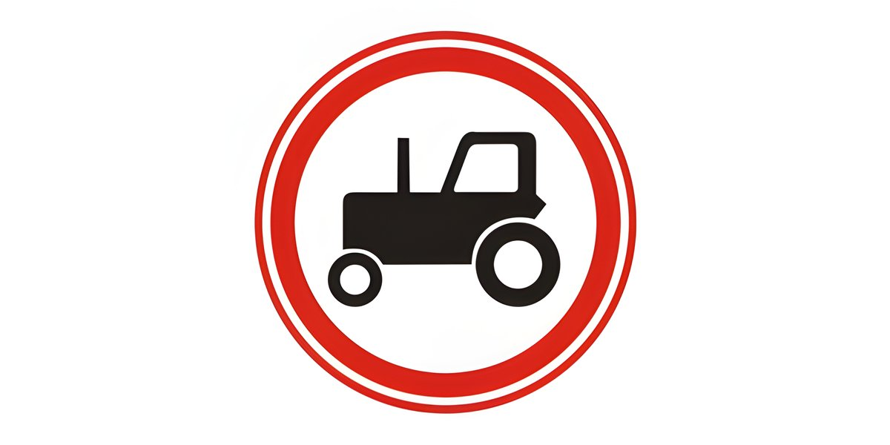

1. Արգելում է բոլոր մեխանիկական տրանսպորտային միջոցների երթեւեկությունը՝ բացառությամբ առանց կողային կցորդի երկանիվ մոտոցիկլների։
2. Արգելում է բոլոր տրանսպորտային միջոցների երթեւեկությունը՝ բացառությամբ անվավոր տրակտորների։
3. **Արգելում է տրակտորների եւ ինքնագնաց մեքենաների երթեւեկությունը։** ✅

### 4-6. Նշաններից ո՞րն է պարտադրում զիջել ճանապարհը հանդիպակաց ուղղությամբ ճանապարհի նեղ հատված մուտք գործող կամ դրան մոտեցող տրանսպորտային միջոցներին։

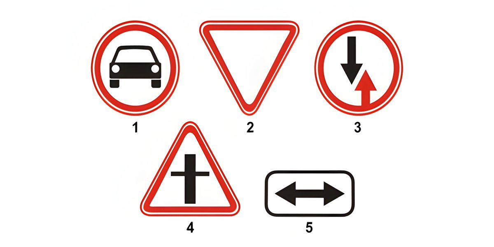

1. 1
2. 2
3. **3** ✅
4. 4
5. 5

### 4-7. Նշաններից ո՞րն է նախազգուշացնում հավասարազոր ճանապարհների խաչմերուկին մոտենալու մասին։

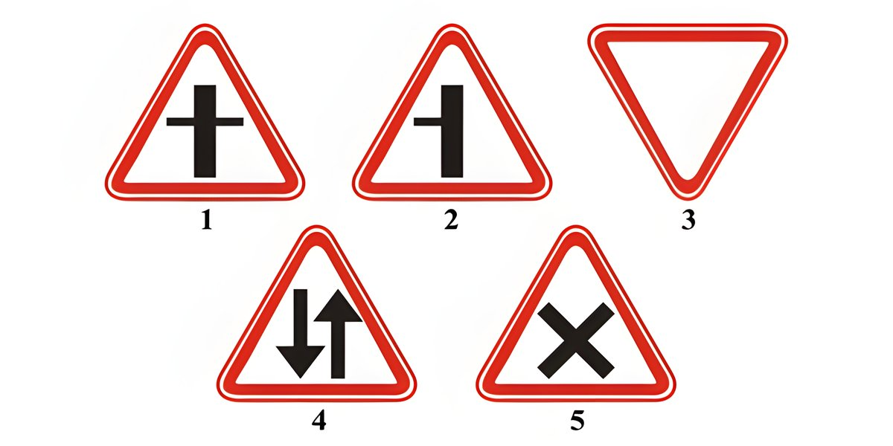

1. 1
2. 2
3. 3
4. 4
5. **5** ✅

### 4-8. Նշաններից ո՞րն է տեղադրվում երթեւեկելի մասերի հատումից անմիջապես առաջ։

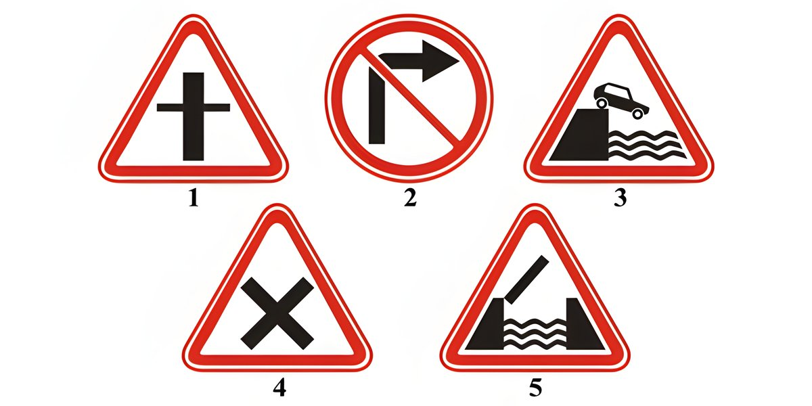

1. 1
2. **2** ✅
3. 3
4. 4
5. 5

### 4-9. Այս նշանները թույլատրում են երթեւեկությունը

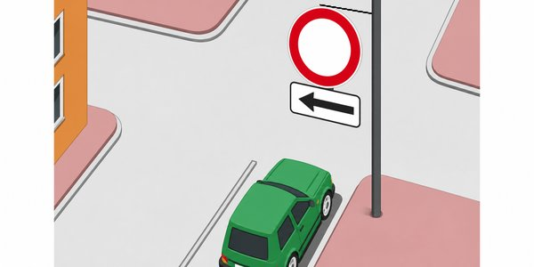

1. Միայն դեպի ձախ։
2. Միայն ուղիղ։
3. Միայն դեպի աջ։
4. **Ուղիղ, դեպի աջ եւ հակառակ ուղղությամբ։** ✅

### 4-10. Նշաններից ո՞րն է վարորդին առավելություն տալիս հանդիպակաց տրանսպորտային միջոցների նկատմամբ։

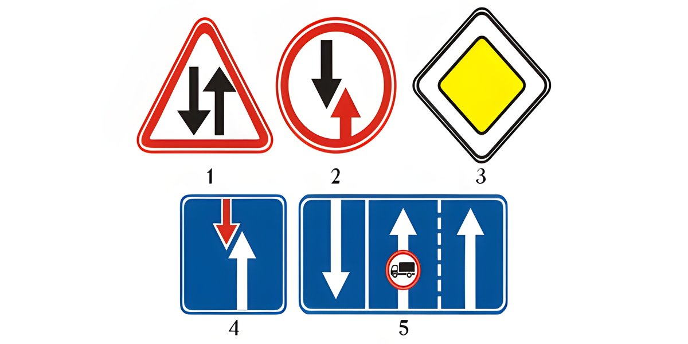

1. 1
2. 2
3. 3
4. **4** ✅
5. 5

### 4-11. Ի՞նչ է ցույց տալիս նշանի տակ տեղադրված ցուցանակը։

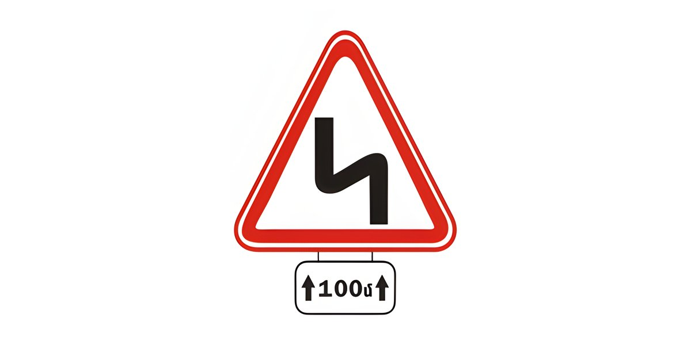

1. Նշանից մինչեւ առաջին շրջադարձի սկիզբը եղած հեռավորությունը
2. Առաջին շրջադարձից մինչեւ երկրորդ շրջադարձի սկիզբը եղած հեռավորությունը
3. **Վտանգավոր շրջադարձերով ճանապարհի հատվածի երկարությունը** ✅

### 4-12. Ի՞նչ է ցույց տալիս հետեւյալ նշանների համադրությունը։

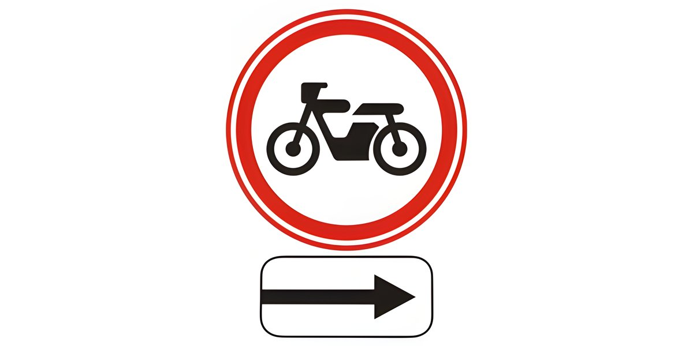

1. **Մոտոցիկլների երթեւեկությունը դեպի աջ արգելվում է։** ✅
2. Մոտոցիկլների երթեւեկությունը դեպի աջ թույլատրվում է։

### 4-13. Նշաններից ո՞րն է արգելում կայանումն ամսվա զույգ օրերին։

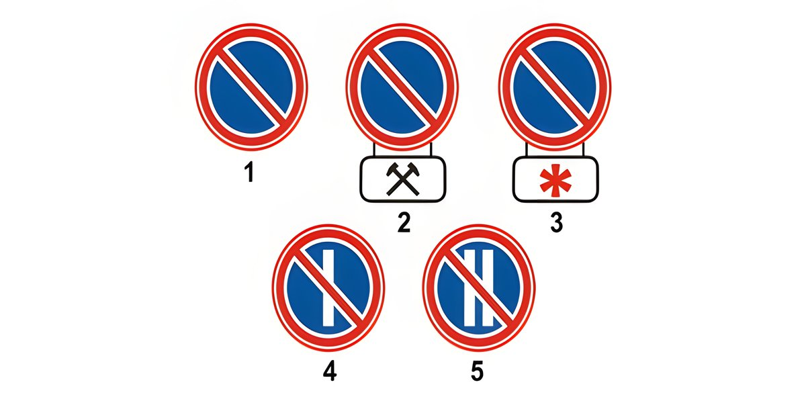

1. 1
2. 2
3. 3
4. 4
5. **5** ✅

### 4-14. Այս ճանապարհային նշանը

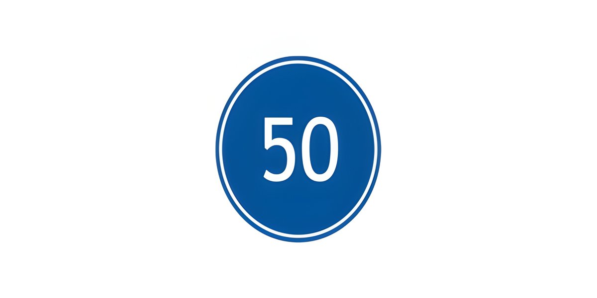

1. **Թույլատրում է երթեւեկել միայն նշված կամ ավելի բարձր արագությամբ։** ✅
2. Արգելում է երթեւեկել նշանի վրա նշվածից ավելի բարձր արագությամբ։
3. Ցույց է տալիս այն արագությունը, որով առաջարկվում է երթեւեկել ճանապարհի տվյալ հատվածում։

### 4-15. Հետեւյալ նշաններից ո՞րն է պարտադրում զիջել ճանապարհը հանդիպակաց երթեւեկող տրանսպորտային միջոցներին։

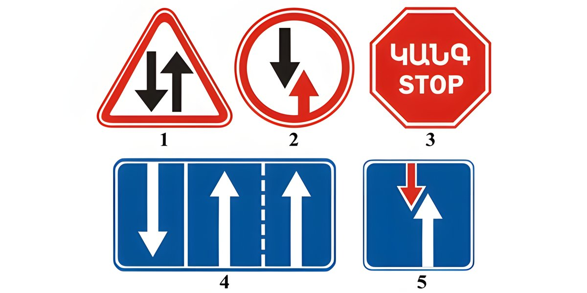

1. 1
2. **2** ✅
3. 3
4. 4
5. 5

### 4-16. Այս նշանը կոչվում է

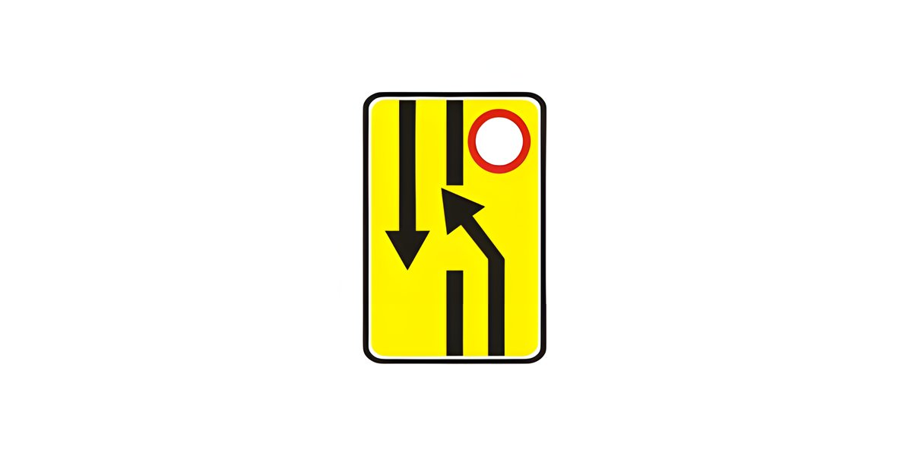

1. Արգելքի շրջանցման նախնական ցուցիչ։
2. **Այլ երթեւեկելի մաս վերադասավորվելու նախնական ցուցիչ։** ✅
3. Հանդիպակաց երթեւեկության գոտի դուրս գալու նախնական ցուցիչ։

### 4-17. Նշաններից ո՞րն է պարտադրում զիջել ճանապարհը հատվող ճանապարհով ընթացող տրանսպորտային միջոցներին։

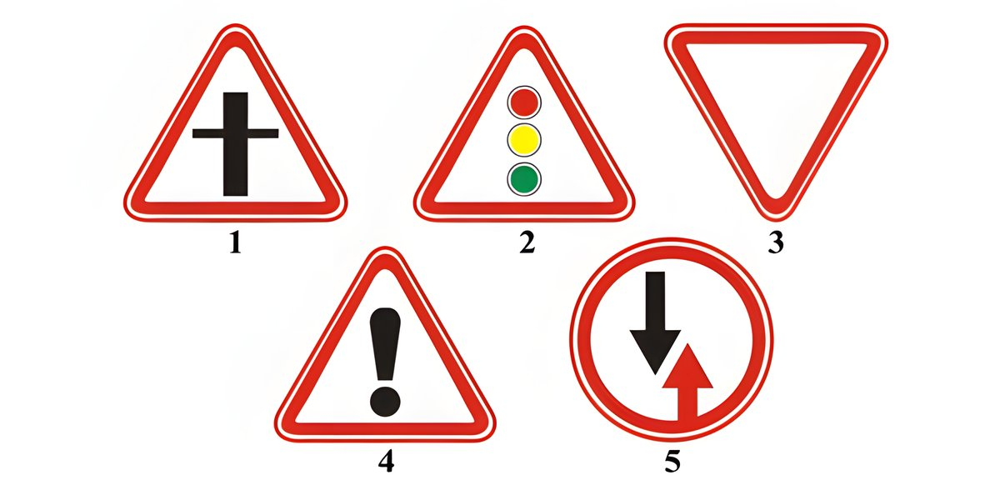

1. 1
2. 2
3. **3** ✅
4. 4
5. 5

### 4-18. Հետեւյալ նշաններից ո՞րն է թույլատրում երթեւեկել միայն նշված կամ ավելի բարձր արագությամբ (կմ/ժ)։

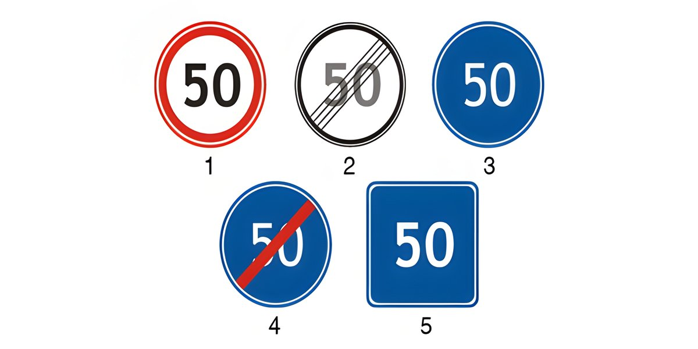

1. 1
2. 2
3. **3** ✅
4. 4
5. 5

### 4-19. Նշաններից ո՞րն է ցույց տալիս միակողմ երթեւեկության ճանապարհի հատվածը։

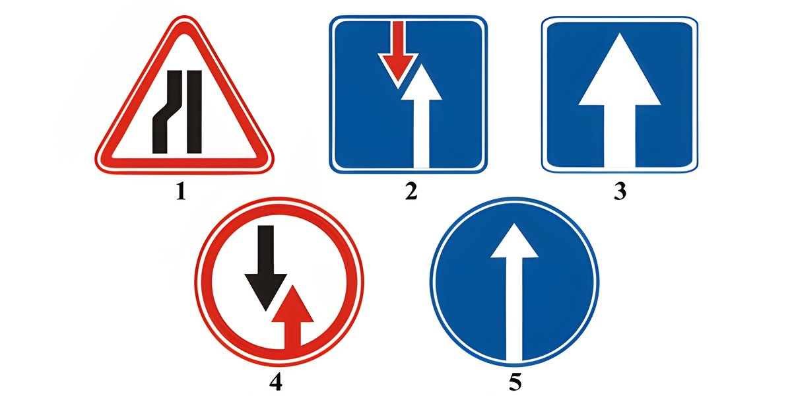

1. 1
2. 2
3. **3** ✅
4. 4
5. 5

### 4-20. Ի՞նչ է ցույց տալիս հիմնական նշանի հետ կիրառվող ցուցանակը

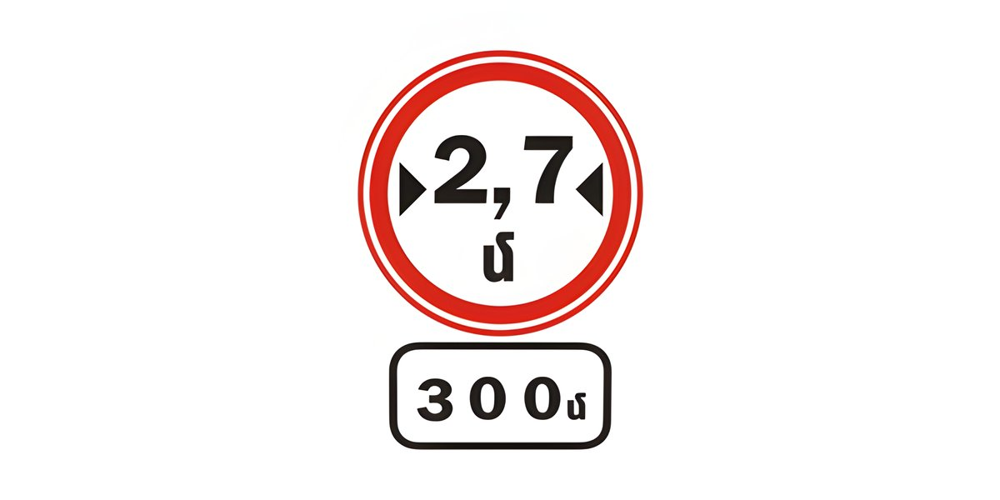

1. Ճանապարհի նեղ հատվածի երկարությունը։
2. **Նշանից մինչեւ սահմանափակման տեղն ընկած հեռավորությունը։** ✅
3. Մինչեւ ճանապարհի նեղ հատվածի շրջանցման տեղն ընկած հեռավորությունը։

### 4-21. Այս ճանապարհային նշանը նախազգուշացնում է, որ առջեւում

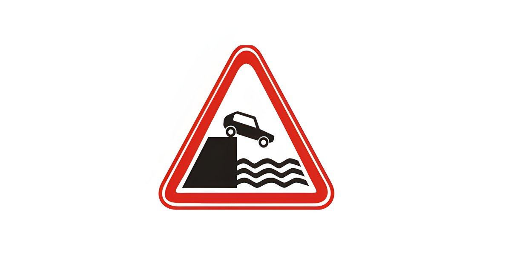

1. Կամուրջ կամ լաստանավային անցում չունեցող ջրային արգելքով ճանապարհահատված է։
2. Ջրային արգելքով ճանապարհահատված է, որի վրա առկա է բացվող կամուրջ։
3. **Տեղամաս է, որտեղ ճանապարհը դուրս է գալիս ափ կամ առափ։** ✅

### 4-22. Նշվածներից ո՞րն է ցույց տալիս տրանսպորտային միջոցների կանգառն ու կայանումն արգելող ճանապարհային նշանների ազդման գոտին։

1. 1
2. 2
3. 3
4. **4** ✅
5. 5

### 4-23. Նշաններից ո՞րն է ցույց տալիս նախազգուշացնող նշանների ազդեցության` ճանապարհի վտանգավոր հատվածի երկարությունը։

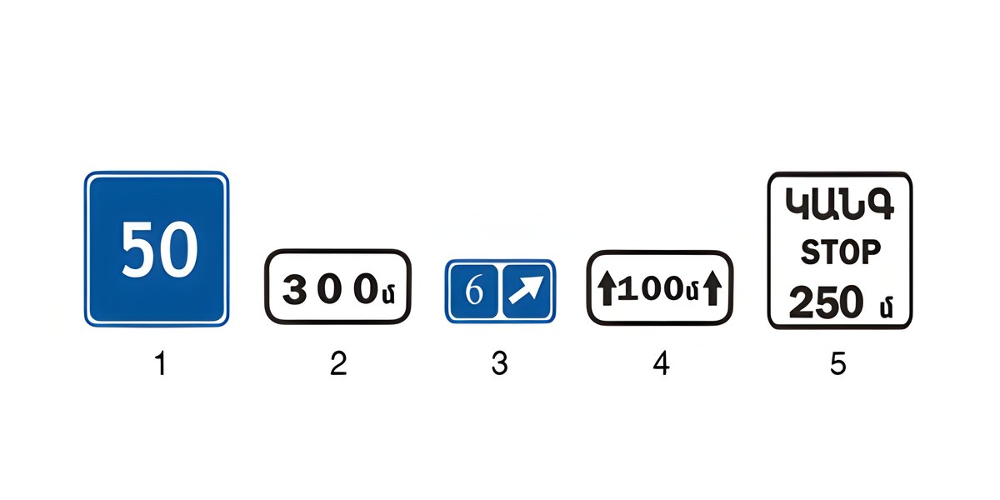

1. 1
2. 2
3. 3
4. **4** ✅
5. 5

### 4-24. Այս ճանապարհային նշանը ցույց է տալիս

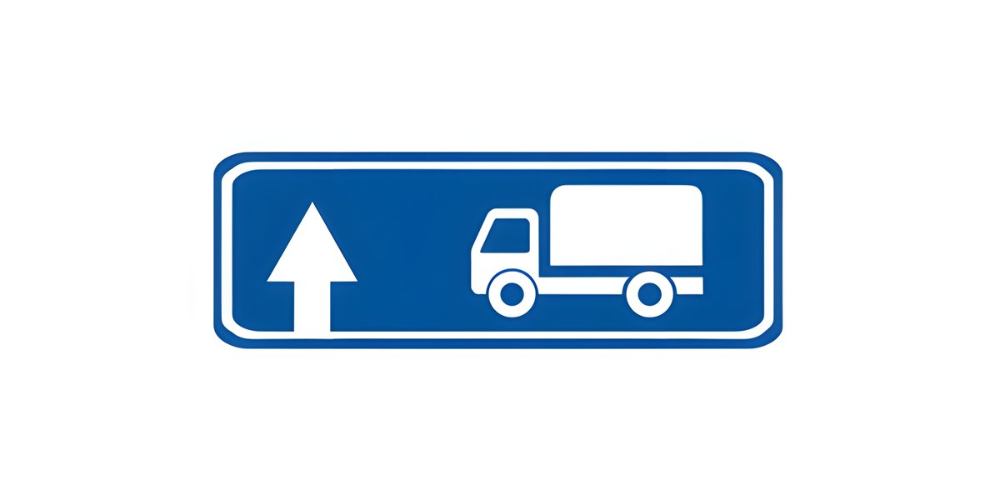

1. Միակողմ երթեւեկությամբ ճանապարհ, որով թույլատրվում է միայն բեռնատար ավտոմոբիլների երթեւեկությունը։
2. Միայն բեռնատար ավտոմոբիլների երթեւեկության համար նախատեսված գոտին։
3. **Բեռնատար ավտոմոբիլների համար առաջարկվող երթեւեկության ուղղությունը։** ✅

### 4-25. Նշաններից ո՞րն է ցույց տալիս «Հյուրանոց» կամ «Մոթել»։

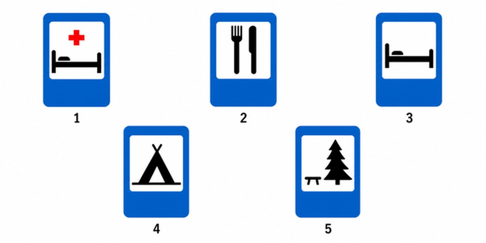

1. 1
2. 2
3. **3** ✅
4. 4
5. 5

### 4-26. Այսպիսի ճանաչման նշանով կահավորվում են այն ավտոմոբիլները, որոնք

1. Փոխադրում են վտանգավոր բեռներ։
2. Ղեկավարվում են հաշմանդամների կողմից։
3. **Ղեկավարվում են խուլ կամ խուլ ու համր վարորդների կողմից։** ✅
4. Ղեկավարվում են մինչեւ 3 տարի վարորդական փորձ ունեցող վարորդների կողմից։

### 4-27. Նշաններից ո՞րն է ցույց տալիս 50 կմ/ժ առավելագույն արագության սահմանափակման գոտու վերջը։

1. 1
2. **2** ✅
3. 3
4. 4
5. 5

### 4-28. Ինչի՞ մասին են զգուշացնում այս նշանը եւ ցուցանակը։

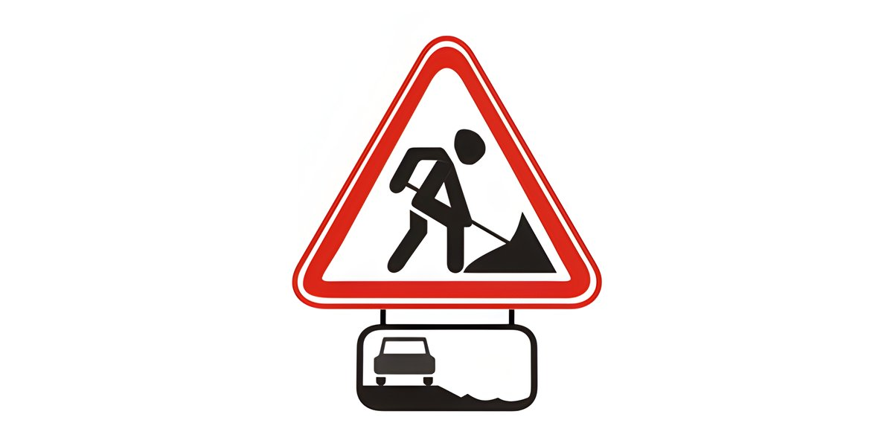

1. Նորոգման աշխատանքների կատարման պատճառով ճանապարհի կողնակին կանգառ կատարելն արգելվում է
2. **Նորոգման աշխատանքների կատարման պատճառով ճանապարհի կողնակ մուտք գործելը վտանգավոր է** ✅
3. Նորոգման աշխատանքների կատարման պատճառով ճանապարհի կողնակին կայանելն արգելում է

### 4-29. Այսպիսի ճանաչման նշանով են կահավորվում այն տրանսպորտային միջոցները, որոնք

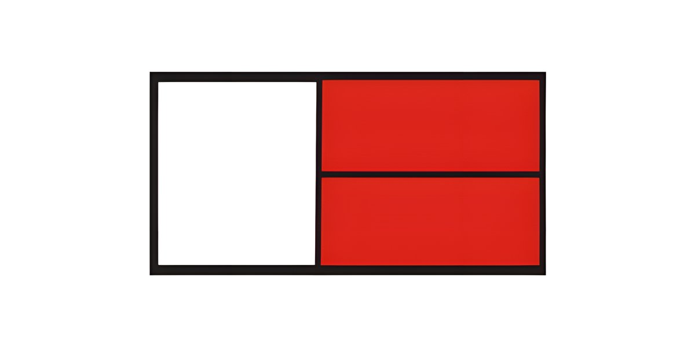

1. Ղեկավարվում են հաշմանդամների կողմից։
2. Փոխադրում են ծանրաքաշ եւ մեծ եզրաչափերով բեռներ։
3. **Փոխադրում են վտանգավոր բեռներ։** ✅
4. Ղեկավարվում են խուլ կամ խուլ ու համր վարորդների կողմից։

### 4-30. Նշաններից ո՞րն է վերացնում նախկին բոլոր սահմանափակումները։

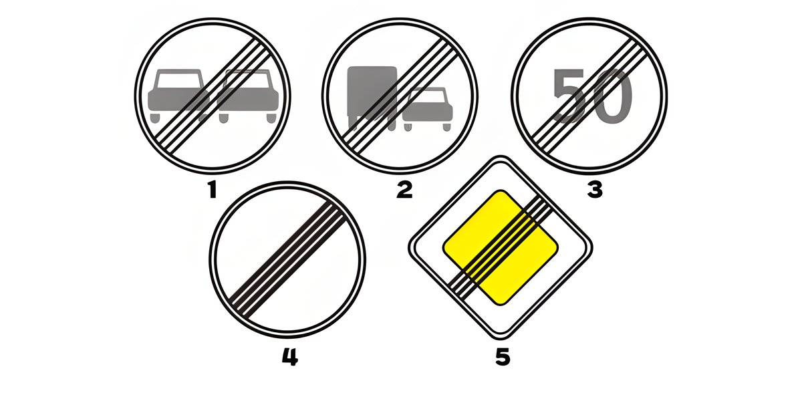

1. 1
2. 2
3. 3
4. **4** ✅
5. 5

### 4-31. Ո՞ր դեպքում է վարորդը ճիշտ կատարել այս նշանի պահանջները։

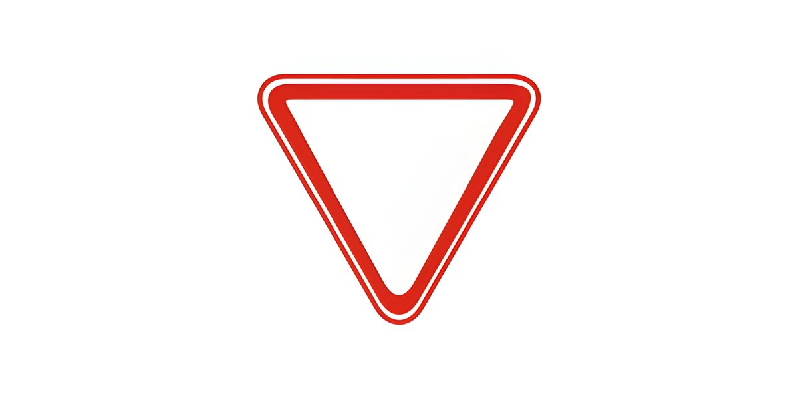

1. Զիջել է ճանապարհը հատվող ճանապարհով ընթացող մեխանիկական տրանսպորտային միջոցներին
2. **Զիջել է ճանապարհը հատվող ճանապարհով ընթացող տրանսպորտային միջոցներին** ✅

### 4-32. Տեղադրվածներից ո՞րն է կիրառվում որպես ավտոգնացքի ճանաչման նշան։

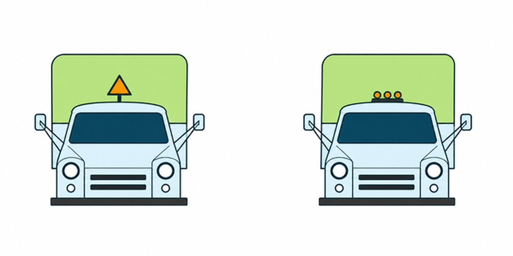

1. Ձախ նշանը
2. **Աջ նշանը** ✅
3. Երկու նշաններն էլ

### 4-33. Ո՞ր նշանն է պարտադրում զիջել ճանապարհը հատվող ճանապարհով երթեւեկող տրանսպորտային միջոցներին։

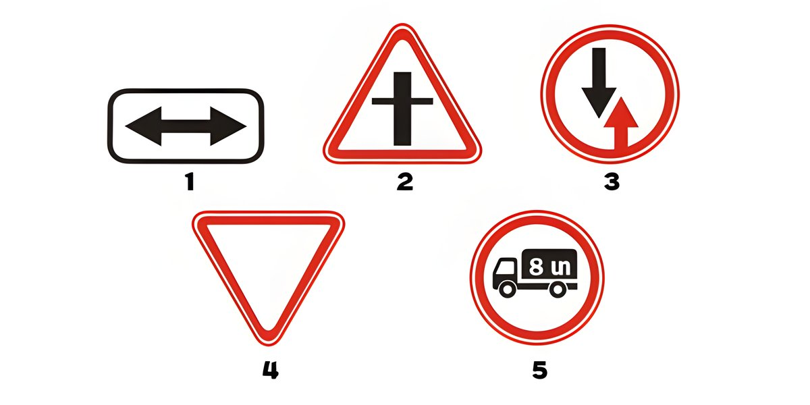

1. 1
2. 2
3. 3
4. **4** ✅
5. 5

### 4-34. Հետեւյալ նշաններից (ցուցանակներից) ո՞րն է ցույց տալիս տրանսպորտային միջոցի կանգնեցման ձեւը կայանման տեղերում։

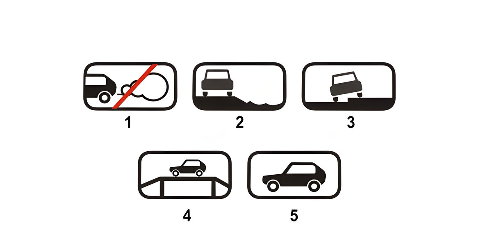

1. 1
2. 2
3. **3** ✅
4. 4
5. 5

### 4-35. Թույլատրվու՞մ է արդյոք ուղեւորներ նստեցնելու համար կանգ առնել այս նշանով նշված գոտու վրա։

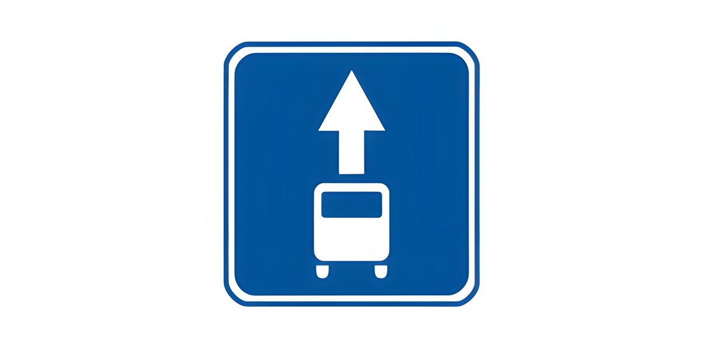

1. **Թույլատրվում է, եթե այդ գոտին գտնվում է երթեւեկելի մասի աջ եզրի մոտ եւ մնացած երթեւեկելի մասից բաժանված չէ գծանշման հոծ գծով** ✅
2. Արգելվում է
3. Թույլատրվում է

### 4-36. Այս ճանապարհային նշանի առկայության դեպքում

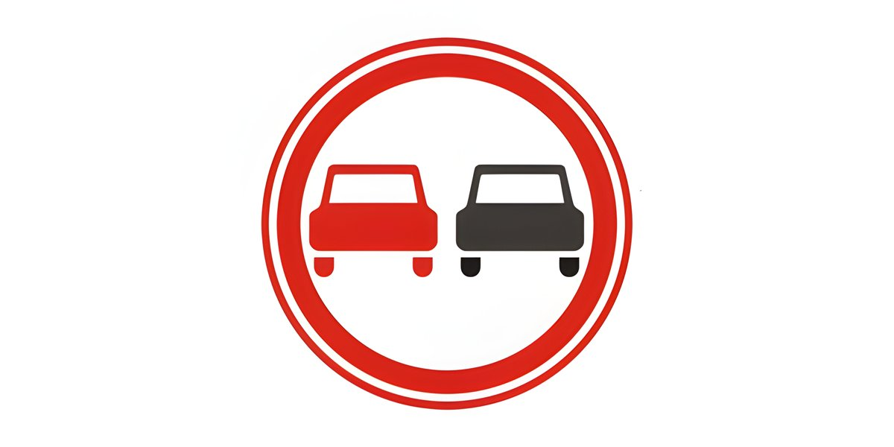

1. **Արգելվում է բոլոր տեսակի տրանսպորտային միջոցներով վազանցի կատարումը՝ բացառությամբ դանդաղընթաց տրանսպորտային միջոցների, լծասայլերի, առանց կողային կցորդի երկանիվ մոտոցիկլների, մոպեդների եւ հեծանիվների։** ✅
2. Թույլատրվում է 3.5 տ ոչ ավելի թույլատրելի առավելագույն զանգված ունեցող բեռնատար ավտոմոբիլներով վազանցի կատարումը։
3. Թույլատրվում է վազանցի կատարումը, եթե վազանցող տրանսպորտային միջոցի արագությունը չի գերազանցում 30 կմ/ժ։

### 4-37. Նշաններից ո՞րն է ցույց տալիս «Հատում հեծանվային արահետի հետ»։

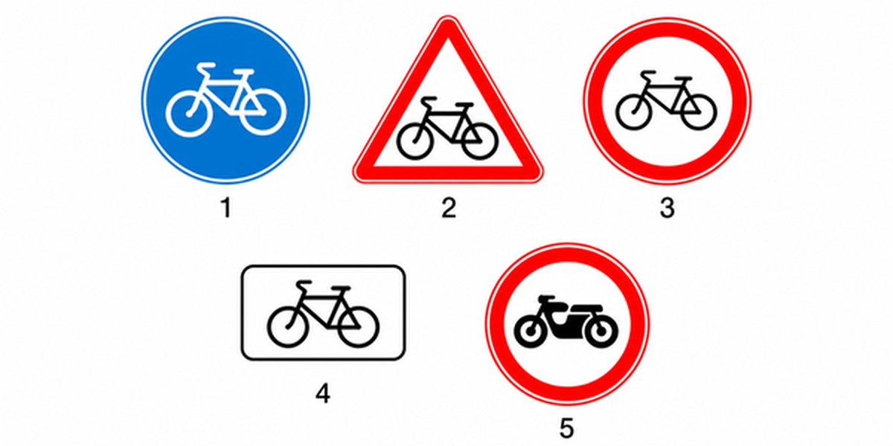

1. 1
2. **2** ✅
3. 3
4. 4
5. 5

### 4-38. Նշաններից ո՞րն է ցույց տալիս վազանցի արգելման գոտու վերջը։

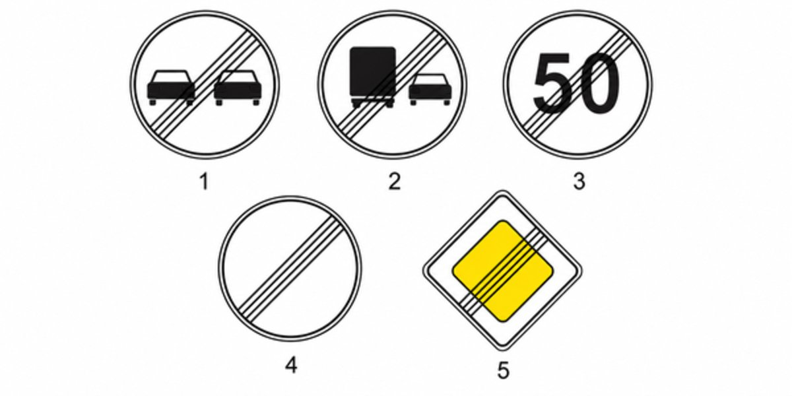

1. **1** ✅
2. 2
3. 3
4. 4
5. 5

### 4-39. Նշաններից ո՞րն է ցույց տալիս երթեւեկության ուղղությունները T-աձեւ խաչմերուկում։

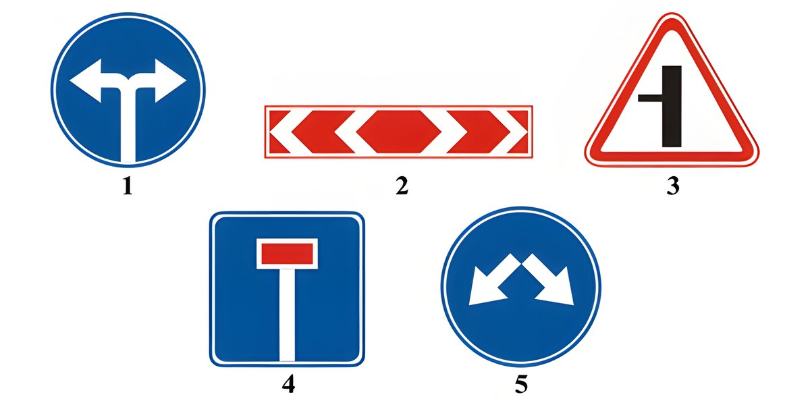

1. 1
2. **2** ✅
3. 3
4. 4
5. 5

### 4-40. Այս ճանապարհային նշանը ցույց է տալիս

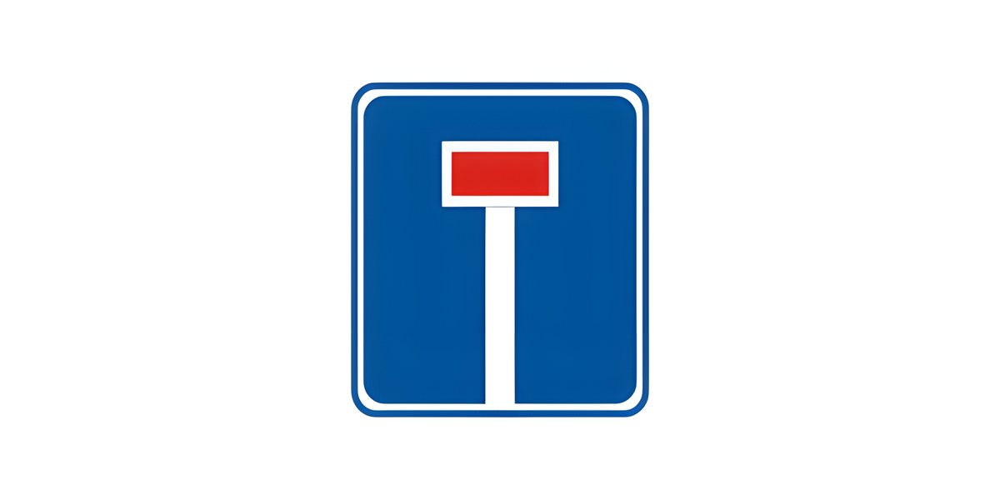

1. **Միջանցիկ անցում չունեցող ճանապարհ։** ✅
2. Երթեւեկության ուղղությունը դեպի օբյեկտ, որը գտնվում է բնակավայրում։
3. Թափառքի գոտու կամ վերելքի վրա լրացուցիչ գոտու վերջը։

### 4-41. Ո՞ր տրանսպորտային միջոցների երթեւեկությունն է թույլատրվում այս նշանի ազդեցության գոտում։

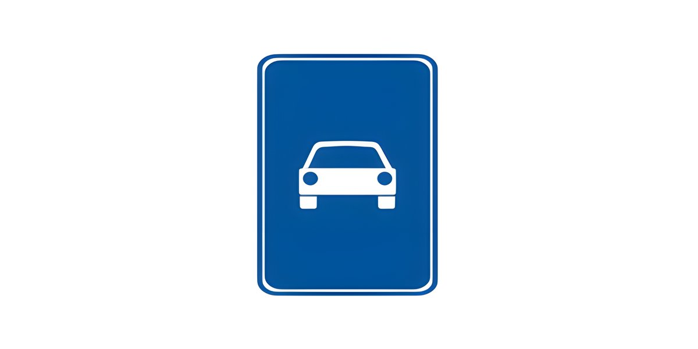

1. Մեխանիկական տրանսպորտային միջոցների
2. Բոլոր տրանսպորտային միջոցների
3. **Ավտոմոբիլների եւ մոտոցիկլների** ✅
4. Այն տրանսպորտային միջոցների, որոնց առավելագույն արագությունը գերազանցում է 40 կմ/ժ

### 4-42. Այս ճանապարհային նշաններից ո՞րը չի համարվում արգելող։

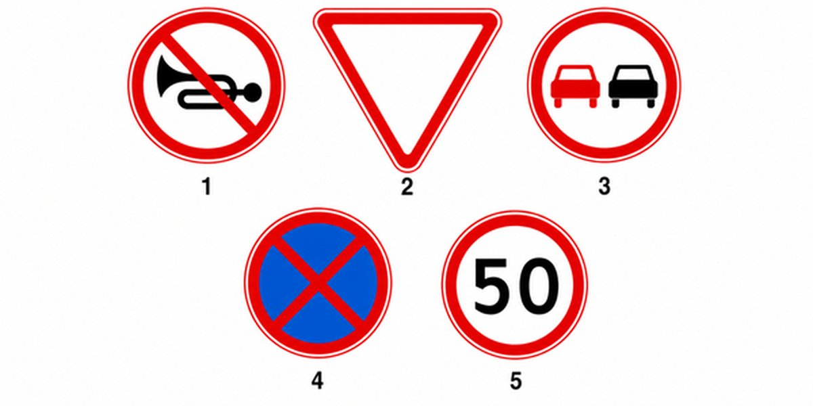

1. 1
2. **2** ✅
3. 3
4. 4
5. 5

### 4-43. Ի՞նչ է նշանակում այս ճանաչման նշանը։

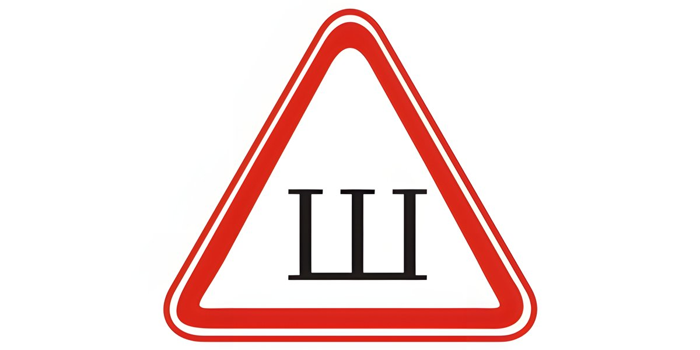

1. Առջեւում երթեւեկելի մասի անհարթություններ ունեցող ճանապարհի հատված է
2. Առջեւում տվյալ ուղղությամբ երթեւեկելու համար երեք գոտի ունեցող ճանապարհի հատված է
3. **Մեխանիկական տրանսպորտային միջոցի վրա տեղադրված են բութակավոր դողեր** ✅

### 4-44. Նշաններից ո՞րն է կոչվում «Միակողմ երթեւեկությամբ ճանապարհի վերջ»։

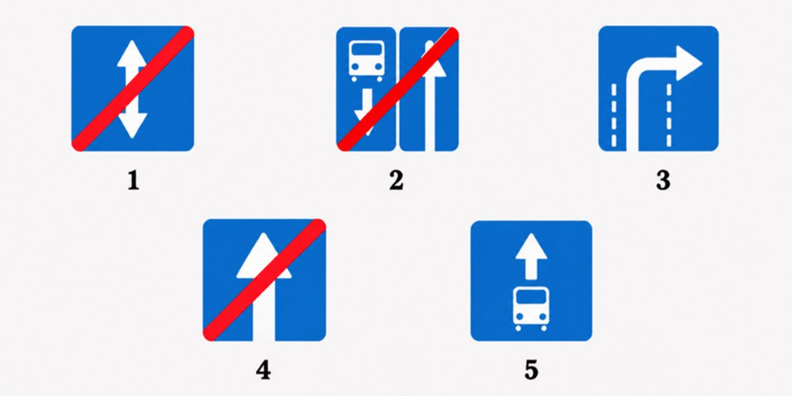

1. 1
2. 2
3. 3
4. **4** ✅
5. 5

### 4-45. Նշաններից ո՞րն է պարտադրում զիջել ճանապարհը հատվող ճանապարհով ընթացող տրանսպորտային միջոցներին։

1. 1
2. **2** ✅
3. 3
4. 4
5. 5

### 4-46. Հետեւյալ նշանները ցույց են տալիս

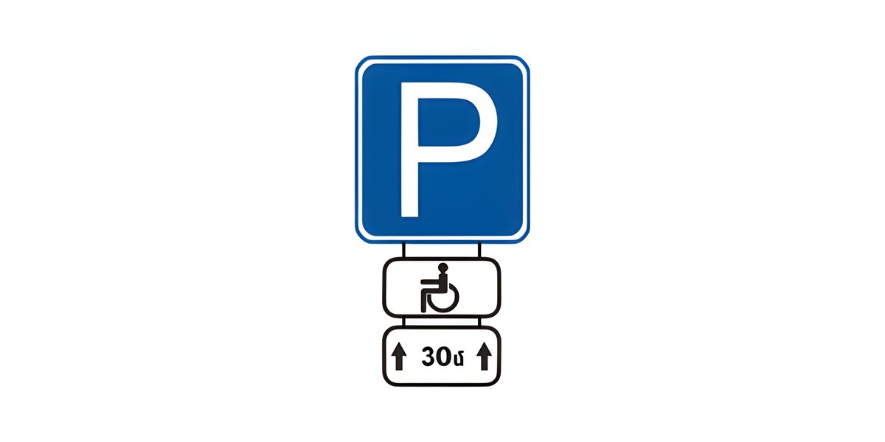

1. Կայանման տեղը 30 մետրից` «Հաշմանդամներ» ճանաչման նշանով կահավորված ավտոմոբիլների համար։
2. Կայանման տեղը 30մ երկարությամբ գոտում` տրանսպորտային միջոցների համար` բացառությամբ մոտոսայլակների։
3. **Կայանման տեղը 30մ երկարությամբ գոտում` մոտոսայլակների եւ «Հաշմանդամ» ճանաչման նշանով կահավորված ավտոմոբիլների համար։** ✅

### 4-47. Այս նշաններից ո՞րն է համարվում տրանսպորտային միջոցի ճանաչման նշան։

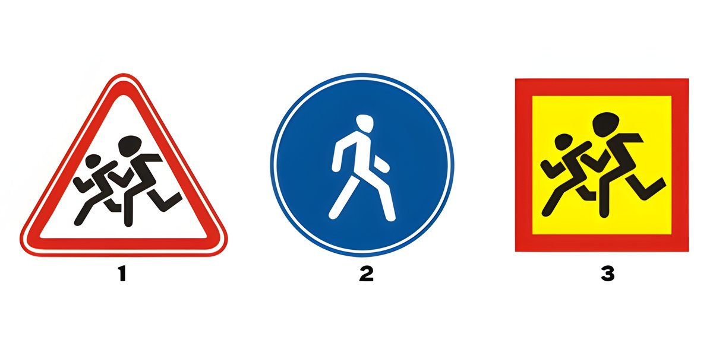

1. 1
2. 2
3. **3** ✅

### 4-48. Ո՞ր տրանսպորտային միջոցի երթեւեկությունն է արգելում այս ճանապարհային նշանը։

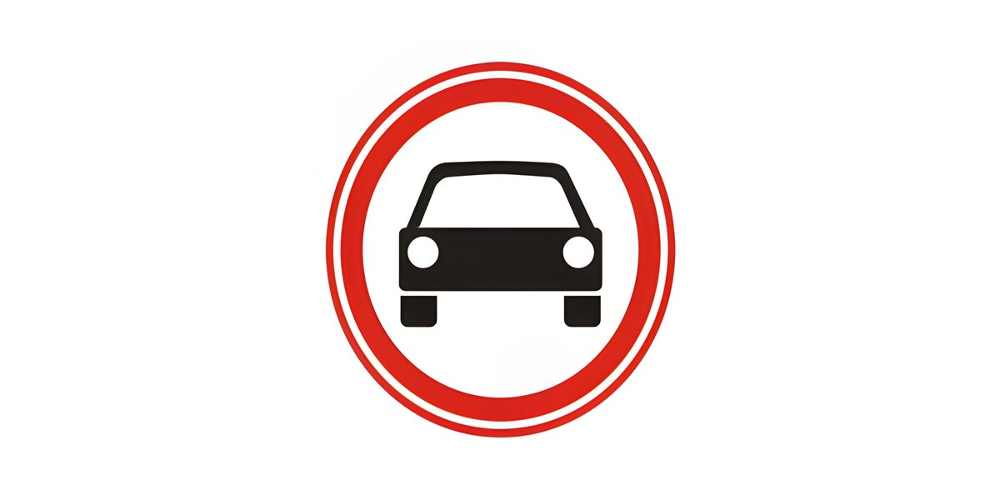

1. **Մեխանիկական տրանսպորտային միջոցների** ✅
2. Միայն ավտոմոբիլների
3. Միայն թեթեւ մարդատար ավտոմոբիլների

### 4-49. Նշաններից ո՞րն է ցույց տալիս արգելքի շրջանցումն աջից կամ ձախից։

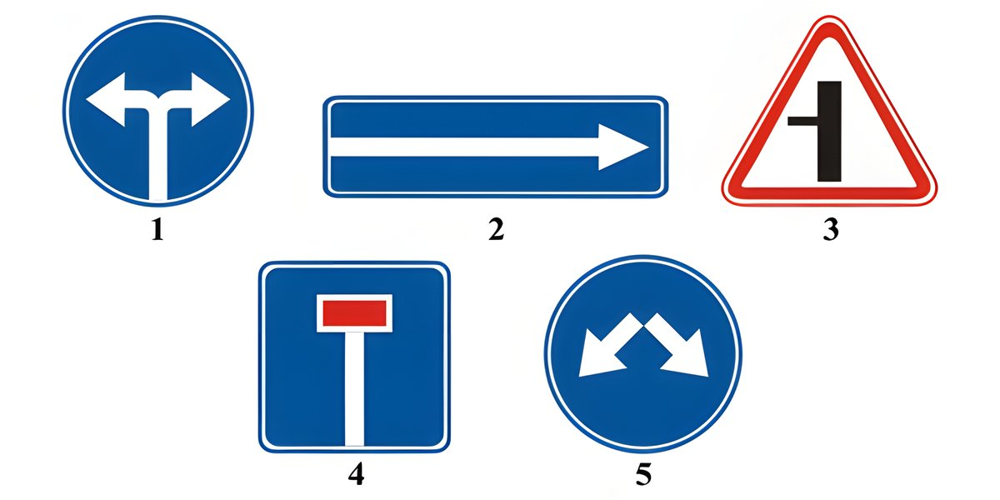

1. 1
2. 2
3. 3
4. 4
5. **5** ✅

### 4-50. Նշաններից ո՞րն է տեղադրվում տրանսպորտային միջոցների առջեւի եւ ետեւի կողմերում` երեխաների կազմակերպված խմբեր տեղափոխելիս։

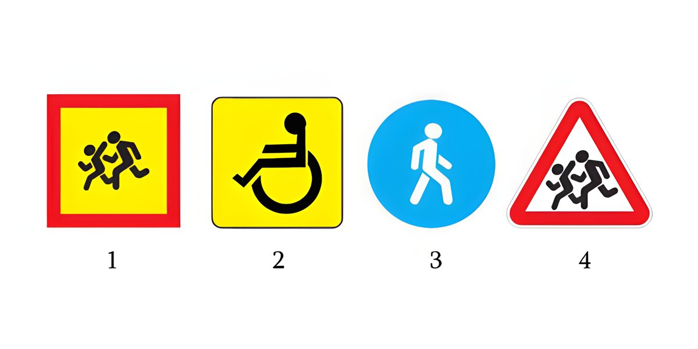

1. **1** ✅
2. 2
3. 3
4. 4

### 4-51. Ի՞նչ են ցույց տալիս նշված ճանապարհային նշանները։

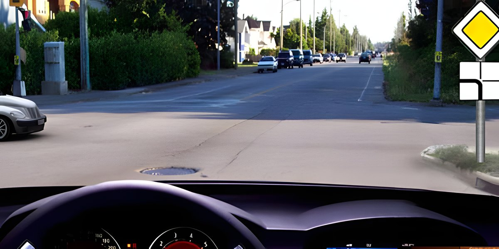

1. **Գլխավոր ճանապարհը շարունակվում է խաչմերուկից դեպի ձախ** ✅
2. Գլխավոր ճանապարհը շարունակվում է խաչմերուկից ուղիղ եւ դեպի ձախ

### 4-52. Ի՞նչ են ցույց տալիս նշված ճանապարհային նշանները։

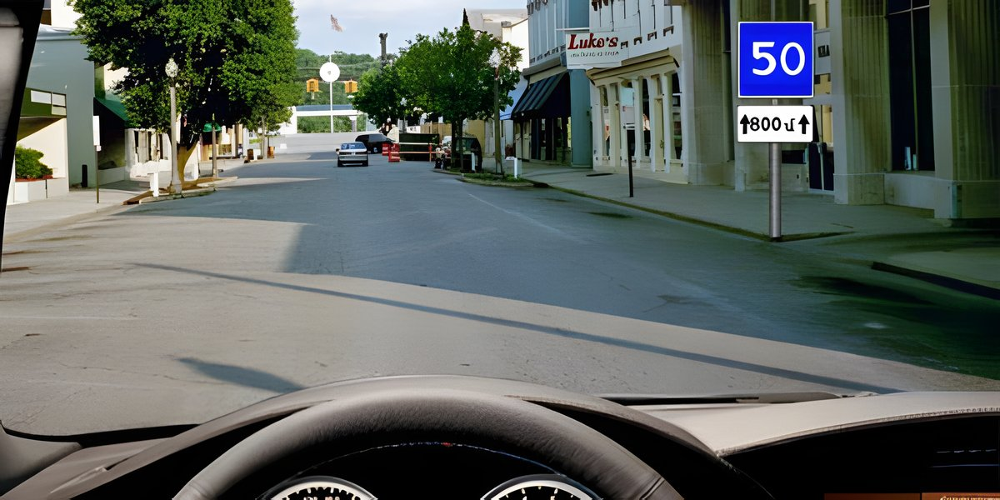

1. Ցուցանակի ազդեցության գոտում վարորդները պետք է երթեւեկեն նշանի վրա ցույց տրվածից ավելի բարձր արագությամբ
2. **Ցուցանակի ազդեցության գոտում վարորդներին առաջարկվում է երթեւեկել նշանի վրա ցույց տրված արագությամբ** ✅

### 4-53. Ո՞ր նշանների ազդեցությունն է գործում միայն այն ժամանակահատվածում, որի ընթացքում երթեւեկելի մասի ծածկույթը խոնավ է։

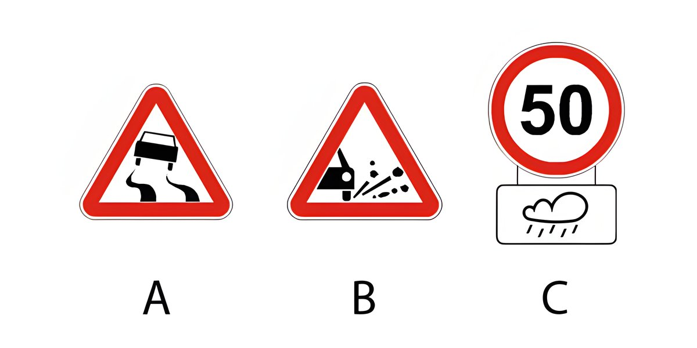

1. Միայն A եւ C
2. Միայն B
3. **Միայն C** ✅
4. Բոլոր

### 4-54. Ինչպե՞ս պետք է վարվի վարորդը տվյալ իրադրությունում։

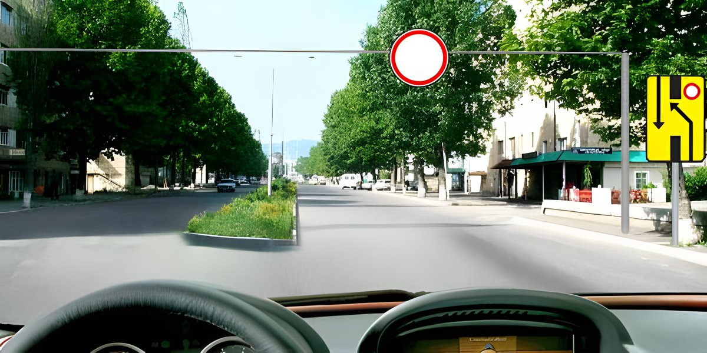

1. Շարունակի երթևեկել ուղիղ
2. **Վերադասավորվի ճանապարհի հանդիպակաց երթեւեկելի մաս** ✅

### 4-55. Ի՞նչ են ցույց տալիս հետևյալ ճանապարհային նշանները։

1. **Նշանից 150-300մ հետո աջ կողմից կա ճանապարհի նեղացում, որի երկարությունը 100մ է** ✅
2. Նշանից 100մ հետո առկա է ճանապարհի նեղացում՝ աջ կողմից

### 4-56. Ո՞ր ուղղությամբ է թույլատրվում վարորդին երթեւեկել։

1. Միայն աջ եւ ձախ
2. Միայն ուղիղ
3. **Ուղիղ եւ հակառակ ուղղությամբ** ✅

### 4-57. Ի՞նչ են ցույց տալիս նշված ճանապարհային նշանները։

1. Կանգառն արգելված է շաբաթ օրերին
2. Կանգառն արգելված է կիրակի օրերին
3. **Կանգառն արգելված է շաբաթ-կիրակի եւ տոն օրերին** ✅
4. Կանգառն արգելված է ձյունաթափի ժամանակ

### 4-58. Ո՞ր ճանապարհային նշանն է արգելում հետադարձը։

1. 1
2. 2
3. **3** ✅

### 4-59. Ի՞նչ են ցույց տալիս տվյալ ճանապարհային նշանները։

1. **Նորոգման աշխատանքների պատճառով կողնակ մուտք գործելը վտանգավոր է** ✅
2. Ճանապարհին իրականացվում են վերանորոգման աշխատանքներ

### 4-60. Ի՞նչպես պիտի վարվի վարորդն այն դեպքում, երբ խաչմերուկից առաջ տեղադրված է հետեւյալ ճանապարհային նշանը։

1. Անցնել խաչմերուկը` անվտանգությունը պահպանելով
2. Ճանապարհը զիջել հատվող ճանապարհով ընթացող տրանսպորտային միջոցներին
3. **Կանգնել նշանի առջեւ եւ ճանապարհը զիջել հատվող ճանապարհով ընթացող տրանսպորտային միջոցներին** ✅

### 4-61. Ո՞ր ճանապարհային նշանների ազդեցությունը չի տարածվում ընդհանուր օգտագործման տրանսպորտային միջոցների վրա։

1. Ոչ մեկը
2. Միայն առաջինը
3. **Միայն չորրորդը** ✅

### 4-62. Հետեւյալ ճանապարհային նշանը ցույց է տալիս

1. Խաչմերուկում պետք է երթեւեկել դեպի ձախ կամ աջ։
2. **Հատվող ճանապարհին կազմակերպված է դարձափոխային երթեւեկություն։** ✅
3. Հատվող ճանապարհին կազմակերպված է միակողմանի երթեւեկություն։

### 4-63. Տվյալ իրադրությունում պարտավո՞ր է վարորդը ճանապարհը զիջել բեռնատար ավտոմոբիլին։

1. **Պարտավոր է** ✅
2. Պարտավոր չէ

### 4-64. Ի՞նչ են ցույց տալիս հետեւյալ ճանապարհային նշանները։

1. Ճանապարհի սառցապատման ժամանակ պետք է երթեւեկել 40կմ/ժ արագությամբ
2. **Թաց ճանապարհածածկույթի դեպքում պետք է երթեւեկել 40կմ/ժ-ից ոչ ավել արագությամբ** ✅

### 4-65. Ի՞նչ են ցույց տալիս հետեւյալ ճանապարհային նշանները։

1. Կանգառն արգելված է շաբաթ օրերին
2. Կանգառն արգելված է կիրակի օրերին
3. **Կանգառն արգելված է աշխատանքային օրերին** ✅

### 4-66. Ի՞նչ են ցույց տալիս հետեւյալ ճանապարհային նշանները։

1. Ճանապարհի տվյալ հատվածում թույլատրվում է երթեւեկել ոչ ավել, քան 50 կմ/ժ արագությամբ
2. **Առաջարկվում է ճանապարհի տվյալ հատվածում երթեւեկել 50 կմ/ժ արագությամբ** ✅
3. Թույլատրվում է երթևեկել միայն նշանում նշված կամ ավելի բարձր արագությամբ

### 4-67. Ո՞ր ճանապարհային նշանն է պարտադրում վարորդին երթեւեկել միայն դեպի ձախ կամ դեպի աջ։

1. 1
2. 2
3. **3** ✅

### 4-68. Ի՞նչ են ցույց տալիս հետեւյալ ճանապարհային նշանները։

1. **Թաց ճանապարհածածկույթի դեպքում առաջարկվում է երթեւեկել 40 կմ/ժ արագությամբ** ✅
2. Թաց ճանապարհածածկույթի դեպքում թույլատրվում է երթեւեկել ոչ ավել, քան 40 կմ/ժ արագությամբ

### 4-69. Տվյալ ճանապարհային նշանների ազդեցությունը տարածվում է

1. Ճանապարհի ձախ կողմում։
2. Ճանապարհի աջ կողմում։
3. **Ճանապարհի այն կողմում, որտեղ դրանք տեղադրված են։** ✅

### 4-70. Տվյալ իրադրությունում ո՞ր հետագծով է թույլատրվում արգելքի շրջանցումը։

1. Միայն «A»
2. Միայն «B»
3. **«A» եւ «B»** ✅

### 4-71. Ինչպե՞ս պետք է վարվի վարորդը տվյալ իրավիճակում։

1. Անհրաժեշտ է կանգ առնել առաջին նշանի մոտ
2. **Անհրաժեշտ է կանգ առնել երկրորդ նշանից առաջ** ✅
3. Անհրաժեշտ է կանգ առնել երկաթուղային առաջին գծից ոչ պակաս, քան 5 մետր հեռավորության վրա

### 4-72. Ի՞նչպես պետք է վարվի վարորդը, եթե խաչմերուկում մտադիր է կատարել աջ շրջադարձ։

1. Կարող է վերադասավորվել աջ երթեւեկելի գոտի, դրանից հետո կատարել աջ շրջադարձ
2. Կարող է մոտենալ խաչմերուկին, այնուհետեւ կատարել աջ շրջադարձ
3. **Երկու պատասխաններն էլ ճիշտ են** ✅

### 4-73. Տվյալ իրադրությունում նշանից 200 մ հեռավորության վրա վարորդն ունի՞ արդյոք հետադարձի իրավունք։

1. **Իրավունք ունի** ✅
2. Իրավունք չունի

### 4-74. Տվյալ դեպքում պարտավո՞ր է վարորդը կանգ առնել կարգավորողի կողմից նշված տեղում։

1. Պարտավոր չէ, քանի որ նշանն արգելում է կանգառը
2. **Պարտավոր է** ✅

### 4-75. Ինչպե՞ս պետք է վարվի վարորդը տվյալ իրավիճակում։

1. Անցնի երկաթուղային գծանցը` ապահովելով անվտանգությունը
2. Անցնի երկաթուղային գծանցը՝ առանց կանգ առնելու
3. **Կանգ առնի նշանից առաջ եւ, պահպանելով անվտանգությունը, անցնի բազմագիծ երկաթուղային գծանցը** ✅

### 4-76. Ի՞նչ է ցույց տալիս երթեւեկելի մասում արված գծանշումը։

1. Համընթաց ուղղությամբ երթեւեկող տրանսպորտային միջոցների համար առանձնացված գոտիների սահմանները
2. **Դարձափոխային երթեւեկության գոտու սահմանները** ✅

### 4-77. Ո՞ ր ուղղությամբ է թույլատրվում թեթեւ մարդատար ավտոմոբիլի երթեւեկությունը։

1. Դեպի ձախ եւ հակառակ ուղղությամբ
2. Ցանկացած ուղղությամբ
3. **Ուղիղ, ձախ եւ հակառակ ուղղությամբ** ✅

### 4-78. Ինչպե՞ս պետք է վարվի վարորդը տվյալ իրադրությունում։

1. Անհրաժեշտության դեպքում ճանապարհը զիջի հատվող ճանապարհով երթեւեկող տրանսպորտային միջոցին
2. **Կանգ առնի եւ ճանապարհը զիջի հատվող ճանապարհով երթեւեկող տրանսպորտային միջոցին** ✅

### 4-79. Ստորև ներկայացվող ճանապարհային նշաններից ո՞րն է արգելում մուտք գործել խաչմերուկի տարածք, եթե առջևում՝ երթևեկության ուղղությամբ, առաջացել է խցանում՝ բացառությամբ աջ կամ ձախ շրջադարձ կատարելու դեպքերի

1. 1
2. 2
3. **3** ✅
4. 4

### 4-80. Ի՞նչ առավելագույն հեռավորության վրա է տեղադրվում բարդ խաչմերուկներում «խաչմերուկի տարածք» ճանապարհային նշանը, եթե այն հնարավոր չէ տեղադրել խաչմերուկի սահմանին:

1. 10մ
2. 20մ
3. **30մ** ✅

### 4-81. Ինչի՞ մասին է զգուշացնում հետևյալ ճանապարհային նշանը:

1. Կանգառն արգելվում է
2. **Արգելվում է մուտք գործել խաչմերուկի տարածք, եթե առջևում՝ երթևեկության ուղղությամբ առաջացել է խցանում, որը վարորդին կհարկադրի կանգ առնել** ✅
3. Արգելվում է մուտք գործել խաչմերուկի տարածք, եթե առջևում՝ երթևեկության ուղղությամբ, առաջացել է խցանում

### 4-82. Ի՞նչ է ցույց տալիս հետևյալ ճանապարհային գծանշումը:

1. Տրանսպորտային միջոցների կայանման վայր:
2. Հետիոտնային անցման տեղ:
3. Անվտանգության կղզյակ:
4. **Խաչմերուկի հատված, որտեղ արգելվում է մուտք գործել, եթե առջևում՝ երթևեկության ուղղությամբ, առաջացել է խցանում, որը վարորդին կհարկադրի կանգ առնել:** ✅

### 4-83. Ստորև ներկայացված ճանապարհային գծանշումներից ո՞րն է ցույց տալիս խաչմերուկի հատվածը, որտեղ արգելվում է մուտք գործել, եթե առջևում՝ երթևեկության ուղղությամբ, առաջացել է խցանում, որը վարորդին կհարկադրի կանգ առնել:

1. 1
2. 2
3. **3** ✅

### 4-84. Հետադարձ կատարել նշված գոտուց

1. Թույլատրվում է։
2. **Արգելվում է։** ✅

### 4-85. Ո՞ր հետագծով է թույլատրվում հետադարձ կատարել։

1. **Միայն A** ✅
2. Միայն B
3. Երկու հետագծերով էլ արգելվում է

### 4-86. Ո՞ր հետագծով է թույլատրվում հետադարձ կատարել

1. Միայն A
2. Միայն B
3. **Ոչ մի** ✅

### 4-87. Ո՞ր տրանսպորտային միջոցի վարորդը կարող է երթևեկությունը շարունակել ուղիղ այս խաչմերուկում։

1. **Ընդհանուր օգտագործման տրանսպորտային միջոցի վարորդը** ✅
2. Մոտոցիկլի վարորդը
3. Հեծանվի վարորդը

### 4-88. Ո՞ր հետագծով է թույլատրվում հետադարձ կատարելը։

1. **Խաչմերուկում՝ A** ✅
2. Մինչև խաչմերուկը՝ B
3. Երկու հետագծերով էլ թույլատրվում է
4. Երկու հետագծերով էլ արգելվում է

### 4-89. Պարտավո՞ր եք արդյոք կանգ առնել «Կանգ-գծի» առջև։

1. Այո
2. **Ոչ** ✅

### 4-90. Երթևեկությունը թույլատրվում է

1. Միայն B ուղղությամբ։
2. **Միայն A կամ B ուղղություններով։** ✅
3. Ցանկացած ուղղությամբ։

### 4-91. Այս ճանապարհային նշանը ցույց է տալիս

1. Հեռավորությունը թունելի վերջից։
2. Հեռավորությունը երեխայավտանգ վայրից։
3. **Վթարային ելքի գտնվելու վայրը և հեռավորությունը դրանից։** ✅

### 4-92. Այս իրավիճակում

1. Պարտավոր ենք զիջել ճանապարհը բեռնատարի վարորդին։
2. **Կարող ենք նեղ հատվածն անցնել առաջինը։** ✅

### 4-93. Այս նշաններից հետո 3.5 տոննայից ոչ ավել թույլատրելի առավելագույն զանգվածով բեռնատարի վարորդին կարող է երթևեկել առավելագույնը

1. 60 կմ/ժ արագությամբ։
2. 70 կմ/ժ արագությամբ։
3. **80 կմ/ժ արագությամբ։** ✅

### 4-94. Ի՞նչն է արգելված այս ճանապարհային նշանով։

1. 20կմ/ժ-ից ավելի երթևեկությունը
2. Մեխանիկական տրանսպորտային միջոցներով երթևեկությունը
3. **Բոլոր տրանսպորտային միջոցներով երթևեկությունը** ✅

### 4-95. Որտե՞ղ է անհրաժեշտ կանգ առնել նշանի պահանջը կատարելու համար։

1. Նշանի առջև (A)
2. Խաչմերուկից առաջ (B)
3. **Երթևեկելի մասերի հատումից առաջ (C)** ✅

### 4-96. Ո՞ր նշանն է արագությունը սահմանափակում։

1. 1 և 3
2. 1 և 4
3. **միայն 2-ը** ✅
4. 2 և 3

### 4-97. Նշաններից ո՞րի ազդեցությունն է տարածվում միայն այն գոտու վրա, որի վերևում այն տեղակայված է։

1. **Միայն A** ✅
2. Միայն B
3. A և B

### 4-98. Կայանել նշված վայրում

1. **Թույլատրվում է։** ✅
2. Թույլատրվում է՝ միայն լուսավոր ժամերին։
3. Արգելվում է։

### 4-99. Խախտե՞լ է արդյոք կայանման կանոնները բեռնատարի վարորդը։

1. **Այո** ✅
2. Այո, եթե թույլատրելի առավելագույն զանգվածը գերազանցում է 3,5 տոննան։
3. Ոչ

### 4-100. Ո՞ր ուղղությամբ է թույլատրված երթևեկությունը։

1. Միայն ուղիղ
2. **Ուղիղ և հակառակ** ✅
3. Բոլոր ուղղություններով

### 4-101. Ո՞ր նշանի ազդեցությունը չի տարածվի ձեզ վրա, եթե բնակվում եք նշանի ազդման գոտում։

1. Միայն A
2. Միայն B
3. **Միայն A և C** ✅
4. Միայն C
5. Բոլոր

### 4-102. Ի՞նչ է ցույց տալիս լրացուցիչ տեղեկատվության ցուցանակը։

1. Նշանից մինչև խաչմերուկ եղած հեռավորությունը, երբ խաչմերուկից անմիջապես առաջ տեղադրված է «Զիջեք ճանապարհը» նշանը։
2. **Նշանից մինչև խաչմերուկ եղած հեռավորությունը, երբ խաչմերուկից անմիջապես առաջ տեղադրված է «Երթևեկությունն առանց կանգառի արգելված է» նշանը։** ✅
3. Սահմանային անցակետի գտնվելու վայրը։

### 4-103. Կանգառ կատարել նշված վայրում

1. **Թույլատրվում է։** ✅
2. Արգելվում է։

### 4-104. Ո՞ր նշանների ազդեցությունն է տարածվում շարժման ուղղությամբ՝ մինչև մոտակա խաչմերուկը։

1. A և C
2. **B և D** ✅
3. C և D

### 4-105. Այս նշաններով ի՞նչ արագության ռեժիմ է սահմանված ճանապարհին։

1. Նվազագույն արագությունը՝ 50 կմ/ժ
2. Առաջարկվող արագությունը՝ 50 կմ/ժ
3. **Համընթաց ձախ գոտիով նվազագույն արագությունը՝ 50կմ/ժ** ✅

### 4-106. Նշաններից, որն է արգելում ձախ շրջադարձ կատարել:

1. Միայն A
2. Միայն A և B
3. **Միայն A և C** ✅
4. Բոլոր

### 4-107. Թույլատրվո՞ւմ է վարորդին կատարել ձախ շրջադարձ։

1. **Այո** ✅
2. Ոչ

### 4-108. Նշանները տեղեկացնում են այն մասին, որ

1. 150մ ճանապարհահատվածում առկա է հետիոտների երթևեկելի մասում հայտնվելու վտանգ։
2. **150մ-ից հետո առկա է չկարգավորվող հետիոտնային անցում։** ✅

### 4-109. Ո՞ր հետագծերով է թույլատրված երթևեկությունը։

1. **Միայն B** ✅
2. A կամ B
3. B կամ C

### 4-110. Նշաններից ո՞րն է արգելում 40կմ/ժ-ից պակաս արագությամբ երթևեկությունը։

1. Միայն A
2. Միայն C
3. **A և B** ✅

### 4-111. Նշաններից ո՞րի դեպքում նեղ հատվածում պետք է զիջել ճանապարհը հանդիպակաց երթևեկողին։

1. Միայն C
2. **A և C** ✅
3. B և C

### 4-112. Ո՞ր ուղղությամբ կարող եք շարունակել երթևեկությունն այս խաչմերուկում, եթե վարում եք 3.5 տոննա թույլատրելի առավելագույն զանգվածով բեռնատար ավտոմեքենա։

1. Միայն ձախ
2. Աջ, ձախ կամ հակառակ
3. **Ցանկացած** ✅

### 4-113. Թո՞ւյլատրվում է աջ շրջադարձ դեպի հողային ծածկույթով ճանապարհը։

1. **Այո** ✅
2. Ոչ

### 4-114. Թույլատրվո՞ւմ է ուղևոր նստեցնելու նպատակով կանգառ կատարել նշված վայրում։

1. **Այո** ✅
2. Ոչ

### 4-115. Ո՞ր նշանով է ցույց տրված հետիոտնային արահետը։

1. **B** ✅
2. B և C
3. Բոլոր

### 4-116. Այս ճանապարհային նշանը

1. Նախազգուշացնում է նեղ հատվածին մոտենալու մասին։
2. Արգելում է անցնել կամրջով։
3. **Պարտադրում է զիջել ճանապարհը հանդիպակաց երթևեկող վարորդին՝ նեղ հատվածներում։** ✅

### 4-117. Ինչպե՞ս կվարվեք, եթե անհրաժեշտ է շարժման ուղղությունը փոխել հակառակի։

1. Հետադարձ կկատարեք այս խաչմերուկում
2. **Խաչմերուկն ուղիղ անցնելուց հետո հետադարձ կկատարեք** ✅
3. Երկու տարբերակներն էլ թույլատրելի են:

### 4-118. Կայանումը նշված վայրում

1. Թույլատրվում է։
2. **Արգելվում է։** ✅

### 4-119. Այս ցուցանակի դեպքում իր հետ օգտագործված նշանի ազդեցությունը տարածվում է

1. Միայն թեթև մարդատարների վրա։
2. **Թեթև մարդատարի, ինչպես նաև մինչև 3.5 տոննա թույլատրելի առավելագույն զանգված ունեցող բեռնատարների վրա։** ✅
3. Թեթև մարդատարների և մոտոցիկլների վրա։

### 4-120. Այս ճանապարհային նշանը ցույց է տալիս, որ

1. Կողնակին կանգնելն արգելվում է։
2. **Կողնակ դուրս գալը վտանգավոր է՝ նորոգման աշխատանքների պատճառով։** ✅
3. Կանգնել թույլատրվում է միայն երթևեկելի մասում։

### 4-121. Նշված գոտուց ո՞ր ուղղություններով է թույլատրվում երթևեկել։

1. Միայն ձախ
2. Ուղիղ և ձախ
3. **Ուղիղ, ձախ և հակառակ** ✅

### 4-122. Այս խաչմերուկում նշվածներից ո՞ր ուղղությամբ (ուղղություններով) կարող եք շարունակել երթևեկությունը։

1. Միայն A
2. B և C
3. **A և B** ✅

### 4-123. Այս ճանապարհային նշանը

1. Առաջարկում է երթևեկել 40կմ/ժ արագությամբ։
2. Թույլատրում է երթևեկել միայն 40կմ/ժ կամ ավելի բարձր արագությամբ։
3. **Արգելում է երթևեկել 40կմ/ժ-ից բարձր արագությամբ։** ✅

### 4-124. Ցուցանակներից որո՞նք են ցույց տալիս իրենց հետ տեղակայված նշանի ազդման գոտին։

1. Միայն A
2. Միայն B
3. **B և C** ✅

### 4-125. Ո՞ր բակ է թույլատրվում մուտք գործել վարորդին։

1. Ձախ
2. **Աջ** ✅
3. Ոչ մի բակ չի կարելի մուտք գործել
4. Երկու բակերն էլ թույլատրվում է

### 4-126. Ո՞ր նշանի ազդեցությունն է տարածվում անմիջապես տեղակայման վայրից։

1. **Միայն A և B** ✅
2. Միայն B
3. Բոլոր

### 4-127. Ո՞ր հետագծով է թույլատրվում շարունակել երթևեկությունը։

1. Միայն A
2. Միայն A կամ C
3. Միայն A կամ D
4. **Ցանկացած՝ բացի B-ից** ✅

### 4-128. Ի՞նչի մասին է նախազգուշացնում ճանապարհային նշանը։

1. Սայթաքուն ճանապարհահատվածին մոտենալու մասին
2. Թաց և կեղտոտ ճանապարհահատվածին մոտենալու մասին
3. **Այն ճանապարհահատվածին մոտենալու մասին, որտեղ հնարավոր է խճի արտանետում անիվներից** ✅

### 4-129. Նշաններից որի՞ ազդման գոտում բնակավայրում երթևեկության կանոնները չեն գործում ։

1. Միայն A
2. **Միայն C** ✅
3. B և C

### 4-130. Թեթև մարդատարի վարորդին ո՞ր ուղղությամբ է թույլատրվում երթևեկել այս իրավիճակում։

1. Միայն ուղիղ
2. Ուղիղ և աջ
3. **Ցանկացած** ✅

### 4-131. Բեռնաթափել ավտոմոբիլը այս ճանապարհային նշանի ազդման գոտում

1. Թույլատրվում է, եթե այն կտևի մինչև 5 րոպե։
2. **Թույլատրվում է՝ անկախ տևողությունից։** ✅
3. Արգելվում է։

### 4-132. Նշաններից ո՞րն է արգելում հետադարձը։

1. Միայն A
2. Միայն A և C
3. **Ոչ մեկը** ✅

### 4-133. Թույլատրվո՞ւմ է նշված բակ մուտք գործել։

1. **Այո** ✅
2. Ոչ

### 4-134. Այս իրադրությունում ուղևոր նստեցնելու նպատակով կանգառ կատարել

1. Թույլատրվում է՝ նշանից հետո։
2. Թույլատրվում է՝ մինչև նշանը։
3. **Երկու դեպքերում էլ արգելվում է։** ✅

### 4-135. Ո՞ր նշաններից հետո է երթևեկությունն արգելվում՝ առանց թույլտվության։

1. Միայն A և D
2. **Միայն B և C** ✅
3. Միայն D և C
4. Բոլոր

### 4-136. Նշանի տեղադրման վայրից ի՞նչ նվազագույն հեռավորության վրա կարող է հանդիպել հավասարազոր խաչմերուկ։

1. 100 մետր
2. 150 մետր
3. **50մետր** ✅

### 4-137. Սլաքներով նշվածներից ո՞ր ուղղությամբ կարելի է շարունակել քարշակումը։

1. **Միայն A** ✅
2. Միայն B
3. Երկու ուղղություններով էլ

### 4-138. Ո՞րտեղից են սկսում գործել բնակավայրում երթևեկության կարգը սահմանող պահանջները։

1. **Սպիտակ հիմնագույնով «Բնակավայրի սկիզբ» նշանից հետո** ✅
2. Միայն բնակավայրի անունը պարունակող սպիտակ կամ կապույտ հիմնագույնով նշաններից հետո
3. Միայն կառուցապատ տարածքն սկսելուց հետո

### 4-139. Այս ճանապարհային նշանը

1. **Նախազգուշացնում է տրամվայի գծերի հետ հատման մասին։** ✅
2. Տրամվայների կանգառի կետին մոտենալու մասին։
3. Պարտադրում է զիջել տրամվայի վարորդին։

### 4-140. Այս նշանները պարտադրում են ձեր և առջևից ընթացող տրանսպորտային միջոցի միջև պահպանել

1. մինչև 70մ հեռավորություն՝ 900մ երկարությամբ ճանապարհահատվածի վրա։
2. **70մ-ից ոչ պակաս հեռավորություն՝ 900մ երկարությամբ ճանապարհահատվածի վրա։** ✅
3. 70մ հեռավորություն՝ 900մ ճանապարհ անցնելուց հետո:

### 4-141. Նշված գոտուց ո՞ր ուղղությամբ կարող եք շարունակել երթևեկությունը։

1. Միայն ուղիղ
2. **Ձախ և ուղիղ** ✅
3. Ձախ, ուղիղ և հետադարձ

### 4-142. Այս նշանները նախազգուշացնում են, որ

1. Առջևում եռագիծ երկաթուղային գծանց է։
2. **150-300մ հեռավորությունից կլինի առանց ուղեփակոցի երկաթուղային գծանց։** ✅
3. 50-100մ հեռավորությունից հետո երկաթուղային գծանց է։

### 4-143. Թույլատրվո՞ւմ է կայանումը նշված վայրում։

1. **Այո** ✅
2. Թույլատրվում է՝ միայն նշված վայրի բնակիչներին
3. Ոչ

### 4-144. Նշաններից ո՞րն է 5 տոննա զանգված ունեցող բեռնատարի վարորդին պարտադրում աջ շրջադարձ կատարել խաչմերուկում։

1. Միայն A
2. **Միայն B** ✅
3. A և B
4. B և C

### 4-145. Ի՞նչ ուղղությամբ կարող եք շարունակել երթևեկությունը նշված խաչմերուկում, եթե վարում եք 3 տոննա թույլատրելի առավելագույն զանգվածով բեռնատար։

1. Միայն ուղիղ
2. Միայն ուղիղ և աջ
3. **Ցանկացած** ✅

### 4-146. Այս իրավիճակում ձայնային ազդանշան կիրառել կարելի է

1. միայն վազանցի մասին զգուշացնելու նպատակով։
2. **միայն ճանապարհատրանսպորտային պատահարը կանխելու նպատակով։** ✅
3. Նշված երկու դեպքերում էլ։

### 4-147. Նշաններից որո՞վ է կահավորվում արհեստական անհարթությունը։

1. **Միայն A** ✅
2. Միայն B
3. B և C

### 4-148. Ո՞ր հետագծով կարող եք շարունակել երթևեկությունը։

1. **Միայն A** ✅
2. Միայն B
3. Նշված երկու հետագծերով էլ

### 4-149. Չկարգավորվող խաչմերուկում ո՞ր նշաններն են առավելություն տալիս վարորդին՝ հատվող ճանապարհով երթևեկողների նկատմամբ։

1. Միայն A
2. **A և C** ✅
3. Բոլոր

### 4-150. Թույլատրվո՞ւմ է վազանց կատարել այս իրավիճակում։

1. **Այո** ✅
2. Այո, եթե մոտոցիկլի արագությունը փոքր է 30կմ/ժ-ից
3. Ոչ

### 4-151. Խախտե՞լ է արդյոք բեռնատարի վարորդը կայանման կանոնները։

1. Ոչ
2. Այո, եթե թույլատրելի առավելագույն զանգվածը մեծ է 3,5 տոննայից
3. **Այո** ✅

### 4-152. Ո՞ր հետագծով է թույլատրված հետադարձ կատարելը։

1. Միայն A
2. **Միայն B** ✅
3. Ցանկացած

### 4-153. Ամսվա կենտ օրերին կարելի է՞ կայանել նշված վայրում։

1. Այո
2. **Այո՝ ժամը 19:00-ից հետո** ✅
3. Ոչ

### 4-154. Ո՞ր նշաններն են ցույց տալիս այն հատվածը, որտեղ վարորդները պետք է զիջեն երթևեկելի մասը հատող հետիոտներին։

1. Միայն A և B
2. **Միայն B և C** ✅
3. Բոլոր

### 4-155. Նշաններից ո՞րն է նախազգուշացնում հանդիպակաց երթևեկությամբ ճանապարհի սկզբին մոտենալու մասին

1. **Միայն A** ✅
2. Միայն A և B
3. Բոլորը

### 4-156. Թույլատրվու՞մ է Ձեզ մուտք գործել այս նշանների ազդման գոտում գտնվող ձեր աշխատավայր։

1. Թույլատրվում է` միայն աշխատանքային օրերին
2. Թույլատրվում է` միայն ոչ աշխատանքային օրերին
3. **Թույլատրվում է` բոլոր օրերին** ✅
4. Արգելվում է

### 4-157. Թույլատրվու՞մ է կցորդ քարշակող թեթև մարդատարին խաչմերուկում երթևեկել ուղիղ։

1. **Այո** ✅
2. Թույլատրվում է՝ միայն նշանի ազդման գոտում բնակվողներին
3. Ոչ

### 4-158. Նշվածներից ո՞ր ուղղությամբ է թույլատրված երթևեկությունը։

1. Միայն B
2. Միայն A և B
3. Միայն B և C
4. **Բոլոր** ✅

### 4-159. Այս նշանը

1. **Ցույց է տալիս խաչմերուկում շարժման ուղղությունները ։** ✅
2. Արգելում է երթևեկությունը խաչմերուկով։

### 4-160. Ո՞ր նշանն է ցույց տալիս հետադարձի համար գոտու երկարությունը։

1. A
2. **B** ✅
3. A և B

### 4-161. Բնակավայրում ի՞նչ հեռավորությունից է սկսվելու սայթաքուն ճանապարհահատվածը։

1. Նվազագույնը 100 մետրից
2. **Նվազագույնը 50 մետրից** ✅
3. Անմիջապես նշանից հետո

### 4-162. Ո՞ր տրանսպորտային միջոցների վրա չի տարածվում կանգառն արգելող նշանի ազդեցությունն այս դեպքում։

1. Թեթև մարդատար տաքսի ավտոմոբիլների
2. **Միայն «Հաշմանդամ» ճանաչման նշանով կահավորված մոտոսայլակների և ավտոմոբիլների վրա** ✅
3. Բոլոր նշվածների

### 4-163. Մյուս խաչմերուկում նշվածներից ո՞ր ուղղությամբ կարող եք շարունակել երթևեկությունը։

1. Միայն B
2. A կամ B
3. **Բոլոր** ✅

### 4-164. Ո՞ր նշանի ազդման գոտում կարող եք երթևեկել 60կմ/ժ արագությամբ։

1. Միայն B
2. **B և C** ✅
3. Ոչ մեկի

### 4-165. Վարորդներից ո՞վ է խախտել կայանման կանոնները։

1. **Ոչ ոք** ✅
2. Բեռնատարի վարորդը
3. Մոտոցիկլի և թեթև մարդատարի վարորդները

### 4-166. Նշվածներից ո՞ր ուղղությունն է թույլատրելի։

1. Միայն C
2. **A կամ C** ✅
3. Բոլորը՝ բացի D

### 4-167. Ո՞ր ցուցանակով կիրառված նշանի ազդեցությունն է տարածվում 3,5 տոննայից թեթև թույլատրելի առավելագույն զանգվածով բեռնատարի վարորդի վրա։

1. Միայն B
2. Միայն C
3. **B և C** ✅
4. Բոլոր

### 4-168. Ո՞ր դեպքում է տեղեկացվում երկու և ավելի ուղիներով երկաթուղային գծանցի մասին։

1. A և C
2. A և B
3. **Միայն C** ✅
4. B և C

### 4-169. Հետադարձը նշված հետագծով

1. Թույլատրվում է։
2. **Արգելվում է։** ✅

### 4-170. Կայանումը ուղեկամուրջից հետո

1. Թույլատրված է։
2. **Արգելված է։** ✅

### 4-171. Այս ճանապարհային նշանները տեղեկացնում են

1. Երկաթուղային գծանցի շինարարության մասին։
2. **Ուղեփակոցով երկաթուղային գծանցին մոտենալու մասին։** ✅
3. Առանց ուղեփակոց երկաթուղային գծանցի մասին։

### 4-172. Ո՞ր նշաններն են թույլատրում հետադարձը։

1. Բոլորը՝ բացի C
2. **Բոլորը** ✅
3. Միայն A

### 4-173. Նշված գոտիով թույլատրվում է երթևեկել

1. Միայն ձախ։
2. Միայն ուղիղ։
3. **Ձախ և հետադարձ։** ✅

### 4-174. Այս նշանը տեղեկացնում է այնպիսի թունելին մոտենալու մասին,

1. որտեղ բացակայում են գծանշումները։
2. **որտեղ բացակայում է արհեստական լուսավորությունը։** ✅

### 4-175. Նշված վայրերից որտե՞ղ է թույլատրվում կանգառ կատարել։

1. Միայն A
2. **Միայն B** ✅
3. Բոլոր տեղերում արգելվում է

### 4-176. Նշաններից ո՞րի դեպքում կարող եք ձախ շրջադարձ կատարել։

1. Միայն B
2. A և B
3. **B և C** ✅

### 4-177. Այս նշանը նախապես տեղեկացնում է

1. Հեծանվորդին զիջելու անհրաժեշտության մասին։
2. **Հեծանվային արահետի հետ հատման մասին։** ✅
3. Հեծանվային հրապարակին մոտենալու մասին:

### 4-178. Ո՞ր տրանսպորտային միջոցների վարորդների վրա է տարածվում նշանների ազդեցությունը։

1. **Թեթև մարդատարների և մոտոցիկլների** ✅
2. Բոլորի
3. Միայն թեթև մարդատարների

### 4-179. Ո՞ր նշանի դեպքում կանգ առնելուց հետո չի կարելի վերսկսել երթևեկությունը՝ առանց թույլտվության:

1. Միայն 2
2. 1 և 5
3. **Միայն 5** ✅
4. Բոլորը
