# Խումբ 5 (136 հարց)

Ճիշտ պատասխանը **թավ** է և նշված ✅-ով։ Աղբյուր՝ roadpolice.am, ABC կարգեր։

### 5-1. Տրանսպորտային միջոցները խաչմերուկը կանցնեն հետեւյալ հերթականությամբ՝

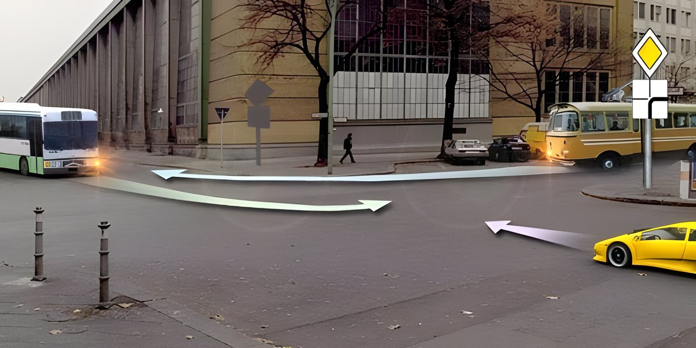

1. Թեթեւ մարդատար ավտոմոբիլը, ավտոբուսը, տրոլեյբուսը։
2. Տրոլեյբուսը եւ ավտոբուսը, թեթեւ մարդատար ավտոմոբիլը։
3. **Տրոլեյբուսը, թեթեւ մարդատար ավտոմոբիլը, ավտոբուսը։** ✅

### 5-2. Խաչմերուկն առաջինը կանցնի

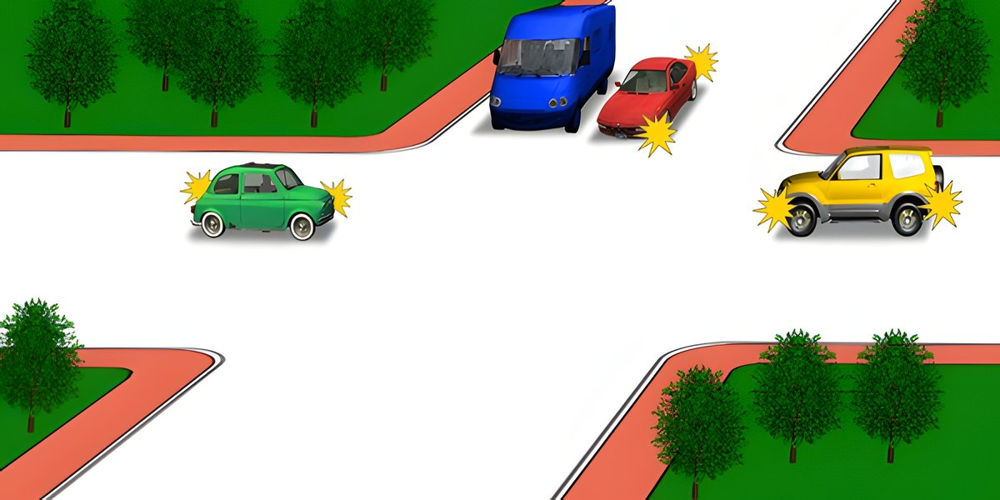

1. Կարմիր ավտոմոբիլը։
2. Կապույտ ավտոմոբիլը։
3. Դեղին ավտոմոբիլը։
4. **Կանաչ ավտոմոբիլը։** ✅

### 5-3. Խաչմերուկը վերջինը կանցնի

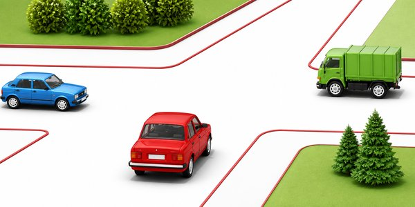

1. **Կապույտ ավտոմոբիլը։** ✅
2. Կանաչ ավտոմոբիլը։
3. Կարմիր ավտոմոբիլը։

### 5-4. Կապույտ ավտոմոբիլը խաչմերուկը կանցնի

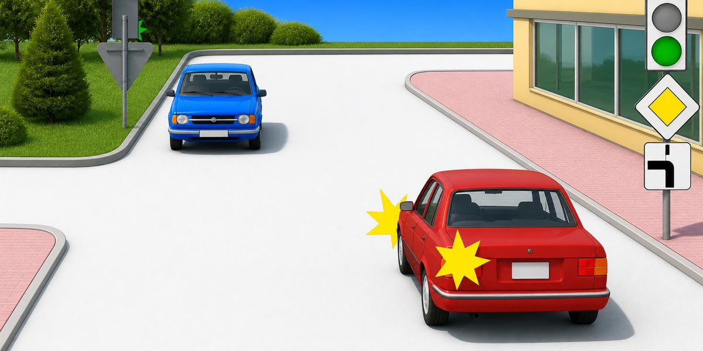

1. **Առաջինը։** ✅
2. Երկրորդը։

### 5-5. Ո՞ր պատասխանում է ճիշտ նշված խաչմերուկն անցնելու հերթականությունը։

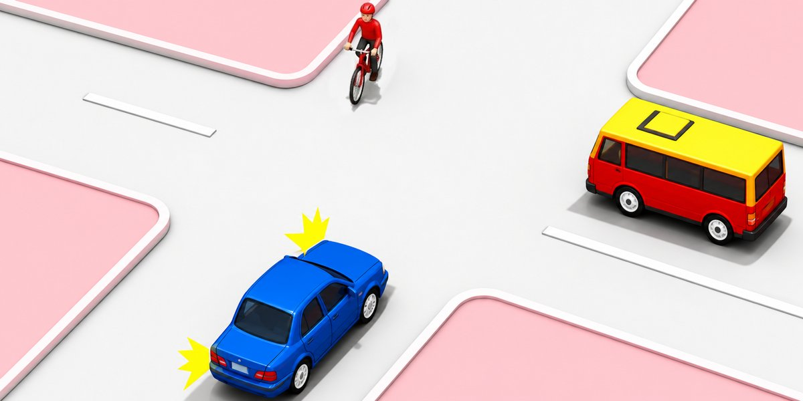

1. Ավտոբուսը, թեթեւ մարդատար ավտոմոբիլը, հեծանիվը
2. Թեթեւ մարդատար ավտոմոբիլը, ավտոբուսը, հեծանիվը
3. **Հեծանիվը, ավտոբուսը, թեթեւ մարդատար ավտոմոբիլը։** ✅

### 5-6. Խաչմերուկը երկրորդը կանցնի

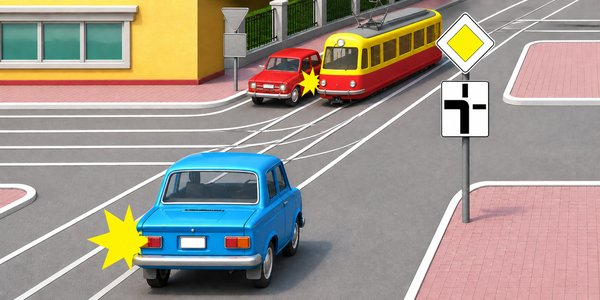

1. **Տրամվայը։** ✅
2. Կարմիր ավտոմոբիլը։
3. Կապույտ ավտոմոբիլը։

### 5-7. Ո՞ր ուղղությամբ է արգելվում երթեւեկությունը։

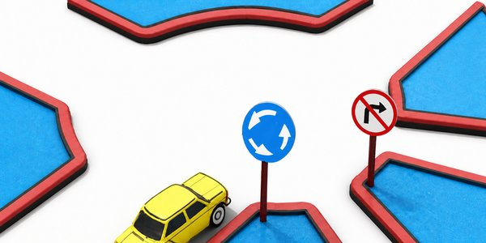

1. Դեպի աջ՝ առաջին անցումով
2. **Դեպի աջ՝ երկրորդ անցումով** ✅
3. Դեպի աջ՝ առաջին եւ երկրորդ անցումներով

### 5-8. Խաչմերուկը երկրորդը կանցնի

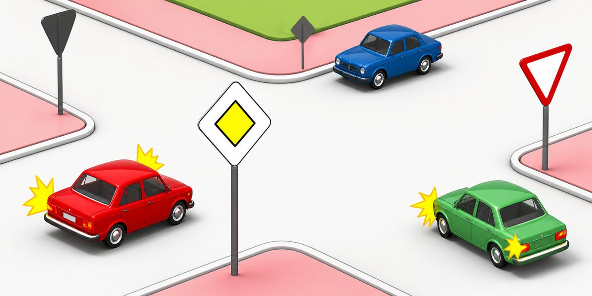

1. Կանաչ ավտոմոբիլը։
2. **Կարմիր ավտոմոբիլը։** ✅
3. Կապույտ ավտոմոբիլը։

### 5-9. Խաչմերուկը երկրորդը կանցնի

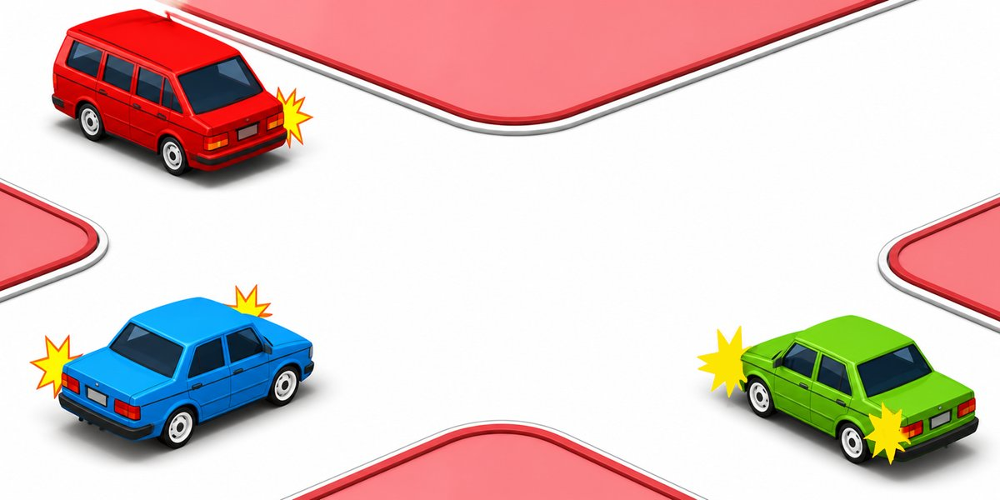

1. **Կապույտ ավտոմոբիլը։** ✅
2. Կանաչ ավտոմոբիլը։
3. Կարմիր ավտոմոբիլը։

### 5-10. Խաչմերուկը երկրորդը կանցնի

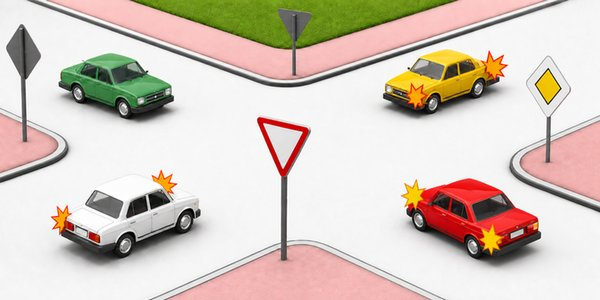

1. Սպիտակ ավտոմոբիլը՝ դեղինի հետ միաժամանակ։
2. **Կարմիր ավտոմոբիլը։** ✅
3. Կանաչ ավտոմոբիլը։

### 5-11. Խաչմերուկը վերջինը կանցնի

1. Կապույտ ավտոմոբիլը։
2. Դեղին ավտոմոբիլը։
3. **Կանաչ ավտոմոբիլը։** ✅
4. Կարմիր ավտոմոբիլը։

### 5-12. Ո՞ր տրանսպորտային միջոցի վարորդը պետք է զիջի ճանապարհը։

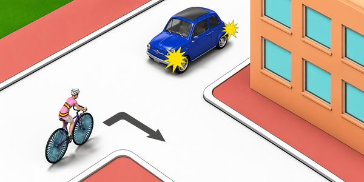

1. Հեծանվորդը
2. **Ավտոմոբիլի վարորդը** ✅

### 5-13. Խաչմերուկն առաջինը կանցնի՝

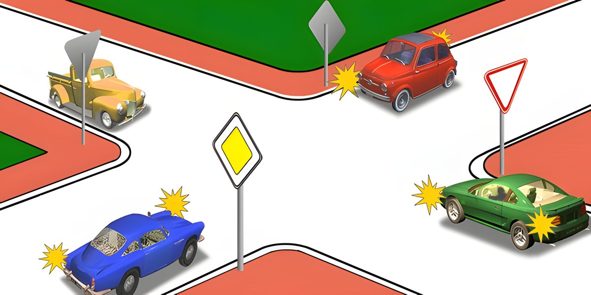

1. Կանաչ ավտոմոբիլը։
2. Կապույտ ավտոմոբիլը։
3. **Կարմիր ավտոմոբիլը։** ✅
4. Դեղին ավտոմոբիլը։

### 5-14. Տրանսպորտային միջոցները ի՞նչ հերթականությամբ կանցնեն խաչմերուկը։

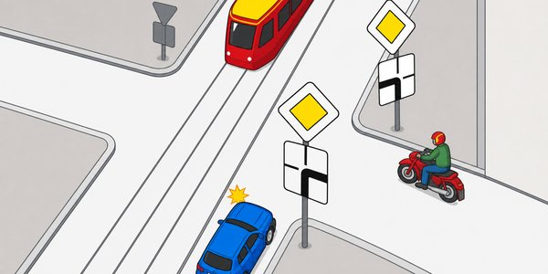

1. **Մոտոցիկլը, ավտոմոբիլը, տրամվայը** ✅
2. Տրամվայը, ավտոմոբիլը, մոտոցիկլը
3. Տրամվայը, մոտոցիկլը, ավտոմոբիլը

### 5-15. Խաչմերուկը երկրորդը կանցնի

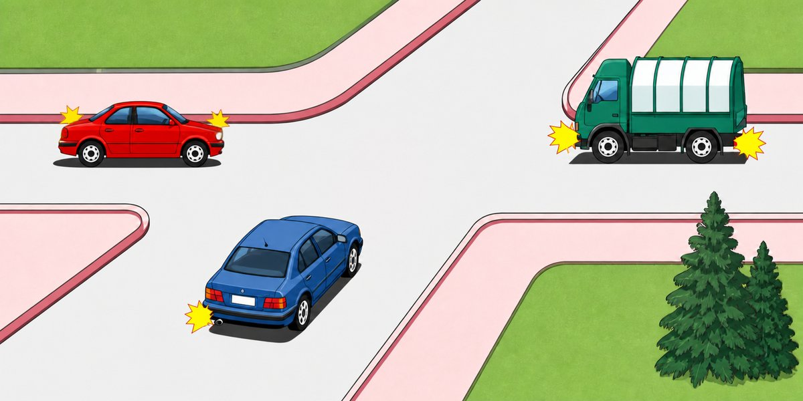

1. Կարմիր ավտոմոբիլը։
2. **Կապույտ ավտոմոբիլը։** ✅
3. Կանաչ ավտոմոբիլը։

### 5-16. Խաչմերուկը վերջինը կանցնի

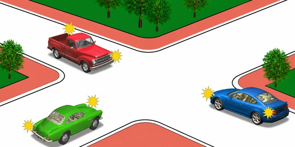

1. Կանաչ ավտոմոբիլը։
2. Կապույտ ավտոմոբիլը։
3. **Կարմիր ավտոմոբիլը։** ✅

### 5-17. Ո՞ր ավտոմոբիլը վերջինը կանցնի խաչմերուկը։

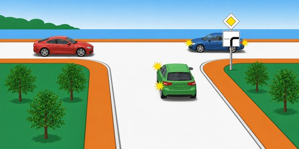

1. Կապույտը
2. **Կարմիրը** ✅
3. Կանաչը

### 5-18. Խաչմերուկն առաջինը կանցնի

1. **Կանաչ ավտոմոբիլը։** ✅
2. Կարմիր ավտոմոբիլը։
3. Կապույտ ավտոմոբիլը։

### 5-19. Ո՞ր տրանսպորտային միջոցի վարորդը պետք է զիջի ճանապարհը։

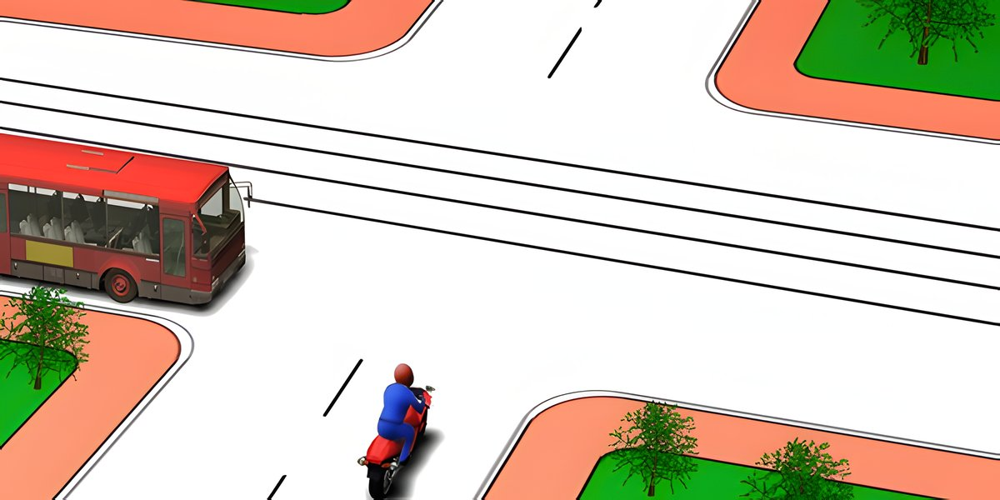

1. **Ավտոբուսի վարորդը** ✅
2. Մոտոցիկլի վարորդը

### 5-20. Խաչմերուկն առաջինը կանցնի

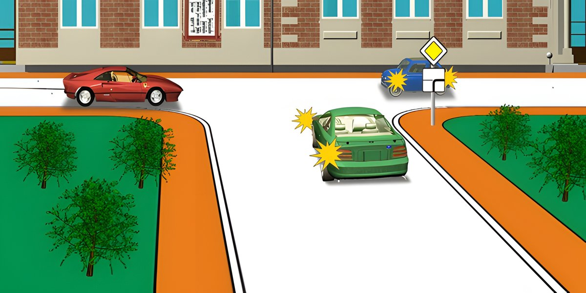

1. Կարմիր ավտոմոբիլը։
2. Կանաչ ավտոմոբիլը։
3. **Կապույտ ավտոմոբիլը։** ✅

### 5-21. Խաչմերուկը երկրորդը կանցնի

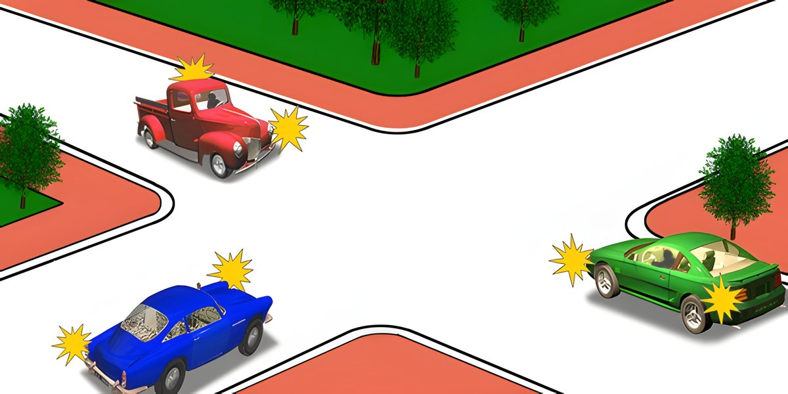

1. **Կապույտ ավտոմոբիլը։** ✅
2. Կանաչ ավտոմոբիլը։
3. Կարմիր ավտոմոբիլը։

### 5-22. Խաչմերուկը երրորդը կանցնի

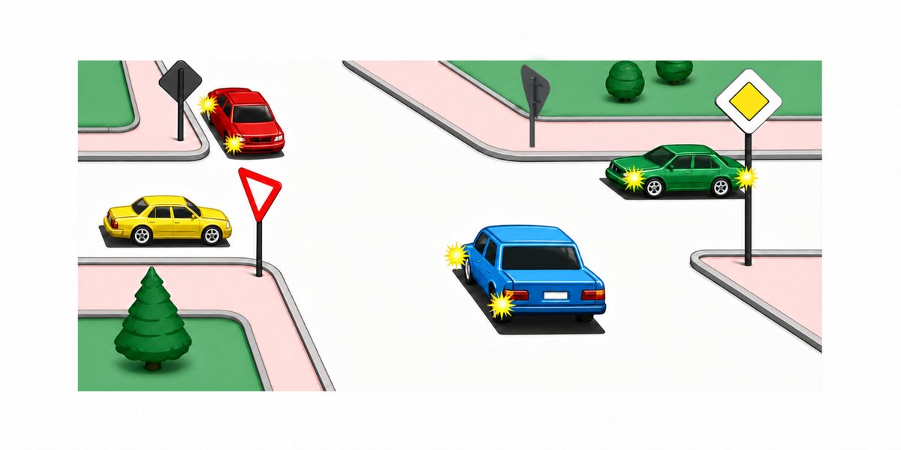

1. Կապույտ ավտոմոբիլը։
2. **Դեղին ավտոմոբիլը։** ✅
3. Կանաչ ավտոմոբիլը։
4. Կարմիր ավտոմոբիլը։

### 5-23. Կարմիր ավտոմոբիլը

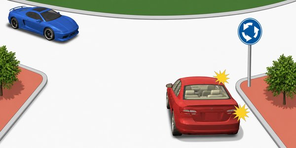

1. Ունի երթեւեկության առավելություն, քանի որ շրջանաձեւ երթեւեկությամբ խաչմերուկին մոտեցել է կապույտ ավտոմոբիլի աջ կողմից։
2. **Պետք է ճանապարհը զիջի շրջանաձեւ երթեւեկությամբ ընթացող կապույտ ավտոմոբիլին։** ✅

### 5-24. Ավտոմոբիլները խաչմերուկը կանցնեն հետեւյալ հերթականությամբ՝

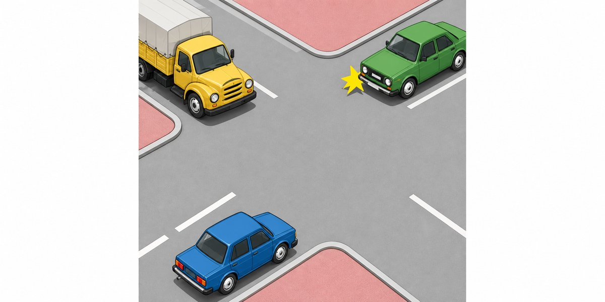

1. Դեղինը, կանաչը, կապույտը։
2. **Կապույտը՝ կանաչի հետ միաժամանակ, դեղինը։** ✅

### 5-25. Խաչմերուկը երրորդը կանցնի

1. Դեղին ավտոմոբիլը։
2. Կարմիր ավտոմբիլը։
3. **Կապույտ ավտոմոբիլը։** ✅
4. Կանաչ ավտոմոբիլը։

### 5-26. Խաչմերուկն առաջինը կանցնի

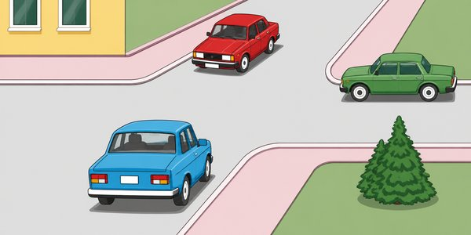

1. Կանաչ ավտոմոբիլը։
2. Կապույտ ավտոմոբիլը։
3. **Կարմիր ավտոմոբիլը։** ✅

### 5-27. Տրանսպորտային միջոցները խաչմերուկը կանցնեն հետեւյալ հերթականությամբ՝

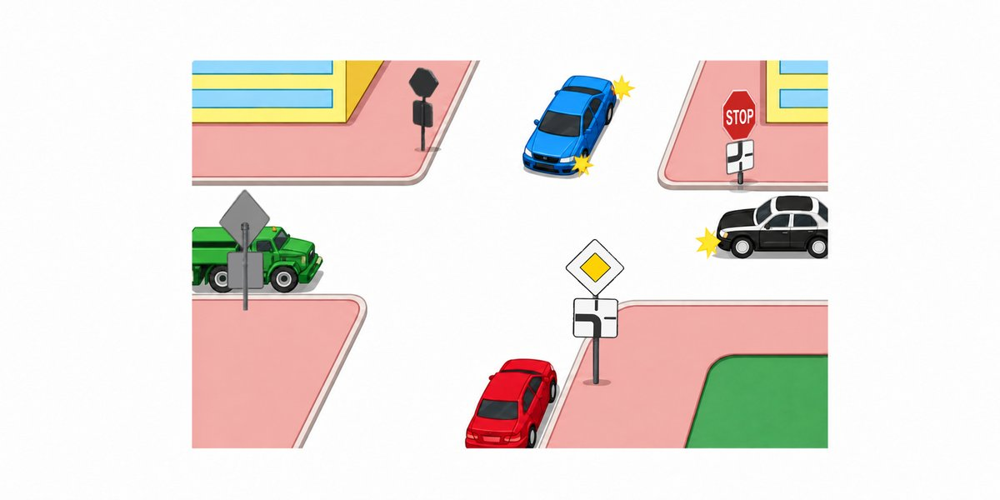

1. **Կարմիրը, կանաչը, կապույտը, սեւը։** ✅
2. Կանաչը, կարմիրը, սեւը, կապույտը։
3. Կանաչը, կարմիրը, կապույտը, սեւը։

### 5-28. Տրանսպորտային միջոցները խաչմերուկը կանցնեն հետեւյալ հերթականությամբ՝

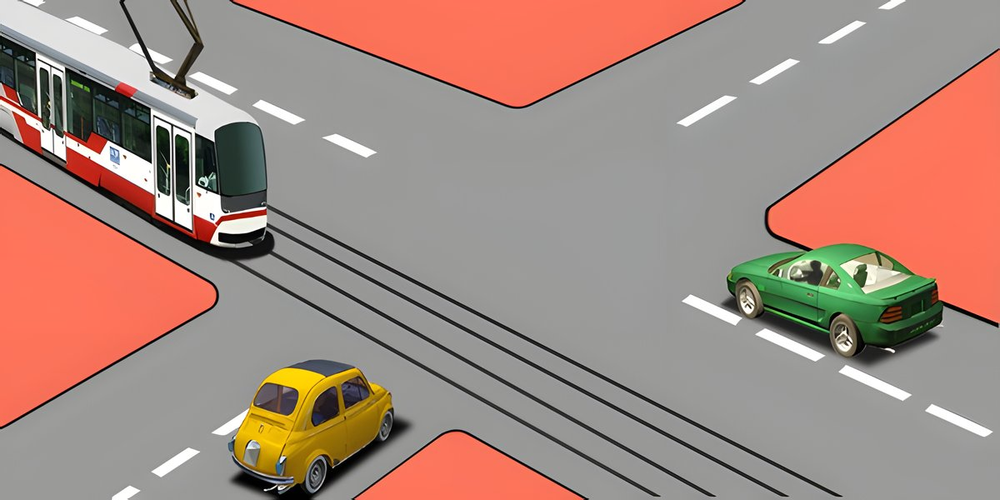

1. Տրամվայը, դեղին ավտոմոբիլը, կանաչ ավտոմոբիլը։
2. **Տրամվայը եւ կանաչ ավտոմոբիլը, դեղին ավտոմոբիլը։** ✅
3. Կանաչ ավտոմոբիլը, դեղին ավտոմոբիլը, տրամվայը։

### 5-29. Վարորդներից ո՞վ ունի առաջնահերթ երթեւեկության իրավունք։

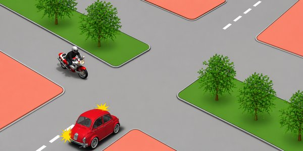

1. Մոտոցիկլի վարորդը
2. **Ավտոմոբիլի վարորդը** ✅

### 5-30. Խաչմերուկը երկրորդը կանցնի

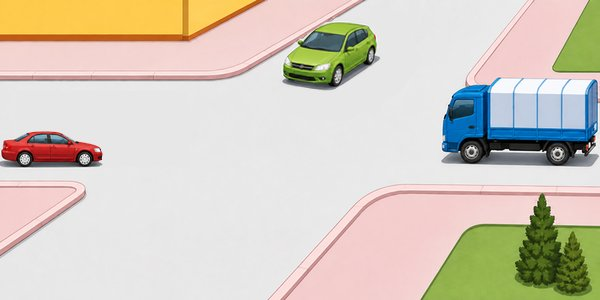

1. Կարմիր ավտոմոբիլը։
2. Կապույտ ավտոմոբիլը։
3. **Կանաչ ավտոմոբիլը։** ✅

### 5-31. Ո՞ր տրանսպորտային միջոցի վարորդը պետք է զիջի ճանապարհը։

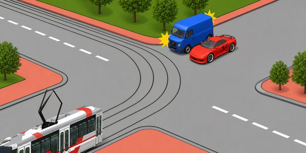

1. Տրամվայի վարորդը
2. Բեռնատար ավտոմոբիլի վարորդը
3. **Ավտոմոբիլների վարորդները** ✅

### 5-32. Կարմիր ավտոմոբիլը խաչմերուկը կանցնի

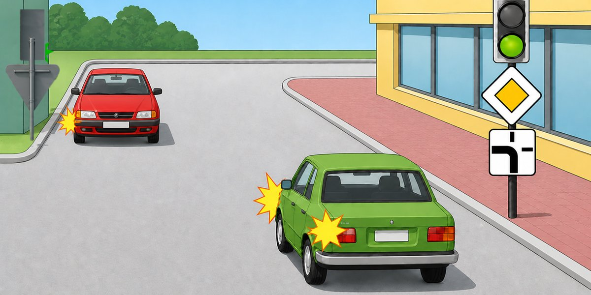

1. **Առաջինը։** ✅
2. Երկրորդը։

### 5-33. Տրանսպորտային միջոցները խաչմերուկը կանցնեն հետեւյալ հերթականությամբ՝

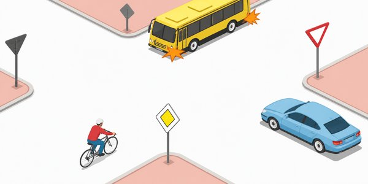

1. Թեթեւ մարդատար ավտոմոբիլը, ավտոբուսը, հեծանիվը։
2. Ավտոբուսը, հեծանիվը, թեթեւ մարդատար ավտոմոբիլը։
3. Ավտոբուսը, թեթեւ մարդատար ավտոմոբիլը, հեծանիվը։
4. **Հեծանիվը, ավտոբուսը, թեթեւ մարդատար ավտոմոբիլը։** ✅

### 5-34. Ո՞ր տրանսպորտային միջոցի վարորդն ունի առաջնահերթ երթեւեկության իրավունք։

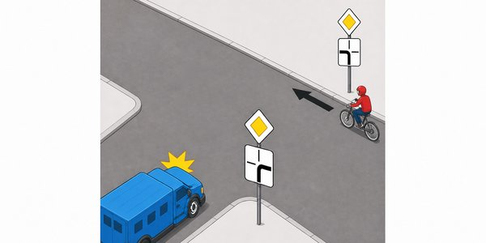

1. Ավտոմոբիլի վարորդը
2. **Հեծանվորդը** ✅

### 5-35. Տրանսպորտային միջոցները խաչմերուկը կանցնեն հետեւյալ հերթականությամբ

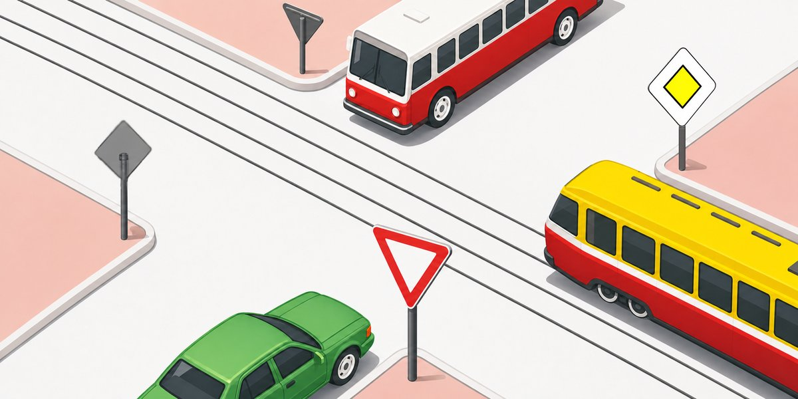

1. **Տրամվայը, ավտոմոբիլն ու ավտոբուսը միաժամանակ։** ✅
2. Տրամվայը, ավտոբուսը, ավտոմոբիլը։
3. Ավտոբուսը, տրամվայը, ավտոմոբիլը։

### 5-36. Ո՞ր տրանսպորտային միջոցի վարորդը պետք է զիջի ճանապարհը։

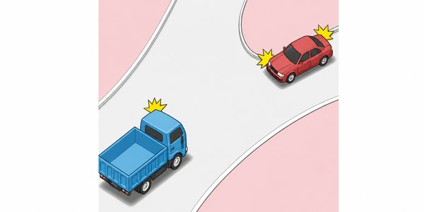

1. **Կապույտ ավտոմոբիլի վարորդը** ✅
2. Կարմիր ավտոմոբիլի վարորդը

### 5-37. Ո՞ր տրանսպորտային միջոցի վարորդը պետք է զիջի ճանապարհը։

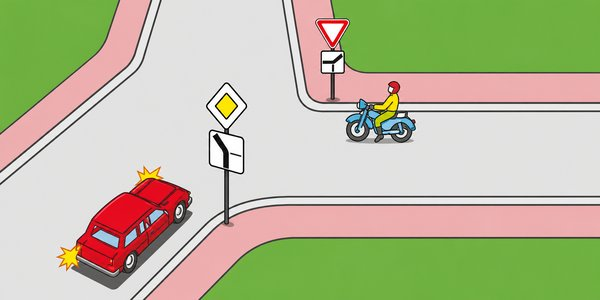

1. Ավտոմոբիլի վարորդը
2. **Մոտոցիկլի վարորդը** ✅

### 5-38. Ո՞ր տրանսպորտային միջոցի վարորդն է ճիշտ մուտք գործում շրջանաձեւ երթեւեկությամբ խաչմերուկ։

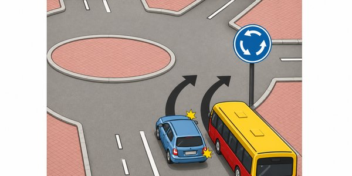

1. **Երկու վարորդներն էլ** ✅
2. Միայն ավտոբուսի վարորդը
3. Միայն թեթեւ մարդատար ավտոմոբիլի վարորդը

### 5-39. Ո՞ր տրանսպորտային միջոցն ունի առաջնահերթ երթեւեկության իրավունք։

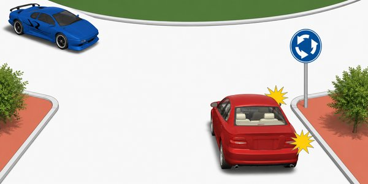

1. Կարմիր ավտոմոբիլը, քանի որ մուտք է գործում շրջանաձեւ երթեւեկությամբ խաչմերուկ կապույտ ավտոմոբիլի աջ կողմից
2. **Կապույտ ավտոմոբիլը, քանի որ ընթանում է շրջանաձեւ երթեւեկությամբ ճանապարհով** ✅

### 5-40. Ցույց տվեք խաչմերուկն անցելու հերթականությունը։

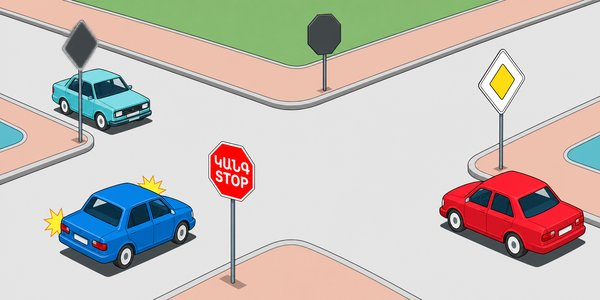

1. Կապույտը, կարմիրը` կանաչի հետ միաժամանակ
2. Կարմիրը, կապույտը, կանաչը
3. **Կարմիրը` կանաչի հետ միաժամանակ, կապույտը** ✅

### 5-41. Կանաչ ավտոմոբիլի վարորդը

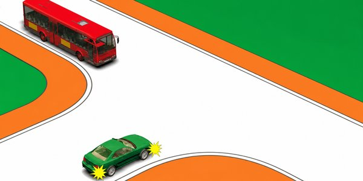

1. **Ունի առաջնահերթ երթեւեկության իրավունք։** ✅
2. Պետք է զիջի ճանապարհը։

### 5-42. Խաչմերուկը վերջինը կանցնի

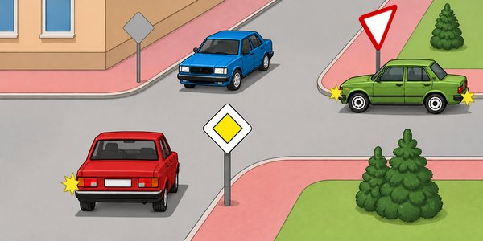

1. Կարմիր ավտոմոբիլը։
2. Կապույտ ավտոմոբիլը։
3. **Կանաչ ավտոմոբիլը։** ✅

### 5-43. Խաչմերուկը երկրորդը կանցնի

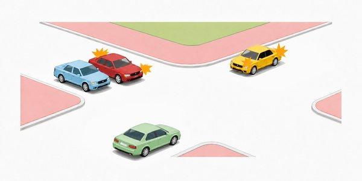

1. Կանաչ ավտոմոբիլը։
2. **Կարմիր ավտոմոբիլը` կապույտի հետ միաժամանակ։** ✅
3. Դեղին ավտոմոբիլը։

### 5-44. Ավտոմոբիլները խաչմերուկը կանցնեն հետեւյալ հերթականությամբ՝

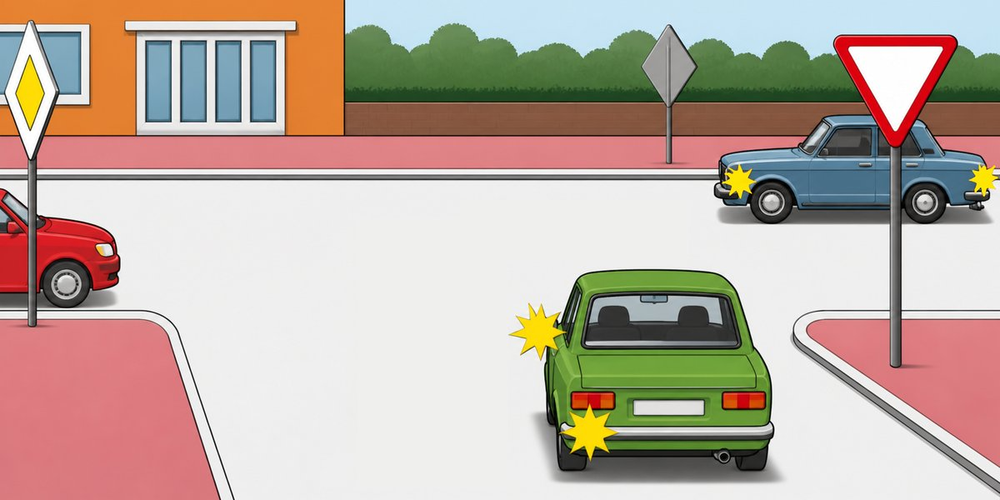

1. Կապույտը, կանաչը, կարմիրը։
2. **Կարմիրը, կապույտը, կանաչը։** ✅
3. Կանաչը, կարմիրը, կապույտը։

### 5-45. Խաչմերուկը երկրորդը կանցնի

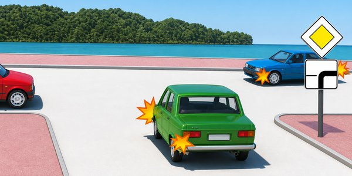

1. **Կանաչ ավտոմոբիլը։** ✅
2. Կապույտ ավտոմոբիլը։
3. Կարմիր ավտոմոբիլը։

### 5-46. Կարմիր ավտոմոբիլը խաչմերուկը կանցնի

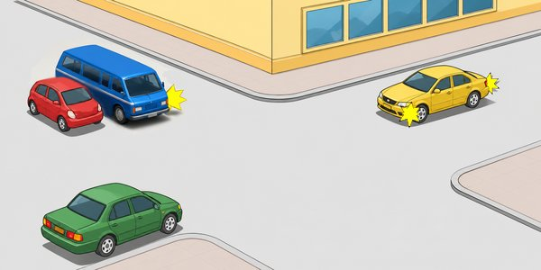

1. **Երկրորդը` կապույտի հետ միաժամանակ։** ✅
2. Երկրորդը` դեղինից հետո։
3. Երրորդը` կանաչից եւ դեղինից հետո։

### 5-47. Դեղին ավտոմոբիլը խաչմերուկը կանցնի

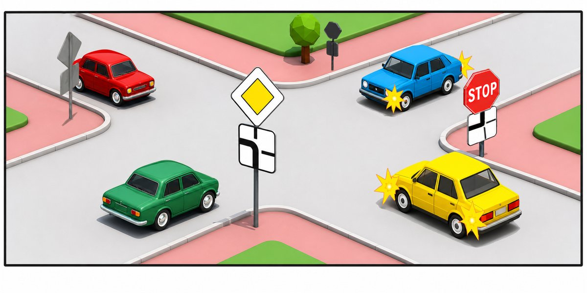

1. Առաջինը։
2. Երկրորդը։
3. Երրորդը
4. **Վերջինը։** ✅

### 5-48. Ո՞ր պատասխանում է ճիշտ նշված անցնելու հերթականությունը։

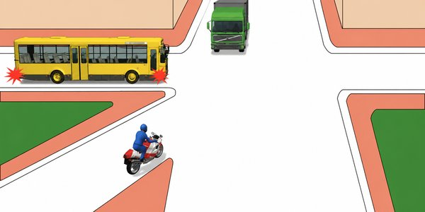

1. **Մոտոցիկլ, ավտոբուս, բեռնատար ավտոմոբիլ** ✅
2. Ավտոբուս, մոտոցիկլը, բեռնատար ավտոմոբիլ
3. Ավտոբուս, բեռնատար ավտոմոբիլ, մոտոցիկլ

### 5-49. Տրանսպորտային միջոցները խաչմերուկը կանցնեն հետեւյալ հերթականությամբ՝

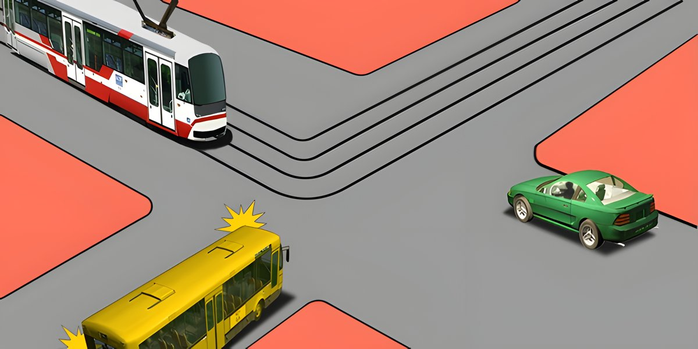

1. Թեթեւ մարդատար ավտոմոբիլը, ավտոբուսը, տրամվայը։
2. Տրամվայը, ավտոբուսը, թեթեւ մարդատար ավտոմոբիլը։
3. **Տրամվայը, թեթեւ մարդատար ավտոմոբիլը, ավտոբուսը։** ✅

### 5-50. Ո՞ր տրանսպորտային միջոցի վարորդը պետք է զիջի ճանապարհը։

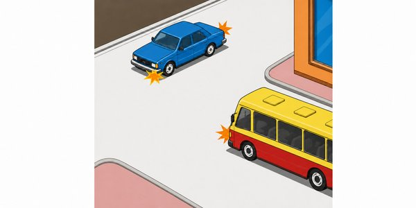

1. Թեթեւ մարդատար ավտոմոբիլի վարորդը
2. **Ավտոբուսի վարորդը** ✅

### 5-51. Ո՞ր տրանսպորտային միջոցը պետք է զիջի ճանապարհը։

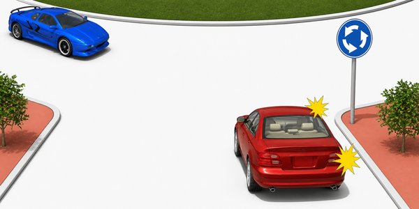

1. Կապույտ ավտոմոբիլը
2. **Կարմիր ավտոմոբիլը** ✅

### 5-52. Տրանսպորտային միջոցները խաչմերուկը կանցնեն հետեւյալ հերթականությամբ՝

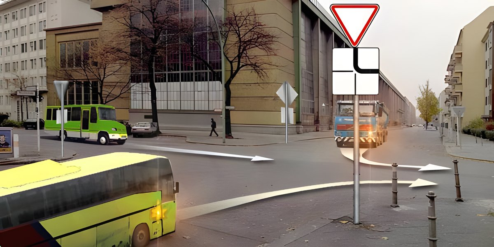

1. Դեղին ավտոբուսը, բեռնատար ավտոմոբիլը, կանաչ ավտոբուսը։
2. **Բեռնատար ավտոմոբիլը, դեղին ավտոբուսը, կանաչ ավտոբուսը։** ✅
3. Դեղին ավտոբուսը, կանաչ ավտոբուսը, բեռնատար ավտոմոբիլը։

### 5-53. Տրանսպորտային միջոցները խաչմերուկը կանցնեն հետեւյալ հերթականությամբ՝

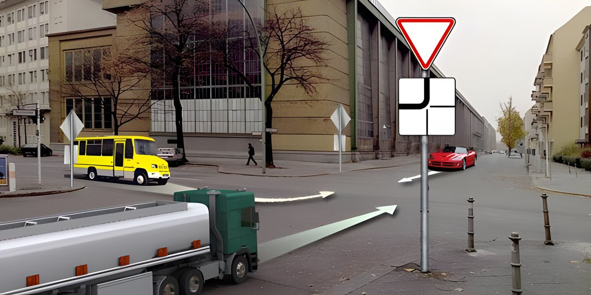

1. **Ավտոբուսը, թեթեւ մարդատար ավտոմոբիլը՝ բեռնատար ավտոմոբիլի հետ միաժամանակ։** ✅
2. Թեթեւ մարդատար ավտոմոբիլը եւ բեռնատար ավտոմոբիլը՝ միաժամանակ, ավտոբուսը։

### 5-54. Ի՞նչ հերթականությամբ խաչմերուկը կանցնեն տրանսպորտային միջոցները, եթե լուսացույցերը չեն աշխատում։

1. Տրոլեյբուսը եւ մոտոցիկլը, ավտոբուսը եւ թեթեւ մարդատար ավտոմոբիլը
2. **Մոտոցիկլը, ավտոբուսը եւ թեթեւ մարդատար ավտոմոբիլը, տրոլեյբուսը** ✅
3. Ավտոբուսը եւ թեթեւ մարդատար ավտոմոբիլը, տրոլեյբուսը եւ մոտոցիկլը

### 5-55. Տրանսպորտային միջոցները խաչմերուկը կանցնեն հետեւյալ հերթականությամբ՝

1. **Բեռնատար ավտոմոբիլը, տրամվայը եւ ավտոբուսը, մոտոցիկլը եւ թեթեւ մարդատար ավտոմոբիլը։** ✅
2. Տրամվայը եւ ավտոբուսը, մոտոցիկլը եւ թեթեւ մարդատար ավտոմոբիլը, բեռնատար ավտոմոբիլը։

### 5-56. Տրանսպորտային միջոցները խաչմերուկը կանցնեն հետեւյալ հերթականությամբ՝

1. «Շտապ օգնության» ավտոմոբիլը, տրամվայը, մոտոցիկլը, ավտոբուսը, թեթեւ մարդատար ավտոմոբիլը։
2. **Մոտոցիկլը, ավտոբուսը, տրամվայը եւ «Շտապ օգնության» ավտոմոբիլը, թեթեւ մարդատար ավտոմոբիլը։** ✅

### 5-57. Տրանսպորտային միջոցները խաչմերուկը կանցնեն հետեւյալ հերթականությամբ՝

1. **Բեռնատար ավտոմոբիլը եւ մոտոցիկլը, ավտոբուսը, տրոլեյբուսը։** ✅
2. Բեռնատար ավտոմոբիլը եւ ավտոբուսը, մոտոցիկլը, տրոլեյբուսը։

### 5-58. Տրանսպորտային միջոցները խաչմերուկը կանցնեն հետեւյալ հերթականությամբ՝

1. **Բեռնատար ավտոմոբիլը, թեթեւ մարդատար ավտոմոբիլը, ավտոբուսը, ավտոցիստեռնը։** ✅
2. Բեռնատար ավտոմոբիլը, ավտոբուսը, թեթեւ մարդատար ավտոմոբիլը, ավտոցիստեռնը։

### 5-59. Թեթեւ մարդատար ավտոմոբիլը խաչմերուկը կանցնի

1. Առաջինը։
2. **Երկրորդը` ավտոբուսից հետո։** ✅
3. Երրորդը։

### 5-60. Տրանսպորտային միջոցները խաչմերուկը կանցնեն հետեւյալ հերթականությամբ՝

1. Թեթեւ մարդատար ավտոմոբիլը, ավտոբուսը, բեռնատար ավտոմոբիլը։
2. **Ավտոբուսը, բեռնատար ավտոմոբիլը, թեթեւ մարդատար ավտոմոբիլը։** ✅
3. Ավտոբուսը, թեթեւ մարդատար ավտոմոբիլը, բեռնատար ավտոմոբիլը։

### 5-61. Տրանսպորտային միջոցները խաչմերուկը կանցնեն հետեւյալ հերթականությամբ՝

1. **Բեռնատար ավտոմոբիլը, թեթեւ մարդատար ավտոմոբիլը, ավտոբուսը։** ✅
2. Ավտոբուսը, բեռնատար ավտոմոբիլը, թեթեւ մարդատար ավտոմոբիլը։
3. Ավտոբուսը, թեթեւ մարդատար ավտոմոբիլը, բեռնատար ավտոմոբիլը։

### 5-62. Կարո՞ղ են արդյոք տրանսպորտային միջոցները միաժամանակ կատարել ձախ շրջադարձ։

1. **Այո** ✅
2. Ոչ: Թեթև մարդատարի վարորդը պետք է զիջի։
3. Ոչ: Բեռնատարի վարորդը պետք է զիջի։

### 5-63. Ո՞ւմ եք պարտավոր զիջել ճանապարհը տվյալ իրավիճակում։

1. Միայն ավտոբուսին
2. Թեթև մարդատարին
3. **Ոչ մեկին** ✅

### 5-64. Այս իրավիճակում ձախ շրջադարձ կատարելիս

1. **կանցնեք խաչմերուկն առաջինը։** ✅
2. պետք է ճանապարհը զիջել բեռնատարի վարորդին։

### 5-65. Այս իրավիճակում աջ շրջադարձ կատարելիս

1. **կանցնեք խաչմերուկն առաջինը։** ✅
2. պետք է ճանապարհը զիջել թեթև մարդատարի վարորդին։

### 5-66. Ձախ շրջադարձ կատարելիս պարտավոր եք զիջել ճանապարհը

1. Թեթև մարդատարի և A տրամվայի վարորդներին։
2. **Միայն A տրամվայի վարորդին։** ✅
3. Տրամվայների վարորդներին։
4. Ոչ ոքի։

### 5-67. Երթևեկությունն ուղիղ շարունակելու դեպքում

1. Խաչմերուկն առաջինը կանցնեք։
2. **Կանցնեք թեթև մարդատարի անցնելուց հետո։** ✅

### 5-68. Այս իրավիճակում հետադարձ կատարելիս անհրաժեշտ է ճանապարհը զիջել

1. **Թեթև մարդատարին։** ✅
2. Երկու վարորդներին։

### 5-69. Այս իրավիճակում հետիոտներին խոչընդոտ չստեղծել

1. **պարտավոր ենք։** ✅
2. պարտավոր չենք։

### 5-70. Խաչմերուկից անմիջապես հետո գոյացած խցանման պայմաններում մուտք գործելը խաչմերուկ թույլատրելի է,

1. Եթե երթևեկությունն ուղիղ ենք շարունակելու:
2. **Եթե շրջադարձ կամ հետադարձ ենք կատարելու:** ✅
3. Թվարկված բոլոր դեպքերում:

### 5-71. Զիջել ճանապարհը պարտավոր ենք

1. Մոտոցիկլի վարորդին:
2. Թեթև մարդատարին:
3. **Ոչ ոքի:** ✅

### 5-72. Խաչմերուկն անցնելիս վարորդը պարտավոր է զիջել ճանապարհը

1. Միայն տրամվայների վարորդներին:
2. **Թեթև մարդատարի և տրամվայ Բ-ի վարորդին:** ✅
3. Ոչ ոքի:
4. Բոլորին:

### 5-73. Այս իրավիճակում ձախ շրջադարձ կատարելիս պարտավոր ենք զիջել ճանապարհը

1. Թեթև մարդատարի վարորդին։
2. Ավտոբուսի վարորդին։
3. **Ոչ ոքի։** ✅

### 5-74. Պարտավոր ենք զիջել ճանապարհը

1. Միայն տրամվայի վարորդին։
2. Բեռնատարի վարորդին։
3. **Երկու վարորդներին էլ։** ✅

### 5-75. Ճանապարհը պետք է զիջել

1. Ավտոբուսի վարորդին։
2. Երկու վարորդներին էլ։
3. **Ոչ ոքի։** ✅

### 5-76. Այս իրավիճակում խաչմերուկն անցնելիս զիջել ճանապարհը

1. Պարտավոր եք։
2. **Պարտավոր չեք։** ✅

### 5-77. Խաչմերուկն անցնելիս այս իրավիճակում

1. **Առաջինն անցնելու իրավունք ունենք** ✅
2. Պետք է զիջենք տրամվայի վարորդին։
3. Պետք է զիջենք բեռնատարի վարորդին։
4. Պետք է զիջենք բոլոր վարորդներին։

### 5-78. «Շրջանաձև երթևեկություն» նշանով կահավորված շրջանաձև երթևեկությամբ խաչմերուկ մուտք գործելիս տրանսպորտային միջոցի վարորդը

1. **պարտավոր է ճանապարհը զիջել այդ խաչմերուկում երթևեկող տրանսպորտային միջոցներին։** ✅
2. ունի երթևեկության առավելություն այդ խաչմերուկում երթևեկողների նկատմամբ:

### 5-79. Այս իրադրությունում ձախ շրջադարձի ժամանակ պարտավոր ենք զիջել ճանապարհը

1. Բոլոր վարորդներին։
2. Միայն թեթև մարդատարի վարորդին։
3. **Ավտոբուսի և թեթև մարդատարի վարորդներին։** ✅

### 5-80. Ո՞ր վարորդն է պարտավոր չխոչընդոտել հետիոտներին։

1. Թեթև մարդատարի վարորդը
2. Բեռնատարի վարորդը
3. **Երկու վարորդները** ✅

### 5-81. Այս իրավիճակում վարորդը կարող է՞ կատարել ձախ շրջադարձը։

1. Այո
2. **Այո, եթե չի խոչընդոտի բեռնատարի վարորդին** ✅
3. Ոչ

### 5-82. Այս իրադրությունում ձախ շրջադարձ կատարելիս վարորդը

1. **Պետք է զիջի ճանապարհը։** ✅
2. Կանցնի խաչմերուկն առաջինը։

### 5-83. Նշանները տեղեկացնում են, որ

1. **200մ-ից հետո ճանապարհը պետք է զիջել հատվող ճանապարհով երթևեկողին:** ✅
2. 200մ տեղամասում պետք է զիջել բոլոր տրանսպորտային միջոցներին:

### 5-84. Երկրորդ անցում ձախ շրջադարձ կատարելու դեպքում վարորդը

1. Ունի առավելություն։
2. Պետք է զիջի մյուս վարորդներին։
3. **Պետք է զիջի ավտոբուսի վարորդին։** ✅

### 5-85. Խաչմերուկն ուղիղ անցնելիս վարորդը

1. Կարող է առաջինն անցնել։
2. **Պետք է զիջի տրամվային։** ✅
3. Պետք է զիջի երկու վարորդներին։

### 5-86. Ձախ շրջադարձ կատարելիս վարորդն ո՞ւմ է պարտավոր զիջել։

1. **Ավտոբուսի վարորդին** ✅
2. Թեթև մարդատարի վարորդին
3. Ոչ ոքի

### 5-87. Այս խաչմերուկ մուտք գործելիս վարորդը

1. Ունի առաջնահերթ երթևեկության իրավունք։
2. Պետք է զիջի բեռնատարին։
3. **Երկու վարոդներին էլ պետք է զիջի։** ✅

### 5-88. Ձախ շրջադարձ կատարելիս վարորդն ո՞ւմ է պարտավոր զիջել։

1. **Երկու վարորդներին էլ** ✅
2. Թեթև մարդատարի վարորդին
3. Ավտոբուսի վարորդին

### 5-89. Այս իրադրությունում զիջել պարտավոր ենք

1. **Երկու վարորդներին էլ։** ✅
2. Միայն հանդիպակաց գոտուց մոտեցող բեռնատարին։

### 5-90. Ձախ շրջադարձ կատարելիս

1. **Խաչմերուկը կանցնեք առաջինը։** ✅
2. Կզիջեք ճանապարհը։

### 5-91. Աջ շրջադարձն այս իրավիճակում կատարում ենք՝

1. **առաջինն անցնելով խաչմերուկը։** ✅
2. զիջելով ճանապարհը թեթև մարդատարի վարորդին։
3. զիջելով ճանապարհը երկու վարորդներին։

### 5-92. Աջ շրջադարձ կատարելիս

1. Պետք է զիջեք ճանապարհը։
2. **Կարող եք անցնել առաջինը։** ✅

### 5-93. Ձախ շրջադարձ կատարելիս պետք է ճանապարհը զիջեք

1. Ավտոբուսի և մոտոցիկլի վարորդներին։
2. Ավտոբուսի վարորդին։
3. **Բոլորին։** ✅

### 5-94. Ձախ շրջադարձ կատարելիս

1. Կանցնեք առաջինը՝ թեթև մարդատարի հետ միաժամանակ։
2. **Կանցնեք մոտոցիկլից հետո։** ✅

### 5-95. Ուղիղ երթևեկելիս պարտավոր եք զիջել

1. **Երկու վարորդներին էլ։** ✅
2. Միայն թեթև մարդատարին։
3. Ոչ ոքի։

### 5-96. Տրամվային զիջել

1. **Պարտավոր ենք։** ✅
2. Պարտավոր չենք։

### 5-97. Այս իրավիճակում ե՞րբ է թույլատրվում աջ շրջադարձ կատարել։

1. Անմիջապես
2. **Բեռնատարին չխոչընդոտելու դեպքում՝ նրա անցման հետ միաժամանակ** ✅
3. Բեռնատարի անցնելուց հետո

### 5-98. Խաչմերուկն ուղիղ անցնելիս պարտավոր եք զիջել ճանապարհը

1. Միայն A տրամվայի վարորդին։
2. Միայն B տրամվայի վարորդին։
3. **Երկու վարորդներին էլ։** ✅
4. Ոչ ոքի։

### 5-99. Ձախ շրջադարձ կատարելիս պարտավոր եք զիջել ճանապարհը

1. **Միայն ավտոբուսի վարորդին։** ✅
2. Երկու վարորդներին էլ։
3. Ոչ ոքի։

### 5-100. Ո՞վ առաջինը կանցնի խաչմերուկը։

1. Բեռնատարի վարորդը
2. Տրոլեյբուսի վարորդը
3. **Կանոններն այս դեպքը չեն կանոնակարգում: Վարորդները կանցնեն՝ փոխադարձ հարգանք ցուցաբերելով:** ✅

### 5-101. Հետիոտներին չխոչընդոտել վարորդը պարտավոր է

1. Միայն ձախ շրջադարձ կատարելիս։
2. Միայն աջ շրջադարձ կատարելիս։
3. **Երկու դեպքերում՝ նմանապես։** ✅

### 5-102. Աջ շրջադարձի ժամանակ պարտավոր եք ճանապարհը զիջել

1. **Հետիոտներին և հեծանվորդներին։** ✅
2. Միայն հետիոտներին։

### 5-103. Ձախ շրջադարձ կատարելիս պարտավոր եք ճանապարհը զիջել

1. **Միայն թեթև մարդատարի վարորդին։** ✅
2. Թեթև մարդատարի և ավտոբուսի վարորդին։
3. Ոչ ոքի։

### 5-104. Երբ վարորդը չի կարող որոշել ճանապարհի ծածկույթի առկայությունը (օրվա մութ ժամանակ, ցեխ, ձյուն և այլն), և բացակայում են առավելության նշանները, ապա

1. **Նա պետք է համարի, որ գտնվում է երկրորդական ճանապարհի վրա։** ✅
2. Նա պետք է առաջնորդվի հավասարազոր խաչմերուկի անցման կանոններով:

### 5-105. Այս իրավիճակում զիջել ճանապարհը պարտավոր ենք

1. **Բոլոր վարոդներին։** ✅
2. Միայն բեռնատարի վարորդին։
3. Միայն թեթև մարդատարի վարորդին։

### 5-106. Զիջել ճանապարհը պարտավոր ենք

1. Թեթև մարդատարի վարորդին։
2. **Ավտոբուսի և թեթև մարդատարի վարորդներին։** ✅
3. Բոլոր վարորդներին։

### 5-107. Այս խաչմերուկում հետադարձ կատարելիս

1. Առաջինը կկատարեմ մանևրը։
2. **Պետք է զիջել ճանապարհը մյուս վարորդին։** ✅

### 5-108. Լուսացույցի դեղին թարթող ազդանշանի պայմաններում խաչմերուկն ուղիղ անցնելիս՝ պարտավոր ենք

1. Կանգնել և սպասել կանաչ թույլատրող ազդանշանի միանալուն։
2. **Զիջել թեթև մարդատարի վարորդին։** ✅
3. Զիջել տրամվայի վարորդին։

### 5-109. Ուղիղ երթևեկելու դեպքում

1. Կարող ենք խաչմերուկն առաջինն անցնել։
2. **Պետք է զիջել ճանապարհը։** ✅

### 5-110. Հետադարձ կատարելիս ո՞ւմ պետք է զիջեք ճանապարհը

1. **Բեռնատարի վարորդին։** ✅
2. Թեթև մարդատարի վարորդին։
3. Երկու վարորդներին։

### 5-111. Ձախ շրջադարձ կատարելիս տրամվային զիջել

1. **Պարտավոր ենք։** ✅
2. Պարտավոր չենք։

### 5-112. Այս խաչմերուկում ծածկույթ չունեցող ճանապարհից մոտեցող բեռնատարին

1. պարտավոր ենք զիջել, քանի որ այն մոտեցել է մեզ աջ կողմից։
2. **պարտավոր չենք զիջել, քանի որ կոշտ ծածկույթով ճանապարհը ծածկույթ չունեցողի նկատմամբ համարվում է գլխավոր։** ✅

### 5-113. Լուսացույցի դեղին թարթող ազդանշանի պարագայում

1. Պետք է սպասենք կանաչ ազդանշանի միանալուն։
2. **Կանցնենք խաչմերուկը զիջելով լծասայլի վարորդին։** ✅
3. Թեթև մարդատարի հետ միաժամանակ կանցնեք խաչմերուկը։

### 5-114. Ձախ շրջվելիս պարտավոր ենք զիջել ճանապարհը

1. Թեթև մարդատարի վարորդին։
2. Ավտոբուսի վարորդին։
3. Մոտոցիկլի վարորդին։
4. **Ոչ ոքի։** ✅

### 5-115. Այս իրավիճակում

1. **Զիջել ճանապարհը բեռնատարի վարորդին պարտավոր ենք։** ✅
2. Կարող ենք տրամվայի հետ միաժամանակ անցնել խաչմերուկը:

### 5-116. Խաչմերուկն անցնելիս զիջել պարտավոր ենք

1. Մոտոցիկլի վարորդին։
2. Մոտոցիկլի և ավտոբուսի վարորդներին։
3. Ավտոբուսի և թեթև մարդատարի վարորդներին։
4. **Բոլոր վարորդներին։** ✅

### 5-117. Այս իրադրությունում ճանապարհը պետք է զիջեք

1. Միայն տրամվայի վարորդին։
2. Թեթև մարդատարի վարորդին։
3. **Թեթև մարդատարի և տրամվայի վարորդներին։** ✅
4. Բոլոր վարորդներին։

### 5-118. Այս իրավիճակում ձախ շրջադարձ կատարելիս

1. Խաչմերուկը կանցնեք առաջինը։
2. **Մուտք գործելով խաչմերուկ՝ կզիջեք ճանապարհը մոտոցիկլի վարորդին և հետո կավարտեք մանևրը։** ✅

### 5-119. Խաչմերուկն ուղիղ անցնելիս անհրաժեշտ է ճանապարհը զիջել

1. Բեռնատարի վարորդին։
2. Թեթև մարդատարի վարորդին։
3. **Երկու վարորդներին։** ✅

### 5-120. Այս իրադրությունում

1. Խաչմերուկը կանցնեք առաջինը։
2. **Կզիջեք ճանապարհը թեթև մարդատարի վարորդին։** ✅
3. Կզիջեք ճանապարհը երկու վարորդներին։

### 5-121. Զիջել պարտավոր ենք

1. **Երկու վարորդներին էլ։** ✅
2. Թեթև մարդատարի վարորդին։
3. Ավտոբուսի վարորդին։

### 5-122. Այստեղ խաչմերուկը

1. Առաջինը կանցնեք։
2. **Կզիջեք ճանապարհը բեռնատարին։** ✅

### 5-123. Զիջել ճանապարհը տրամվայի վարորդին

1. **Պարտավոր ենք։** ✅
2. Պարտավոր չենք։

### 5-124. Ձախ շրջադարձ կատարելիս պետք է զիջել

1. **Բեռնատարի վարորդին։** ✅
2. Երկու վարորդներին էլ։
3. Ոչ ոքի։

### 5-125. Այս խաչմերուկում

1. Կզիջեք ճանապարհը ։
2. **Կանցնեք առաջինը։** ✅

### 5-126. Երթևեկությունն ուղիղ շարունակելու դեպքում տրամվային զիջել

1. **Պարտավոր ենք։** ✅
2. Պարտավոր չենք։

### 5-127. Տրամվային զիջել

1. **Պարտավոր ենք։** ✅
2. Պարտավոր չենք։

### 5-128. Այս իրավիճակում աջ շրջադարձը թույլատրվում է

1. Միայն բեռնատարից հետո։
2. **Բեռնատարի հետ միաժամանակ, եթե դա չի խոչընդոտի բեռնատարի վարորդին։** ✅

### 5-129. Ո՞ր տրամվայի վարորդին ենք պարտավոր զիջել ճանապարհը։

1. Միայն A
2. Միայն B
3. **Երկու տրամվայների** ✅

### 5-130. Ուղիղ երթևեկելիս պետք է զիջել

1. **Թեթև մարդատարի վարորդին։** ✅
2. Բոլորին։
3. Ոչ մեկին։

### 5-131. Այս իրադրությունում զիջել անհրաժեշտ է

1. Ավտոբուսի վարորդին։
2. Բեռնատարի վարորդին։
3. **Երկու վարորդներին։** ✅

### 5-132. Ո՞ր նշանի դեպքում խաչմերուկում պետք է զիջեք ձախից մոտեցող վարորդներին։

1. Միայն A
2. **Միայն B** ✅
3. A և B
4. Բոլոր

### 5-133. Ո՞ր նկարում է պատկերված գլխավոր ճանապարհը։

1. Միայն ձախ
2. **Ներքևի և ձախ** ✅
3. Բոլոր

### 5-134. Ո՞ր նկարում է պատկերված գլխավոր ճանապարհը։

1. Միայն աջ
2. **Աջ և ներքևի** ✅
3. Բոլոր

### 5-135. Ո՞ր նկարում է պատկերված գլխավոր ճանապարհը։

1. Վերին ձախ
2. Վերին աջ
3. **Վերևի նկարներում** ✅
4. Բոլոր

### 5-136. Խաչմերուկում ո՞ր ճանապարհն է համարվում գլխավոր։

1. **Կոշտ ծածկույթով (ասֆալտբետոն, ցեմենտբետոն, քարե նյութեր և այլն) ճանապարհը հողային ծածկույթ ունեցողի նկատմամբ** ✅
2. Եռագոտի ճանապարհը՝ ամեն ուղղությամբ մեկ գոտի ունեցողի նկատմամբ
3. Ասֆալտբետոնե ճանապարհը՝ սալիկապատ ճանապարհի նկատմամբ
