# Խումբ 6 (95 հարց)

Ճիշտ պատասխանը **թավ** է և նշված ✅-ով։ Աղբյուր՝ roadpolice.am, ABC կարգեր։

### 6-1. Երթեւեկել արգելվում է

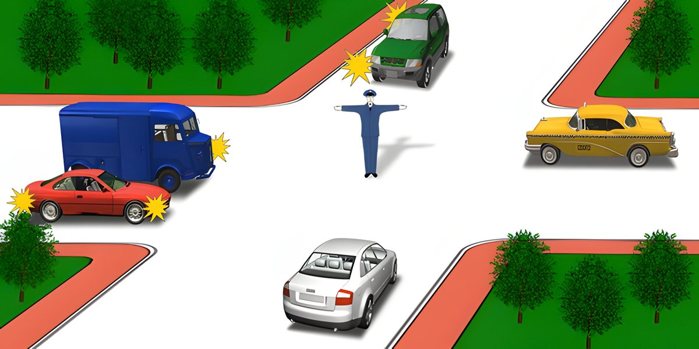

1. Կարմիր եւ սպիտակ ավտոմոբիլներին։
2. **Կապույտ, կանաչ եւ սպիտակ ավտոմոբիլներին։** ✅
3. Սպիտակ, կապույտ եւ դեղին ավտոմոբիլներին։

### 6-2. Վարորդներից ո՞վ իրավունք ունի երթեւեկել ուղիղ։

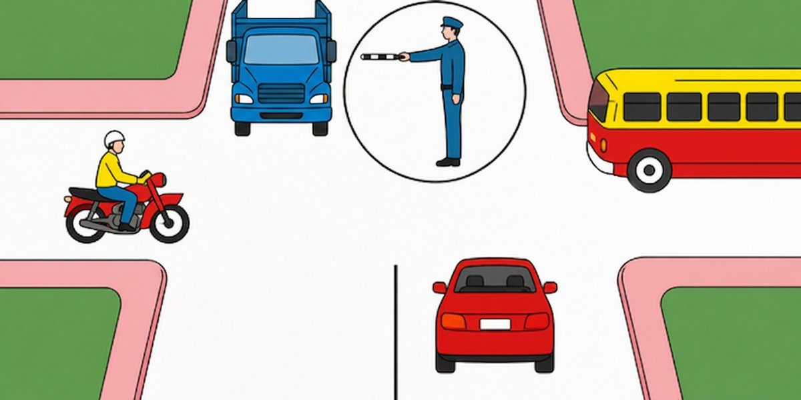

1. Ավտոբուսի եւ մոտոցիկլի վարորդները
2. Թեթեւ մարդատար եւ բեռնատար ավտոմոբիլների վարորդները
3. **Թեթեւ մարդատար ավտոմոբիլի վարորդը** ✅

### 6-3. Ո՞ր տրանսպորտային միջոցի վարորդը պետք է զիջի ճանապարհը։

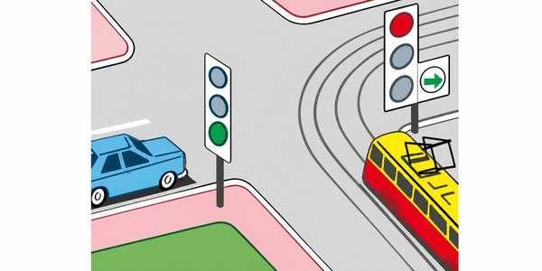

1. Ավտոմոբիլի վարորդը
2. **Տրամվայի վարորդը** ✅

### 6-4. Եթե կարգավորողի աջ ձեռքը պարզված է առաջ, ապա ոչ ռելսագնաց տրանսպորտային միջոցների երթեւեկությունը թույլատրվում է

1. Ձախ կողմից` դեպի ձախ եւ հակառակ ուղղությամբ։
2. Աջ կողմից` միայն դեպի աջ։
3. **Ձախ կողմից` բոլոր ուղղություններով։** ✅
4. Թիկունքից` միայն դեպի աջ։

### 6-5. Տրանսպորտային միջոցները խաչմերուկը կանցնեն հետեւյալ հերթականությամբ՝

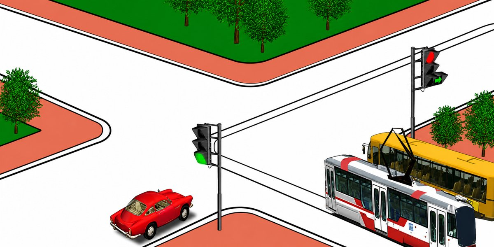

1. Տրամվայը եւ ավտոբուսը, թեթեւ մարդատար ավտոմոբիլը։
2. Տրամվայը, թեթեւ մարդատար ավտոմոբիլը, ավտոբուսը։
3. **Թեթեւ մարդատար ավտոմոբիլը, տրամվայը եւ ավտոբուսը։** ✅

### 6-6. Ո՞ր պատասխանում են ճիշտ նշված այն տրանսպորտային միջոցները, որոնց թույլատրվում է երթեւեկել։

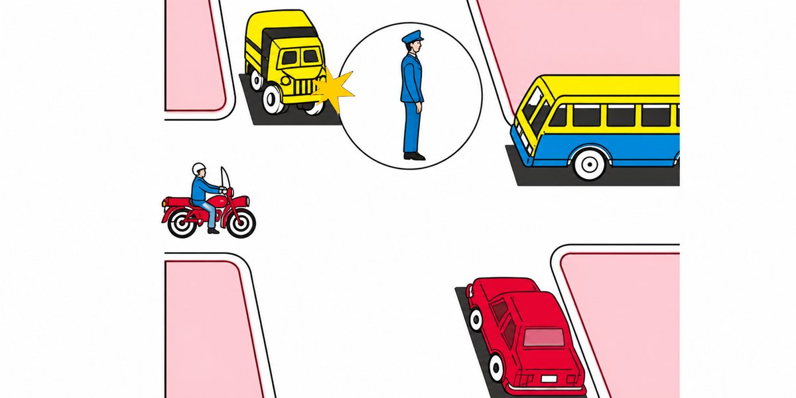

1. Մոտոցիկլը
2. Բեռնատար ավտոմոբիլը
3. Ավտոբուսը
4. **Թեթեւ մարդատար ավտոմոբիլը** ✅
5. Թեթեւ մարդատար եւ բեռնատար ավտոմոբիլները

### 6-7. Ո՞ր տրանսպորտային միջոցի վարորդը պետք է զիջի ճանապարհը։

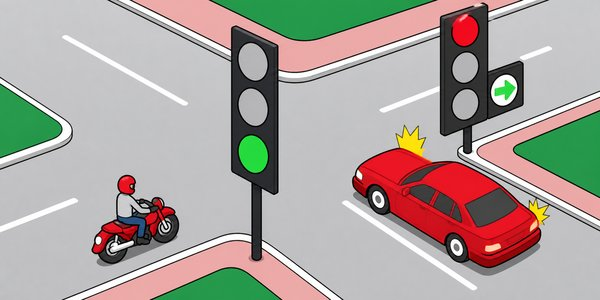

1. Մոտոցիկլի վարորդը
2. **Ավտոմոբիլի վարորդը** ✅

### 6-8. Կարգավորողի այս ազդանշանը նշանակում է, որ երթեւեկությունը թույլատրվում է

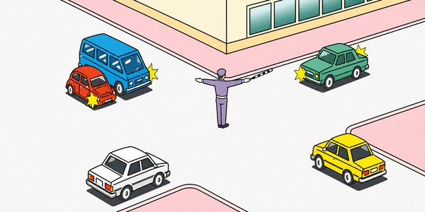

1. Կապույտ եւ կանաչ ավտոմոբիլներին։ Արգելվում է կարմիրին, դեղինին եւ սպիտակին։
2. **Կապույտ, կարմիր եւ կանաչ ավտոմոբիլներին։ Արգելվում է դեղինին եւ սպիտակին։** ✅

### 6-9. Ո՞ր տրանսպորտային միջոցները կարող են կատարել աջ շրջադարձ։

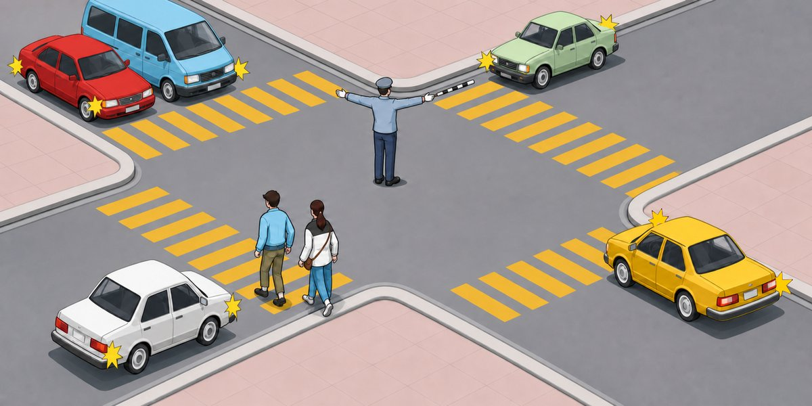

1. Միայն կարմիր ավտոմոբիլը
2. Բոլոր տրանսպորտային միջոցները
3. **Կարմիր եւ կանաչ ավտոմոբիլները** ✅

### 6-10. Երթեւեկությունը թույլատրվում է

1. Ուղիղ։
2. **Դեպի աջ՝ առաջին անցումով։** ✅
3. Դեպի աջ՝ երկրորդ անցումով։
4. Դեպի աջ՝ առաջին եւ երկրորդ անցումներով։

### 6-11. Երթեւեկությունը թույլատրվում է

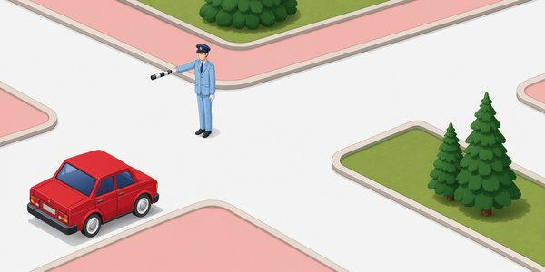

1. **Դեպի աջ՝ առաջին անցումով։** ✅
2. Ուղիղ եւ դեպի աջ՝ առաջին անցումով։

### 6-12. Եթե կարգավորողի ձեռքերը կողմ են պարզված կամ իջեցված են, ապա ոչ ռելսագնաց տրանսպորտային միջոցների երթեւեկությունը թույլատրվում է

1. Թիկունքի եւ կրծքի կողմից՝ միայն դեպի աջ։
2. **Ձախ եւ աջ կողմերից՝ ուղիղ եւ դեպի աջ։** ✅
3. Ձախ եւ աջ կողմերից՝ միայն ուղիղ։

### 6-13. Կարմիր ավտոմոբիլի վարորդը

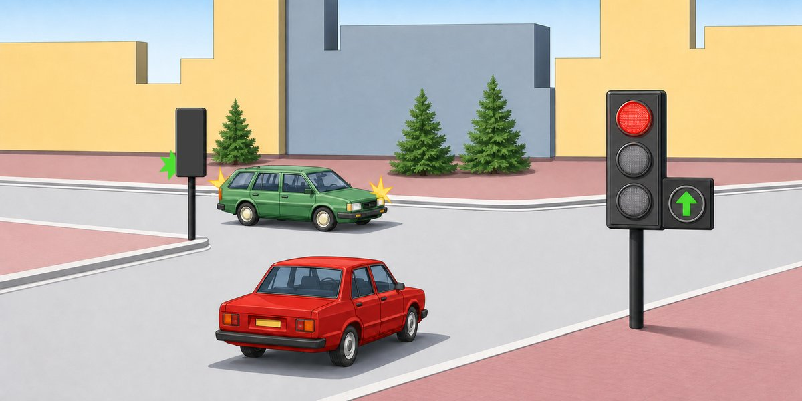

1. **Պետք է զիջի ճանապարհը։** ✅
2. Ունի առաջնահերթ երթեւեկության իրավունք։

### 6-14. Ո՞ր տրանսպորտային միջոցներին է թույլատրվում երթեւեկությունը։

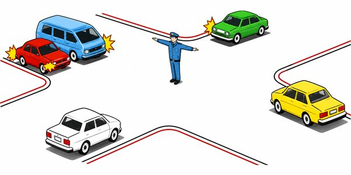

1. **Դեղին եւ կարմիր ավտոմոբիլներին** ✅
2. Կանաչ, կարմիր եւ սպիտակ ավտոմոբիլներին
3. Սպիտակ եւ կանաչ ավտոմոբիլներին

### 6-15. Լուսացույցի ի՞նչ ազդանշանի դեպքում ավտոմոբիլի վարորդը կարող է ավարտել հետադարձը։

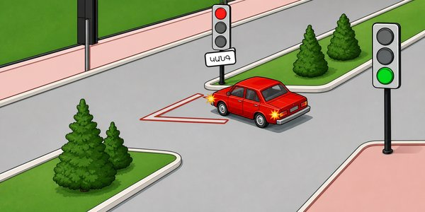

1. Կարմիր
2. **Կանաչ** ✅
3. Ցանկացած

### 6-16. Ի՞նչ է նշանակում լուսացույցի դեղին եւ կարմիր գույների ազդանշանների զուգակցումը։

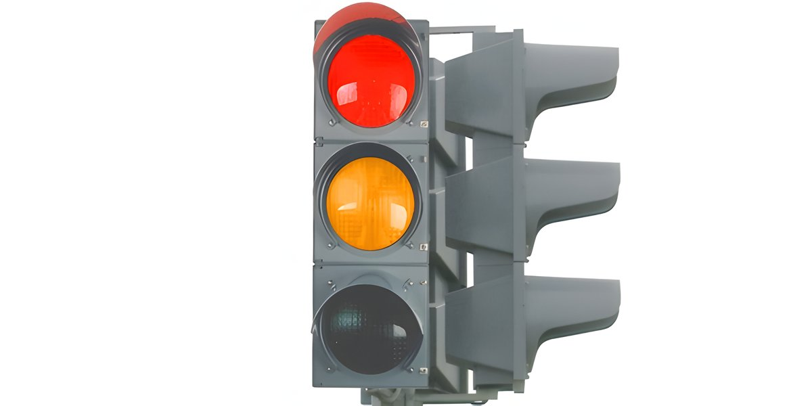

1. Թույլատրվում է սկսել երթեւեկությունը
2. **Արգելվում է երթեւեկությունը եւ տեղեկացնում կանաչ ազդանշանի՝ առաջիկայում միանալու մասին** ✅
3. Խաչմերուկին մոտենում է հատուկ ձայնային ազդանշան եւ առկայծող փարոսիկներ միացրած տրանսպորտային միջոց

### 6-17. Ո՞ր նկարում է վարորդը ճիշտ կատարում շրջադարձը։

1. **Ձախ նկարում** ✅
2. Աջ նկարում

### 6-18. Պարտավո՞ր է արդյոք տրամվայի վարորդը լուսացույցի կանաչ ազդանշանի դեպքում զիջել ճանապարհն այլ ուղղություններից մոտեցող տրանսպորտային միջոցներին։

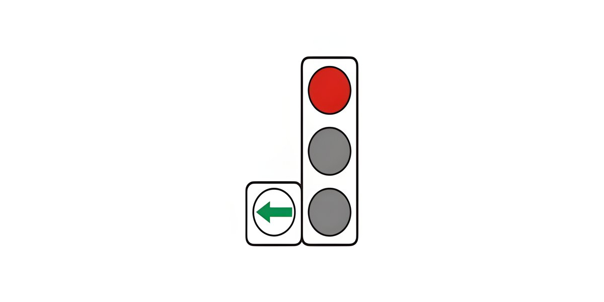

1. **Պարտավոր է** ✅
2. Պարտավոր չէ

### 6-19. Այս լուսացույցը կիրառվում է երթեւեկությունը կարգավորելու համար՝

1. Երթեւեկելի մասի ամբողջ լայնությամբ։
2. **Երթեւեկելի մասի այն գոտիներով, որտեղ երթեւեկության ուղղությունը կարող է փոխվել հանդիպակացի։** ✅
3. Միայն ընդհանուր օգտագործման տրանսպորտային միջոցների երթեւեկության համար նախատեսված գոտիներում։

### 6-20. Եթե կարգավորողի աջ ձեռքը պարզված է առաջ, ապա նրա ձախ կողմից ոչ ռելսագնաց տրանսպորտային միջոցների երթեւեկությունը թույլատրվում է

1. **Բոլոր ուղղություններով։** ✅
2. Միայն դեպի ձախ։

### 6-21. Ո՞ր տրանսպորտային միջոցների երթեւեկությունն է թույլատրվում լուսացույցի տվյալ ազդանշանի դեպքում։

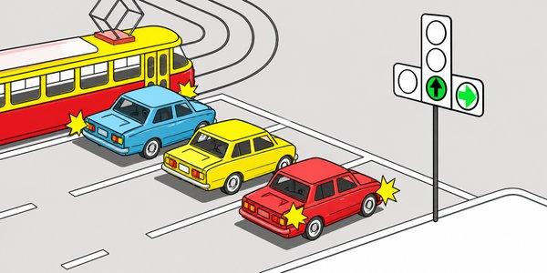

1. Տրամվայի, դեղին եւ կարմիր ավտոմոբիլների
2. **Դեղին եւ կարմիր ավտոմոբիլների** ✅
3. Բոլոր տրանսպորտային միջոցների

### 6-22. Երթեւեկությունը թույլատրվում է

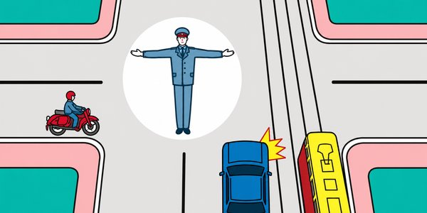

1. Բոլոր տրանսպորտային միջոցներին։
2. **Մոտոցիկլին։** ✅
3. Ավտոմոբիլին եւ մոտոցիկլին։

### 6-23. Եթե կարգավորողի ձեռքերը կողմ են պարզված կամ իջեցված են, ապա նրա ձախ եւ աջ կողմերից ոչ ռելսագնաց տրանսպորտային միջոցների երթեւեկությունը թույլատրվում է

1. **Ուղիղ եւ դեպի աջ։** ✅
2. Միայն ուղիղ։

### 6-24. Ո՞ր տրանսպորտային միջոցի վարորդն ունի երթեւեկության առավելություն։

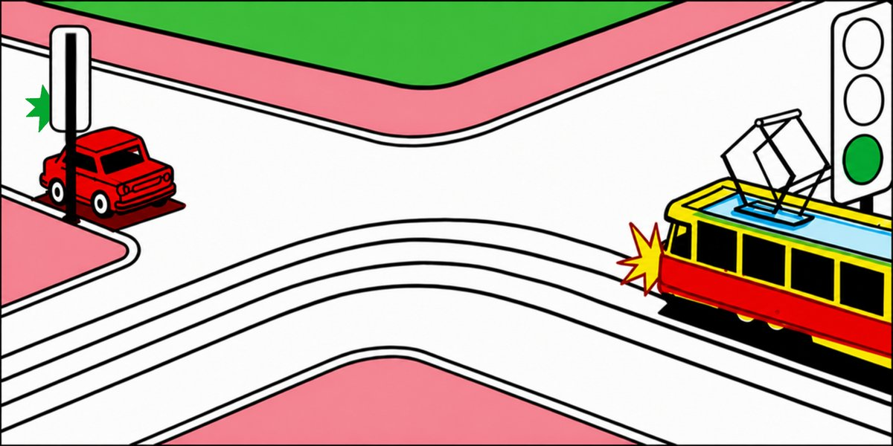

1. Ավտոմոբիլի վարորդը
2. **Տրամվայի վարորդը** ✅

### 6-25. Երթեւեկել արգելվում է

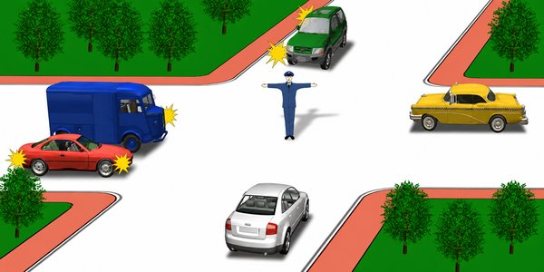

1. Կանաչ եւ սպիտակ ավտոմոբիլներին։
2. **Սպիտակ, կապույտ եւ կանաչ ավտոմոբիլներին։** ✅
3. Սպիտակ եւ դեղին ավտոմոբիլներին։
4. Կանաչ եւ դեղին ավտոմոբիլներին։

### 6-26. Այս լուսացույցի կարմիր ազդանշանի դեպքում երթեւեկությունն արգելվում է

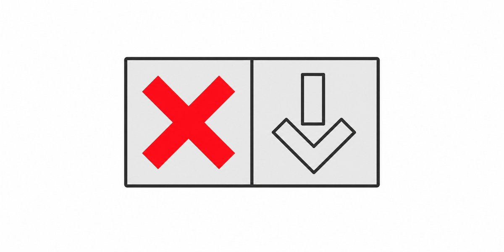

1. երթեւեկելի մասի ամբողջ լայնությամբ։
2. ոչ ավել, քան 50 կմ/ժ արագությամբ։
3. **Այն գոտիով, որի վերեւում տեղակայված է։** ✅

### 6-27. Ի՞նչ նշանակություն ունի լուսացույցի կլոր կանաչ թարթող ազդանշանը։

1. Տեղեկացնում է, որ մուտքը խաչմերուկ արգելվում է
2. **Թույլատրում է երթեւեկությունը եւ տեղեկացնում, որ դրա գործողության ժամկետը լրանում է եւ շուտով կմիանա արգելող ազդանշանը** ✅

### 6-28. Տրանսպորտային միջոցները խաչմերուկը կանցնեն հետեւյալ հերթականությանբ՝

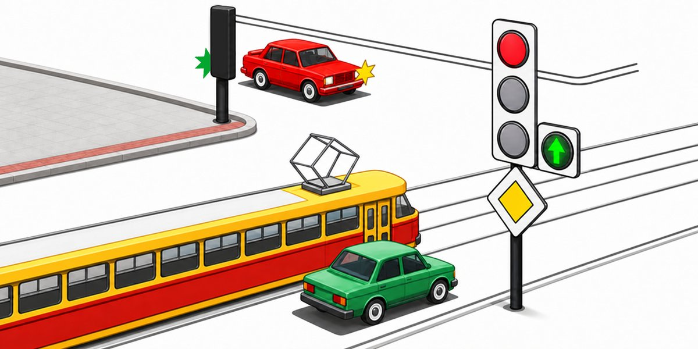

1. Տրամվայը, կարմիր ավտոմոբիլը, կանաչ ավտոմոբիլը։
2. **Կարմիր ավտոմոբիլը, տրամվայը` կանաչ ավտոմոբիլի հետ միաժամանակ։** ✅
3. Տրամվայը` կանաչ ավտոմոբիլի հետ միաժամանակ, կարմիր ավտոմոբիլը։

### 6-29. Ո՞ր պատասխանում են ճիշտ նշված այն տրանսպորտային միջոցները, որոնց երթեւեկությունը թույլատրվում է։

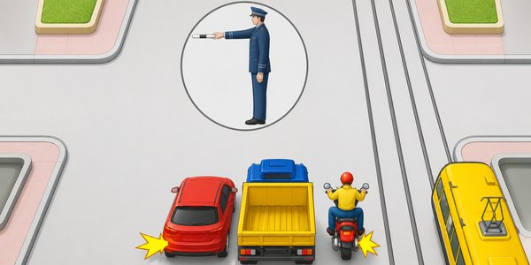

1. **Ավտոմոբիլները եւ մոտոցիկլը** ✅
2. Բոլոր տրանսպորտային միջոցները
3. Ավտոմոբիլները եւ տրամվայը

### 6-30. Եթե կարգավորողի աջ ձեռքը պարզված է առաջ, ապա նրա ձախ կողմից ոչ ռելսագնաց տրանսպորտային միջոցների երթեւեկությունը թույլատրվում է

1. Ուղիղ եւ դեպի ձախ։
2. **Բոլոր ուղղություններով։** ✅

### 6-31. Երթեւեկել արգելվում է

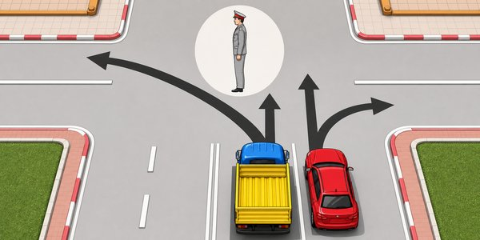

1. **Կապտադեղին ավտոմոբիլին` դեպի ձախ։** ✅
2. Կապտադեղին ավտոմոբիլին` ուղիղ, կարմիր ավտոմոբիլին` ուղիղ եւ դեպի աջ։
3. Կարմիր ավտոմոբիլին։

### 6-32. Ո՞ր ուղղությամբ է թույլատրվում երթեւեկությունը։

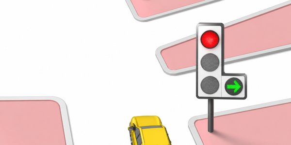

1. Ուղիղ եւ դեպի աջ` առաջին անցումով
2. **Դեպի աջ` առաջին անցումով** ✅
3. Դեպի աջ` երկրորդ անցումով
4. Դեպի աջ` առաջին եւ երկրորդ անցումներով

### 6-33. Խաչմերուկն առաջինը կանցնի

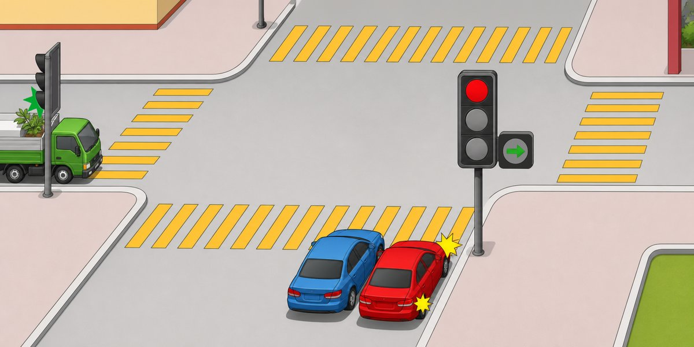

1. Կարմիր ավտոմոբիլը։
2. Կապույտ ավտոմոբիլը։
3. **Կանաչ ավտոմոբիլը։** ✅

### 6-34. Ո՞ր նկարում է վարորդը ճիշտ կատարում շրջադարձը։

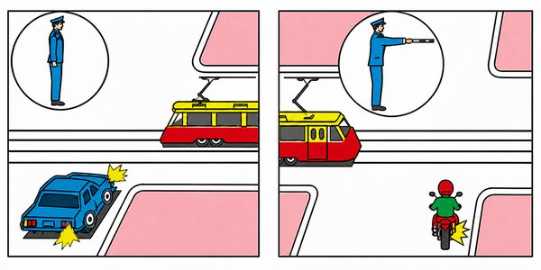

1. **Ձախ նկարում** ✅
2. Աջ նկարում
3. Երկու նկարներում էլ

### 6-35. Կարմիր ավտոմոբիլը խաչմերուկը կանցնի

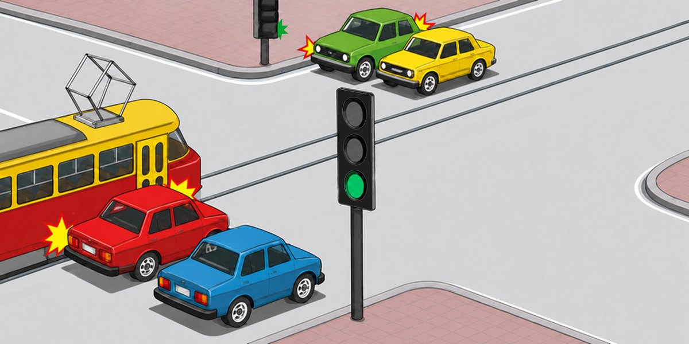

1. Առաջինը։
2. Երկրորդը։
3. Երրորդը։
4. **Վերջինը։** ✅

### 6-36. Ավտոմոբիլը խաչմերուկը կանցնի

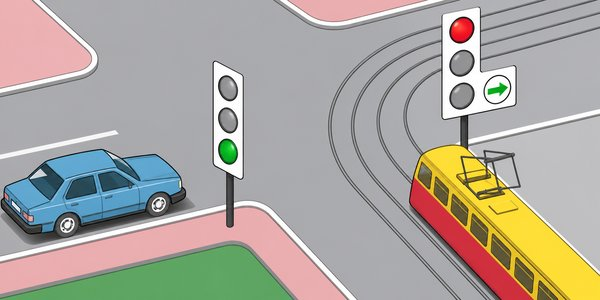

1. **Առաջինը։** ✅
2. Երկրորդը։

### 6-37. Երթեւեկությունը թույլատրվում է

1. Կապտադեղին ավտոմոբիլին` ուղիղ, կարմիրին` դեպի աջ։
2. **Կարմիր ավտոմոբիլին` ուղիղ եւ դեպի աջ, կապտադեղինին` ուղիղ։** ✅
3. Երկու ավտոմոբիլներին` միայն ուղիղ։

### 6-38. Երթեւեկությունը թույլատրվում է

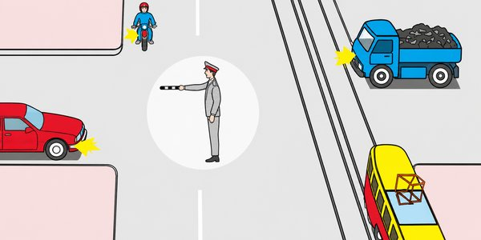

1. **Կարմիր ավտոմոբիլին։** ✅
2. Մոտոցիկլին։
3. Տրամվային եւ կարմիր ավտոմոբիլին։
4. Տրամվային։
5. Կապույտ ավտոմոբիլին։

### 6-39. Թույլատրվու՞մ է երթեւեկել նշված հետագծով, երբ դարձափոխային լուսացույցերն անջատված են։

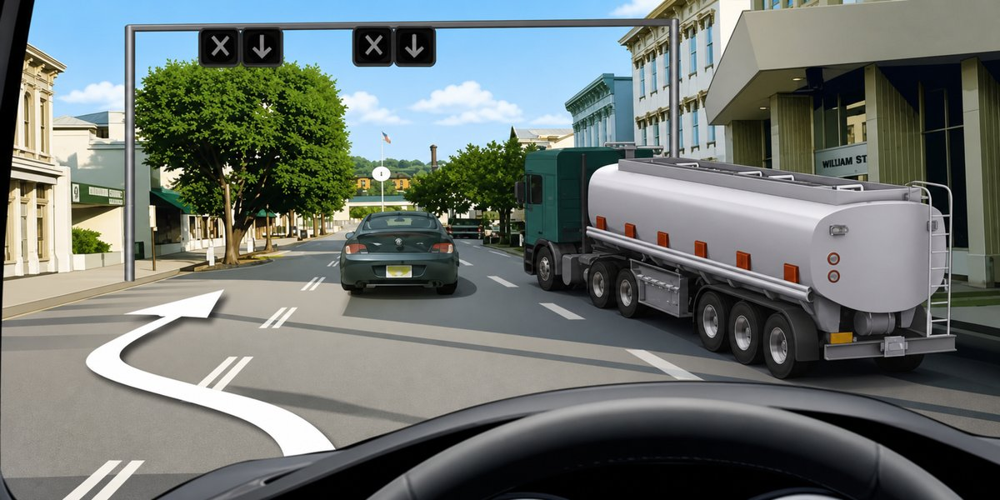

1. Թույլատրվում է
2. Թույլատրվում է վազանցելու նպատակով
3. **Արգելվում է** ✅
4. Թույլատրվում է՝ հանդիպակաց երթեւեկող տրանսպորտային միջոցների բացակայության դեպքում

### 6-40. Տվյալ իրավիճակում ո՞ր տրանսպորտային միջոցներն ունեն երթեւեկությունը շարունակելու իրավունք։

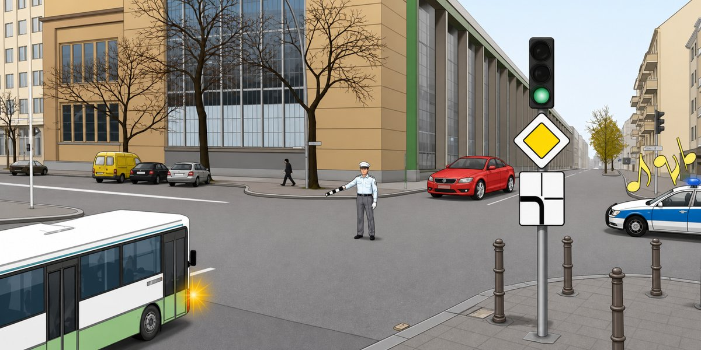

1. Թեթեւ մարդատար ավտոմոբիլը` ուղիղ, պարեկային ավտոմոբիլը` բոլոր ուղղություններով, ավտոբուսը` միայն աջ
2. Միայն պարեկային ավտոմոբիլը` բոլոր ուղղություններով
3. **Պարեկային ավտոմոբիլը` բոլոր ուղղություններով, ավտոբուսը` միայն աջ** ✅

### 6-41. Ի՞նչ է տեղեկացնում լուսացույցի ազդանշանը։

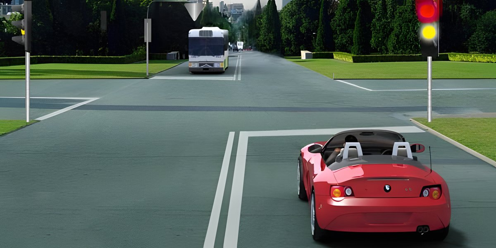

1. Լուսացույցն անսարք է
2. Խաչմերուկն անցնելիս վարորդները պետք է ղեկավարվեն ճանապարհային նշանի պահանջներով
3. **Վարորդները պետք է սպասեն լուսացույցի թույլատրող ազդանշանին** ✅

### 6-42. Թույլատրվու՞մ է թեթեւ մարդատար ավտոմոբիլի վարորդին առաջ անցնել ավտոբուսից, երբ դարձափոխային լուսացույցն անջատված է։

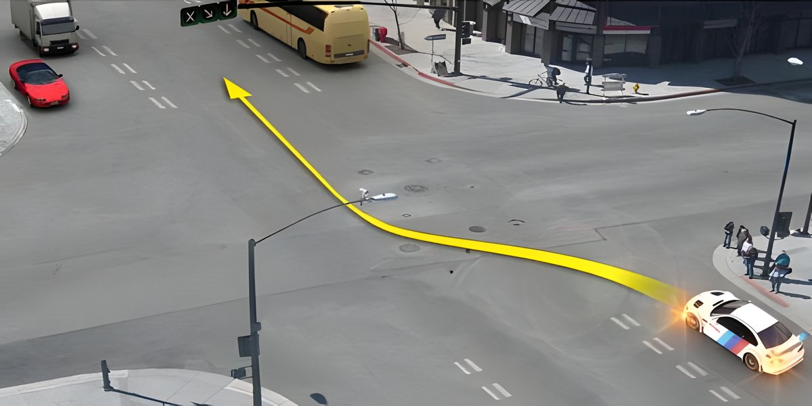

1. Թույլատրվում է
2. Թույլատրվում է, եթե ավտոբուսը շարժվում է 30 կմ/ժ արագությամբ
3. Թույլատրվում է, եթե չկան հանդիպակաց երթեւեկող տրանսպորտային միջոցներ
4. **Արգելվում է** ✅

### 6-43. Ո՞ր տրանսպորտային միջոցը պետք է զիջի ճանապարհը։

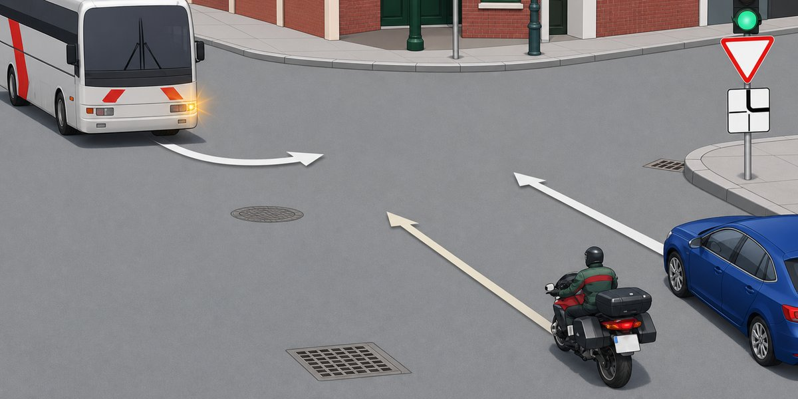

1. **Ավտոբուսը** ✅
2. Մոտոցիկլը եւ թեթեւ մարդատար ավտոմոբիլը

### 6-44. Նշված հետագծերով երթեւեկությունը շարունակելու իրավունք ունեն

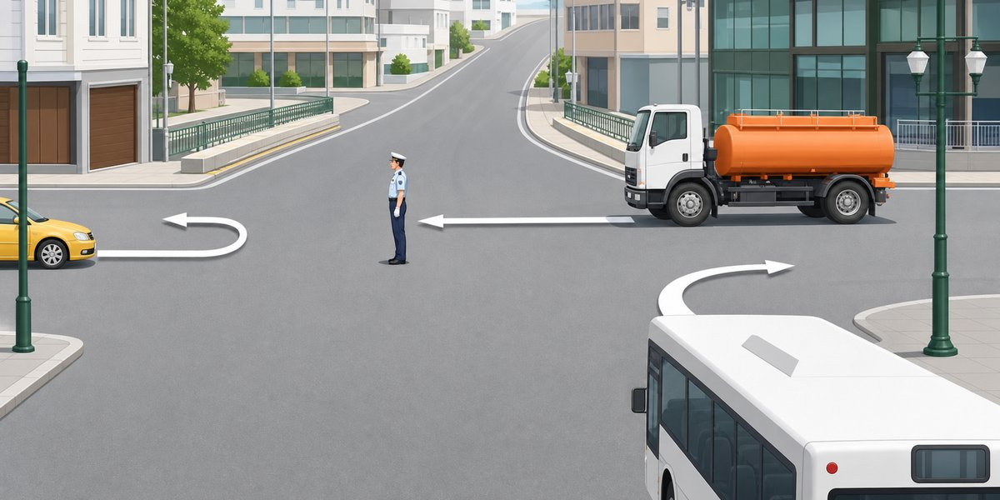

1. Բեռնատար ավտոմոբիլի վարորդը։
2. Ավտոբուսի եւ բեռնատար ավտոմոբիլների վարորդները։
3. Թեթեւ մարդատար ավտոմոբիլի եւ ավտոբուսի վարորդները։
4. **Ավտոբուսի վարորդը։** ✅

### 6-45. Տրանսպորտային միջոցները խաչմերուկը կանցնեն հետեւյալ հերթականությամբ՝

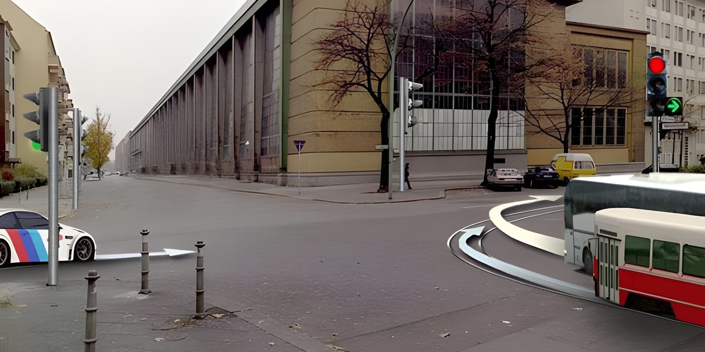

1. Տրամվայը, թեթեւ մարդատար ավտոմոբիլը, ավտոբուսը։
2. **Թեթեւ մարդատար ավտոմոբիլը, տրամվայը, ավտոբուսը։** ✅
3. Թեթեւ մարդատար ավտոմոբիլը, ավտոբուսը, տրամվայը։

### 6-46. Ո՞ր ուղղությամբ կարող է վարորդը շարունակել երթեւեկությունը։

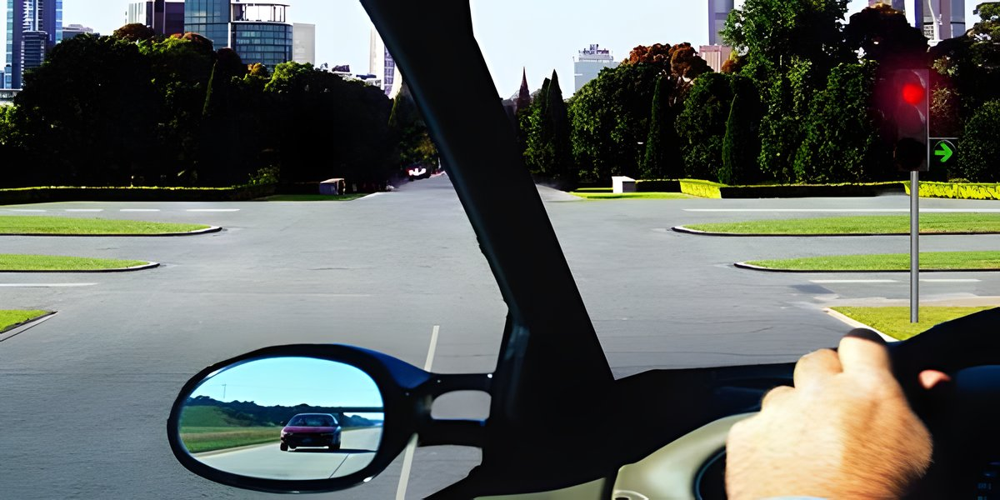

1. **Դեպի աջ` առաջին անցումով** ✅
2. Դեպի աջ` առաջին եւ երկրորդ անցումներով
3. Դեպի ձախ` առաջին անցումով

### 6-47. Աջ շրջադարձի դեպքում վարորդը պարտավոր է ճանապարհը զիջել

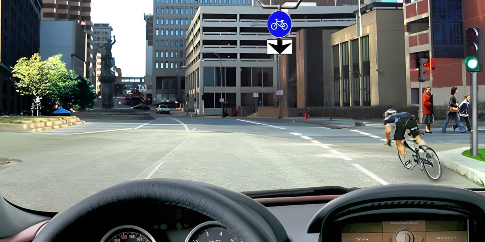

1. Միայն հեծանվորդին։
2. Միայն հետիոտներին։
3. **Հետիոտներին եւ հեծանվորդին։** ✅
4. Կարող է շարունակել երթեւեկությունը՝ առանց կանգ առնելու։

### 6-48. Տրանսպորտային միջոցները խաչմերուկը կանցնեն հետեւյալ հերթականությամբ՝

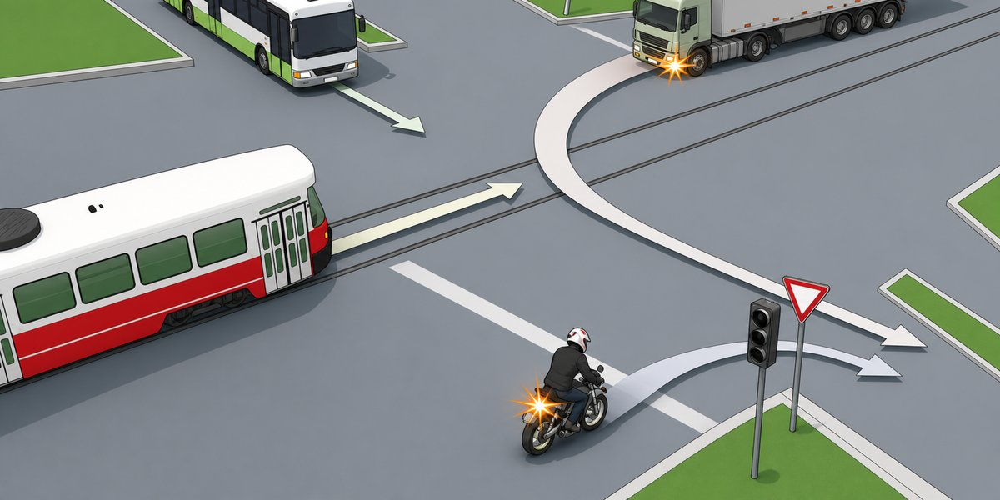

1. Տրամվայը, ավտոբուսը, բեռնատար ավտոմոբիլը, մոտոցիկլը։
2. Ավտոբուսը, բեռնատար ավտոմոբիլը, տրամվայը, մոտոցիկլը։
3. **Ավտոբուսը, տրամվայը եւ մոտոցիկլը, բեռնատար ավտոմոբիլը։** ✅

### 6-49. Այս իրավիճակում ո՞ր տրամվայի վարորդին պետք է զիջել ճանապարհը։

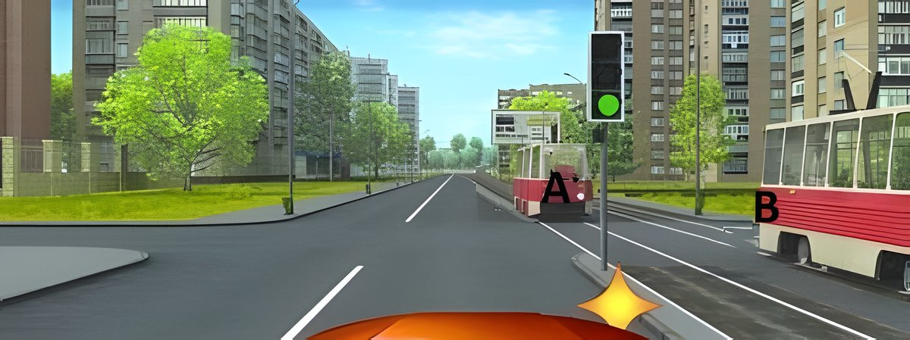

1. Ոչ մեկին
2. **Երկու տրամվայների** ✅
3. Միայն A

### 6-50. Ո՞ր վարորդն ունի առաջնահերթ երթևեկության իրավունք։

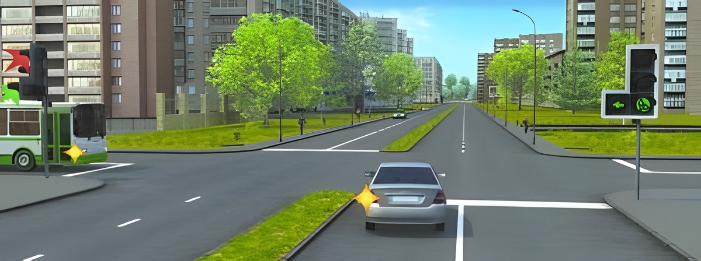

1. Ավտոբուսի վարորդը
2. **Թեթև մարդատարի վարորդը** ✅

### 6-51. Այս իրավիճակում ձախ շրջադարձ կատարելիս

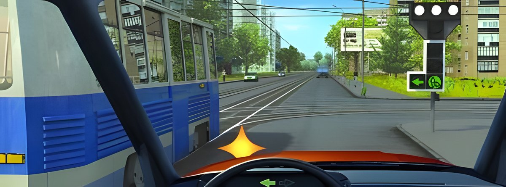

1. Կզիջեմ ճանապարհը տրամվային։
2. **Խաչմերուկն առաջինը կանցնեմ։** ✅

### 6-52. Ինչպե՞ս վարվել այս իրավիճակում։

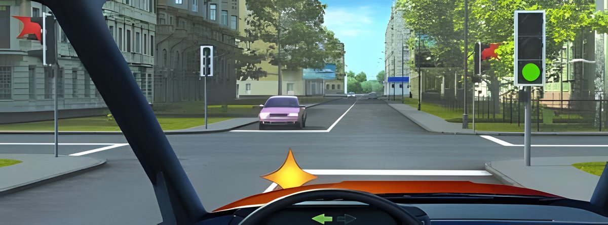

1. **Մուտք գործել խաչմերուկ և, զիջելով ճանապարհը թեթև մարդատարի վարորդին, անցնել խաչմերուկը** ✅
2. Սպասել «Կանգ-գծի» առջև, մինչև թեթև մարդատարի վարորդը կանցնի խաչմերուկը
3. Անցնել առաջինը

### 6-53. Ո՞ր վարորդն է խախտում երթևեկության կանոնները շրջադարձ կատարելիս։

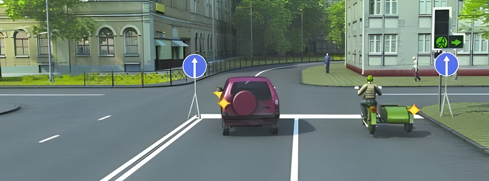

1. Թեթև մարդատարի
2. Մոտոցիկլի
3. **Երկու վարորդներն էլ** ✅
4. Ոչ ոք

### 6-54. Աջ շրջադարձ կատարելիս այս իրավիճակում զիջել ճանապարհը

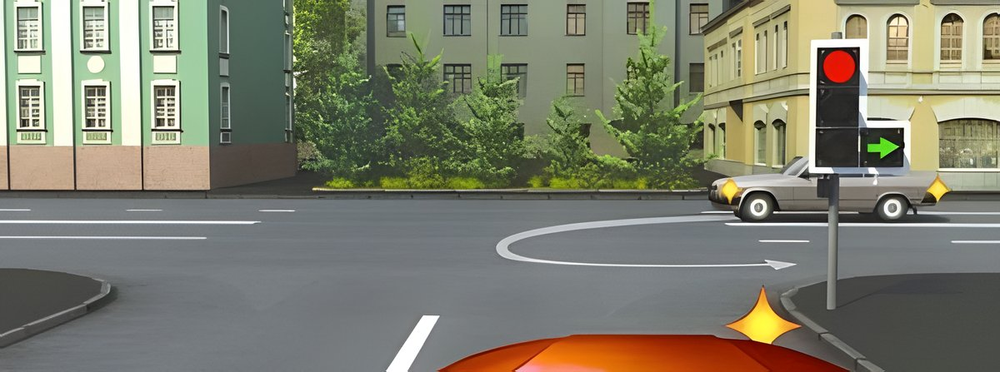

1. **Պարտավոր եք։** ✅
2. Պարտավոր չեք։

### 6-55. Աջ շրջադարձ թույլատրելի է՞ այս իրավիճակում։

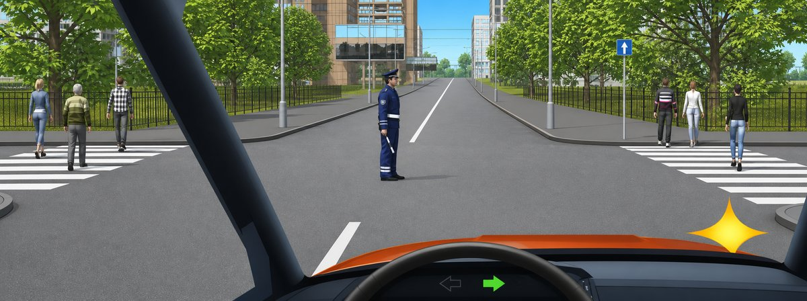

1. **Այո՝ չխոչընդոտելով հետիոտններին** ✅
2. Ոչ

### 6-56. Զիջել ճանապարհը տրամվայի վարորդին այս իրավիճակում

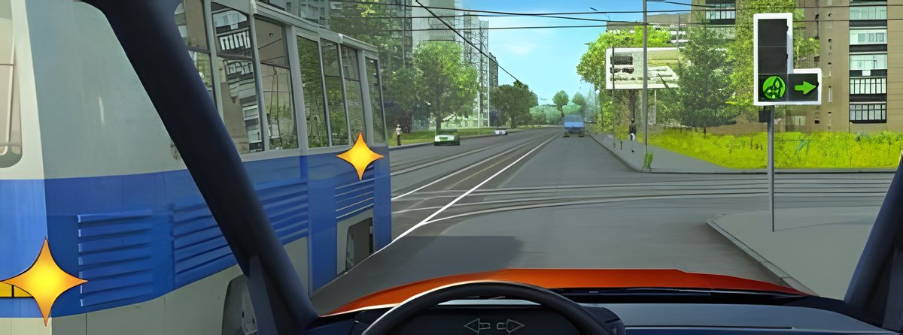

1. Պարտավոր չեք
2. **Պարտավոր եք։** ✅

### 6-57. Կանաչ ազդանշանը միանալու դեպքում վարորդը

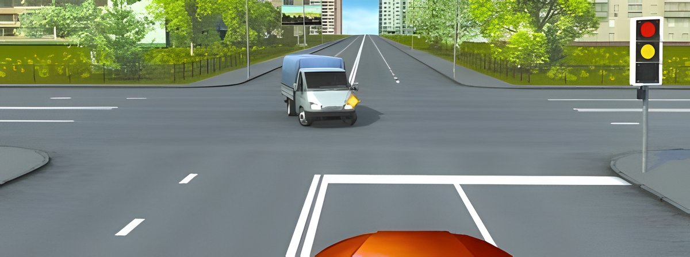

1. **Պետք է զիջի բեռնատարի վարորդին։** ✅
2. Ունի առաջնահերթ երթևեկելու իրավունք։

### 6-58. Այս խաչմերուկում վարորդը

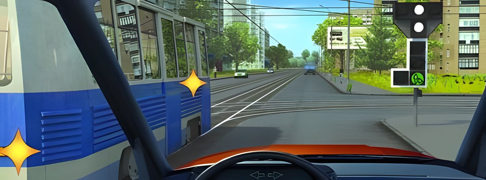

1. **Կանցնի առաջինը։** ✅
2. Պետք է զիջի ճանապարհը տրամվային։

### 6-59. Խաչմերուկն ուղիղ անցնելիս վարորդը

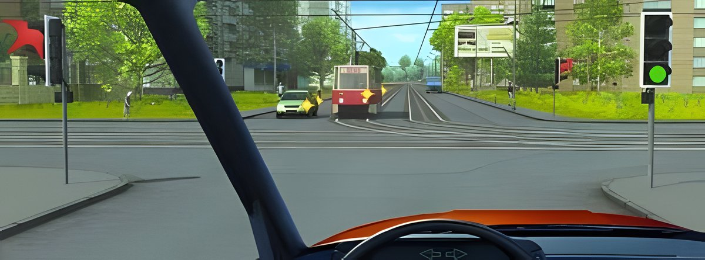

1. Կարող է առաջինն անցնել։
2. **Պետք է զիջի տրամվային։** ✅
3. Պետք է զիջի երկու վարորդներին։

### 6-60. Շրջադարձը կատարելիս վարորդը պարտավոր է ճանապարհը զիջել

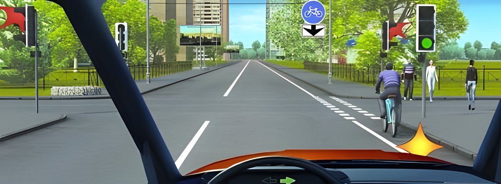

1. Միայն հետիոտներին։
2. Հեծանվորդին։
3. **Հեծանվորդին և հետիոտներին։** ✅

### 6-61. Աջ շրջադարձ կատարելիս պարտավո՞ր եք զիջել ճանապարհը հանդիպակաց գոտուց մոտեցող վարորդին։

1. Այո
2. **Ոչ** ✅

### 6-62. Խաչմերուկն ուղիղ անցնելիս

1. Կարող ենք անցնել առաջինը։
2. **Պարտավոր ենք զիջել ճանապարհը թեթև մարդատարի վարորդին։** ✅

### 6-63. Ձախ շրջադարձ կատարելիս պետք է զիջել

1. Միայն թեթև մարդատարի վարորդին։
2. Միայն հետիոտներին։
3. **Թեթև մարդատարի վարորդին և հետիոտներին։** ✅

### 6-64. Այս իրավիճակում աջ շրջադարձ թույլատրվո՞ւմ է։

1. Ոչ
2. **Այո՝ չխոչընդոտելով հետիոտնին** ✅

### 6-65. Ձախ շրջադարձը կատարելիս

1. **Պարտավոր եք զիջել տրամվայի վարորդին։** ✅
2. Խաչմերուկն անցնել առաջինը

### 6-66. Ո՞ր ճանապարհային նշանները չեն գործում, երբ դրանց պահանջները հակասում են լուսացույցի ազդանշաններին:

1. **Առավելության նշանները** ✅
2. Արգելող նշանները
3. Թելադրող նշանները
4. Բոլոր թվարկվածները

### 6-67. Այս իրավիճակում ճանապարհը պարտավոր է զիջել

1. Թեթև մարդատարի վարորդը։
2. **Տրամվայի վարորդը։** ✅

### 6-68. Աջ շրջադարձ կատարելիս

1. Պարտավոր ենք զիջել ճանապարհը տրամվայի վարորդին։
2. **Խաչմերուկը կանցնենք առաջինը։** ✅

### 6-69. Մտադիր եք կատարել ձախ շրջադարձ: Ո՞ւմ եք պարտավոր զիջել ճանապարհը։

1. Միայն տրամվայի վարորդին
2. Ոչ ոքի
3. **Ավտոմոբիլի և տրամվայի վարորդներին** ✅

### 6-70. Ձախ շրջադարձ կատարելիս

1. Մանևրը կկատարեմ՝ առանց կանգ առնելու:
2. **Խաչմերուկ մուտք գործելուց հետո կկանգնեմ երկրորդ ՛՛Կանգ-գծի՛՛ առջև և կսպասեմ կանաչ ազդանշանի միանալուն** ✅

### 6-71. Պարտավոր ենք արդյո՞ք այս իրավիճակում զիջել բեռնատարի վարորդին։

1. **Այո** ✅
2. Ոչ

### 6-72. Այս իրադրությունում ձախ շրջադարձ կատարելիս պետք է

1. Մուտք գործել խաչմերուկ և սպասել կարգավորողի՝ ձախ շրջադարձ թույլատրող ազդանշանին։
2. **Կանգ առնել ՛՛Կանգ-գիծ՛՛ գծանշման առջև և սպասել կարգավորողի՝ ձախ շրջադարձ թույլատրող ազդանշանին։** ✅
3. Դուրս գալ խաչմերուկ և հանդիպակաց գոտուց մոտեցող վարորդին ճանապարհը զիջելուց հետո անցնել խաչմերուկը:

### 6-73. Ո՞ր դեպքում կարող եք խաչմերուկն անցնել առանց ճանապարհը զիջելու՝ երթևեկության այլ մասնակցին։

1. **Ուղիղ անցնելու դեպքում** ✅
2. Աջ շրջադարձ կատարելիս
3. Ձախ շրջադարձ կատարելիս

### 6-74. Աջ շրջադարձ կատարելիս պետք է

1. Կանգ առնել «Կանգ-գծի» առջև՝ հետիոտններին չխոչընդոտելու նպատակով։
2. **Մտնելով խաչմերուկ կանգ առնել՝ հետիոտններին չխոչընդոտելու նպատակով։** ✅
3. Անցնել խաչմերուկը՝ առանց կանգ առնելու։

### 6-75. Աջ շրջադարձ կատարելիս

1. Պետք է զիջել ճանապարհը թեթև մարդատարի վարորդին։
2. **Առաջինը անցնել խաչմերուկը։** ✅

### 6-76. Լուսացույցի թույլատրող ազդանշանի միանալուց հետո խաչմերուկ մուտք գործել կարող ենք

1. **Միայն հետադարձ կամ շրջադարձ կատարելու դեպքում։** ✅
2. Բոլոր դեպքերում։

### 6-77. Լուսացույցի կանաչ ազդանշանի միացման դեպքում պարտավոր ենք

1. **համոզվել, որ հետիոտնային անցման չերևացող մասում չկան անցումը չավարտած հետիոտներ:** ✅
2. լուսացույցի ազդանշանի համաձայն անմիջապես սկսել երթևեկությունը:

### 6-78. Այս իրավիճակում ձախ շրջվելիս պարտավոր եք ճանապարհը զիջել

1. Միայն հետիոտնին։
2. Ավտոբուսի վարորդին։
3. **Ավտոբուսի վարորդին և հետիոտնին։** ✅
4. Ոչ ոքի։

### 6-79. Պարտավո՞ր եք արդյոք ճանապարհը զիջել ավտոբուսին։

1. **Այո** ✅
2. Ոչ

### 6-80. Այս իրավիճակում հետադարձ կատարելիս ճանապարհը զիջել մյուս վարորդին

1. Պարտավոր չենք։
2. **Պարտավոր ենք։** ✅

### 6-81. Այս իրավիճակում ո՞ր ուղղությամբ կարող է վարորդը շարունակել երթևեկությունը։

1. **Միայն ուղիղ** ✅
2. Ուղիղ և աջ
3. Ուղիղ և ձախ
4. Բոլոր

### 6-82. Ո՞ր վարորդը կարող է շարունակել երթևեկությունը։

1. Ոչ ոք
2. Միայն ավտոբուսի վարորդը
3. **Երկու վարորդներն էլ** ✅

### 6-83. Գծանցն անցնելը

1. **Թույլատրված է։** ✅
2. Արգելված է։

### 6-84. Վարորդին խաչմերուկն անցնել

1. **արգելվում է։** ✅
2. թույլատրվում է բոլոր դեպքերում։
3. թույլատրվում է, եթե նա հնարավորություն չունի առանց կտրուկ արգելակելու կանգնել «Կանգ-գծի» առջև:

### 6-85. Լուսացույցի ազդանշանին ենթարկվելով՝ որտե՞ղ պետք է կանգնել։

1. **Լուսացույցի առջև** ✅
2. Հատվող երթևեկելի մասի առջև
3. Ցանկացած տեղում

### 6-86. Ձախ շրջադարձ կատարելը թույլատրվում է

1. Դարձափոխային գոտուց։
2. **Նկարում նշված գոտուց։** ✅

### 6-87. Երթևեկությունը թույլատրվում է

1. Միայն ուղիղ։
2. Միայն աջ։
3. **Ուղիղ և աջ։** ✅

### 6-88. Երթևեկությունը թույլատրվում է

1. Ուղիղ և աջ։
2. Միայն ուղիղ։
3. **Միայն աջ։** ✅

### 6-89. Լուսացույցի կանաչ ազդանշանին պատկերված սլաքները տեղեկացնում են, որ

1. Աջ շրջադարձն արգելված է։
2. **Աջ ուղղությամբ երթևեկությունը կարգավորվում է լրացուցիչ սեկցիայով:** ✅

### 6-90. Վազանցել բեռնատարին թույլատրվու՞մ է։

1. Այո
2. **Ոչ** ✅

### 6-91. Ո՞ր ուղղությամբ վարորդը կարող է շարունակել երթևեկությունը այս իրավիճակում։

1. Միայն ձախ
2. Պետք է սպասի թույլատրող ազդանշանի
3. **Ձախ և հակառակ** ✅

### 6-92. Այս իրավիճակում մուտք գործել դարձափոխային երթևեկության գոտի

1. **Թույլատրվում է։** ✅
2. Թույլատրվում է միայն վազանց կատարելու նպատակով։
3. Արգելվում է։

### 6-93. Նշված գոտուց ուղիղ երթևեկությունը

1. Թույլատրվում է։
2. Թույլատրվում է միայն հիմնական կանաչ ազդանշանի միանալուց հետո։
3. **Արգելվում է։** ✅

### 6-94. Երթևեկությունը թույլատրվում է

1. Ուղիղ և աջ։
2. Միայն աջ։
3. **Բոլոր ուղղություններով։** ✅

### 6-95. Այս իրավիճակում երթևեկությունը

1. Թույլատրվում է։
2. **Արգելվում է։** ✅
