# Խումբ 7 (129 հարց)

Ճիշտ պատասխանը **թավ** է և նշված ✅-ով։ Աղբյուր՝ roadpolice.am, ABC կարգեր։

### 7-1. Ո՞ր տրանսպորտային միջոցներին է թույլատրվում կայանումը։

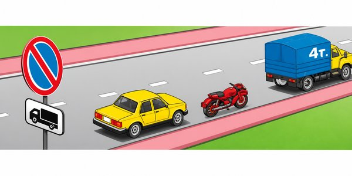

1. Միայն մոտոցիկլին
2. Միայն բեռնատար ավտոմոբիլին
3. Միայն թեթեւ մարդատար ավտոմոբիլին
4. **Թեթեւ մարդատար ավտոմոբիլին եւ մոտոցիկլին** ✅
5. Բոլոր տրանսպորտային միջոցներին

### 7-2. Կայանումն արգելվում է

1. Կամուրջների, էստակադների եւ ուղեկամուրջների վրա։
2. Կամուրջների, էստակադների եւ ուղեկամուրջների տակ։
3. **Թվարկած բոլոր դեպքերում։** ✅

### 7-3. Թույլատրվու՞մ է արդյոք ուղեւոր իջեցնել ճանապարհի այն տեղում, որտեղ եզրաքարի վերին մակերեսին գծված է դեղին հոծ գիծ եւ տեղադրված է «Կանգառն արգելվում է» նշանը։

1. Թույլատրվում է
2. **Արգելվում է** ✅
3. Թույլատրվում է՝ ընդհանուր օգտագործման տրանսպորտային միջոցների բացակայության դեպքում
4. Թույլատրվում է միայն ընդհանուր օգտագործման տրանսպորտային միջոցներին

### 7-4. Ազդու՞մ է արդյոք արգելող նշանը ճանապարհի այն հատվածի վրա, որտեղ կանգառ է կատարել վարորդը։

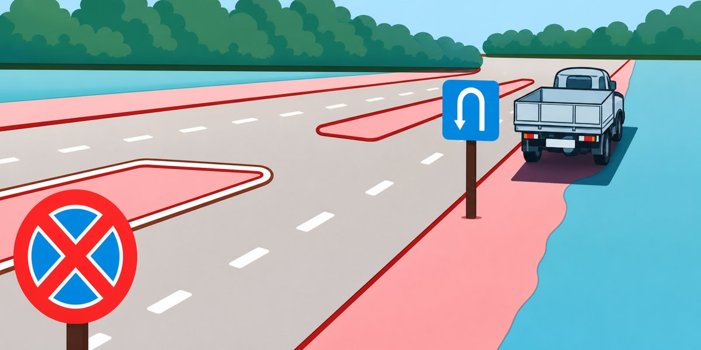

1. **Ազդում է** ✅
2. Չի ազդում

### 7-5. Թույլատրվու՞մ է արդյոք ավտոմոբիլի կայանումը նշված տեղում։

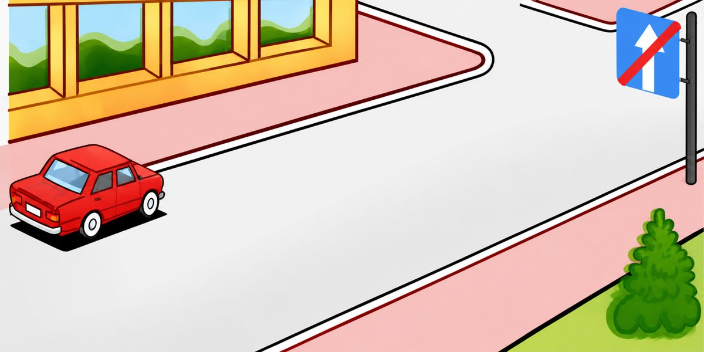

1. **Թույլատրվում է** ✅
2. Արգելվում է

### 7-6. Երկաթուղային գծանցներից ի՞նչ հեռավորության վրա է արգելվում տրանսպորտային միջոցների կայանումը։

1. 300 մ
2. 150 մ
3. 100 մ
4. 50 մ
5. **25 մ** ✅

### 7-7. Թույլատրվու՞մ է արդյոք տվյալ դեպքում կանգ առնել՝ ուղեւոր իջեցնելու համար։

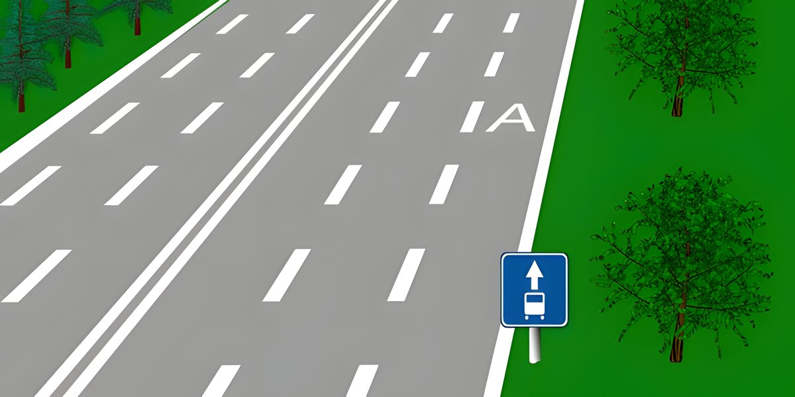

1. **Թույլատրվում է, եթե դա չի խոչընդոտի ընդհանուր օգտագործման տրանսպորտային միջոցների երթեւեկությանը** ✅
2. Արգելվում է

### 7-8. Վարորդներից ո՞րն է պարտավոր կանգ առնել։

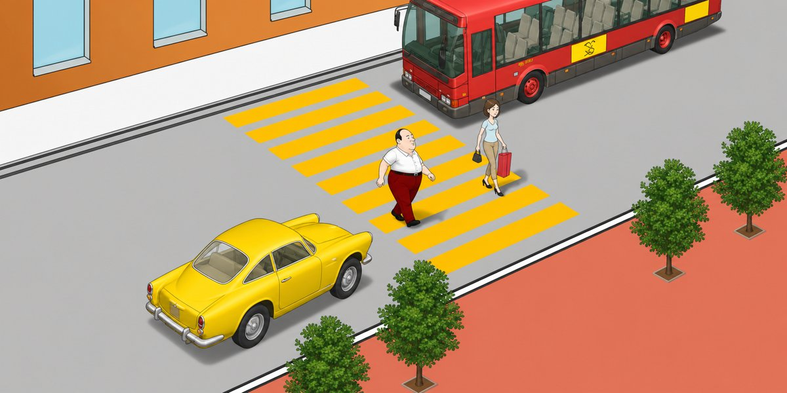

1. **Թեթեւ մարդատար ավտոմոբիլի վարորդը** ✅
2. Ավտոբուսի վարորդը
3. Երկու վարորդներն էլ

### 7-9. Տվյալ ճանապարհային գծանշումը թույլատրում է երթեւեկել

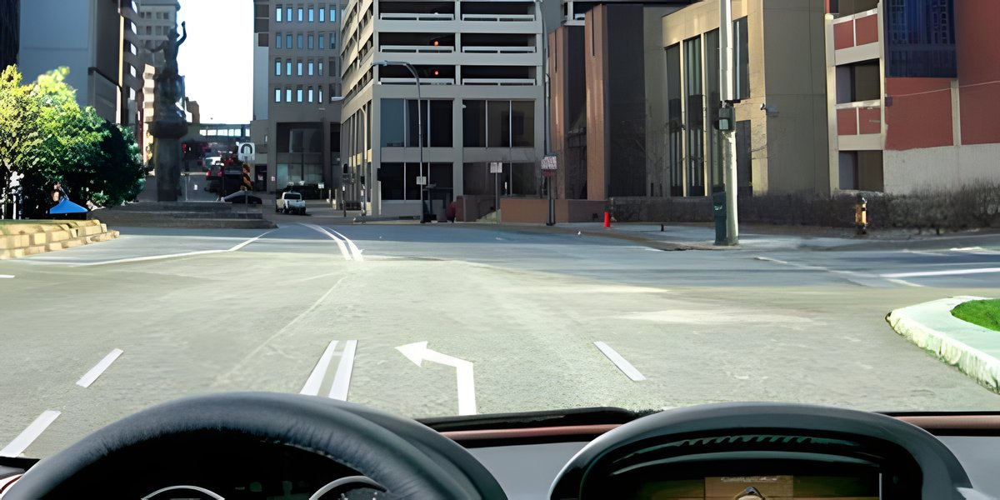

1. Միայն դեպի ձախ։
2. **Դեպի ձախ եւ հակառակ ուղղությամբ։** ✅
3. Միայն հակառակ ուղղությամբ։
4. Ուղիղ, ձախ եւ հակառակ ուղղությամբ։

### 7-10. Ո՞ր տրանսպորտային միջոցներին է թույլատրվում կայանել տվյալ ճանապարհային նշանի ազդեցության գոտում։

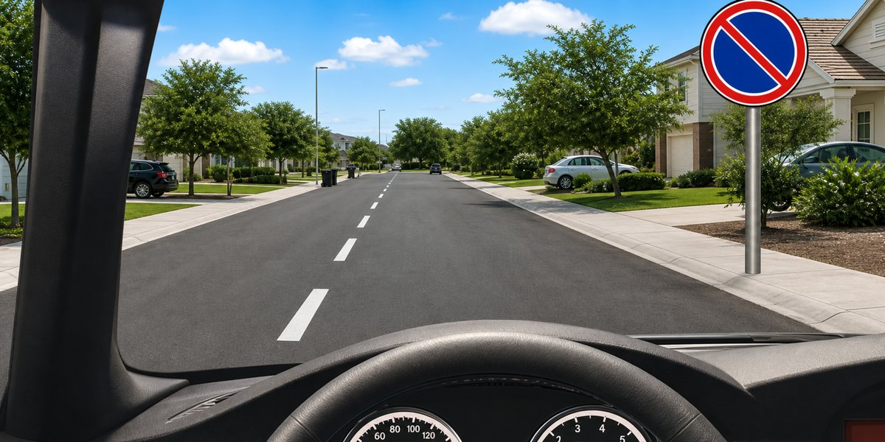

1. Միայն ընդհանուր օգտագործման տրանսպորտային միջոցներին
2. **Այն տրանսպորտային միջոցներին, որոնք վարում են հաշմանդամները, եւ միացված հաշվիչով տաքսիներին** ✅

### 7-11. Ի՞նչ է նշանակում տվյալ ճանապարհային գծանշումը։

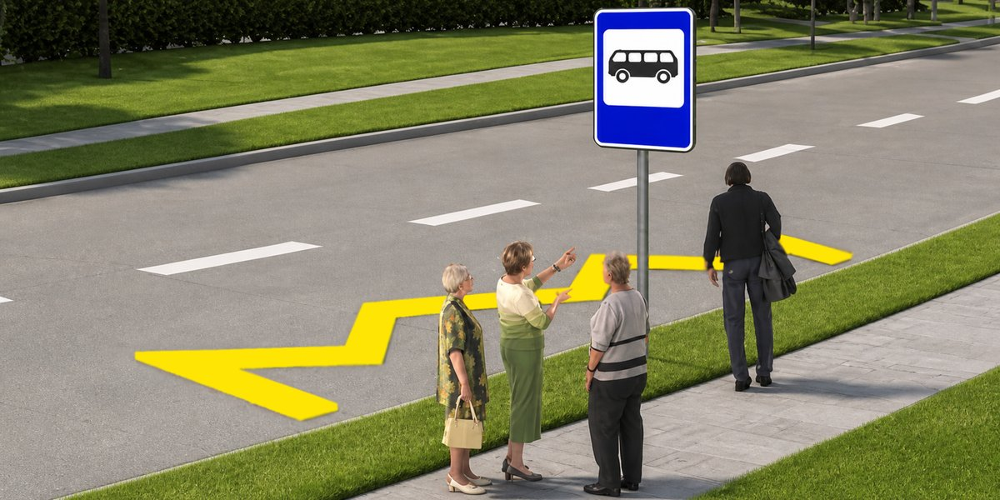

1. Ուղեւորներ նստեցնելու-իջեցնելու տեղ
2. **Ընդհանուր օգտագործման տրանսպորտային միջոցների կանգառի կետ** ✅
3. Ընդհանուր օգտագործման տրանսպորտային միջոցների կանգառի եւ տաքսիների կայանման տեղ

### 7-12. Ի՞նչ է ցույց տալիս հորիզոնական գծանշման դեղին հոծ գիծը։

1. **Այն տեղը, որտեղ արգելվում է տրանսպորտային միջոցների կանգառը եւ կայանումը** ✅
2. Այն տեղը, որտեղ թույլատրվում է կանգառ կատարել՝ ուղեւորներ իջեցնելու կամ տրանսպորտային միջոցը բեռնաթափելու համար
3. Այն տեղը, որտեղ արգելվում է տրանսպորտային միջոցների կայանումը

### 7-13. Թույլատրվու՞մ է արդյոք վարորդին հատել տրանսպորտային միջոցների կայանման տեղերի սահմանները նշող գծանշման հոծ գիծը։

1. Արգելվում է
2. **Թույլատրվում է։** ✅

### 7-14. Սլաքներով նշված ո՞ր ուղղություններով է թույլատրվում երթեւեկությունը։

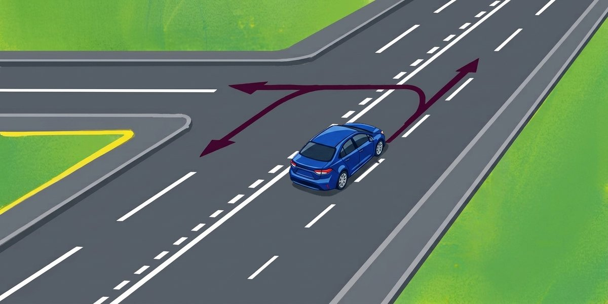

1. **Միայն ուղիղ** ✅
2. Դեպի ձախ եւ հակառակ ուղղությամբ
3. Ուղիղ, դեպի ձախ եւ հակառակ ուղղությամբ

### 7-15. Ի՞նչ է ցույց տալիս այս գծանշումը։

1. Հետիոտնային անցում, որտեղ երթեւեկությունը կարգավորվում է լուսացույցով
2. **Այն տեղը, որտեղ հեծանվային արահետը հատում է ճանապարհի երթեւեկելի մասը** ✅
3. Այն տեղը, որտեղ հետիոտնային արահետը հատում է ճանապարհի երթեւեկելի մասը

### 7-16. Քանի՞ գոտի ունի ճանապարհը, որտեղ հանդիպակաց ուղղությունների տրանսպորտային հոսքերը բաժանվում են կրկնակի հոծ գծերով։

1. Երկու գոտի
2. Երկու կամ երեք գոտի
3. Երեք գոտի
4. **Չորս եւ ավելի գոտիներ** ✅

### 7-17. Ի՞նչ են նախազգուշացնում երթեւեկելի մասի վրա գծանշված սլաքները։

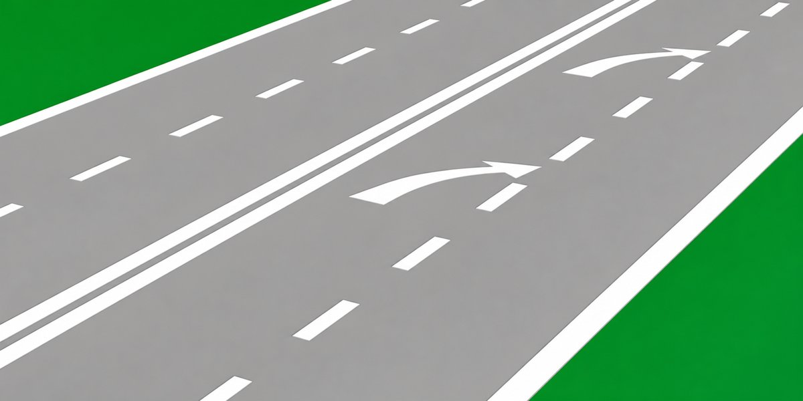

1. Նախազգուշացնում են վարորդին ճանապարհի վտանգավոր հատվածին մոտենալու մասին
2. **Նախազգուշացնում են երթեւեկության գոտու վերջին մոտենալու մասին** ✅
3. Ցույց են տալիս ճանապարհի վտանգավոր շրջադարձի ուղղությունը

### 7-18. Գծանշման այս գծերից ո՞րն է օգտագործվում դարձափոխային երթեւեկությամբ գոտիները նշելու համար։

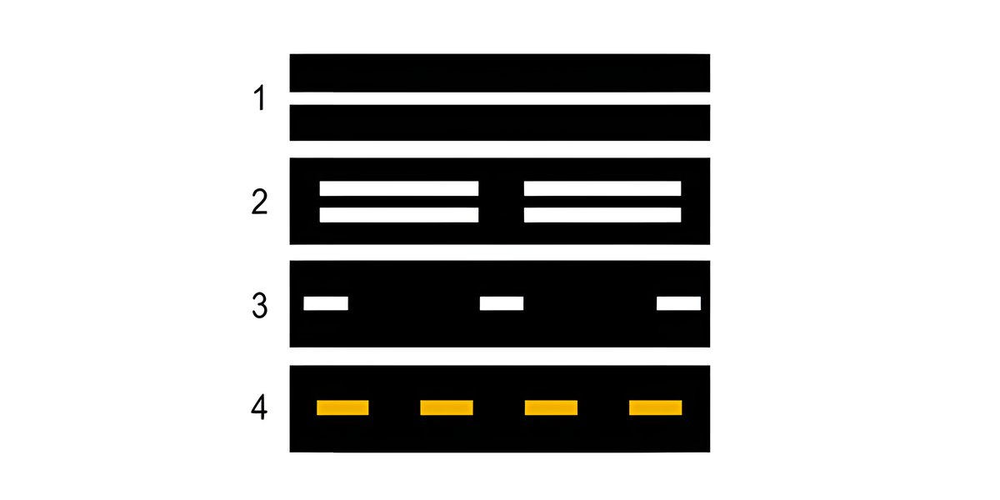

1. 1-ին գիծը
2. **2-րդ գիծը** ✅
3. 3-րդ գիծը
4. 2-րդ եւ 3 -րդ գծերը
5. 3-րդ եւ 4 -րդ գծերը

### 7-19. Որտե՞ղ է գծվում կանգառը եւ կայանումն արգելող տեղերը նշող դեղին հոծ գիծը։

1. Երթեւեկելի մասի վրա
2. Երթեւեկելի մասի եզրի մոտ
3. **Երթեւեկելի մասի եզրի մոտ կամ եզրաքարի վերին մակերեսին** ✅
4. Միայն եզրաքարի վերին մակերեսին

### 7-20. Ճանապարհային նշաններից որի՞ հետ կարող է կիրառվել դեղին գույնի ընդհատվող գծանշումը։

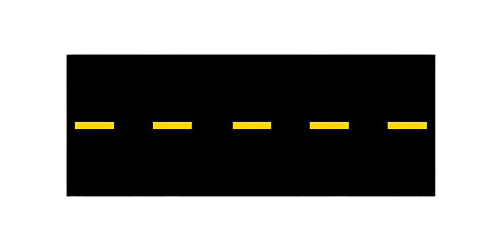

1. «Կանգառն արգելվում է»
2. **«Կայանելն արգելվում է»** ✅
3. «Կայանելն արգելվում է ամսվա կենտ օրերին»

### 7-21. Ո՞ր տրանսպորտային միջոցներին է թույլատրվում երթեւեկել երթեւեկելի մասի աջ գոտիով։

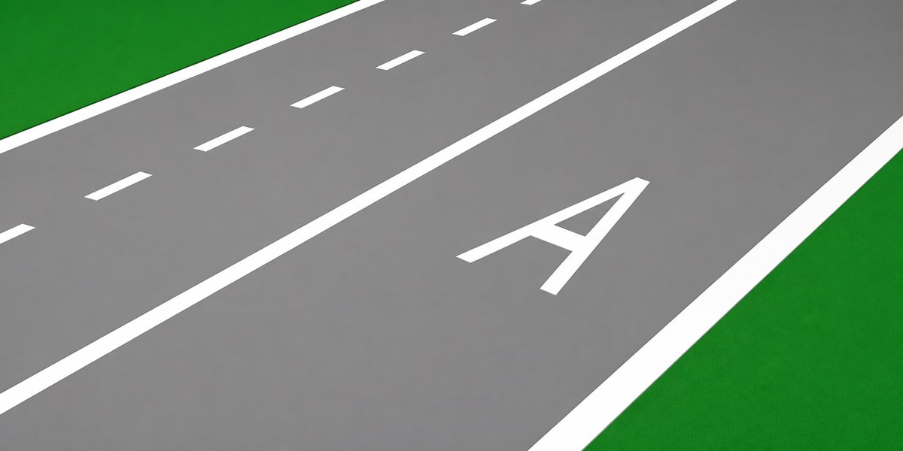

1. Բոլոր մեխանիկական տրանսպորտային միջոցներին
2. Ընդհանուր օգտագործման տրանսպորտային միջոցներին եւ տաքսիներին
3. Միայն հեծանիվներին
4. **Միայն ընդհանուր օգտագործման տրանսպորտային միջոցներին** ✅

### 7-22. Այս ճանապարհային գծանշումն ունի հետեւյալ նշանակությունը։

1. Ցույց է տալիս մայթամերձ կայանման տեղերը, որտեղ նշված են մեխանիկական տրանսպորտային միջոցների կանգնեցման ձեւերը
2. Ցույց է տալիս այն տեղերը, որտեղ արգելվում է մեխանիկական տրանսպորտային միջոցների կանգառը
3. **Ցույց է տալիս ընդհանուր օգտագործման տրանսպորտային միջոցների կանգառի կետերը եւ տաքսիների կայանման վայրերը** ✅

### 7-23. Այս հորիզոնական ճանապարհային գծանշումը ցույց է տալիս

1. Երթեւեկելի մասի նեղացումը, որտեղ նվազում է երթեւեկության գոտիների քանակը տվյալ ուղղությամբ։
2. **Այն տեղը, որտեղ վարորդը պետք է անհրաժեշտության դեպքում կանգ առնի` հատվող ճանապարհով երթեւեկող տրանսպորտային միջոցներին ճանապարհը զիջելու համար։** ✅
3. Մոտեցում դեպի կանգառն արգելված տեղին։

### 7-24. Թույլատրվու՞մ է արդյոք մուտք գործել սպիտակ լայն գծերով նշված ուղղորդ կղզյակ։

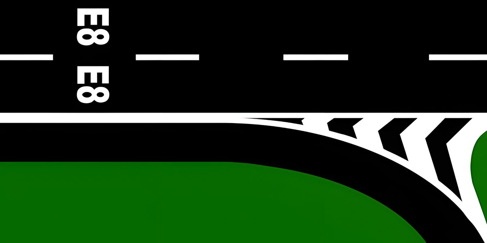

1. Թույլատրվում է միայն կանգառ կատարելու համար
2. Թույլատրվում է հետընթացի ժամանակ
3. **Արգելվում է** ✅

### 7-25. Ինչպե՞ս պետք է վարվի վարորդը՝ մոտենալով խաչմերուկին՝ «Կանգ - գիծ» գծանշման եւ լուսացույցի կանաչ ազդանշանի պայմաններում։

1. Կանգ առնի «Կանգ-գծի» մոտ, որից հետո վերսկսի երթեւեկությունը
2. **Շարունակի երթեւեկությունը խաչմերուկով` առանց կանգառի** ✅

### 7-26. Ի՞նչ է ցույց տալիս այս գծանշումը։

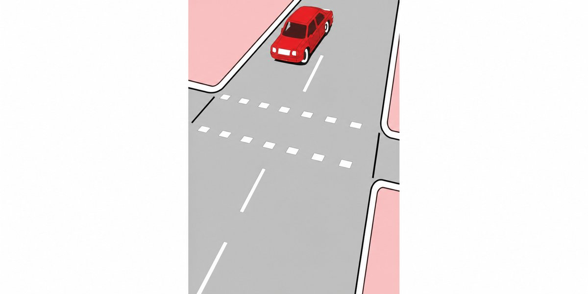

1. Հետիոտնային անցում
2. **Այն տեղը, որտեղ հեծանվային արահետը հատում է ճանապարհի երթեւեկելի մասը** ✅
3. Անասուններ քշելու համար նախատեսված տեղ

### 7-27. Վարորդը որտե՞ղ պետք է կանգնեցնի տրանսպորտային միջոցն այս գծանշման առկայության դեպքում։

1. **Գծանշման մոտ** ✅
2. Գծանշման վրա
3. Գծանշումից ոչ պակաս, քան 5մ հեռավորության վրա

### 7-28. Ի՞նչ է նշանակում այս գծանշումը։

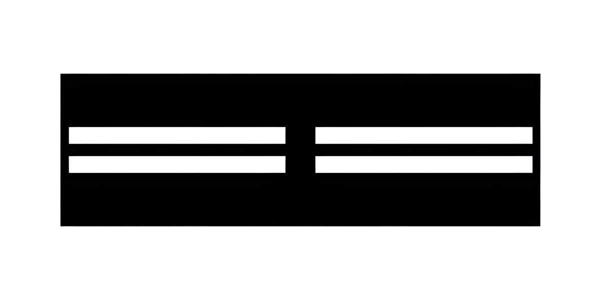

1. Ընդհանուր օգտագործման տրանսպորտային միջոցների համար նախատեսված երթեւեկության գոտի
2. Հատուկ նշանակության ավտոմոբիլների համար նախատեսված երթեւեկության գոտի
3. **Ցույց է տալիս երթեւեկության այն գոտիների սահմանները, որտեղ իրականացվում է դարձափոխային կարգավորում** ✅

### 7-29. Թույլատրվու՞մ է արդյոք նշված վայրում հետադարձ կատարել։

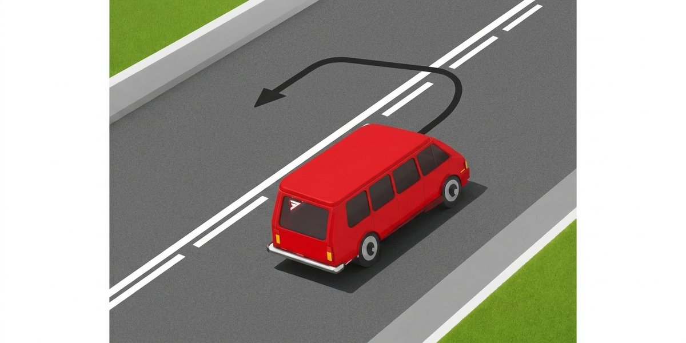

1. **Թույլատրվում է** ✅
2. Արգելվում է

### 7-30. Թույլատրվու՞մ է արդյոք տվյալ գծանշման առկայության դեպքում զբոսաշրջության երթուղով ընթացող ավտոբուսի վարորդին մուտք գործել «A» գծանշումով գոտի։

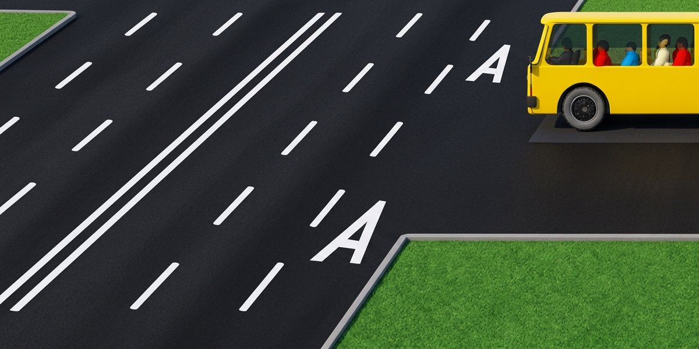

1. **Թույլատրվում է** ✅
2. Արգելվում է

### 7-31. Ի՞նչ է ցույց տալիս ընդհատվող լայն գծի տեսքով գծանշումը։

1. Երթեւեկելի մասի եւ կողնակի միջեւ առկա սահմանը
2. **Երթեւեկելի մասի հիմնական գոտու եւ թափառքի գոտու միջեւ առկա սահմանը** ✅
3. Երթեւեկելի մասի հիմնական գոտու եւ արգելակման գոտու միջեւ առկա սահմանը

### 7-32. Ո՞ր ավտոմոբիլին է թույլատրվում կանգառ կատարել այս նշանների ազդման գոտում։

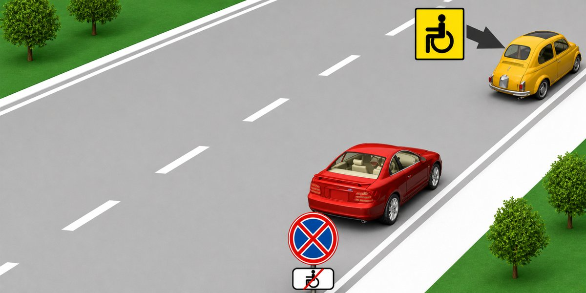

1. Կարմիրին
2. Երկու ավտոմոբիլներին էլ
3. Ոչ մեկին
4. **Դեղինին՝ «Հաշմանդամ» ճանաչման նշանով կահավորված** ✅

### 7-33. Ո՞ր նկարում է վարորդը ճիշտ կատարել կանգառ` ուղեւորներ իջեցնելու համար։

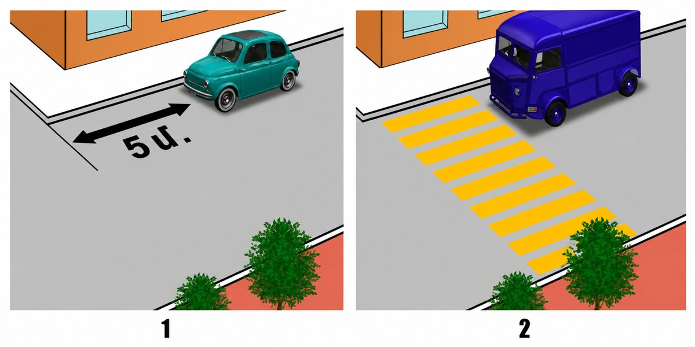

1. **Ձախ նկարում** ✅
2. Երկու նկարներում էլ
3. Աջ նկարում

### 7-34. Որպես գնացքի կանգառի ազդանշան ծառայում է

1. **Ձեռքի շրջանաձեւ շարժումը (ցերեկը` վառ գույնի լաթով կամ որեւէ լավ տեսանելի առարկայով, գիշերը` ջահով կամ լապտերով)։** ✅
2. Սկավառակով կամ կարմիր դրոշակով գլխավերեւ բարձրացված ձեռքը։
3. Առաջ պարզած ձեռքը։
4. Վեր եւ վար ճոճվող` առաջ պարզած ձեռքը։

### 7-35. Բնակավայրերում, յուրաքանչյուր ուղղությամբ մեկ երթեւեկելի գոտի ունեցող եւ մեջտեղում տրամվայի գծեր չունեցող ճանապարհների ձախ կողմում կանգառն ու կայանումը

1. **Թույլատրվում է։** ✅
2. Արգելվում է։

### 7-36. «Կանգ-գծից» կամ «Երթեւեկությունն առանց կանգառի արգելվում է» նշանից ի՞նչ հեռավարության վրա պետք է կանգնեցվի տրանսպորտային միջոցը՝ մոտեցող գնացքին ճանապարհը զիջելու համար։

1. 1,5 մ
2. 2,5 մ
3. 5 մ
4. 10 մ
5. **Անմիջապես «Կանգ-գծի» եւ (կամ) նշանի մոտ** ✅

### 7-37. Թույլատրվու՞մ է արդյոք կանգառը նշված տեղում։

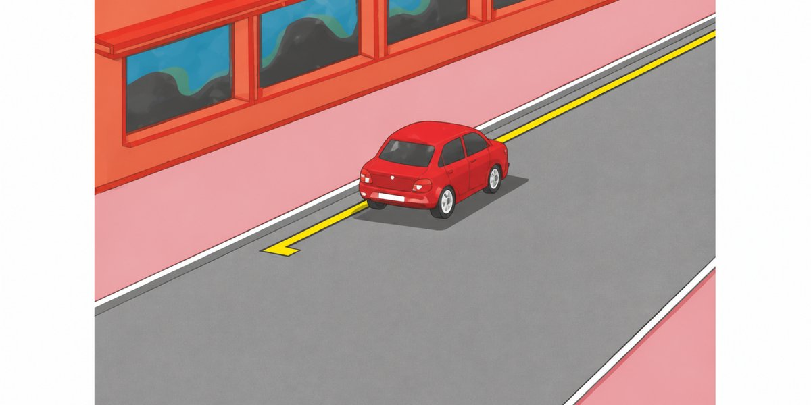

1. Թույլատրվում է
2. **Արգելվում է** ✅

### 7-38. Թույլատրվու՞մ է արդյոք ավտոմոբիլի կանգառն այս վայրում։

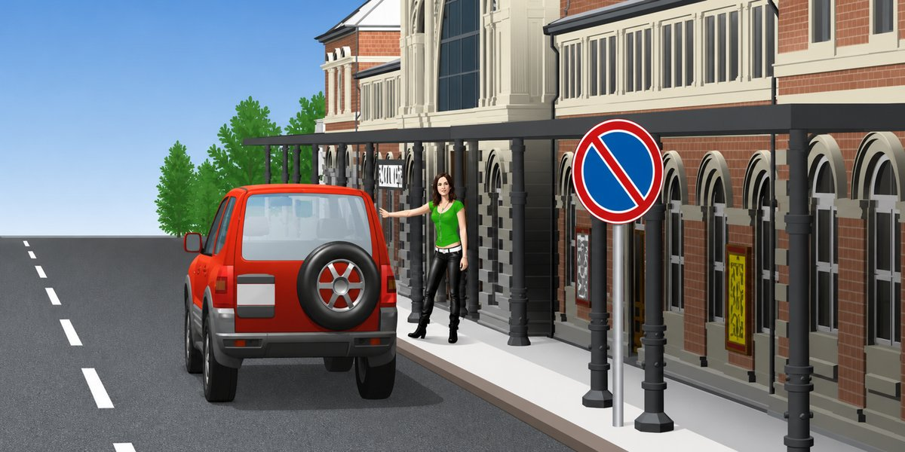

1. Արգելվում է, քանի որ գծանշման ընդհատվող գծի եւ կանգ առած տրանսպորտային միջոցի միջեւ հեռավորությունը պակաս է 3 մետրից
2. Արգելվում է ամսվա զույգ օրերին
3. **Թույլատրվում է** ✅

### 7-39. Ո՞ր տրանսպորտային միջոցի վարորդն է խախտել կայանման կանոնները։

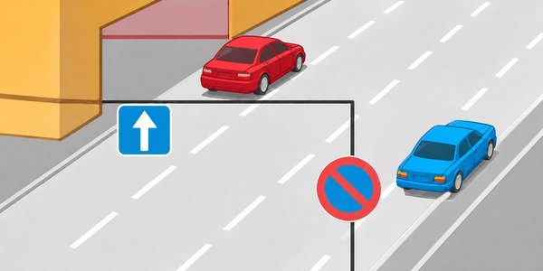

1. Կապույտ ավտոմոբիլի վարորդը
2. Կարմիր ավտոմոբիլի վարորդը
3. **Երկու վարորդներն էլ խախտել են** ✅
4. Երկու վարորդներն էլ չեն խախտել

### 7-40. Բնակավայրերից դուրս որտե՞ղ է թույլատրվում երկարատեւ հանգստի, գիշերակացի եւ այլ նպատակներով կայանելը։

1. Ճանապարհի կողնակներին
2. **Կայանման համար նախատեսված հրապարակներում կամ ճանապարհի սահմաններից դուրս** ✅
3. Ճանապարհի երթեւեկելի մասի աջ կողմում` չխոչընդոտելով այլ տրանսպորտային միջոցների երթեւեկությունը
4. Ճանապարհի ձախ կողմում` ապահովելով ճանապարհային երթեւեկության անվտանգությունը

### 7-41. Կանգառն արգելվում է, եթե հոծ գծի եւ կանգնած տրանսպորտային միջոցի միջեւ տարածությունը կազմում է

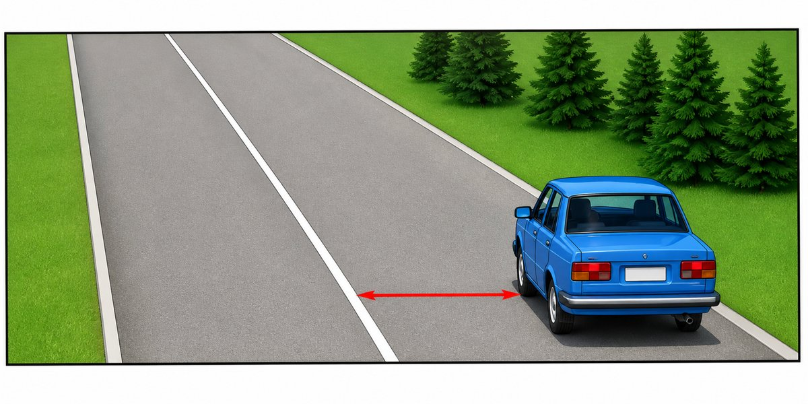

1. 6 մ։
2. 5.5 մ։
3. 4 մ։
4. 3.5 մ։
5. **2.5 մ։** ✅

### 7-42. Եթե երկաթուղային գծանցով երթեւեկությունը արգելված է, եւ բացակայում են լուսացույցը, ճանապարհային նշանները, գծանշումն ու ուղեփակոցը, ապա վարորդը պետք է կանգնի

1. Մոտակա ռելսից ոչ պակաս, քան 5 մ հեռավորության վրա։
2. Մոտակա ռելսից ոչ պակաս, քան 7 մ հեռավորության վրա։
3. **Մոտակա ռելսից ոչ պակաս, քան 10 մ հեռավորության վրա։** ✅

### 7-43. Ի՞նչ հեռավորության վրա է արգելվում տրանսպորտային միջոցների կայանումը երկաթուղային գծանցներից։

1. **15 մ** ✅
2. 50 մ
3. 100 մ
4. 150 մ

### 7-44. Ո՞ր պատասխանում են ճիշտ թվարկած կանգառի կանոնները խախտած վարորդները։

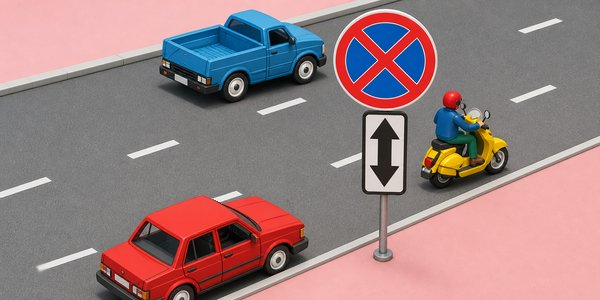

1. Կարմիր ավտոմոբիլի եւ մոտոցիկլի վարորդները
2. Կապույտ ավտոմոբիլի վարորդը
3. Մոտոցիկլի վարորդը
4. **Բոլոր տրանսպորտային միջոցների վարորդները** ✅

### 7-45. Ո՞ր տրանսպորտային միջոցների վարորդներն են սխալ կանգառ կատարել ուղեւորներ իջեցնելու համար։

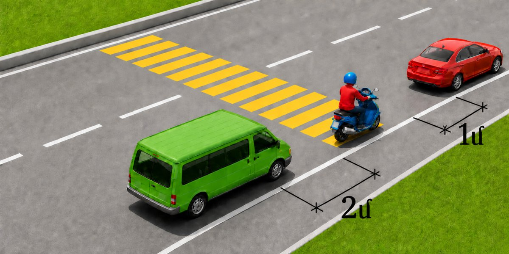

1. Թեթեւ մարդատար ավտոմոբիլի վարորդը
2. Մոտոցիկլի վարորդը
3. Ավտոբուսի վարորդը
4. **Մոտոցիկլի և ավտոբուսի վարորդները** ✅
5. Բոլոր վարորդները

### 7-46. Եթե երկաթուղային գծանցով երթեւեկությունն արգելված է, եւ բացակայում են լուսացույցը, ճանապարհային նշաններն ու գծանշումը, ապա վարորդը պետք է կանգնի

1. **Ուղեփակոցից ոչ պակաս, քան 5 մ հեռավորության վրա։** ✅
2. Ուղեփակոցից ոչ պակաս, քան 3 մ հեռավորության վրա։
3. Ուղեփակոցից անմիջապես առաջ։

### 7-47. Ի՞նչ է նշանակում երթեւեկելի մասի գոտում գծանշված «A» տառը։

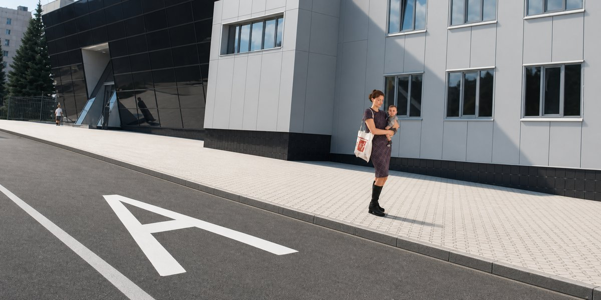

1. Ճանապարհի (երթուղու) համարը
2. **Ընդհանուր օգտագործման տրանսպորտային միջոցների երթեւեկության համար նախատեսված հատուկ գոտի** ✅
3. ,,A" կարգի տրանսպորտային միջոցների երթեւեկության համար նախատեսված հատուկ գոտի

### 7-48. Տրանսպորտային միջոցին թույլատրվու՞մ է կանգնել նշված տեղում ուղեւորներ իջեցնելու համար։

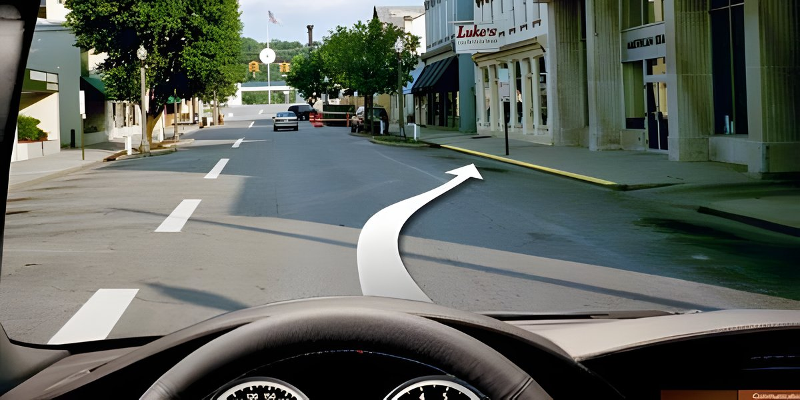

1. Թույլատրվում է
2. **Արգելվում է** ✅
3. Թույլատրվում է` բայց մայթին բարձրանալով

### 7-49. Թույլատրվու՞մ է շարունակել երթեւեկությունը սլաքով նշված ուղղությամբ։

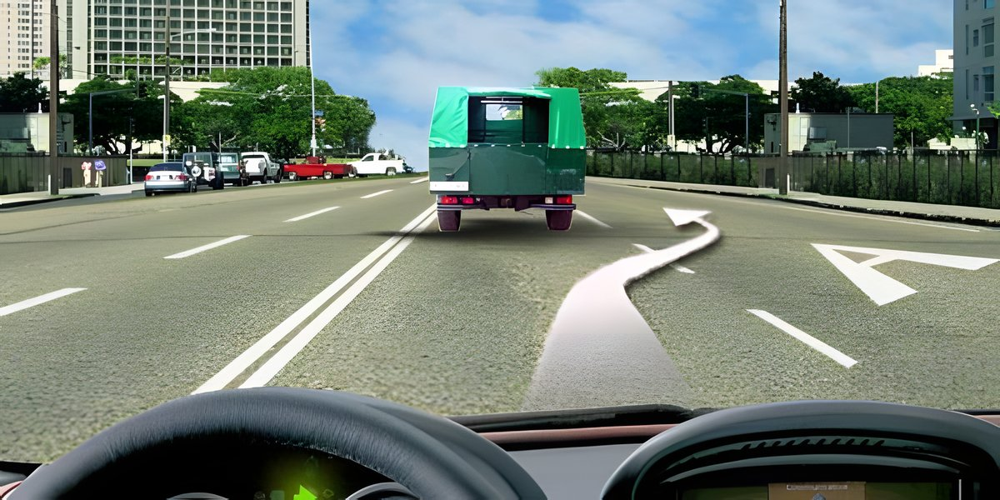

1. Արգելվում է
2. Թույլատրվում է բոլոր դեպքերում
3. **Թույլատրվում է՝ ուղեւորներ իջեցնելու նպատակով կանգառ կատարելու համար** ✅
4. Թույլատրվում է՝ բեռնատար ավտոմոբիլին վազանցելու նպատակով

### 7-50. Այսպիսի ուղղաձիգ գծանշմամբ նշվում են

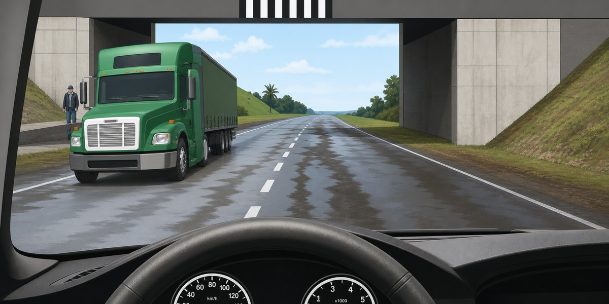

1. **Կամրջի, թունելի ստորին եզրերը։** ✅
2. Չլուսավորված թունելների մուտքը։
3. Ճանապարհային շինությունների ցանկացած տարր, որը վտանգ է ստեղծում երթեւեկության համար։

### 7-51. Ինչպե՞ս պետք է վարվի թեթեւ մարդատար ավտոմոբիլի վարորդը, եթե ավտոբուսի վարորդը սկսել է արգելակել։

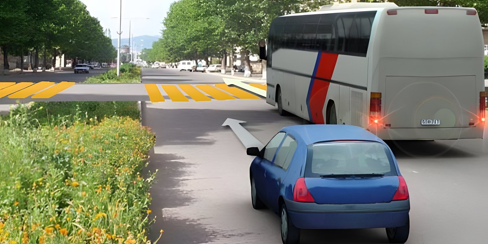

1. Շարունակի երթեւեկությունը
2. **Դանդաղեցնի ընթացքը, անհրաժեշտության դեպքում կանգնի եւ շարունակի երթեւեկությունը` համոզվելով, որ անցումում հետիոտներ չկան** ✅
3. Կանգ առնի եւ շարունակի երթեւեկությունը միայն այն դեպքում, երբ ավտոբուսը կվերսկսի երթեւեկությունը

### 7-52. Ավտոբուսի վարորդը կատարել է կանգառ ուղեւորներ նստեցնելու նպատակով։ Թեթեւ մարդատար ավտոմոբիլը երթեւեկում է 70կմ/ժ արագությամբ։ Ո՞ր տրանսպորտային միջոցի վարորդն է խախտում ճանապարհային երթեւեկության կանոնների պահանջները։

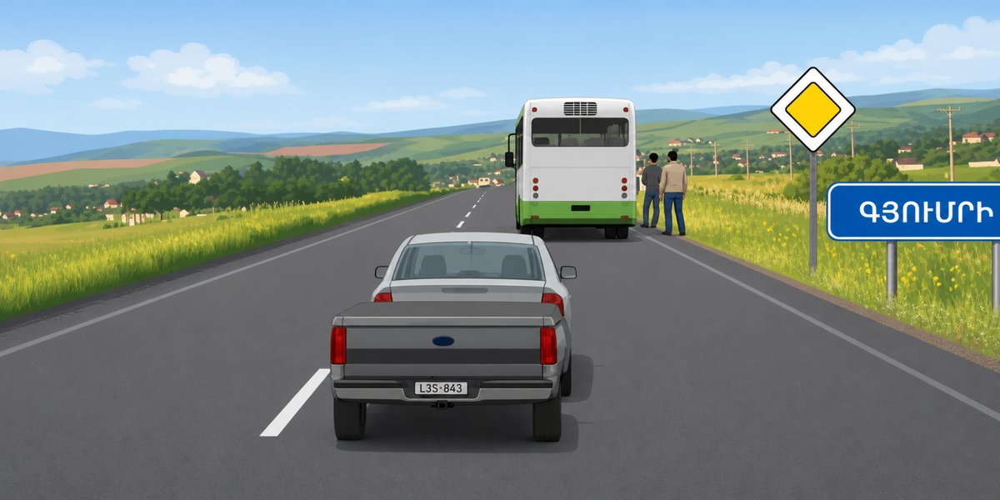

1. **Ոչ ոք** ✅
2. Ավտոբուսի վարորդը
3. Թեթեւ մարդատար ավտոմոբիլի վարորդը
4. Երկու վարորդներն էլ

### 7-53. Որտե՞ղ պետք է կանգ առնի վարորդը տվյալ իրավիճակում։

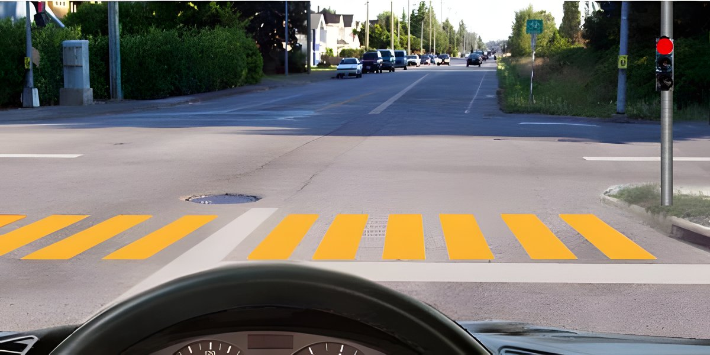

1. Կանգառը պարտադիր չէ
2. Լուսացույցի առջեւ
3. **«Կանգ-գիծ» գծանշման առջեւ** ✅
4. Երթեւեկելի գոտիների հատման առջեւ

### 7-54. Ավտոբուսը կանգ է առել հետիոտնին զիջելու համար։ Թեթեւ մարդատար ավտոմոբիլի վարորդը տվյալ իրադրությունում խախտու՞մ է ճանապարհային երթեւեկության կանոնների պահանջները։

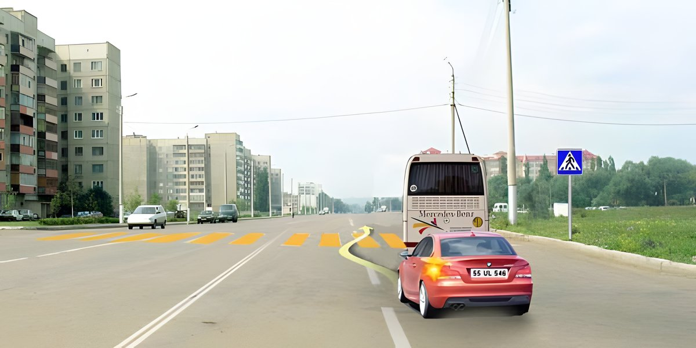

1. **Խախտում է** ✅
2. Չի խախտում

### 7-55. Դեպի ձախ երթեւեկությունը շարունակելու համար որտե՞ղ պետք է կանգ առնի ավտոբուսի վարորդը ճանապարհը թեթեւ մարդատար ավտոմոբիլին զիջելու համար։

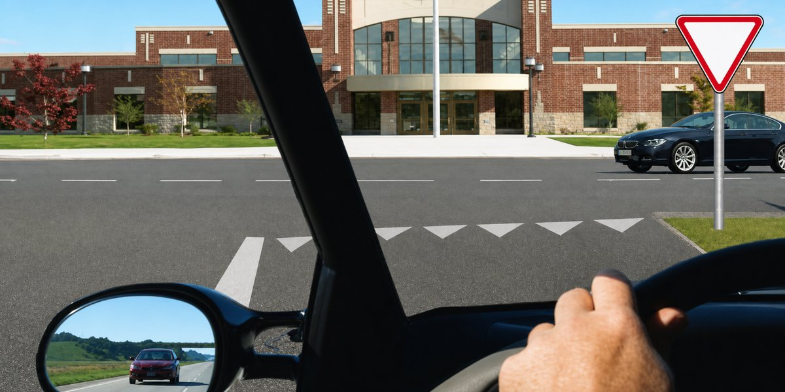

1. Ճանապարհային նշանի առջեւ
2. **Գծանշման մոտ** ✅
3. Վարորդի հայեցողությամբ անվտանգ տեղում

### 7-56. Տվյալ իրավիճակում որտե՞ղ պետք է կանգ առնել։

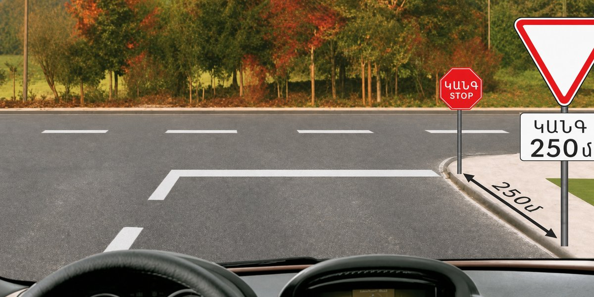

1. Առաջին ճանապարհային նշանի մոտ
2. **«Կանգ-գիծ» գծանշման առջեւ** ✅
3. Երկրորդ ճանապարհային նշանի մոտ
4. Կանգառը պարտադիր չէ

### 7-57. Տվյալ նշանի ազդեցության գոտում ո՞ր տրանսպորտային միջոցներին է թույլատրվում կանգառ կատարել։

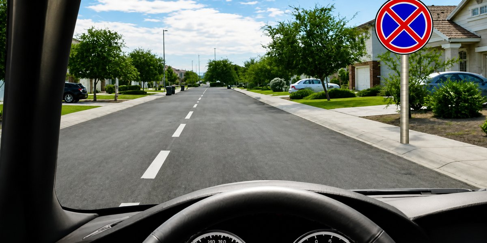

1. Միայն ընդհանուր օգտագործման տրանսպորտային միջոցներին
2. Միայն հաշմանդամների կողմից ղեկավարվող տրանսպորտային միջոցներին
3. Միայն միացված հաշվիչով տաքսիներին
4. **Բոլորին արգելվում է** ✅

### 7-58. Տվյալ ճանապարհային նշանների ազդման գոտում թույլատրվու՞մ է կանգառ կատարել՝ ուղեւորներ նստեցնելու նպատակով։

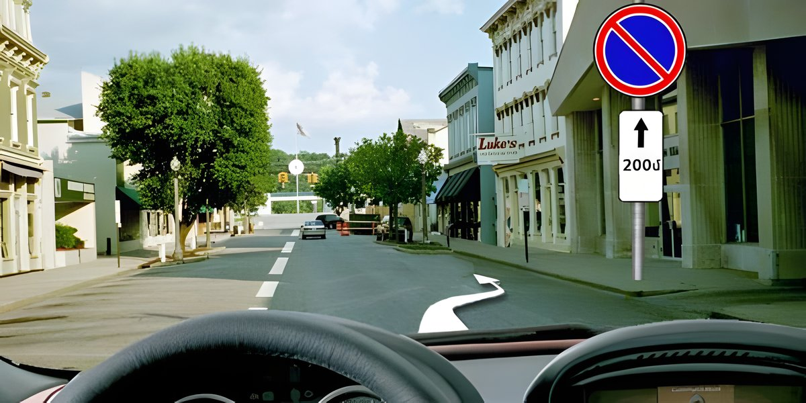

1. **Թույլատրվում է** ✅
2. Արգելվում է

### 7-59. Ո՞ր տրանսպորտային միջոցների համար է առանձնացված «A» տառով գծանշված գոտին։

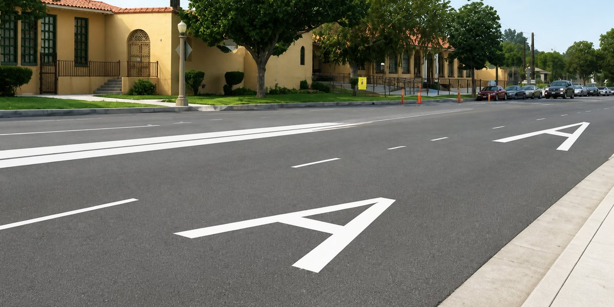

1. Միայն ավտոբուսների համար, որոնք շարժվում են սահմանված երթուղով
2. Տրոլեյբուսների եւ տաքսիների համար
3. **Ընդհանուր օգտագործման տրանսպորտային միջոցների համար** ✅

### 7-60. Թո՞ւյլատրվում է կանգառը նշված վայրում։

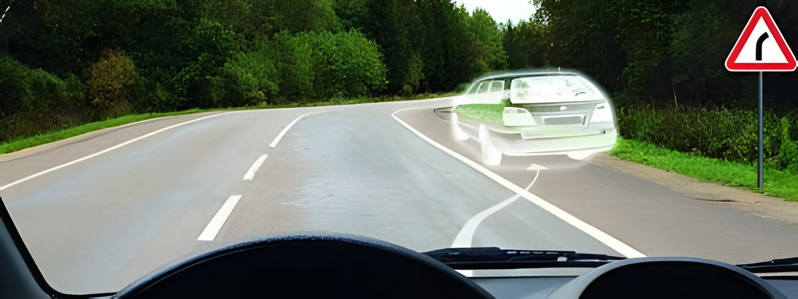

1. **Այո** ✅
2. Ոչ

### 7-61. Թույլատրվո՞ւմ է կայանումն այս իրավիճակում։

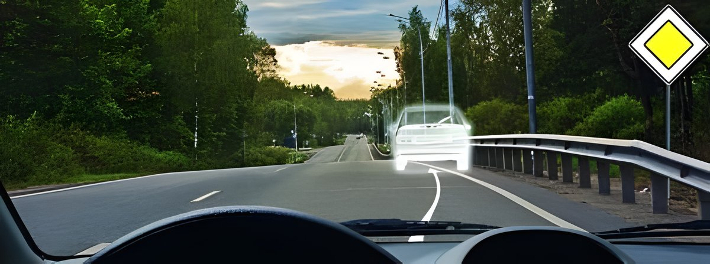

1. Այո
2. Միայն օրվա լուսավոր ժամերին
3. **Ոչ** ✅

### 7-62. Նշվածներից ո՞ր վայրում է թույլատրվում կանգառ կատարել։

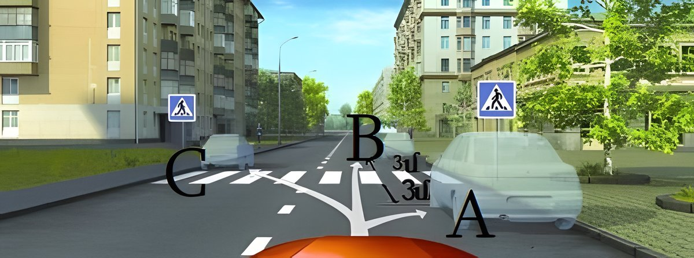

1. Միայն A
2. **Միայն B** ✅
3. Միայն B և C
4. Ոչ մի վայրում

### 7-63. Ո՞ր վայրում է թույլատրվում կանգառ կատարել։

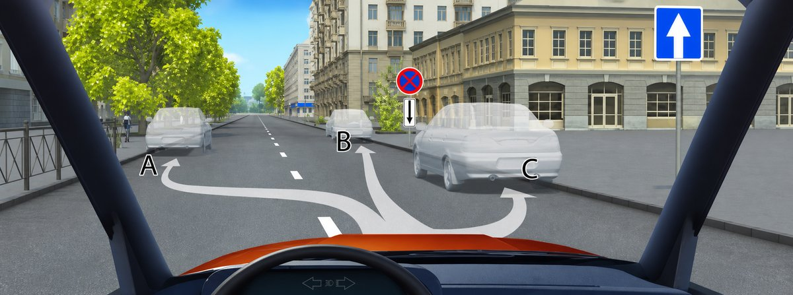

1. Միայն B
2. **Միայն A և B** ✅
3. Միայն A և C
4. Ոչ մի վայրում

### 7-64. Թույլատրվու՞մ է կանգառ կատարել նշված վայրում։

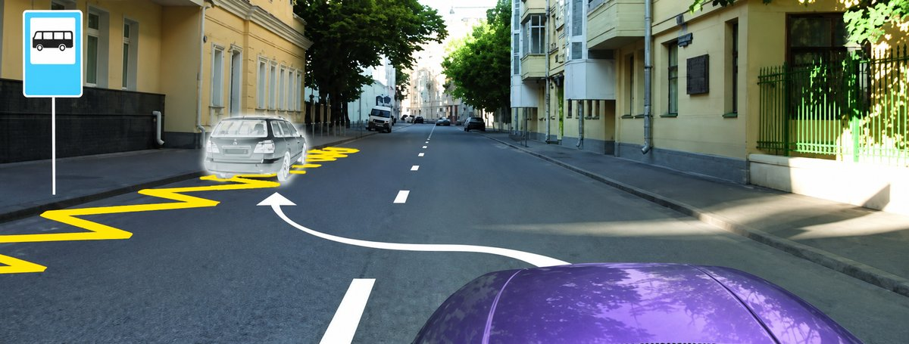

1. Այո
2. **Արգելվում է** ✅
3. Միայն ուղևոր նստեցնելու նպատակով

### 7-65. Նշված իրավիճակում ուղևոր նստեցնելու նպատակով կանգառ թույլատրվու՞մ է։

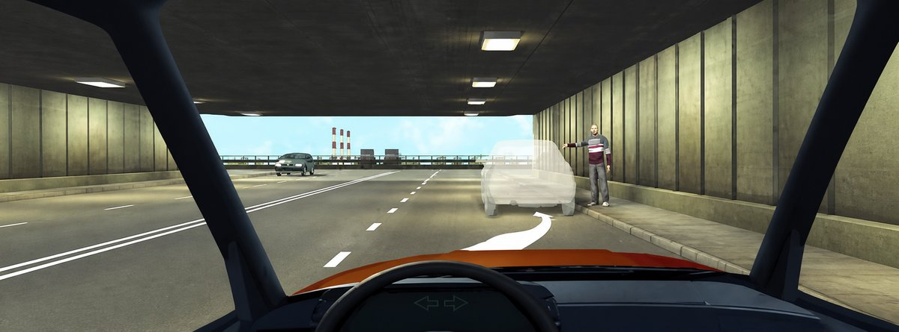

1. Այո
2. **Ոչ** ✅

### 7-66. Նշվածներից ո՞ր դեպքում է թույլատրվում կանգառ կատարել։

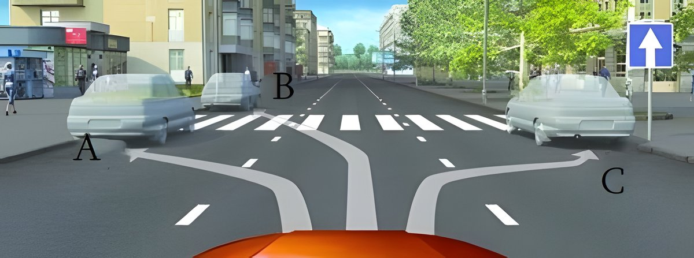

1. **Միայն B** ✅
2. Միայն C
3. A և C
4. Բոլոր դեպքերում:

### 7-67. Կանգառն արգելվում է

1. **Երկաթուղային գծանցում։** ✅
2. Երկաթուղային գծանցում և 50մ գծանցին մոտ։
3. Երկաթուղային գծանցում և 50մ գծանցից առաջ։

### 7-68. Կայանումն արգելվում է

1. Երկաթուղային գծանցում։
2. **Երկաթուղային գծանցում և 50մ գծանցին մոտ։** ✅
3. Երկաթուղային գծանցում և 50մ գծանցից առաջ։

### 7-69. Ո՞ր տարբերակում է նշված ճիշտ կանգառ կատարողը։

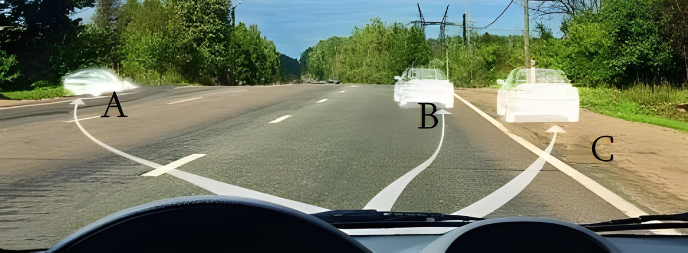

1. **Միայն C** ✅
2. Միայն A և C
3. Միայն B և C
4. Երեք դեպքերում էլ։

### 7-70. Պարտավո՞ր եք արդյոք զիջել բեռնատարին։

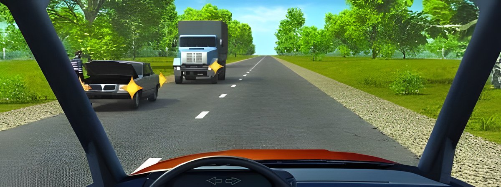

1. Այո
2. **Ոչ** ✅

### 7-71. Կանգառը նշված վայրում

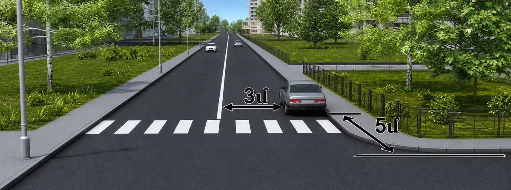

1. **Թույլատրվում է։** ✅
2. Արգելվում է։

### 7-72. Ե՞րբ է թույլատրվում հատել գծանշումը։

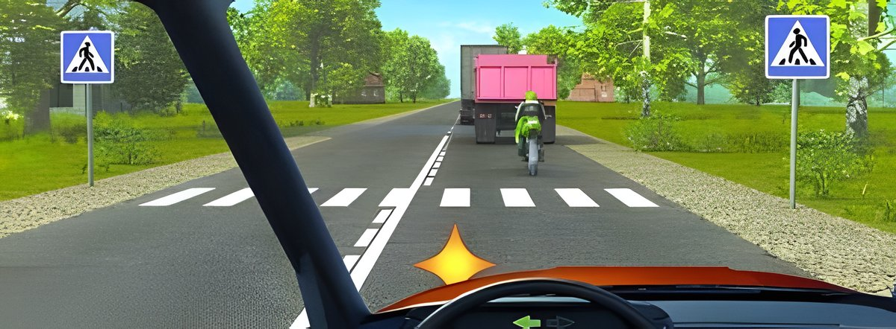

1. Հետիոտնային անցումից առաջ
2. **Հետիոտնային անցումից հետո** ✅

### 7-73. Բեռնատարի վարորդը խախտե՞լ է արդյոք կանգառ կատարելու կանոնները։

1. **Այո** ✅
2. Ոչ

### 7-74. Նշված իրավիճակում թույլատրվու՞մ է արդյոք կանգառ կատարել ուղևոր նստեցնելու նպատակով։

1. Այո
2. **Թույլատրվում է միայն ընդհանուր օգտագործման տրանսպորտային միջոցի վարորդին** ✅
3. Ոչ

### 7-75. Վարորդներից ո՞վ է խախտել կայանման կանոնները։

1. Երկու վարորդներն էլ
2. **Միայն թեթև մարդատարի վարորդը** ✅
3. Միայն մոտոցիկլի վարորդը
4. Ոչ ոք

### 7-76. Ո՞ր տարբերակում է նշված արգելված դիրքով կայանում կատարած վարորդը

1. **Միայն A** ✅
2. Միայն B

### 7-77. Թույլատրվո՞ւմ է նշված վայրում կանգառ կատարել։

1. Միայն ուղևոր իջեցնելու նպատակով
2. **Արգելվում է** ✅

### 7-78. Նշված վայրերից որտե՞ղ կարելի է կայանում կատարել։

1. Միայն A
2. Միայն C
3. **A կամ C** ✅

### 7-79. Թույլատրվո՞ւմ է կանգառ կատարել նշված վայրում։

1. **Ոչ** ✅
2. Այո

### 7-80. Ո՞վ է խախտել կանգառ կատարելու կանոնները։

1. Երկու վարորդները
2. **Միայն բեռնատարի վարորդը** ✅
3. Միայն թեթև մարդատարի վարորդը
4. Ոչ ոք

### 7-81. Ո՞ր դեպքում է վարորդը խախտել կանգառ կատարելու կանոնները։

1. Միայն A
2. Միայն B
3. **Ոչ ոք** ✅
4. Երկուսն էլ խախտել են

### 7-82. Ո՞ր դեպքում է վարորդը խախտել կայանում կատարելու կանոնները։

1. Միայն A
2. Միայն B
3. **Երկուսն էլ խախտել են** ✅
4. Ոչ ոք

### 7-83. Թույլատրվու՞մ է արդյոք կայանումը նշված վայրում։

1. **Արգելվում է** ✅
2. Թույլատրվում է

### 7-84. Թույլատրվո՞ւմ է կամրջի վրա կանգառ կատարել ուղևոր նստեցնելու նպատակով։

1. Այո
2. **Ոչ** ✅

### 7-85. Ո՞ր վարորդն է խախտել կանգառ կատարելու կանոնները։

1. Ավտոմոբիլի վարորդը
2. Մոտոցիկլի վարորդը
3. **Երկու վարորդները** ✅
4. Ոչ ոք

### 7-86. Ո՞ր վարորդն է ճիշտ կատարել կանգառը։

1. **Միայն C** ✅
2. B կամ C
3. Բոլոր վարորդները:

### 7-87. Թույլատրվու՞մ է կանգառ կատարել նշված վայրում։

1. Այո
2. **Ոչ** ✅

### 7-88. Ո՞ր վարորդն է խախտել կայանման կանոնները:

1. Բեռնատարի վարորդը
2. **Թեթև մարդատարի վարորդը** ✅
3. Ոչ ոք
4. Երկու վարորդները

### 7-89. Թույլատրվու՞մ է արդյոք 3.5 տոննայից թեթև բեռնատարի վարորդին ցուցանակում նշված եղանակով կայանում կատարել:

1. Այո
2. **Ոչ** ✅

### 7-90. Թո՞ւյլատրվում է կանգառ կատարել նշված վայրում։

1. Այո
2. **Ոչ** ✅

### 7-91. Նշվածներից ո՞ր վայրում է թույլատրվում կանգառ կատարել։

1. **Միայն A** ✅
2. Միայն B
3. Ցանկացած:

### 7-92. Կայանումը նշված վայրում

1. **Թույլատրվում է։** ✅
2. Արգելվում է։

### 7-93. Ո՞ր վարորդն է խախտել կայանման կանոնները։

1. Միայն A
2. **Միայն B** ✅
3. Ոչ ոք

### 7-94. Կանգառ կատարելը նշված վայրում

1. Թույլատրվում է։
2. Թույլատրվում է` ուղևոր նստեցնելու նպատակով։
3. **Արգելվում է։** ✅

### 7-95. Ո՞ր վարորդն է խախտել կանգառ կատարելու կանոնները։

1. Միայն B
2. **Միայն B և C** ✅
3. Բոլորը

### 7-96. Թույլատրվու՞մ է վարորդներին կանգառ կատարել նշված վայրում։

1. Այո
2. Միայն մոտոցիկլի վարորդին
3. **Ոչ** ✅

### 7-97. Նշվածներից ո՞ր դեպքում է թույլատրվում կանգառը։

1. Միայն C
2. Միայն B և C
3. **Բոլոր դեպքերում:** ✅

### 7-98. Թույլատրվո՞ւմ է նման դիրքով կանգառ կատարել։

1. Այո
2. Միայն թեթև մարդատարներին
3. **Ոչ** ✅

### 7-99. Թույլատրվու՞մ է արդյոք բեռնատարից առաջ անցնելուց հետո շարունակել երթևեկությունն այս գոտիով:

1. Այո
2. **Ոչ** ✅

### 7-100. Թույլատրվո՞ւմ է այս իրավիճակում շարունակել երթևեկությունը զբաղեցրած գոտիով:

1. **Այո** ✅
2. Ոչ

### 7-101. Կանգառը նշված վայրում

1. Թույլատրվում է։
2. Թույլատրվում է, եթե տրանսպորտային միջոցից մինչև գծանշում ընկած հեռավորությունը 3 մետրից ավել է:
3. **Արգելվում է։** ✅

### 7-102. Այս գծանշումը ցույց է տալիս

1. Առավելությունը՝ վերադասավորման ժամանակ։
2. Ճանապարհի կորագիծ հատվածին մոտեցումը։
3. **Գոտու վերջին մոտենալը։** ✅

### 7-103. Ի՞նչ է ցույց տալիս այս գծանշումը։

1. «Կանգ-գիծ» նշանին մոտենալը կարգավորվող խաչմերուկում
2. **«Կանգ-գիծ» գծանշմանը մոտենալը, երբ այն կիրառվել է«Երթևեկությունն առանց կանգառի արգելվում է» նշանի հետ** ✅
3. Ուղեփակոցին մոտենալը

### 7-104. Ցանկապատերի ուղղահայաց գծանշումը տեղեկացնում է

1. Երկաթուղային գծանցին մոտենալու մասին։
2. Վտանգավոր խաչմերուկին մոտենալու մասին։
3. **Ճանապարհի վտանգավոր հատվածով երթևեկության մասին։** ✅

### 7-105. Այս եռանկյունաձև գծանշումը տեղեկացնում է

1. Վտանգավոր շրջադարձին մոտենալու մասին։
2. **Ճանապարհը զիջելու տեղին մոտենալու մասին։** ✅
3. Մեքենան կանգնեցնելու տեղին մոտենալու մասին։

### 7-106. Այս ընդհատվող գծանշումները խաչմերուկի տարածքում ցույց են տալիս

1. Երթևեկության թույլատրելի ուղղությունները։
2. **Երթևեկության գոտիները խաչմերուկի սահմաններում։** ✅

### 7-107. Այս գծանշմամբ վազանցը

1. **Թույլատրվում է։** ✅
2. Արգելվում է։
3. Թույլատրվում է միայն տրակտորներին վազանցել։

### 7-108. Այս ուղղաձիգ գծանշմամբ

1. Նշվում են երթևեկելի մասին հարակից բոլոր ուղղահայաց տարրերը։
2. **Ճանապարհային կառույցների միայն այն տարրեը, որոնք վտանգ են ներկայացնում վարորդների համար։** ✅

### 7-109. Այս գծանշման դեպքում կարելի է մուտք գործել խաչմերուկ, եթե դա չի խոչընդոտի թեթև մարդատարի վարորդին։

1. Այո
2. **Ոչ** ✅

### 7-110. Ո՞ր հետագծով երթևեկող վարորդը չի խախտում գծանշման պահանջները"

1. Միայն A
2. **Միայն B** ✅
3. Երկուսն էլ խախտում են
4. Երկուսն էլ չեն խախտում

### 7-111. Ո՞ր դեպքում է թույլատրվում հատել հոծ գծանշումը։

1. **Միայն B՝ կանգառ կատարելիս** ✅
2. Ոչ մի դեպքում
3. Կանգառ կատարելիս երկու դեպքերում էլ

### 7-112. Ի՞նչ է ցույց տալիս ընդհատվող գծանշումը։

1. Կողնակին կանգառ կատարելու իրավունքը
2. **Երթևեկելի մասի եզրերը երկգոտի ճանապարհին** ✅
3. Կողնակով երթևեկելու իրավունքը

### 7-113. Այս հետագծով երթևեկել նման իրավիճակում

1. Թույլատրվում է՝ միայն վազանցելիս։
2. Թույլատրվում է։
3. **Արգելվում է։** ✅

### 7-114. Թույլատրվո՞ւմ է կայանել նշված վայրում։

1. Թույլատրվում է
2. Թույլատրվում է՝ առանց մայթին բարձրանալու
3. **Արգելվում է** ✅

### 7-115. Այս գծանշման դեպքում վազանցը

1. թույլատրվում է։
2. թույլատրվում է, եթե առջևից ընթացող տրանսպորտային միջոցը դանդաղընթաց է։
3. **արգելվում է։** ✅

### 7-116. Կարո՞ղ եք շարունակել երթևեկությունը նշանից հետո։

1. Այո
2. **Այո՝ մինչև Կանգ-գիծը** ✅
3. Ոչ

### 7-117. Երբ նարնջագույն և սպիտակ գծանշումները իրար հակասում են, վարորդները

1. Կարող են կատարել իրենց հարմար գծանշման պահանջները։
2. Պետք է կատարեն սպիտակ գծանշման պահանջները։
3. **Պետք է կատարեն նարնջագույն գծանշման պահանջները:** ✅

### 7-118. Ո՞ր վարորդին է թույլատրվում հատել հոծ գծանշումը՝ կանգառ կատարելու դեպքում։

1. Երկու վարորդներին էլ
2. **Հանդիպակացից երթևեկող վարորդին** ✅
3. Երկու վարորդներին արգելվում է

### 7-119. Թույլատրվո՞ւմ է կանգառ կատարել նշված վայրում։

1. Միայն մոտոցիկլներին
2. Ոչ
3. **Այո** ✅

### 7-120. Այս գծանշումը

1. Ցույց է տալիս բնակելի գոտու սահմանները։
2. **Ցույց է տալիս արհեստական անհարթությունը։** ✅
3. Արգելում է հետագա երթևեկությունը։

### 7-121. Այս գծանշումն արգելում է

1. վազանցը։
2. շրջանցումը։
3. հետադարձը։
4. **երթևեկությունը դրանից ձախ կամ դրա վրայով։** ✅

### 7-122. Այս գծանշումը ցույց է տալիս

1. Երթուղու կամ ճանապարհի համարը։
2. Առաջարկվող արագությունը։
3. **Թույլատրելի առավելագույն արագությունը՝ նշված ճանապարհահատվածում։** ✅

### 7-123. Երթևեկելի մասում արված գրառումը ցույց է տալիս

1. Հեռավորությունը մոտակա խաչմերուկից։
2. Հեռավորությունը մոտակա բնակավայրից;
3. **Ճանապարհի կամ երթուղու համարը։** ✅

### 7-124. Ո՞ր կողմից կարելի է շրջանցել արգելքը;

1. **Միայն A** ✅
2. Միայն B
3. Ցանկացած

### 7-125. Ո՞ր տրանսպորտային միջոցները կարող են երթևեկել այս ճանապարհի աջ եզրային գոտվ։

1. **Տրոլեյբուսներն ու ընդհանուր օգտագործման ավտոբուսները** ✅
2. Տրոլեյբուսներն ու ավտոբուսները
3. Միայն ավտոբուսները

### 7-126. Թո՞ւյլատրվում է կայանել նշված վայրում։

1. **Արգելվում է** ✅
2. Միայն մայթին
3. Միայն մոտոցիկլներին
4. Թույլատրվում է

### 7-127. Ընդհատվող գծանշման գծիկների մեծացումը հայտնում է

1. Գոտու վերջին մոտենալու մասին։
2. Վտանգավոր հատվածին մոտենալու մասին։
3. **Որ այդ գծանշումը շուտով հոծ է դառնալու։** ✅

### 7-128. Նշված իրավիճակում ուղիղ երթևեկելն

1. Արգելվում է։
2. Թույլատրվում է։
3. **Թույլատրվում է՝ աջ գոտի վերադասավորվելով։** ✅

### 7-129. Քան՞ի երթևեկության գոտի ունի այս ճանապարհը։

1. Երկու
2. **Չորս** ✅
