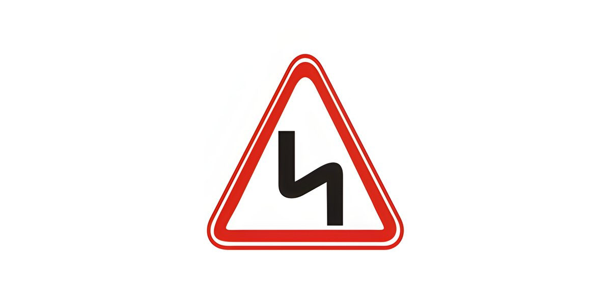
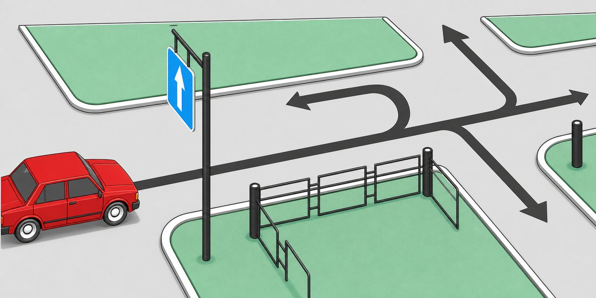
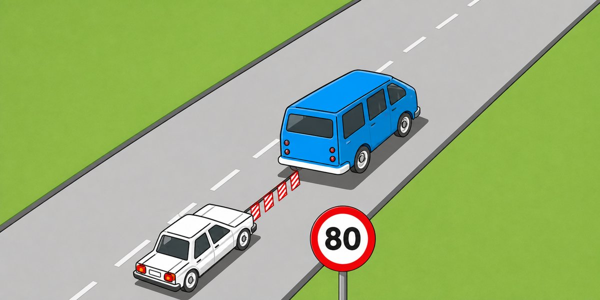
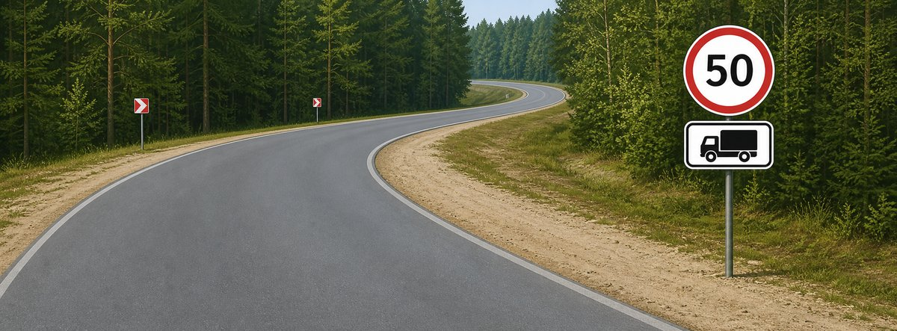
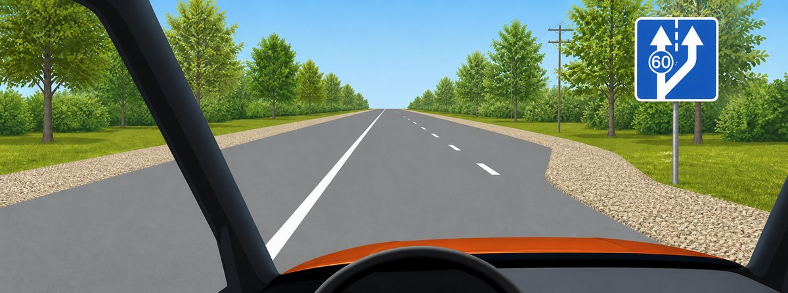
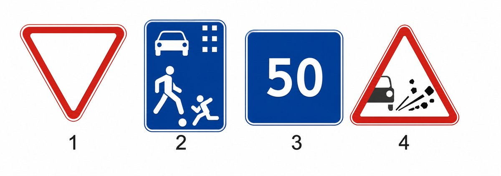

# Խումբ 8 (55 հարց)

Ճիշտ պատասխանը **թավ** է և նշված ✅-ով։ Աղբյուր՝ roadpolice.am, ABC կարգեր։

### 8-1. Ի՞նչ առավելագույն արագությամբ է թույլատրվում թեթեւ մարդատար ավտոմոբիլների երթեւեկությունը ճանապարհներին` բնակավայրերից դուրս։

1. 110կմ/ժ
2. 100կմ/ժ
3. **90կմ/ժ** ✅
4. 80կմ/ժ
5. 70կմ/ժ

### 8-2. Կահավորված թափքում մարդ փոխադրող բեռնատար ավտոմոբիլների երթեւեկությունը թույլատրվում է ոչ ավել, քան

1. **60կմ/ժ արագությամբ։** ✅
2. 70կմ/ժ արագությամբ։
3. 80կմ/ժ արագությամբ։

### 8-3. Այս նախազգուշացնող նշանը բնակավայրերից դուրս՝ մինչեւ վտանգավոր հատվածի սկիզբը, ի՞նչ հեռավորության վրա է տեղադրվում։

1. 50 - 100մ
2. **150 - 300մ** ✅
3. 300 - 500մ

### 8-4. Երեխաների կազմակերպված խմբեր փոխադրող տրանսպորտային միջոցների երթեւեկությունը թույլատրվում է

1. **ոչ ավել, քան 60կմ/ժ արագությամբ։** ✅
2. ոչ ավել, քան 70կմ/ժ արագությամբ։
3. ոչ ավել, քան 80կմ/ժ արագությամբ։

### 8-5. Տրանսպորտային միջոցների երթեւեկությունը բնակավայրերում թույլատրվում է

1. **ոչ ավել, քան 60կմ/ժ արագությամբ։** ✅
2. ոչ ավել, քան 80կմ/ժ արագությամբ։
3. ոչ ավել, քան 90կմ/ժ արագությամբ։

### 8-6. Ո՞ր ուղղությամբ է թույլատրվում երթեւեկությունը։

1. Միայն ուղիղ
2. Ուղիղ եւ դեպի աջ
3. **Ուղիղ, դեպի աջ եւ դեպի ձախ** ✅
4. Բոլոր ուղղություններով

### 8-7. Ի՞նչ արագությամբ է թույլատրվում երթեւեկել 3.5 տ ոչ ավելի թույլատրելի առավելագույն զանգված ունեցող բեռնատար ավտոմոբիլներով՝ բնակավայրերից դուրս։

1. **ոչ ավել, քան 90կմ/ժ արագությամբ** ✅
2. ոչ ավել, քան 70կմ/ժ արագությամբ
3. ոչ ավել, քան 80կմ/ժ արագությամբ

### 8-8. Քարշակման ժամանակ՝ վթարային լուսային ազդանշանի բացակայության կամ անսարքության դեպքում, «Վթարային կանգառ» նշանը տեղադրվում է

1. **Քարշակվող տրանսպորտային միջոցի հետեւի մասում։** ✅
2. Քարշակող տրանսպորտային միջոցի առջեւի մասում։
3. Վարորդի հայեցողությամբ` տրանսպորտային միջոցներից մեկի վրա` տեսանելի տեղում։

### 8-9. Կոշտ կցիչով քարշակման ժամանակ տրանսպորտային միջոցների միջեւ հեռավորությունը չպետք է գերազանցի

1. 2 մ։
2. 3 մ։
3. **4 մ։** ✅
4. 5 մ։
5. 6 մ։

### 8-10. Թույլատրվու՞մ է արդյոք կոշտ կամ ճկուն կցիչով քարշակման ժամանակ մարդկանց փոխադրումը բեռնատար ավտոմոբիլի թափքում։

1. Թույլատրվում է քարշակող եւ քարշակվող ավտոմոբիլների թափքում
2. Թույլատրվում է միայն քարշակվող ավտոմոբիլի թափքում
3. **Թույլատրվում է միայն քարշակող ավտոմոբիլի թափքում** ✅
4. Երկու ավտոմոբիլների թափքում էլ արգելվում է

### 8-11. Կոշտ կամ ճկուն կցիչով քարշակման ժամանակ նշվածներից ո՞ր դեպքում է թույլատրվում մարդկանց փոխադրումը քարշակվող ավտոմոբիլում։

1. Թույլատրվում է ավտոբուսում
2. **Թույլատրվում է թեթեւ մարդատար ավտոմոբիլում** ✅
3. Թույլատրվում է բեռնատար ավտոմոբիլի թափքում՝ կոշտ կցիչով քարշարկելիս

### 8-12. Ի՞նչ առավելագույն արագությամբ է թույլատրվում երթեւեկությունը՝ մեխանիկական տրանսպորտային միջոցներով քարշակում կատարելիս։

1. 30 կմ/ժ
2. 40 կմ/ժ
3. **50 կմ/ժ** ✅
4. 60 կմ/ժ
5. 70 կմ/ժ

### 8-13. Քարշակումը մերկասառույցի պայմաններում արգելվում է

1. **Ճկուն կցիչով։** ✅
2. Կոշտ կցիչով։
3. Մասնակի բեռնման եղանակով։

### 8-14. Ինչպիսի՞ առավելագույն արագությամբ կարող է իրականացվել քարշակումը տվյալ պայմաններում։

1. 30կմ/ժ
2. **50կմ/ժ** ✅
3. 70կմ/ժ
4. 80կմ/ժ

### 8-15. Թույլատրվու՞մ է արդյոք ճկուն կամ կոշտ կցիչով քարշակման դեպքում մարդկանց փոխադրումը քարշակվող մեխանիկական տրանսպորտային միջոցում։

1. Թույլատրվում է՝ ավտոբուսում եւ տրոլեյբուսում
2. Թույլատրվում է՝ միայն թեթեւ մարդատար ավտոմոբիլում
3. Թույլատրվում է՝ բեռնատար ավտոմոբիլի թափքում եւ թեթեւ մարդատար ավտոմոբիլում
4. **Թույլատրվում է՝ բեռնատար ավտոմոբիլի խցիկում եւ թեթեւ մարդատար ավտոմոբիլում** ✅
5. Արգելվում է։

### 8-16. Քարշակումը մերկասառույցի պայմաններում

1. Արգելվում է
2. Թույլատրվում է
3. **Թույլատրվում է՝ կոշտ կցիչով կամ մասնակի բեռնման եղանակով քարշակելիս** ✅

### 8-17. Ինչպիսի՞ առավելագույն արագությամբ է թույլատրվում տրանսպորտային միջոցների քարշակումը ճկուն կցիչով։

1. 70կմ/ժ
2. 60կմ/ժ
3. **50կմ/ժ** ✅
4. 40կմ/ժ
5. 30կմ/ժ

### 8-18. Ո՞ր դեպքում է արգելվում քարշակումը։

1. Մերկասառույցի պայմաններում` կոշտ կցիչով
2. **Մերկասառույցի պայմաններում` ճկուն կցիչով** ✅
3. Կողային կցորդով մոտոցիկլներով

### 8-19. Բնակավայրերից դուրս մեխանիկական տրանսպորտային միջոցներ քարշակելիս երթեւեկության արագությունը չպետք է գերազանցի

1. 30կմ/ժ։
2. 40կմ/ժ։
3. **50կմ/ժ։** ✅
4. 60կմ/ժ։
5. 70կմ/ժ։

### 8-20. Թույլատրվու՞մ է արդյոք մոտոցիկլների քարշակումը։

1. **Թույլատրվում է կողային կցորդով մոտոցիկլների քարշակումը** ✅
2. Թույլատրվում է առանց կողային կցորդի մոտոցիկլների քարշակումը
3. Երկու դեպքում էլ թույլատրվում է

### 8-21. Քարշարկման ժամանակ տրանսպորտային միջոցների միջեւ ի՞նչ հեռավորություն պետք է ապահովի ճկուն կցիչը։

1. 1 - 3մ
2. 2 - 4մ
3. 3 - 6մ
4. **4 - 6մ** ✅
5. 4 - 8մ

### 8-22. Ի՞նչ առավելագույն արագությամբ է թույլատրվում կցորդ քարշակող թեթեւ մարդատար ավտոմոբիլների երթեւեկությունն ավտոմայրուղիներով երթեւեկելիս։

1. 110կմ/ժ
2. 100կմ/ժ
3. **90կմ/ժ** ✅
4. 80կմ/ժ
5. 70կմ/ժ

### 8-23. Կոշտ կցիչով քարշակման ժամանակ հեռավորությունը տրանսպորտային միջոցների միջեւ պետք է լինի ոչ ավել, քան

1. **4մ։** ✅
2. 5մ։
3. 6մ։

### 8-24. Մեխանիկական տրանսպորտային միջոցների մասնակի բեռնումով քարշակման ժամանակ ուղեւորների փոխադրում թույլատրվում է

1. Քարշակող ավտոմոբիլի թափքում։
2. Քարշակվող ավտոմոբիլի խցիկում։
3. Քարշակվող ավտոմոբիլի թափքում։
4. **Քարշակող ավտոմոբիլի խցիկում։** ✅

### 8-25. Թույլատրվու՞մ է արդյոք քարշակել կողային կցորդով մոտոցիկլները։

1. Թույլատրվում է` միայն կոշտ կցիչով
2. Արգելվում է
3. **Թույլատրվում է** ✅

### 8-26. Ի՞նչ առավելագույն արագությամբ է թույլատրվում երթեւեկությունը ճկուն կցիչով քարշակելիս։

1. 70կմ/ժ
2. 60կմ/ժ
3. **50կմ/ժ** ✅
4. 40կմ/ժ
5. 30կմ/ժ

### 8-27. Տրանսպորտային միջոցի վրա բեռը տեղաբաշխվում եւ անհրաժեշտության դեպքում նաեւ ամրացվում է այնպես, որպեսզի

1. Չցցվի հարթակի կողերից բարձր։
2. **Զգալի աղմուկ չհանի, փոշի չբարձրացնի կամ չաղտոտի ճանապարհն ու շրջակա միջավայրը։** ✅
3. Դուրս չցցվի տրանսպորտային միջոցի հետեւի եզրից 0,8 մ-ից ավելի։

### 8-28. Թեթեւ մարդատար ավտոմոբիլի առջեւի նստատեղին, եթե այն կահավորված չէ երեխաներին պահող հարմարանքով, թույլատրվում է փոխադրել երեխաներ, եթե լրացել է նրանց

1. 10 տարին։
2. 11 տարին
3. **12 տարին։** ✅

### 8-29. Թույլատրվու՞մ է արդյոք մարդկանց փոխադրումը բեռնատար կցորդում։

1. **Արգելվում է** ✅
2. Թույլատրվում է
3. Թույլատրվում է միայն բեռն ուղեկցող անձանց

### 8-30. Թույլատրվու՞մ է արդյոք մինչեւ 12 տարեկան երեխաների փոխադրումը մոտոցիկլի հետևի նստատեղին։

1. Թույլատրվում է
2. **Արգելվում է** ✅

### 8-31. Թույլատրվո՞ւմ է երթևեկության ընթացքում անձանց գտնվել բեռնատար ավտոմոբիլի թափքում, եթե այն կահավորված չէ մարդկանց փոխադրելու համար։

1. Արգելվում է
2. Թույլատրվում է ավտոմայրուղի չհամարվող ճանապարհներին
3. **Թույլատրվում է միայն բեռն ուղեկցող կամ այն ստանալու համար մեկնող անձանց՝ պայմանով, որ նրանք ապահովված են ավտոմոբիլի կողերի մակարդակից ցածր տեղադրված նստարաններով** ✅

### 8-32. Մարդկանց փոխադրումը բեռնատար կցորդում

1. **արգելվում է։** ✅
2. թույլատրվում է։
3. թույլատրվում է միայն բեռն ուղեկցող անձանց։

### 8-33. Թույլատրվու՞մ է արդյոք ճկուն կամ կոշտ կցիչով քարշակման դեպքում մարդկանց փոխադրումը քարշակվող մեխանիկական տրանսպորտային միջոցում։

1. Թույլատրվում է ավտոբուսում եւ տրոլեյբուսում
2. **Թույլատրվում է բեռնատար ավտոմոբիլի խցիկում եւ թեթեւ մարդատար ավտոմոբիլում** ✅
3. Թույլատրվում է բեռնատար ավտոմոբիլի թափքում եւ թեթեւ մարդատար ավտոմոբիլում
4. Արգելվում է

### 8-34. Ի՞նչ առավելագույն արագությամբ է թույլատրվում մոտոցիկլի երթեւեկությունը «Բնակելի գոտի» եւ «Բնակելի գոտու վերջը» նշաններով կահավորված տարածքներում։

1. **20կմ/ժ** ✅
2. 30կմ/ժ
3. 40կմ/ժ

### 8-35. Կահավորված թափքում մարդկանց փոխադրելու դեպքում բեռնատար ավտոմոբիլի վարորդը պարտավոր է երթեւեկել ոչ ավել, քան

1. 50կմ/ժ արագությամբ։
2. **60կմ/ժ արագությամբ։** ✅
3. 70կմ/ժ արագությամբ։

### 8-36. Քարշակման ժամանակ քարշակվող տրանսպորտային միջոցի վրա պետք է միացված լինեն

1. Լապտերների հեռահար լույսերը։
2. Լապտերների մոտակա լույսերը։
3. **Վթարային լուսային ազդանշանը։** ✅

### 8-37. Ի՞նչ արագությամբ է թույլատրվում տրանսպորտային միջոցների երթեւեկությունը «Բնակելի գոտի» եւ «Բնակելի գոտու վերջ» ճանապարհային նշանների ազդեցության տարածքներում։

1. ոչ ավել, քան 5կմ/ժ
2. ոչ ավել, քան 10կմ/ժ
3. **ոչ ավել, քան 20կմ/ժ** ✅

### 8-38. Ի՞նչ առավելագույն արագությամբ է թույլատրված երթևեկությունը 3,5 տոննայից ոչ ավել թույլատրելի առավելագույն զանգվածով բեռնատարի վարորդին տվյալ նշանների ազդման գոտում։

1. Ոչ ավել, քան 50 կմ/ժ
2. Ոչ ավել, քան 70 կմ/ժ
3. **Ոչ ավել, քան 90 կմ/ժ** ✅

### 8-39. Մեխանիկական տրանսպորտային միջոց քարշակելիս այս ճանապարհի ո՞ր գոտիով կարող եք շարունակել երթևեկությունը։

1. **Միայն աջ** ✅
2. Ցանկացած

### 8-40. Ի՞նչ պայմաններ պետք է հաշվի առնի վարորդը թույլատրված սահմաններում արագություն ընտրելիս։

1. Ճանապարհային ծածկույթի վիճակը
2. Տեսանելիությունը՝ երթևեկության ուղղությամբ
3. **Նշված երկու պայմանները** ✅

### 8-41. Թույլատրելի սահմաններում ի՞նչ առավելագույն արագություն պետք է ընտրի վարորդը։

1. **Այնպիսի արագություն, որ ապահովի տրանսպորտային միջոցի լիարժեք կառավարումը** ✅
2. Ազատ է ընտրելու ցանկացած արագություն, որը չի գերազանցի առավելագույն թույլատրելին

### 8-42. Վարորդին արգելվում է

1. Գերազանցել տվյալ տրանսպորտային միջոցի տեխնիկական բնութագրով սահմանված առավելագույն արագությունը։
2. Գերազանցել տրանսպորտային միջոցի վրա տեղադրված «Արագության սահմանափակում» ճանաչման նշանով նախատեսված արագությունը։
3. առանց անհրաժեշտության ընթանալ շատ ցածր արագությամբ` խոչընդոտելով մյուս տրանսպորտային միջոցների երթևեկությունը։
4. կտրուկ արգելակել, եթե դա անհրաժեշտ չէ ճանապարհատրանսպորտային պատահար կանխելու համար։
5. **Բոլոր նշված գործողությունները։** ✅

### 8-43. Ո՞ր նշանն է սահմանափակում արագությունը։

1. 1 և 3
2. 1 և 4
3. **2** ✅
4. 2 և 3

### 8-44. Վարորդին արգելվում է

1. Երկաթուղային գծանցը հատել ավելի, քան 30կմ/ժ արագությամբ:
2. Երկաթուղային գծանցը հատել 30 կմ/ժ-ից ցածր արագությամբ։
3. **Առանց երկաթգծի ուղեմասի պետի թույլտվության գծանցով երթևեկել դանդաղընթաց մեքենաներով` 8 կմ/ժ-ից ցածր արագությամբ, և տափանների հետ կցված տրակտորներով։** ✅

### 8-45. Խաչմերուկին մոտենալիս վարորդը տրանսպորտային միջոցը պետք է վարի այնպիսի արագությամբ, որ

1. չգերազանցի տվյալ հատվածում սահմանված առավելագույն թույլատրելին:
2. **հնարավորություն ունենա կանգնելու և զիջելու անցման առաջնահերթության իրավունք ունեցող փոխադրամիջոցներին։** ✅

### 8-46. Վարորդին արգելվում է բարձրացնել արագությունը,

1. **եթե, դա կխոչընդոտի իրեն վազանցող տրանսպորտային միջոցի վարորդին ավարտել վազանցը։** ✅
2. եթե, դա անհրաժեշտ է իրեն ճանապարհը զիջելու նպատակով կանգ առած վարորդի ճանապարհը ազատելու համար:
3. եթե դա կատարվում է խաչմերուկն ազատելու նպատակով։

### 8-47. Վարորդը պարտավոր է իջեցնել արագությունը

1. Երեխաների նստեցման և իջեցման ժամանակ «Երեխաների փոխադրում» ճանաչման նշանով կահավորված տրանսպորտային միջոցներին մոտենալիս:
2. շլանալու դեպքում
3. Երթևեկության համար խոչընդոտ կամ վտանգ առաջանալու դեպքում:
4. Կապույտ և կարմիր գույների առկայծող փարոսիկներ և հատուկ ձայնային ազդանշան միացրած տրանսպորտային միջոց մոտենալու դեպքում, ինչպես նաև կապույտ կամ կապույտ և կարմիր գույների առկայծող փարոսիկներ միացրած, կանգնած վիճակում գտնվող տրանսպորտային միջոցին մոտենալիս:
5. **բոլոր նշված դեպքերում** ✅

### 8-48. Արդյոք պե՞տք է տրանսպորտային միջոցի կողքից` եզրաչափային լույսի արտաքին եզրից, 0,5 մ դուրս ցցվելու դեպքում բեռը օրվա լուսավոր ժամերին նշվի «Մեծ եզրաչափերով բեռ» ճանաչման նշանով, իսկ օրվա մութ ժամանակ և անբավարար տեսանելիության պայմաններում՝ նաև առջևից՝ սպիտակ, իսկ հետևից` կարմիր գույնի լապտերիկներով կամ լուսանդրադարձիչով:

1. **Այո** ✅
2. Ոչ

### 8-49. Բեռնատարով, որի վարորդն ունի B և C կարգերի վարորդական իրավունք և ապահովված են բեռնատարներով մարդ փոխադրելու պայմանները, թույլատրվում է փոխադրել մինչև

1. **8 ուղևոր։** ✅
2. 9 ուղևոր։
3. 4 ուղևոր։

### 8-50. Արգելվում է մինչև 12 տարեկան երեխաներին փոխադրել

1. **Կողավոր թափքով բեռնատար ավտոմոբիլի թափքում:** ✅
2. Ֆուրգոն թափքով բեռնատար ավտոմոբիլի թափքում։

### 8-51. Արդյոք պե՞տք է տրանսպորտային միջոցի հետևի եզրաչափից 1.2մ դուրս ցցված բեռը օրվա լուսավոր ժամերին նշվի «Մեծ եզրաչափերով բեռ» ճանաչման նշանով, իսկ օրվա մութ ժամանակ և անբավարար տեսանելիության պայմաններում՝ նաև առջևից՝ սպիտակ, իսկ հետևից` կարմիր գույնի լապտերիկներով կամ լուսանդրադարձիչով։

1. **Այո** ✅
2. Ոչ

### 8-52. Բեռի փոխադրումն արգելվում է, եթե այն

1. սահմանափակում է վարորդի տեսադաշտը։
2. դժվարացնում է տրանսպորտային միջոցի ղեկավարումը և թուլացնում կայունությունը։
3. ծածկում է արտաքին լուսային սարքերն ու լուսանդրադարձիչները, համարանիշերը կամ ճանաչման նշանները, ինչպես նաև խանգարում ընկալել ձեռքով տրվող ազդանշանները։
4. **Նշված բոլոր դեպքերում:** ✅

### 8-53. Եթե բեռի վիճակն ու դասավորությունը հնարավորություն չեն տալիս կատարել դրա փոխադրումը կանոնների պահանջներին համապատասխան, ապա վարորդը պետք է

1. Բեռը բարեհաջող հասցնի մինչև մոտակա բեռնաթափման վայրը:
2. **Վերացնի խախտումները կամ դադարեցնի հետագա երթևեկությունը։** ✅

### 8-54. Արդյոք պե՞տք է տրանսպորտային միջոցի հետևի եզրաչափից 0.6մ դուրս ցցված բեռը օրվա լուսավոր ժամերին նշվի «Մեծ եզրաչափերով բեռ» ճանաչման նշանով, իսկ օրվա մութ ժամանակ և անբավարար տեսանելիության պայմաններում՝ նաև առջևից՝ սպիտակ, իսկ հետևից` կարմիր գույնի լապտերիկներով կամ լուսանդրադարձիչով։

1. Այո
2. **Ոչ** ✅

### 8-55. Արդյոք պե՞տք է տրանսպորտային միջոցի կողքից` եզրաչափային լույսի արտաքին եզրից, 0,3մ դուրս ցցվելու դեպքում բեռը օրվա լուսավոր ժամերին նշվի «Մեծ եզրաչափերով բեռ» ճանաչման նշանով, իսկ օրվա մութ ժամանակ և անբավարար տեսանելիության պայմաններում՝ նաև առջևից՝ սպիտակ, իսկ հետևից` կարմիր գույնի լապտերիկներով կամ լուսանդրադարձիչով:

1. Այո
2. **Ոչ** ✅
