# Խումբ 9 (119 հարց)

Ճիշտ պատասխանը **թավ** է և նշված ✅-ով։ Աղբյուր՝ roadpolice.am, ABC կարգեր։

### 9-1. Կարմիր գույնի առկայծող փարոսիկ միացրած, կանգնած վիճակում գտնվող տրանսպորտային միջոցին մոտենալիս` տվյալ ուղղությամբ երթեւեկող տրանսպորտային միջոցների վարորդները պետք է

1. **Կանգ առնեն եւ շարունակեն երթեւեկությունը միայն թույլտվություն ստանալուց հետո։** ✅
2. Իջեցնեն արագությունը, որպեսզի անհրաժեշտության դեպքում հնարավորություն ունենան անմիջապես կանգ առնել։
3. Շարունակեն երթեւեկությունը:

### 9-2. Կապույտ գույնի առկայծող փարոսիկ եւ հատուկ ձայնային ազդանշան միացրած տրանսպորտային միջոցի մոտենալու դեպքում տրանսպորտային միջոցների վարորդները պետք է

1. Շարունակեն երթեւեկությունը:
2. **Զիջեն ճանապարհը՝ նշված տրանսպորտային միջոցի անխոչընդոտ անցումն ապահովելու համար։** ✅
3. Իջեցնեն արագությունը եւ զիջեն ճանապարհը՝ նշված տրանսպորտային միջոցի անխոչընդոտ անցումն ապահովելու համար։

### 9-3. Պարտադի՞ր է արդյոք օրվա լուսավոր ժամերին լապտերների մոտակա լույսը միացված լինի մոպեդների վրա։

1. **Պարտադիր է** ✅
2. Պարտադիր չէ

### 9-4. Ո՞ր դեպքում կանոնները չեն պարտադրում տալ նախազգուշացնող ազդանշան։

1. Երթեւեկելի մասի եզրին կանգառ կատարելիս
2. **«Վտանգավոր շրջադարձ» նշանի ազդեցության ճանապարհի կորացումից առաջ** ✅
3. Երթեւեկության հարեւան գոտի վերադասավորվելուց առաջ

### 9-5. Վերադասավորումից առաջ նախազգուշացնող ազդանշանը պետք է տրվի

1. Անմիջապես մանեւրը սկսելուց առաջ։
2. Անմիջապես մանեւրն սկսելուց հետո։
3. **Նախօրոք՝ մինչեւ մանեւրը սկսելը։** ✅

### 9-6. Մանեւր կատարելիս նախազգուշացնող ազդանշանը պետք է տրվի

1. Երթևեկության ուղղությունը փոխելուց առաջ։
2. Երթևեկության ուղղությունը փոխելու ընթացքում։
3. **Նախօրոք՝ մինչեւ երթևեկության ուղղություն փոխելը։** ✅

### 9-7. Վարորդի կողմից ձեռքով տրվող նախազգուշացնող ազդանշանը դադարեցվում է

1. **Մանեւրն սկսելուց անմիջապես առաջ։** ✅
2. Մանեւրն ավարտելուց անմիջապես հետո։
3. Մանեւրը կատարելու ժամանակ։

### 9-8. Ո՞ր դեպքում վարորդը պետք է տա նախազգուշացնող ազդանշան՝ կանգառ կատարելուց առաջ։

1. Եթե նրա հետեւից երթեւեկում է այլ տրանսպորտային միջոց
2. Միայն բնակավայրերում
3. **Բոլոր դեպքերում** ✅

### 9-9. Ձայնային ազդանշանների կրկնողությամբ ընդհանուր տագնապի ինչպիսի՞ ազդանշան է վարորդը պարտավոր տալ երկաթուղային գծանցի վրա հարկադրական կանգառ կատարելու դեպքում։

1. Երեք երկար եւ մեկ կարճ
2. **Մեկ երկար եւ երեք կարճ** ✅
3. Մեկ երկար եւ երկու կարճ

### 9-10. Շրջադարձի լուսային ցուցիչի բացակայության կամ անսարքության դեպքում ձեռքով տրվող նախազգուշացնող ազդանշանը դադարեցվում է

1. **Մանեւրն սկսելուց անմիջապես առաջ։** ✅
2. Մանեւրն ավարտելուց անմիջապես հետո։
3. Մանեւրը կատարելու ժամանակ։

### 9-11. Երկաթուղային գծանցի վրա տրվող ընդհանուր տագնապի ազդանշան է հանդիսանում ձայնային ազդանշանների հետեւյալ համակցությունը՝

1. Երկու երկար եւ երկու կարճ։
2. **Մեկ երկար եւ երեք կարճ։** ✅
3. Երեք երկար եւ երեք կարճ։
4. Երեք երկար եւ մեկ կարճ։

### 9-12. Ո՞ր նկարում է վարորդը տալիս ձախ շրջադարձի ազդանշան։

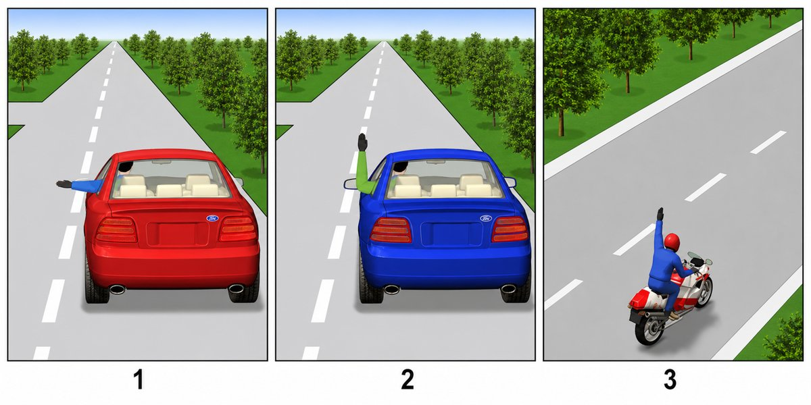

1. **1** ✅
2. 2
3. 3

### 9-13. Կարմիր գույնի առկայծող փարոսիկ միացրած, կանգնած վիճակում գտնվող տրանսպորտային միջոցին մոտենալիս` տվյալ ուղղությամբ երթեւեկող տրանսպորտային միջոցների վարորդները պետք է

1. **Կանգ առնեն եւ շարունակեն երթեւեկությունը միայն թույլտվություն ստանալուց հետո։** ✅
2. Իջեցնեն արագությունը, որպեսզի անհրաժեշտության դեպքում հնարավորություն ունենան անմիջապես կանգ առնել։

### 9-14. Տրանսպորտային միջոցների վրա ի՞նչ նպատակով են տեղադրված նարնջագույն կամ դեղին գույնի առկայծող փարոսիկներ։

1. Երթեւեկության մյուս մասնակիցների նկատմամբ երթեւեկության առավելություն ստանալու համար
2. **Երթեւեկության մյուս մասնակիցներին վտանգի մասին նախազգուշացնելու համար** ✅

### 9-15. Կապույտ գույնի առկայծող փարոսիկ եւ հատուկ ձայնային ազդանշան միացրած տրանսպորտային միջոց մոտենալու դեպքում վարորդները պետք է

1. **Զիջեն ճանապարհը՝ նշված տրանսպորտային միջոցի անխոչընդոտ անցումն ապահովելու համար։** ✅
2. Իջեցնեն արագությունը եւ զիջեն ճանապարհը՝ նշված տրանսպորտային միջոցի անխոչընդոտ անցումն ապահովելու համար։

### 9-16. Կապույտ ավտոմոբիլը խաչմերուկը կանցնի

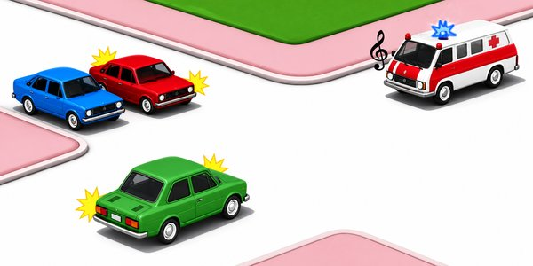

1. Առաջինը՝ կարմիրի հետ միաժամանակ։
2. Երկրորդը՝ կարմիրի հետ միաժամանակ։
3. **Երրորդը՝ կարմիրի հետ միաժամանակ։** ✅

### 9-17. Կապույտ եւ կարմիր գույների առկայծող փարոսիկներ եւ հատուկ ձայնային ազդանշան միացրած տրանսպորտային միջոց մոտենալու դեպքում վարորդները պետք է

1. Զիջեն ճանապարհը՝ նշված տրանսպորտային միջոցի անխոչընդոտ անցումն ապահովելու համար։
2. **Իջեցնեն արագությունը եւ զիջեն ճանապարհը՝ նշված, ինչպես նաեւ դրանով ուղեկցվող տրանսպորտային միջոցների անխոչընդոտ անցումն ապահովելու համար։** ✅

### 9-18. Ո՞ր տրանսպորտային միջոցի վարորդն ունի առաջնահերթ երթեւեկության իրավունք։

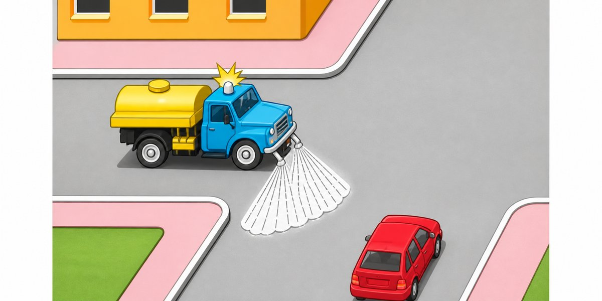

1. Ճանապարհը մաքրող մեքենայի վարորդը
2. **Թեթեւ մարդատար ավտոմոբիլի վարորդը** ✅

### 9-19. Սեւ ավտոմոբիլը խաչմերուկը կանցնի՝

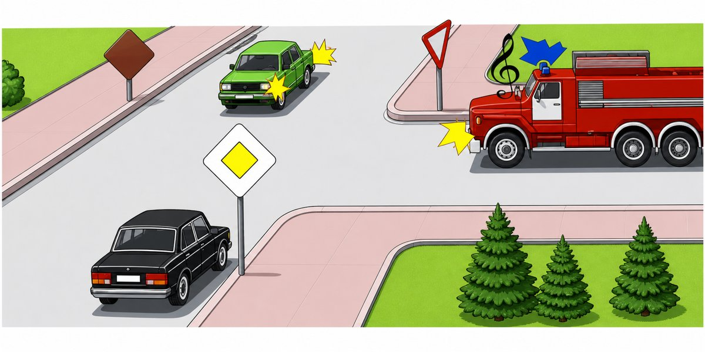

1. Առաջինը։
2. **Երկրորդը։** ✅
3. Վերջինը։

### 9-20. Ո՞ր տրանսպորտային միջոցի վարորդը պետք է զիջի ճանապարհը։

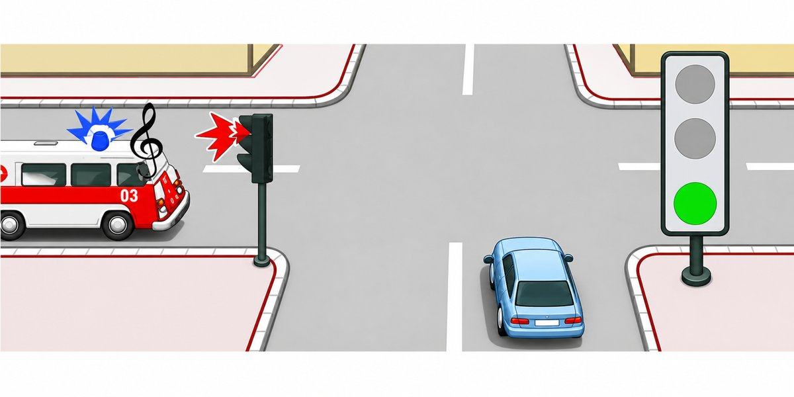

1. Շտապ օգնության ավտոմոբիլի վարորդը
2. **Թեթեւ մարդատար ավտոմոբիլի վարորդը** ✅

### 9-21. Կապույտ ավտոմոբիլը խաչմերուկը կանցնի

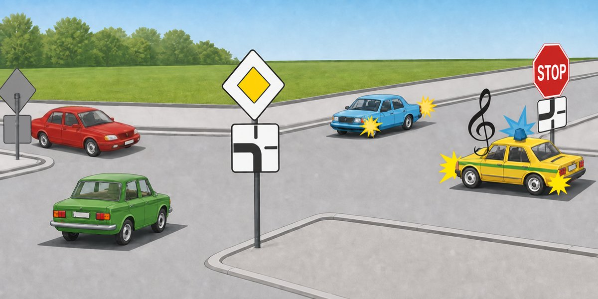

1. Առաջինը։
2. Երկրորդը։
3. Երրորդը։
4. **Վերջինը։** ✅

### 9-22. Տալի՞ս է արդյոք երթեւեկության առավելություն տրանսպորտային միջոցի վրա միացված դեղին գույնի (նարնջագույն) առկայծող փարոսիկը։

1. Տալիս է
2. **Չի տալիս** ✅

### 9-23. Լուսնասպիտակ գույնի առկայծող փարոսիկները միացրած տրանսպորտային միջոցի վարորդը տալիս է հատուկ ձայնային ազդանշան, որպեսզի

1. Ստանա երթեւեկության առավելություն երթեւեկության այլ մասնակիցների նկատմամբ։
2. **Ոստիկանության ծառայողների եւ այլ անձանց ուշադրությունը գրավելու համար։** ✅

### 9-24. Կապույտ գույնի առկայծող փարոսիկով կահավորված տրանսպորտային միջոցի վարորդը երթեւեկության մյուս մասնակիցների նկատմամբ առավելություն ունի, եթե

1. Միացրել է առկայծող փարոսիկը։
2. Հատուկ ձայնային ազդանշան է տալիս։
3. **Միացրել է կապույտ գույնի առկայծող փարոսիկը եւ հատուկ ձայնային ազդանշանը։** ✅

### 9-25. Ի՞նչ տարածության վրա է արգելվում վազանցը մինչեւ երկաթուղային գծանցը։

1. Մինչեւ 50մ գծանցից առաջ։
2. **Մինչեւ 100մ գծանցից առաջ։** ✅
3. Մինչեւ 150մ գծանցից առաջ։

### 9-26. Թույլատրվու՞մ է արդյոք խաչմերուկում կատարել տրանսպորտային միջոցների վազանց` հատվողի նկատմամբ գլխավոր համարվող ճանապարհի վրա։

1. Թույլատրվում է
2. **Արգելվում է** ✅

### 9-27. Թույլատրվու՞մ է արդյոք թեթեւ մարդատար ավտոմոբիլի վարորդին վազանց կատարել նշված իրադրությունում։

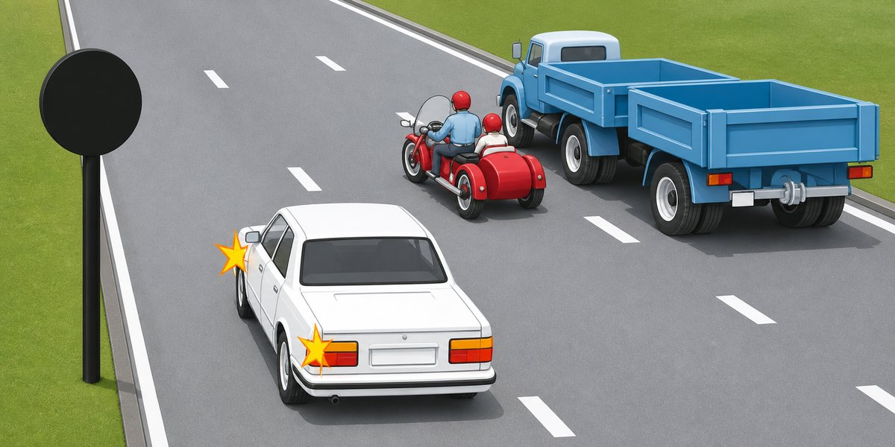

1. Թույլատրվում է
2. Թույլատրվում է, եթե մոտոցիկլի արագությունը չի գերազանցում 30 կմ/ժ
3. **Արգելվում է** ✅

### 9-28. Վազանցն արգելվում է

1. **Խաչմերուկներում։** ✅
2. Երկաթուղային գծանցներից 150 մ առաջ։
3. Երկու դեպքում էլ։

### 9-29. Վազանցն արգելվում է

1. Կարգավորվող խաչմերուկներում։
2. Չկարգավորվող խաչմերուկներում։
3. **Երկու դեպքում էլ։** ✅

### 9-30. Թույլատրվու՞մ է արդյոք վազանցել ավտոգնացքը տվյալ իրադրությունում, եթե դրա արագությունը չի գերազանցում 30կմ/ժ։

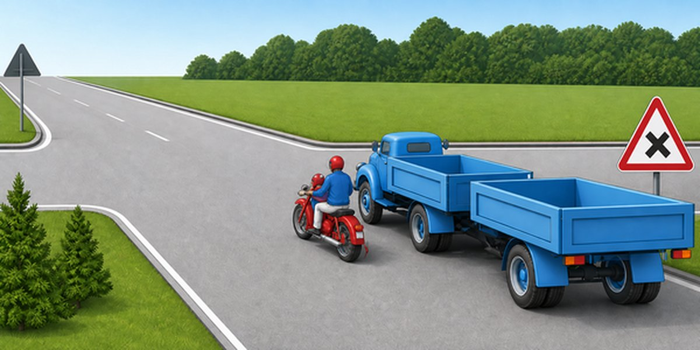

1. **Արգելվում է** ✅
2. Թույլատրվում է

### 9-31. Թույլատրվու՞մ է արդյոք կանաչ ավտոմոբիլի վարորդին վազանց կատարել։

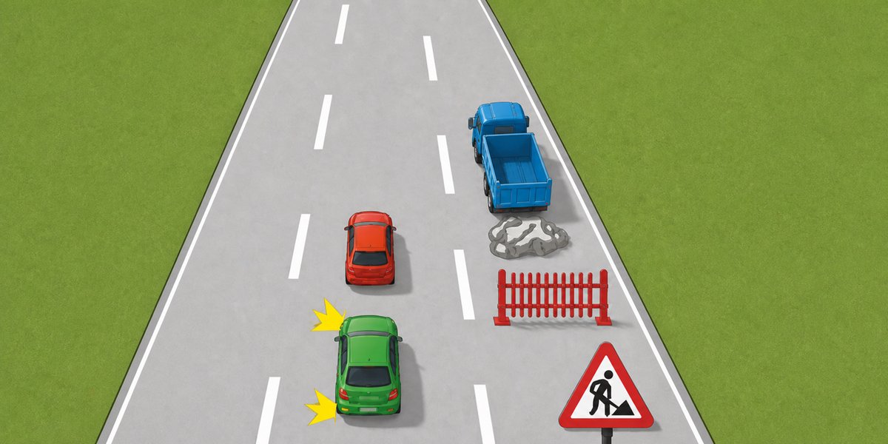

1. Թույլատրվում է
2. **Արգելվում է** ✅
3. Թույլատրվում է, եթե կարմիր ավտոմոբիլը երթեւեկում է 30 կմ/ժ-ից ցածր արագությամբ

### 9-32. Թույլատրվու՞մ է արդյոք կարմիր ավտոմոբիլի վարորդին վազանց կատարել տվյալ իրադրությունում։

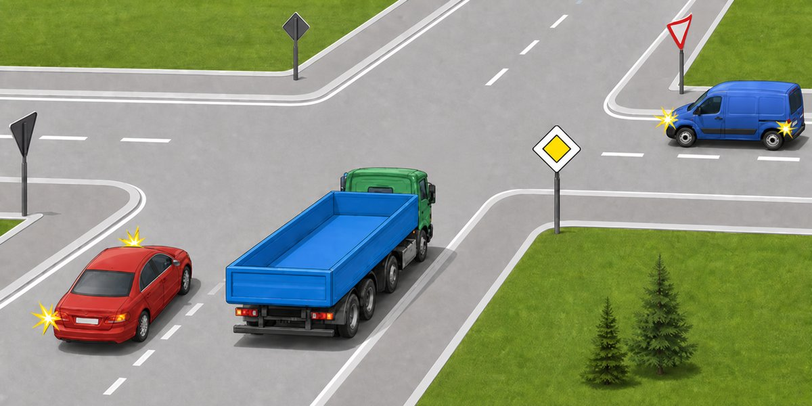

1. Թույլատրվում է
2. **Արգելվում է** ✅
3. Թույլատրվում է, եթե վազանցվող ավտոմոբիլի արագությունը չի գերազանցում 30 կմ/ժ։

### 9-33. Թույլատրվու՞մ է արդյոք նշված տեղում վազանցել ավտոբուսը։

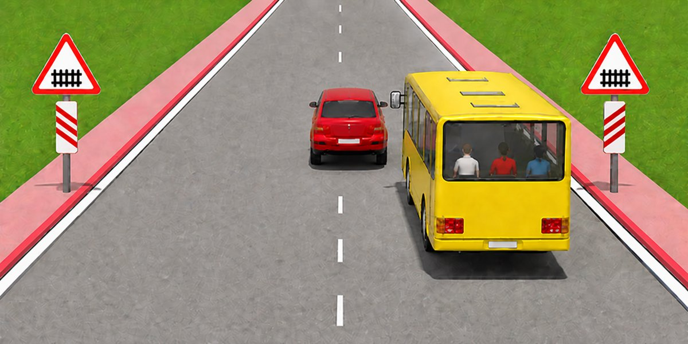

1. **Թույլատրվում է** ✅
2. Արգելվում է

### 9-34. Տրանսպորտային միջոցների վազանց նշանակում է

1. Շարժման մեջ գտնվող մեկ կամ մի քանի տրանսպորտային միջոցից առաջ անցնելը` կապված զբաղեցրած գոտուց հանդիպակաց երթեւեկության գոտի դուրս գալու հետ։
2. **Շարժման մեջ գտնվող մեկ կամ մի քանի տրանսպորտային միջոցից առաջ անցնելը` կապված զբաղեցրած գոտուց դուրս գալու հետ։** ✅

### 9-35. Օրվա մութ ժամանակ եւ անբավարար տեսանելիության պայմաններում` անկախ ճանապարհի լուսավորվածությունից, երթեւեկող մեխանիկական տրանսպորտային միջոցների վրա պետք է միացված լինեն

1. Լապտերների հեռահար լույսը։
2. Լապտերների մոտակա լույսը։
3. **Լապտերների հեռահար կամ մոտակա լույսը։** ✅

### 9-36. Ո՞ր դեպքում օրվա լուսավոր ժամանակ մոտոցիկլի վրա պետք է միացված լինի լապտերների մոտակա լույսը։

1. Անբավարար տեսանելիության պայմաններում երթեւեկելիս
2. Անսարքություններ ունեցող մոտոցիկլով դեպի կայանման վայր երթեւեկելիս
3. **Ցանկացած դեպքում` երթեւեկության մեջ գտնվելիս** ✅
4. Հիվանդ ուղեւոր փոխադրելիս

### 9-37. Առաջնահերթ ի՞նչ պետք է ձեռնարկի վարորդը հանդիպակաց երթեւեկող տրանսպորտային միջոցի լապտերների լույսից շլանալու դեպքում։

1. Լապտերների հեռահար լույսը (միացված լինելու դեպքում) փոխարկի մոտակայի
2. **Միացնի վթարային լուսային ազդանշանը** ✅
3. Տա ձայնային ազդանշան՝ մեկ երկար եւ երեք կարճ
4. Տա ձայնային ազդանշան՝ մեկ կարճ եւ երեք երկար

### 9-38. Ձայնային ազդանշանները կարող են կիրառվել միայն

1. Բնակավայրերում՝ վազանց կատարելու մտադրության մասին մյուս վարորդներին նախազգուշացնելու համար։
2. **Երբ դա անհրաժեշտ է ճանապարհատրանսպորտային պատահարը կանխելու համար** ✅
3. Երկու դեպքում էլ

### 9-39. Օրվա մութ ժամանակ ճանապարհի չլուսավորված հատվածներում երթեւեկող մեխանիկական տրանսպորտային միջոցի վրա պետք է միացված լինի

1. **Լապտերների հեռահար կամ մոտակա լույսը։** ✅
2. Լապտերների միայն մոտակա լույսը։
3. Լապտերների միայն հեռահար լույսը։

### 9-40. Հետին հակամառախուղային լապտերիկները կարող են օգտագործվել

1. Օրվա մութ ժամանակ՝ տրանսպորտային շարասյան կազմում երթեւեկելիս։
2. Թունելներում երթեւեկելիս։
3. **Միայն անբավարար տեսանելիության պայմաններում։** ✅
4. Օրվա մութ ժամանակ՝ տրանսպորտային միջոցը բեռնաթափելիս։
5. Թվարկած բոլոր դեպքերում։

### 9-41. Հանդիպակաց երթեւեկող տրանսպորտային միջոցից ի՞նչ հեռավորության վրա լապտերների հեռահար լույսը պետք է փոխարկվի մոտակայի։

1. 100 մ-ից ոչ պակաս
2. **150 մ-ից ոչ պակաս** ✅
3. 300 մ-ից ոչ պակաս

### 9-42. Լապտեր-լուսարձակ թույլատրվում է օգտագործել

1. **Միայն բնակավայրերից դուրս՝ հանդիպակաց եւ համընթաց տրանսպորտային միջոցների բացակայության դեպքում։** ✅
2. Միայն անբավարար տեսանելիության պայմաններում։
3. Ցանկացած տեղում, եթե դրա անհրաժեշտությունը կա։
4. Օրվա մութ ժամանակ՝ ճանապարհների բոլոր հատվածներում։

### 9-43. Այս նախազգուշացնող նշանը բնակավայրերում, մինչեւ վտանգավոր հատվածի սկիզբը ի՞նչ հեռավորության վրա է տեղադրվում։

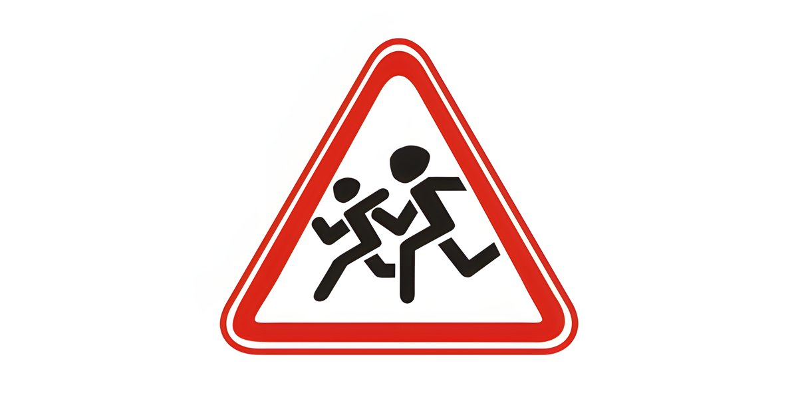

1. 25 - 50մ
2. **50 - 100մ** ✅
3. 100 - 150մ

### 9-44. Թույլատրվու՞մ է արդյոք երկաթուղային գծանցով փոխադրել գյուղատնտեսական, ճանապարհային, շինարարական եւ այլ մեքենաներ ու մեխանիզմներ։

1. Թույլատրվում է, եթե գծանցը կահավորված չէ ուղեփակոցով
2. Թույլատրվում է, եթե դրանք գտնվում են ոչ տրանսպորտային վիճակում
3. **Թույլատրվում է, եթե դրանք գտնվում են տրանսպորտային վիճակում** ✅

### 9-45. Որտե՞ղ է թույլատրվում հատել երկաթուղային գծերը։

1. Այն տեղերում, որտեղ երկու կողմից տեսանելիությունը կազմում է առնվազն 1000մ
2. Վարորդի հայեցողությամբ՝ դրա համար առավել հարմարավետ տեղերում
3. **Դրա համար նախատեսված տեղերում** ✅
4. Երկաթուղային կայարաններից առնվազն 1000մ հեռավորության վրա

### 9-46. Թույլատրվու՞մ է արդյոք ծառայողական առաջադրանք կատարելիս ինքնակամ բացել կամ շրջանցել ուղեփակոցը։

1. **Արգելվում է** ✅
2. Թույլատրվում է
3. Թույլատրվում է՝ վարորդի հայեցողությամբ, եթե մոտակայքում բացակայում է մոտեցող գնացքը
4. Թույլատրվում է՝ գծանցի հերթապահի բացակայության դեպքում

### 9-47. Թույլատրվու՞մ է արդյոք երկաթուղայհն գծանցով փոխադրել գյուղատնտեսական, ճանապարհային, շինարարական եւ այլ մեքենաներ ու մեխանիզմներ։

1. Թույլատրվում է
2. **Թույլատրվում է, եթե դրանք գտնվում են տրանսպորտային վիճակում** ✅
3. Արգելվում է

### 9-48. Ինչո՞վ պետք է ղեկավարվի վարորդը երկաթուղային գծանցին մոտենալիս։

1. Ուղեփակոցի դիրքով եւ լուսացույցի ազդանշաններով
2. Ճանապարհային նշանների եւ գծանշումների պահանջներով
3. Գծանցի հերթապահի ցուցումներով
4. **Բոլոր թվարկած պահանջներով** ✅

### 9-49. Թույլատրվու՞մ է արդյոք հետիոտներին տեղաշարժվել «Ավտոմայրուղի» նշանով կահավորված ճանապարհով։

1. **Արգելվում է** ✅
2. Թույլատրվում է` բնակավայրերից դուրս` տրանսպորտային միջոցների հոսքին հակառակ
3. Թույլատրվում է` բնակավայրերից դուրս` տրանսպորտային միջոցների հոսքին համընթաց

### 9-50. Տրանսպորտային միջոցներով, որոնց արագությունը, տեխնիկական բնութագրերից կամ վիճակից ելնելով, չի գերազանցում 40 կմ/ժ, ավտոմայրուղիներով երթեւեկել

1. Թույլատրվում է` միայն աջ եզրային գոտիով։
2. **Արգելվում է։** ✅
3. Թույլատրվում է` «Նվազագույն արագության սահմանափակում» նշանի բացակայության դեպքում։

### 9-51. Տրանսպորտային միջոցի վրա վթարային լուսային ազդանշանը պետք է միացված լինի

1. Ճանապարհատրանսպորտային պատահարի դեպքում։
2. Կանգառն արգելված տեղերում՝ հարկադրված կանգառի դեպքում։
3. **Երկու դեպքում էլ։** ✅

### 9-52. Տրանսպորտային միջոցի վրա վթարային լուսային ազդանշանը պետք է միացված լինի

1. Ճանապարհատրանսպորտային պատահարի դեպքում։
2. Քարշակման դեպքում (քարշակվող մեխանիկական տրանսպորտային միջոցի վրա)։
3. Կանգառն արգելված տեղերում՝ հարկադրված կանգառի դեպքում։
4. **Թվարկած բոլոր դեպքերում։** ✅

### 9-53. Տրանսպորտային միջոցից ի՞նչ հեռավորության վրա է տեղադրվում «Վթարային կանգառ» նշանը։

1. **Բնակավայրերում՝ ոչ պակաս, քան 15մ վրա, բնակավայրերից դուրս՝ ոչ պակաս, քան 30մ** ✅
2. Բնակավայրերում՝ ոչ պակաս, քան 10 մ վրա, բնակավայրերից դուրս՝ ոչ պակաս, քան 20մ
3. Բնակավայրերում՝ ոչ պակաս, քան 5մ վրա, բնակավայրերից դուրս՝ ոչ պակաս, քան 10մ

### 9-54. Տրանսպորտային միջոցի վրա վթարային լուսային ազդանշանը պետք է միացված լինի

1. Լապտերների լույսից վարորդի շլացման դեպքում։
2. Քարշակման դեպքում (քարշակվող մեխանիկական տրանսպորտային միջոցի վրա)։
3. **Երկու դեպքում էլ։** ✅

### 9-55. Տրանսպորտային միջոցի վրա վթարային լուսային ազդանշանը պետք է միացված լինի

1. Ճանապարհատրանսպորտային պատահարի դեպքում։
2. Քարշակման դեպքում (քարշակվող մեխանիկական տրանսպորտային միջոցի վրա)։
3. **Երկու դեպքում էլ։** ✅

### 9-56. Կառուցապատված տարածքներում, որտեղ մուտքն ու ելքը նշված են «Բնակելի գոտի» եւ «Բնակելի գոտու վերջ» ճանապարհային նշաններով, չի արգելվում

1. **Հետիոտների տեղաշարժը՝ ճանապարհի երթեւեկելի մասով։** ✅
2. Տրանսպորտային միջոցների միջանցիկ երթեւեկությունը։
3. Ուսումնական վարումը։

### 9-57. Խաչմերուկը համարվում է կարգավորվող, եթե երթեւեկության հերթականությունը որոշվում է

1. Միայն լուսացույցի ազդանշաններով։
2. Միայն կարգավորողի ազդանշաններով։
3. **Երկու դեպքում էլ։** ✅

### 9-58. Առանց ծածկույթի հողային ճանապարհի վրա, անմիջապես խաչմերուկից առաջ, ծածկույթով հատվածի առկայությունն արդյոք այդ ճանապարհը դարձնու՞մ է հատվողին հավասարազոր։

1. **Ոչ** ✅
2. Այո

### 9-59. Ո՞ր նկարում են պատկերված երթեւեկության թույլատրելի ուղղությունները։

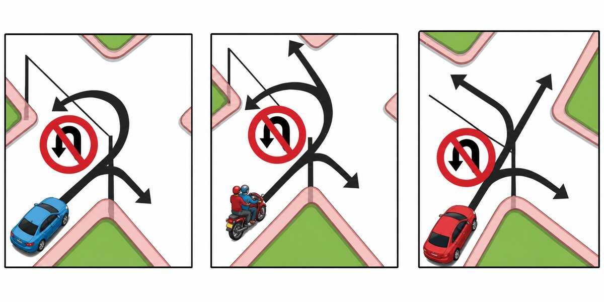

1. Ձախ նկարում
2. Մեջտեղի նկարում
3. **Աջ նկարում** ✅
4. Մեջտեղի եւ աջ նկարներում

### 9-60. Եթե լուսացույցի ազդանշանների նշանակությունները հակասում են առավելության նշանների պահանջներին, ապա վարորդները պետք է ղեկավարվեն

1. Նշանների պահանջներով։
2. **Լուսացույցի ազդանշաններով։** ✅

### 9-61. Թույլատրվու՞մ է արդյոք վարորդին շարունակել երթեւեկությունը լուսացույցի դեղին ազդանշանը միանալու կամ կարգավորողի ձեռքը բարձրացնելու դեպքում։

1. Արգելվում է
2. **Թույլատրվում է, եթե վարորդը չի կարող կանգնել՝ առանց կտրուկ արգելակման** ✅

### 9-62. Կարգավորողն ազդանշան տալիս է սուլիչով

1. Միայն այն դեպքում, երբ պահանջում է կանգնեցնել տրանսպորտային միջոցը։
2. **Երթեւեկության մասնակիցների ուշադրությունն իր վրա հրավիրելու համար։** ✅

### 9-63. Թույլատրվու՞մ է արդյոք տվյալ իրադրությունում ավտոգնացքին անցնել կամուրջի վրայով։

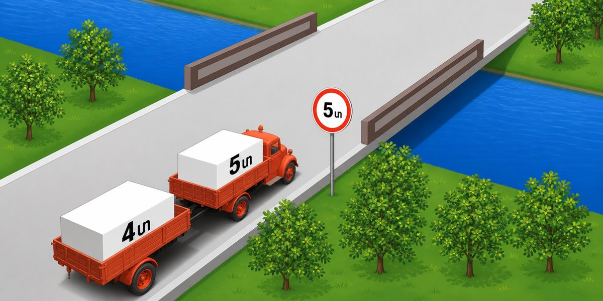

1. Թույլատրվում է
2. **Արգելվում է** ✅

### 9-64. Կարելի՞ է նշված հետագծով երթեւեկելու համար ձեռքով տալ նախազգուշացնող ազդանշան։

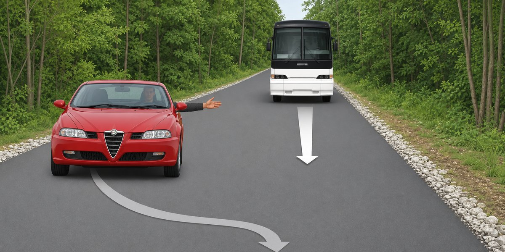

1. **Կարելի է, եթե անսարք է շրջադարձի ցուցիչը** ✅
2. Կարելի, եթե անսարք է շրջադարձի ցուցիչը` օրվա լուսավոր ժամերին
3. Կարելի է բոլոր դեպքերում

### 9-65. Պարտավո՞ր է վարորդը միացնել շրջադարձի ցուցիչը` բնակելի գոտում երթեւեկությունը սկսելուց առաջ։

1. Պարտավոր չէ
2. **Պարտավոր է** ✅
3. Պարտավոր է, այլ տրանսպորտային միջոցների առկայության դեպքում

### 9-66. Պարեկային ծառայության ավտոմոբիլի վարորդը երթեւեկության այլ մասնակիցների նկատմամբ առավելություն ստանալու համար պետք է միացնի

1. Կապույտ գույնի առկայծող փարոսիկը։
2. Կապույտ եւ կարմիր գույնի առկայծող փարոսիկները։
3. **Կապույտ գույնի առկայծող փարոսիկը եւ հատուկ ձայնային ազդանշանը։** ✅

### 9-67. Վազանցն արգելվում է

1. **Երկաթուղային գծանցների վրա եւ դրանցից 100մ առաջ։** ✅
2. Երկաթուղային գծանցների վրա եւ դրանցից 150մ առաջ։
3. Երկաթուղային գծանցների վրա եւ դրանցից 250մ առաջ։

### 9-68. Ինչի՞ մասին է տեղեկացնում թեթեւ մարդատար ավտոմոբիլի վարորդի կողմից ձեռքով տրված ազդանշանը։

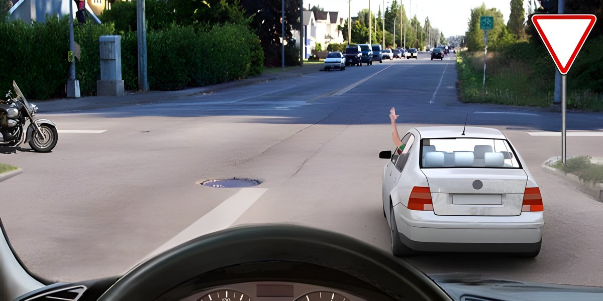

1. Շրջադարձ է կատարում դեպի աջ
2. Շարունակում է երթեւեկությունն ուղիղ
3. **Արգելակում է** ✅

### 9-69. Վթարային լուսային ազդանշանը միացվում է

1. Մինչեւ թունել մտնելը։
2. **Ճանապարհատրանսպորտային պատահարի դեպքում։** ✅
3. Կազմակերպված ավտոշարասյան կազմում երթեւեկելիս։

### 9-70. Ինչի՞ մասին է տեղեկացնում մոտոցիկլի վարորդի կողմից ձեռքով տրված ազդանշանը։

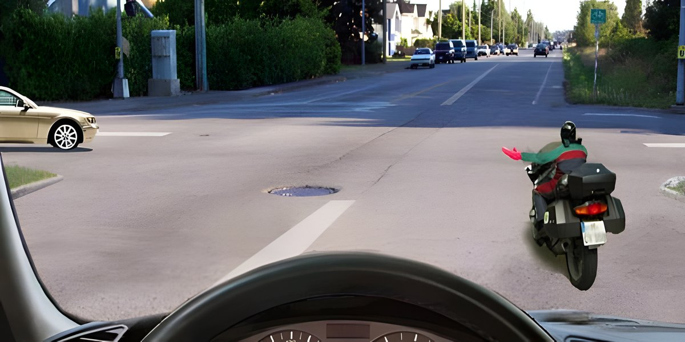

1. **Շարունակում է երթեւեկությունը ձախ կամ հակառակ ուղղությամբ** ✅
2. Շարունակում է երթեւեկությունն ուղիղ կամ աջ ուղղությամբ

### 9-71. Ինչի՞ մասին է տեղեկացնում թեթեւ մարդատար ավտոմոբիլի վարորդի կողմից ձեռքով տրված ազդանշանը։

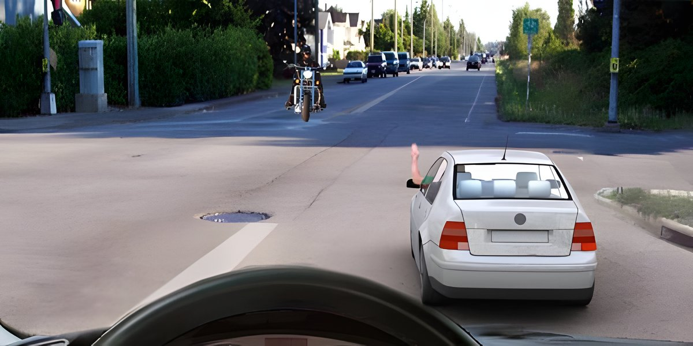

1. **Աջ շրջադարձ է կատարում** ✅
2. Շարունակում է երթեւեկությունն ուղիղ
3. Արգելակում է` ճանապարհը մոտոցիկլին զիջելու համար

### 9-72. Ինչի՞ մասին է տեղեկացնում թեթեւ մարդատար ավտոմոբիլի վարորդի կողմից ձեռքով տրված ազդանշանը։

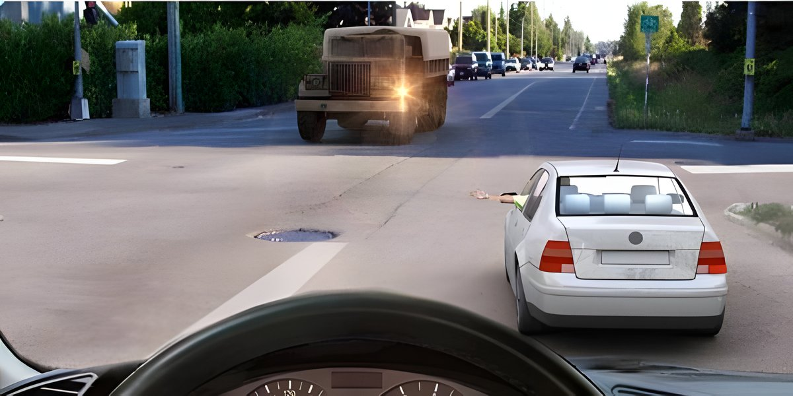

1. **Մտադիր է կատարել ձախ շրջադարձ կամ հետադարձ** ✅
2. Արգելակում է` ճանապարհը բեռնատար ավտոմոբիլին զիջելու համար

### 9-73. Պարտավո՞ր է արդյոք վարորդը միացնել շրջադարձի ցուցիչը տվյալ դեպքում։

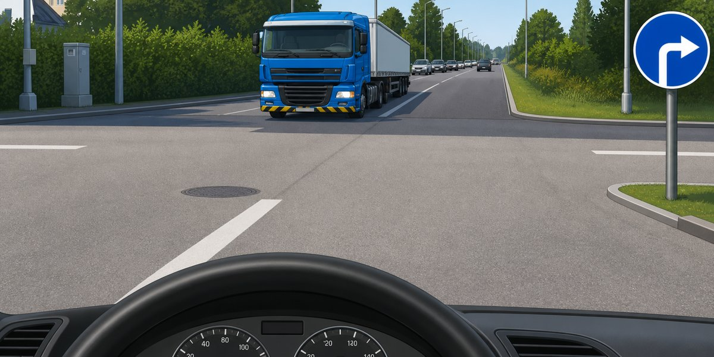

1. **Պարտավոր է** ✅
2. Պարտավոր չէ

### 9-74. Թույլատրվու՞մ է բեռնատար ավտոմոբիլի վարորդին վազանցել ավտոբուսին, որը երթեւեկում է 60 կմ/ժ արագությամբ։

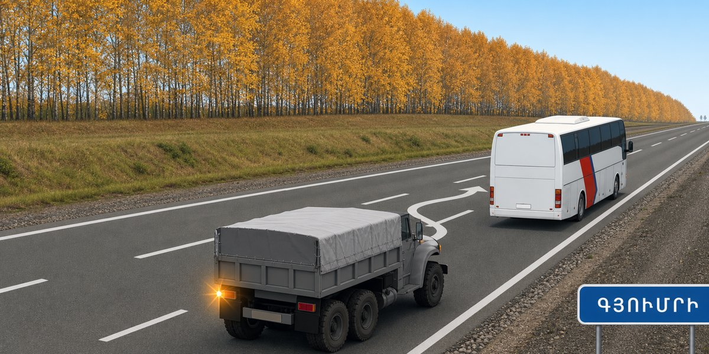

1. Արգելվում է
2. **Թույլատրվում է** ✅

### 9-75. Թույլատրվու՞մ է վազանց կատարել տվյալ իրավիճակում։

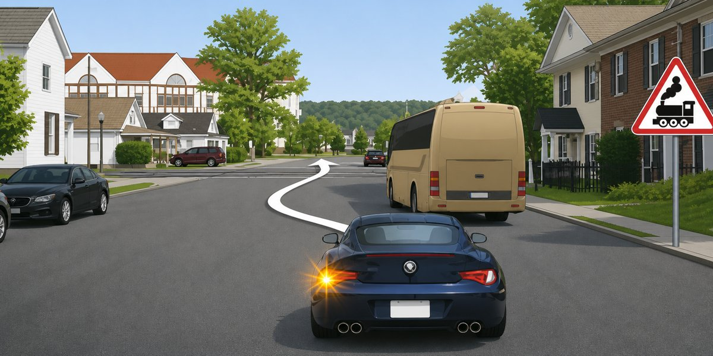

1. **Արգելվում է** ✅
2. Թույլատրվում է
3. Թույլատրվում է, եթե ավտոբուսը երթեւեկում է 30 կմ/ժ պակաս արագությամբ

### 9-76. Թույլատրվու՞մ է արդյոք մուտք գործել երկաթուղային գծանց տվյալ իրավիճակում։

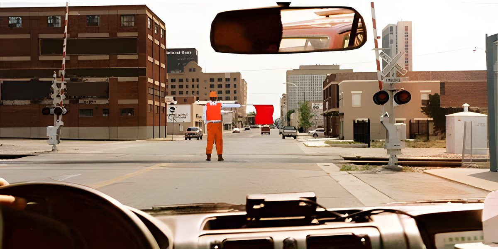

1. Թույլատրվում է
2. **Արգելվում է** ✅

### 9-77. Թույլատրվու՞մ է արդյոք մուտք գործել երկաթուղային գծանց տվյալ իրավիճակում։

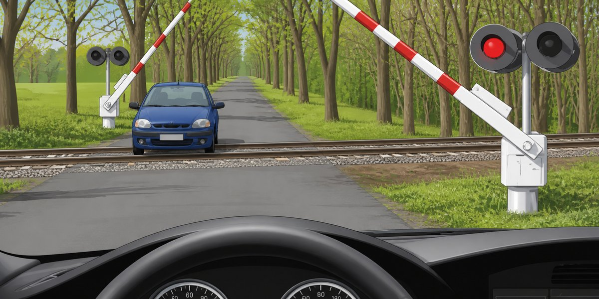

1. Թույլատրվում է, եթե գնացք չի մոտենում
2. Թույլատրվում է, եթե ուղեփակոցը բաց է
3. **Արգելվում է** ✅

### 9-78. Ինչպե՞ս պետք է գործել տվյալ իրադրությունում։

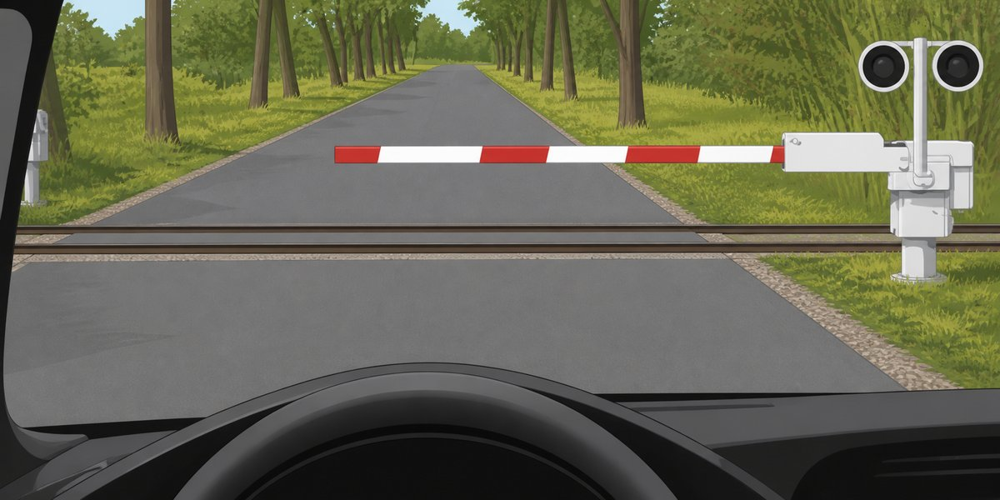

1. Գնացքի բացակայության դեպքում շրջանցել ուղեփակոցը եւ շարունակել երթեւեկությունը
2. **Կանգ առնել եւ սպասել ուղեփակոցի բացմանը** ✅

### 9-79. Տվյալ իրավիճակում թույլատրվու՞մ է անցնել երկաթուղային գծանցը։

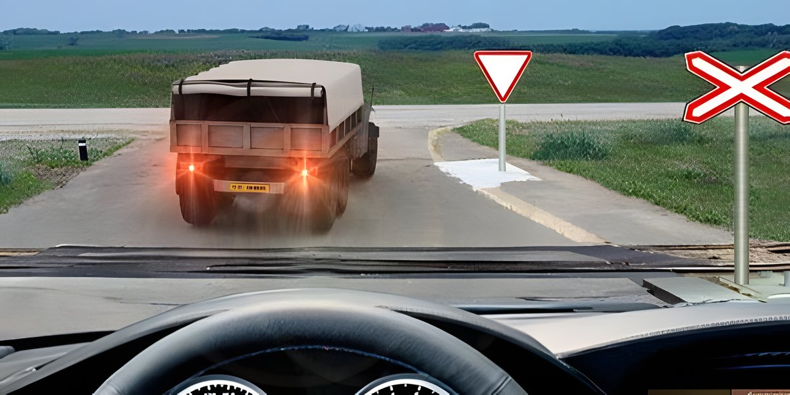

1. Թույլատրվում է, եթե գնացք չի մոտենում
2. Թույլատրվում է
3. **Արգելվում է** ✅

### 9-80. Տվյալ իրավիճակում թույլատրվու՞մ է անցնել երկաթուղային գծանցը։

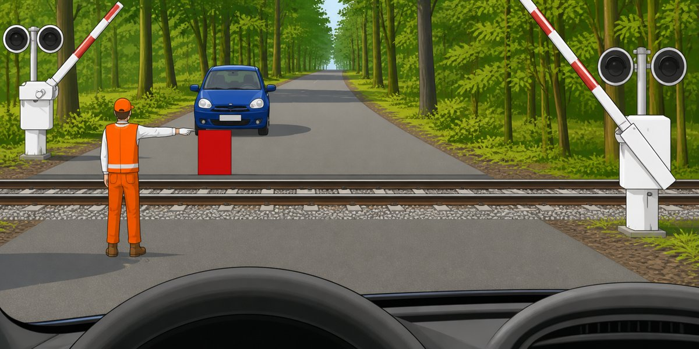

1. **Արգելվում է** ✅
2. Թույլատրվում է, եթե մոտեցող գնացք չկա
3. Թույլատրվում է, քանի որ գծանցի հերթապահն արգելում է հանդիպակաց տրանսպորտային միջոցի անցումը

### 9-81. Տվյալ իրավիճակում որտե՞ղ կարելի է սկսել վազանցը։

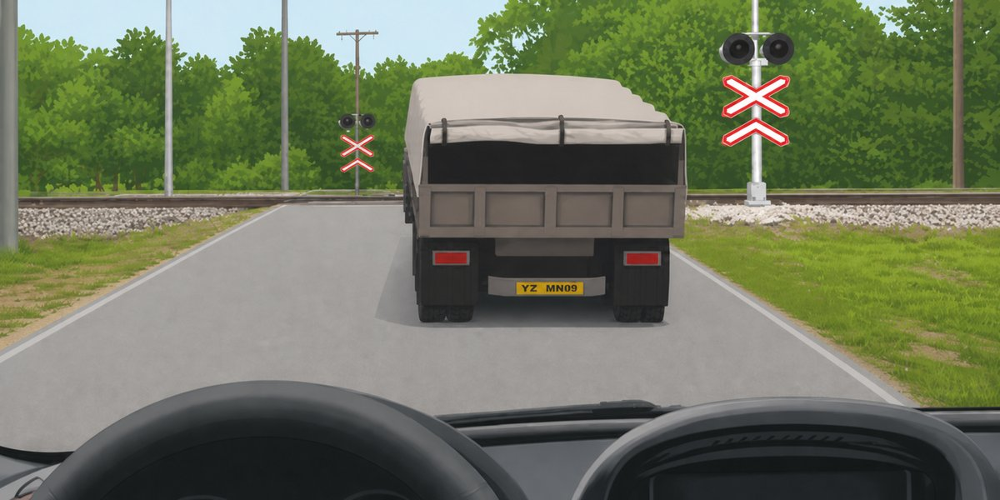

1. Երկաթուղային գծանցում
2. **Երկաթուղային գծանցն անցնելուց հետո** ✅
3. Երկաթուղային գծանցից 100մ անցնելուց հետո

### 9-82. Տվյալ իրավիճակում թույլատրվու՞մ է վազանց կատարել։

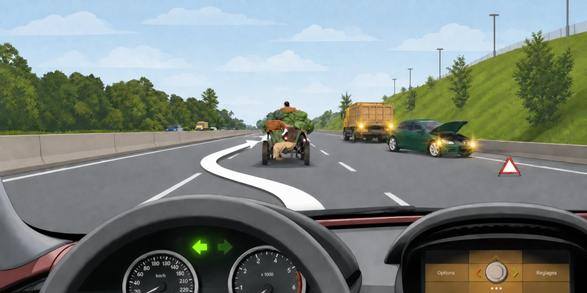

1. Թույլատրվում է, քանի որ հանդիպակաց երթեւեկող տրանսպորտային միջոց չկա
2. **Արգելվում է** ✅
3. Թույլատրվում է, եթե լծասայլը շարժվում է 30 կմ/ժ-ից ցածր արագությամբ

### 9-83. Ի՞նչ մանևր է կատարում թեթև մարդատարի վարորդը։

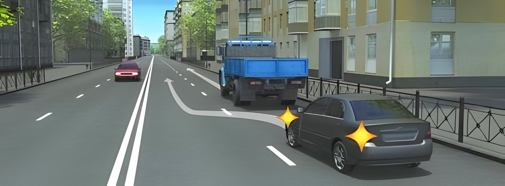

1. Կողանցում
2. **Վազանց** ✅
3. Շրջանցում

### 9-84. Թույլատրվում է արդյո՞ք վազանցել մոտոցիկլին։

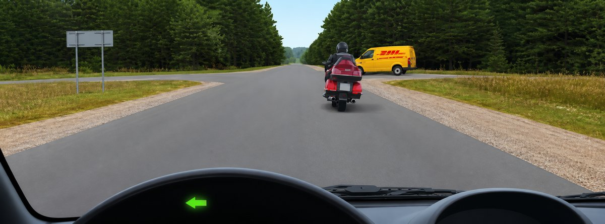

1. Թույլատրվում է
2. **Արգելվում է** ✅

### 9-85. Ո՞ր դեպքում է թույլատրվում հանդիպակաց երթևեկության գոտիով վազանց կատարել յուրաքանչյուր ուղղությամբ մեկ գոտի ունեցող ճանապարհներին։

1. Միայն, երբ հանդիպակաց ուղղությամբ գոտին բավարար տարածությամբ ազատ է:
2. Միայն, երբ մեզ վազանց չեն կատարում:
3. **Երկու պայմաններն էլ պետք է ապահովված լինեն:** ✅

### 9-86. Թույլատրվում է արդյո՞ք վազանց կատարել նշված իրավիճակում:

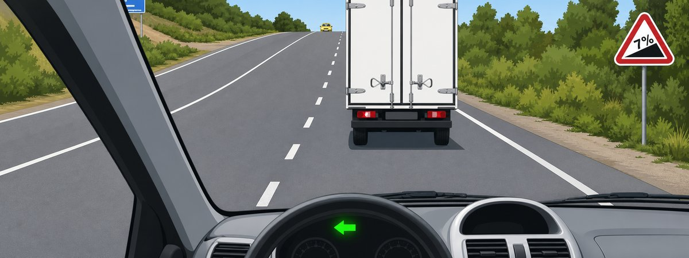

1. Արգելվում է
2. Թույլատրվում է, եթե մանևրը կավարտվի տեսանելիության սահմաններում
3. **Թույլատրվում է** ✅

### 9-87. Թույլատրվո՞ւմ է վազանցել բեռնատարին:

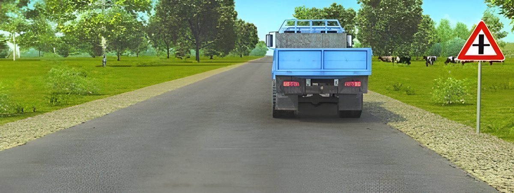

1. Այո
2. **Այո, եթե վազանցը մինչև խաչմերուկ կավարտվի** ✅
3. Ոչ

### 9-88. Ի՞նչ է պահանջվում վազանցվող տրանսպորտային միջոցի վարորդից։

1. Նա պարտավոր է զիջել ճանապարհը վազանց կատարողին:
2. **Նա որևէ կերպ չպետք է խոչընդոտի վազանցողին՝ բարձրացնելով արագությունը կամ կատարելով այլ գործողություն** ✅

### 9-89. Թույլատրվո՞ւմ է այս իրավիճակում վազանց կատարել։

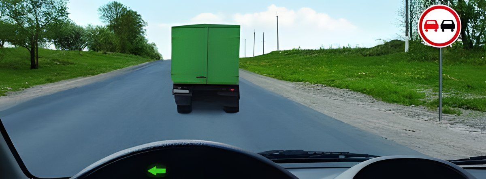

1. **Արգելվում է** ✅
2. Թույլատրվում է, եթե բեռնատարի արագությունը 30 կմ/ժ-ից պակաս է
3. Թույլատրվում է

### 9-90. Թույլատրվո՞ւմ է բեռնատարի վարորդին վազանցել տրակտորին, եթե թույլատրելի առավելագույն զանգվածը 3 տոննա է:

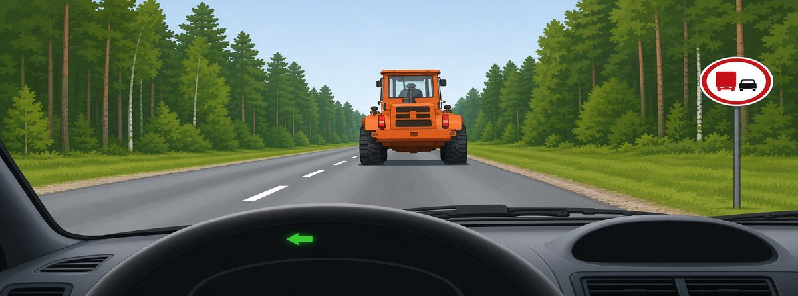

1. **Այո** ✅
2. Այո, եթե տրակտորը 30 կմ/ժ-ից պակաս արագությամբ է ընթանում
3. Ոչ

### 9-91. Եթե այս իրավիճակում հանդիպակաց երթևեկությունը դժվար է, ապա ճանապարհը պետք է զիջի

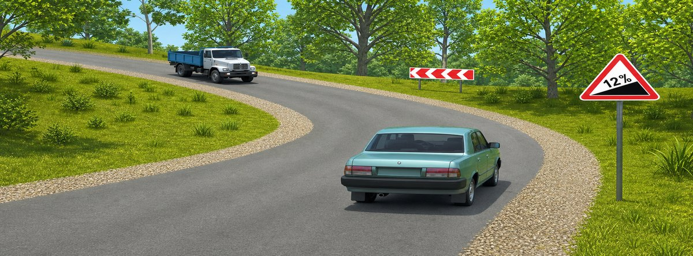

1. **Բեռնատարի վարորդը։** ✅
2. Թեթև մարդատարի վարորդը։

### 9-92. Հետիոտնային անցման վրա վազանցն

1. Արգելվում է միայն հետիոտնի առկայության դեպքում:
2. **Արգելվում է։** ✅
3. Թույլատրվում է։

### 9-93. Ո՞ր հետագծով է թույլատրվում վազանց կատարել։

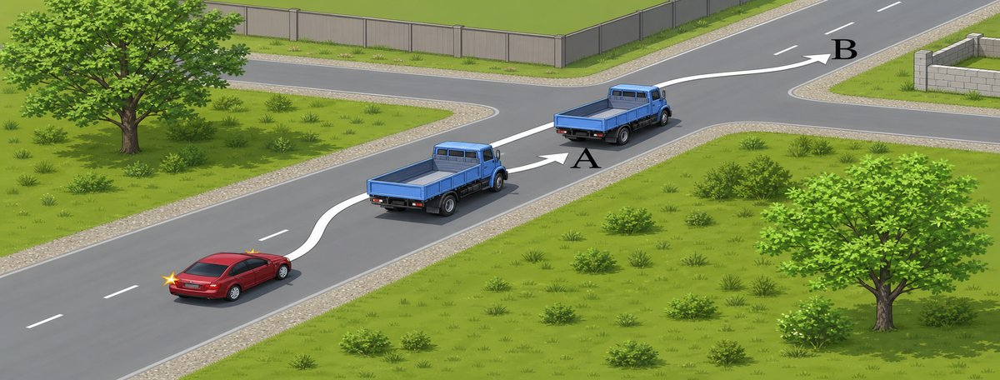

1. Ցանկացած
2. **Միայն Ա** ✅
3. Միայն Բ

### 9-94. Ի՞նչ է ցույց տալիս ճանապարհային նշանը։

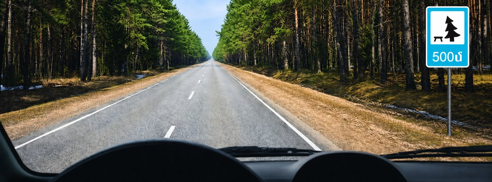

1. 500 մետր հետո տապալված ծառ կա
2. **500 մետր հետո հանգստի վայր է** ✅
3. 500 մետր հատվածում հանգստի վայր է

### 9-95. Այս իրավիճակում շրջադարձի լուսային ցուցիչ վարորդը միացնել

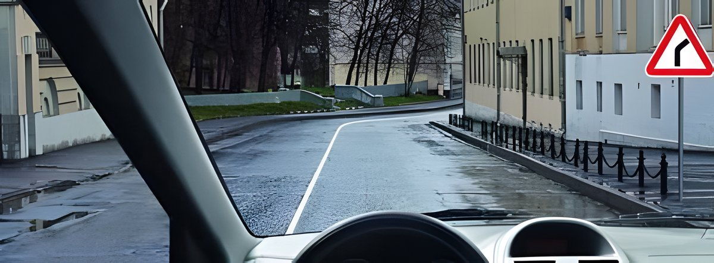

1. պարտավոր է։
2. պարտավոր է, եթե հետևից մոտեցող տրանսպորտային միջոց կա։
3. **պարտավոր չէ։** ✅

### 9-96. Վարորդը դեպի վեր պարզած ձեռքով տեղեկացնում է

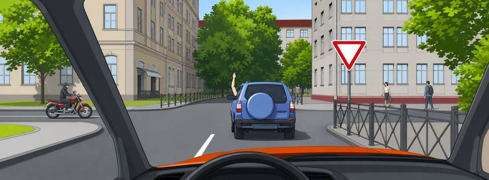

1. Ձախ շրջադարձ կատարելու մասին։
2. Ուղիղ երթևեկելու մասին։
3. **Ընթացքը դանդաղեցնելու մասին։** ✅

### 9-97. Ազդանշան տալը երթևեկության մյուս մասնակիցների նկատմամբ առավելություն

1. Տալիս է։
2. **Չի տալիս։** ✅
3. Տալիս է՝ միայն շարժում սկսելիս։

### 9-98. Գլխավոր ճանապարհով աջ շրջադարձ կատարելիս ազդանշան տալը

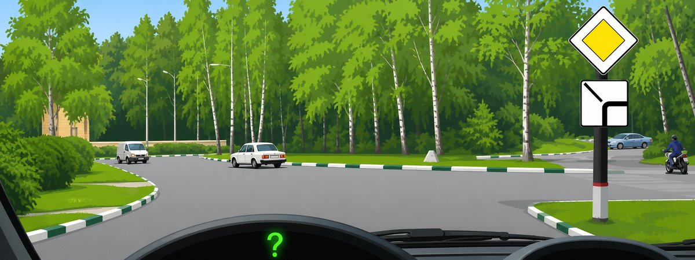

1. **պարտադիր է։** ✅
2. պարտադիր է, միայն օրվա մութ ժամանակ։
3. պարտադիր չէ։

### 9-99. Ի՞նչի մասին է տեղեկացնում մոտոցիկլի վարորդը։

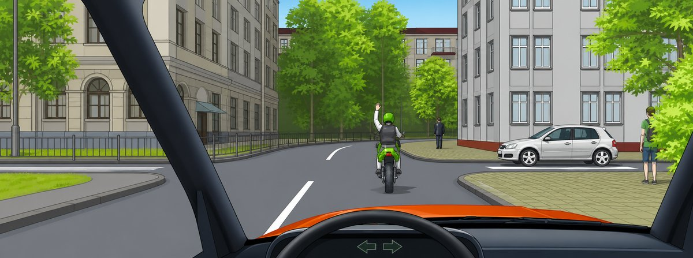

1. Երթևեկությունը ուղիղ շարունակելու
2. Ձախ շրջադարձ կատարելու
3. **Թեթև մարդատարին զիջելու նպատակով արագությունն իջեցնելու** ✅

### 9-100. Ձախ շրջադարձ կատարելիս այս իրավիճակում ազդանշան տալը

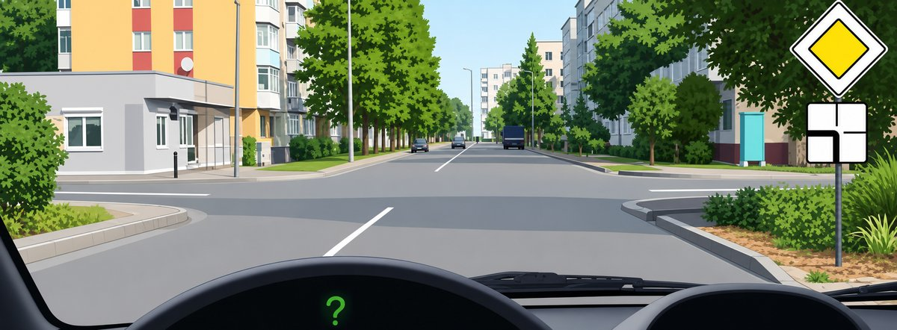

1. **Պարտադիր է։** ✅
2. Պարտադիր չէ։

### 9-101. Վազանց կատարելիս ձախ շրջադարձի լուսային ցուցիչն անջատել պարտավոր ենք

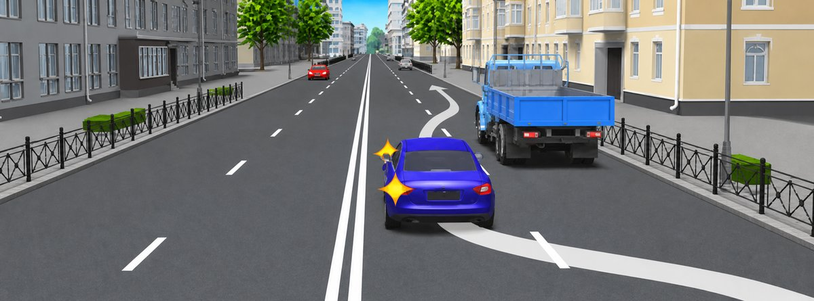

1. **Անմիջապես ձախ գոտի վերադասավորվելուց հետո։** ✅
2. Միայն առջևից ընթացողից առաջ անցնելուց հետո։
3. Վարորդի հայեցողությամբ։

### 9-102. Հետադարձն այս խաչմերուկում կատարելիս ո՞ր շրջադարձի ցուցիչը պետք է միացնենք։

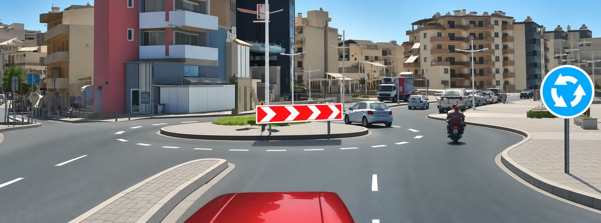

1. **Աջ** ✅
2. Ձախ
3. Ոչ մեկը

### 9-103. Պարտավոր եք արդյո՞ք նշված իրադրությունում տալ ազդանշան լուսային ցուցիչով։

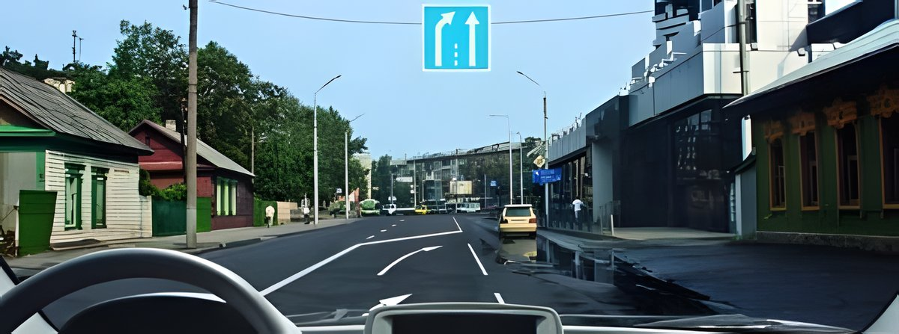

1. **Այո** ✅
2. Ոչ
3. Այո, եթե աջ գոտով երթևեկող վարորդ կա:

### 9-104. Ի՞նչի մասին է տեղեկացնում մոտոցիկլի վարորդը։

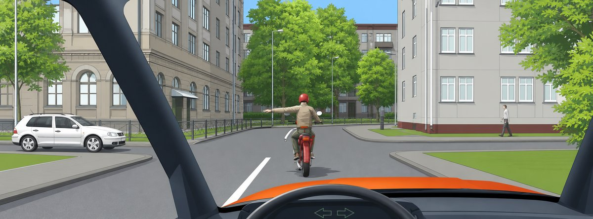

1. Երթևեկությունն ուղիղ շարունակելու
2. Աջ շրջադարձ կատարելու
3. **Ձախ շրջադարձ կամ հետադարձ կատարելու** ✅

### 9-105. Լուսային ցուցիչով տրված մանևրի մասին ազդանշանը պետք է դադարեցվի

1. Անմիջապես մանևրից առաջ։
2. **Անմիջապես մանևրից հետո։** ✅
3. Մանևրի ընթացքում։

### 9-106. Լուսային ցուցիչով ազդանշան տալ նշված իրավիճակում

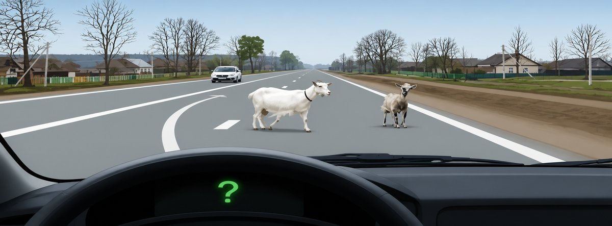

1. **Պարտադիր է։** ✅
2. Ըստ վարորդի հայեցողության։

### 9-107. Ո՞ր վարորդն է աջ շրջադարձի ազդանշան տալիս։

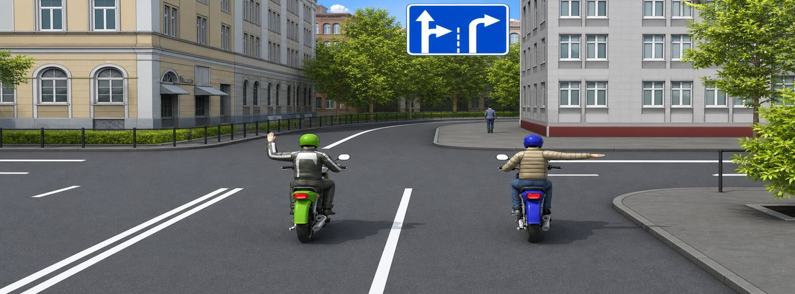

1. Միայն աջում գտնվողը
2. **Երկու վարորդներն էլ** ✅
3. Միայն ձախում գտնվողը

### 9-108. Կայանատեղիներում կամ ավտոլցակայաններում մանևրելիս ազդանշան տալ լուսային ցուցիչով

1. **Պարտավոր եք։** ✅
2. Պարտավոր չեք։

### 9-109. Այս իրավիճակում ի՞նչ կարող է նշանակել վարորդի դուրս պարզած ձեռքը։

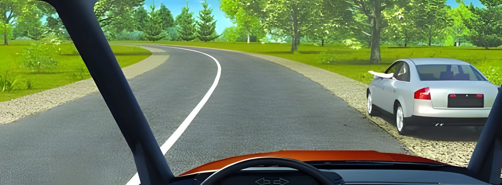

1. **Նրա կողմից երթևեկությունը սկսելու վերաբերյալ նշան** ✅
2. Կանգնելու մասին նշան
3. Ընդհանուր տագնապի ազդանշան

### 9-110. Ի՞նչ ազդանշաններ պետք է տաք նշված հետագծով հետադարձը կատարելիս։

1. Աջ
2. Ձախ
3. **Նախ՝ աջ, ապա՝ ձախ:** ✅

### 9-111. Եթե անմիջապես խաչմերուկից հետո մտադրվել եք կանգառ կատարել, ապա երթևեկության մասնակիցներին շփոթության մեջ չգցելու համար ե՞րբ պետք է միացնեք աջ շրջադարձի լուսային ցուցիչը։

1. Նախապես՝ մինչև խաչմերուկը
2. **Խաչմերուկ մուտք գործելուց հետո** ✅

### 9-112. Վազանցն ավարտող մեքենայի վարորդն համընթաց գոտի վերադասավորվելիս արդյո՞ք ունի առավելություն տվյալ գոտով երթևեկող վարոդի նկատմամբ։

1. **Ոչ** ✅
2. Այո

### 9-113. Մերձակա տարածքից դուրս եկող հատուկ ձայնային և լուսային ազդանշաններ միացրած վարորդին զիջել

1. Պարտավոր չենք։
2. **Պարտավոր ենք։** ✅

### 9-114. Խաչմերուկն ուղիղ անցնելիս պարտավո՞ր ենք արդյոք զիջել ճանապարհը միացված դեղին առկայծող փարոսիկներով բեռնատարի վարորդին։

1. Այո
2. **Ոչ** ✅

### 9-115. Այս իրավիճակում ու՞մ պետք է զիջել ճանապարհը։

1. Մոտոցիկլի վարորդին
2. Հատուկ լուսային և ձայնային ազդանշաններ միացրած ավտոմոբիլի վարորդին
3. **Երկու վարորդներին** ✅

### 9-116. Զիջել ճանապարհը պարտավոր ենք

1. Երկու վարորդներին։
2. Դեղին առկայծող փարոսիկով բեռնատարի վարորդին։
3. **Միայն ավտոբուսի վարորդին։** ✅

### 9-117. Այս իրադրությունում

1. Խաչմերուկը կանցնեք առաջինը։
2. **Պետք է զիջեք ճանապարհը ձախից մոտեցող վարորդին:** ✅

### 9-118. Զիջել պարտավոր ենք

1. Բոլորին։
2. **Ոստիկանության ավտոմոբիլի վարորդին;** ✅
3. Ոչ ոքի։

### 9-119. Ձախ շրջադարձ կատարելիս

1. Խաչմերուկն առաջինը կանցնեք։
2. Կզիջեք միայն ոստիկանության ավտոմոբիլի վարորդին;
3. **Կզիջեք բոլոր վարորդներին։** ✅
